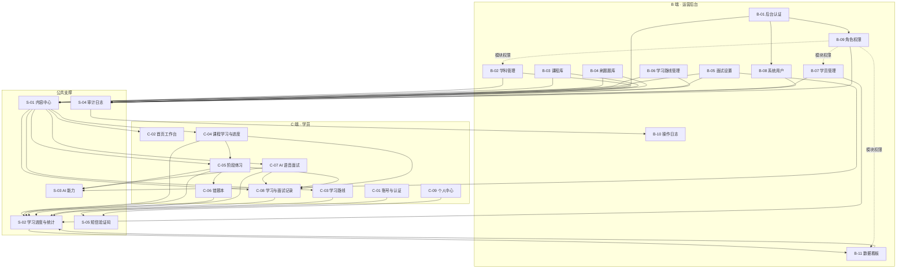
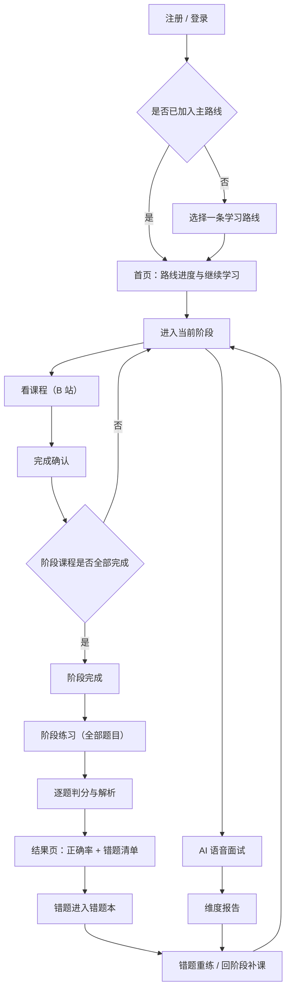
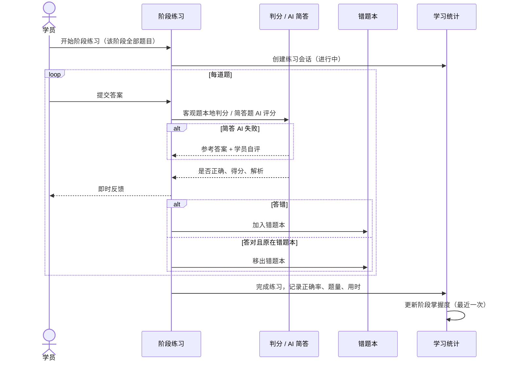
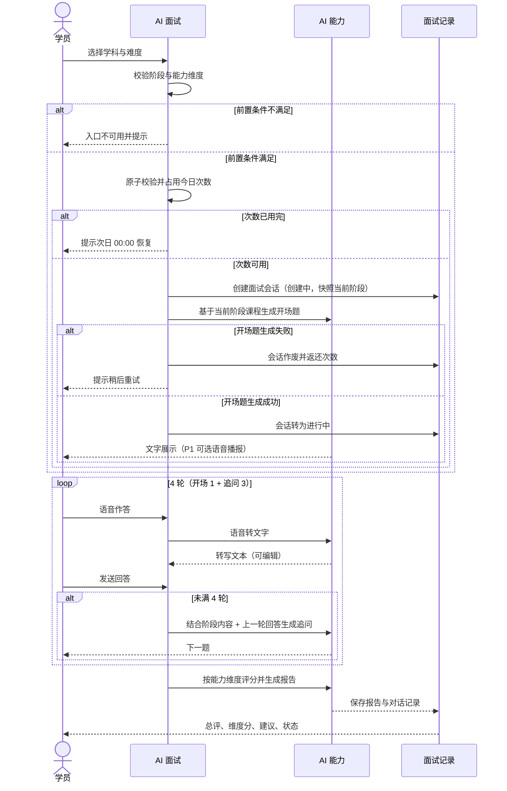
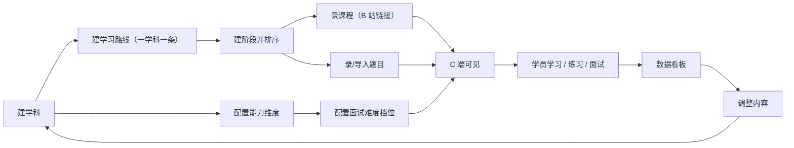

# 云枢智学 · 功能模块梳理

| 项目 | 内容 |
|---|---|
| 设计阶段 | 总体设计 · 第一阶段：需求与功能模块梳理 |
| 文档版本 | v1.0（定稿） |
| 编写日期 | 2026-10-31 |
| 最近更新 | 2026-10-31：第五阶段评审定稿；TTS 降为 P1 可选，P0 仅语音转写；PRD 已同步至 v1.0 |
| 主要依据 | `docs/PRD.md`（v1.0）、`prototype/` 页面原型、已确认的增量需求 |
| 本阶段范围 | 功能梳理、模块划分、模块关系、核心业务流程、问题收口 |
| 不在本阶段范围 | 技术选型、数据库设计、API 接口设计、代码开发 |

---

## 1. 口径说明

### 1.1 依据优先级

本文以以下顺序理解当前需求：

1. **用户在 PRD 之后明确确认的调整**：AI 面试改为语音面试；选择面试难度（简单 / 中等 / 困难）；面试题由大模型基于“当前阶段所学内容 + 上一轮回答”实时生成；运营后台由“面试题库”调整为“面试设置”；AI 面试每个学员每天最多 3 次。
2. **`docs/PRD.md` v1.0**：产品定位、角色、业务规则、功能范围与优先级的主要来源。
3. **`prototype/` 页面原型**：交互方式、页面组成、信息展示的参考，也用于发现 PRD 尚未覆盖或表述不一致的地方。

当三者不一致时，本文按上述顺序整理，并在第 9 章逐条列出差异。**未经确认的差异不写成既定结论**，统一记录在第 10 章，作为已确认决策或后续细化项。

本轮已确认以下口径（见第 10.1 节）：

- 面试出题完全替代原“面试主题 + 固定追问”模型；
- 面试会话创建时按主路线确定当前阶段，并快照该阶段；
- 语音面试不保留音频，仅保存转写文本；
- 阶段练习按 PRD 实现 7 天内续答；
- 错题重练按 PRD 组成一次练习并记录；
- 数据看板按 PRD 全量指标设计，按 P0/P1 分期实现；
- 学员注销保留个人中心与运营后台两个入口，职责分开、结果一致；
- 后台系统用户不删除，只停用；
- 操作日志不提供导出；
- 首页保留“最近动态”摘要；
- AI 面试每个学员每天最多 3 次，按自然日 Asia/Shanghai 00:00 重置；创建会话即计 1 次，系统/AI 故障未正常开始则作废并返还；续答不重复计数；
- PRD 已在进入后续设计前同步，并已随面试次数规则与第五阶段评审结论同步至 v1.0。

### 1.2 原型说明

原型是纯前端交互演示，登录验证码、简答判分、语音识别、大模型出题等均为本地模拟。原型中的简化实现（如固定验证码 `123456`）不代表正式业务规则；正式规则以 PRD 为准。该约定同样适用于本设计。

### 1.3 术语

| 术语 | 含义 |
|---|---|
| 主路线 | 学员同一时间仅有一条的学习路线，由学员选择或运营变更 |
| 阶段 | 学习路线内的有序学习单元，是课程与题目的挂载单位 |
| 阶段完成 | 阶段内全部课程标记完成；与刷题掌握度相互独立 |
| 掌握度 | 最近一次“阶段练习”的正确率；不是完成度 |
| 阶段练习 | 覆盖某阶段全部题目的练习，计入掌握度 |
| 错题重练 | 对错题本内题目发起的练习，不计入阶段完成度与掌握度 |
| 面试会话 | 学员一次 AI 面试的完整过程，包含多轮问答与报告 |
| 能力维度 | 按学科配置的面试评分维度，决定报告维度分 |

---

## 2. 产品与角色总览

### 2.1 产品闭环

```
学习路线 → 阶段课程学习 → 阶段练习 → 错题复习
                ↑                         │
                └──── AI 面试报告 ←───────┘
```

产品把“看视频”的弱效果行为，转化为三组可追踪数据：

- **完成度**：课程完成数、阶段完成状态、路线进度。
- **掌握度**：最近一次阶段练习正确率、练习历史趋势。
- **面试表现**：按学科能力维度输出的面试维度分与总评。

### 2.2 角色

| 端 | 角色 | 核心诉求 | 默认模块权限 |
|---|---|---|---|
| C 端 | 学员 | 路径清晰、学完可验证、能看到进步 | 全部 C 端功能 |
| B 端 | 超级管理员 | 系统与权限管理 | 全部后台模块 |
| B 端 | 内容运营 | 维护学科、课程、题库、路线与面试设置 | 内容类模块 + 数据看板 |
| B 端 | 学员运营 | 管理学员、查看学习情况 | 学员管理 + 数据看板 |

角色为三类预置角色，权限按**模块**控制“能否进入/操作”，不做按钮级与数据行级权限，全机构数据共享。

---

## 3. 功能总览

### 3.1 C 端功能清单

| 编号 | 功能域 | 主要功能 | 优先级 |
|---|---|---|---|
| C-01 | 账号与认证 | 注册、验证码登录、密码登录、找回密码、验证码频控 | P0 |
| C-02 | 首页工作台 | 主路线卡片、继续学习、工具入口、未选路线引导、最近动态摘要 | P0 |
| C-03 | 学习路线 | 路线列表、路线详情、加入/切换主路线、进度保留、阶段顺序引导 | P0 |
| C-04 | 课程学习与进度 | 阶段课程列表、开始学习、完成确认、阶段完成、B 站链接跳转 | P0 |
| C-05 | 阶段练习 | 创建练习、逐题作答、即时判分、简答 AI 判分与降级、结果页、续答 | P0 |
| C-06 | 错题本 | 错题收集、分组筛选、答案与解析、错题重练、答对移出 | P0 |
| C-07 | AI 语音面试 | 学科与难度选择、语音作答转写、动态出题、4 轮问答、报告 | P0 |
| C-08 | 学习与面试记录 | 课程完成记录、练习记录、掌握度趋势、面试历史、报告对比 | P0/P1 |
| C-09 | 个人中心 | 资料、密码、手机号换绑、路线入口、注销账号、退出登录 | P0 |

### 3.2 B 端功能清单

| 编号 | 功能域 | 主要功能 | 优先级 |
|---|---|---|---|
| B-01 | 后台认证 | 账号密码登录、失败锁定、按角色展示菜单 | P0 |
| B-02 | 学科管理 | 学科新增/编辑/排序/启停 | P0 |
| B-03 | 课程库 | 课程新增/编辑/筛选/排序、B 站链接维护 | P0 |
| B-04 | 刷题题库 | 题目新增/编辑/停用、筛选、批量导入与回滚 | P0/P1 |
| B-05 | 面试设置 | 难度档位、学科能力维度、动态出题配置 | P0 |
| B-06 | 学习路线管理 | 路线信息、阶段增删改与排序、阶段内容挂载 | P0 |
| B-07 | 学员管理 | 查询、详情、重置密码、改路线、禁用/启用、注销脱敏 | P0 |
| B-08 | 系统用户 | 后台账号新增/编辑/禁用、重置密码 | P0 |
| B-09 | 角色权限 | 三类预置角色的模块权限配置 | P0 |
| B-10 | 操作日志 | 登录与关键写操作记录、筛选查询、只读 | P1 |
| B-11 | 数据看板 | 规模、学习、练习、面试、内容效果、趋势 | P0/P1 |

### 3.3 公共支撑能力

| 编号 | 支撑能力 | 说明 |
|---|---|---|
| S-01 | 内容中心 | 学科、路线、阶段、课程、题目、能力维度、难度档位的统一内容源 |
| S-02 | 学习进度与统计 | 课程进度、阶段/路线完成度、掌握度、错题状态、练习与会话记录、活跃统计 |
| S-03 | AI 能力 | 简答评分、面试出题、面试评分与报告、语音转写；语音播报（TTS）为 P1 可选，不进入 P0 |
| S-04 | 审计日志 | 后台登录与关键写操作留痕，供操作日志模块查询 |
| S-05 | 短信验证码 | 注册、验证码登录、找回密码、换绑手机号、注销确认的短信能力 |

---

## 4. 模块职责

### 4.1 C 端模块

### C-01 账号与认证

**目标**：完成学员身份建立与登录，并保证验证码与密码规则可用。

**核心职责**

- 注册：手机号 + 短信验证码，必须设置密码；注册成功后进入“选择主学习路线”引导。
- 登录：手机号 + 验证码、手机号 + 密码二选一。
- 找回密码：手机号 + 验证码重置。
- 验证码：同一手机号 60 秒限发 1 次、有效期 5 分钟、单号单日上限 10 次。
- 密码：8–20 位且包含字母与数字；连续 5 次登录失败后，要求改用验证码登录或重置密码。
- 账号状态校验：禁用账号不能登录；注销账号不可登录。

**输入 / 输出**

- 输入：手机号、验证码、密码、找回密码请求。
- 输出：已登录学员身份；新学员的未选路线状态。

**依赖**：S-05 短信验证码、C-09 个人中心（找回/换绑复用安全校验）。

**边界**：不做微信/第三方登录；不做自助注销之外的账号注销。

---

### C-02 首页工作台

**目标**：让学员一眼知道“现在学什么、接下来做什么”。

**核心职责**

- 主路线卡片：路线名、总进度、当前阶段。
- 继续学习：指向当前阶段下一门未完成课程。
- 工具入口：去刷题、AI 面试、错题本、面试记录。
- 未加入路线时：用“选择学习路线”入口替换主路线区域。
- 最近动态摘要：阶段掌握度、最近一次练习、最近一次 AI 面试；已确认保留，仅做摘要展示。

**边界**：不做推荐位、跨路线推荐、签到/连续天数等激励；不做消息中心。

**依赖**：C-03、C-04、C-05、C-06、C-07、C-08、S-02。

---

### C-03 学习路线

**目标**：让学员选择并维护唯一主路线，理解阶段顺序与自身进度。

**核心职责**

- 路线列表：展示可用学科对应的路线、阶段数、课程数、题目数。
- 加入主路线：同一时间只能有一条；已加入可更换。
- 路线切换：原路线进度保留，切回后可继续。
- 阶段解锁：不锁定，全部可进入；展示“建议按顺序学习”并高亮当前阶段。
- 路线详情：阶段时间线、阶段状态（未开始/进行中/已完成）、阶段掌握度。
- 路线进度：已完成课程数 ÷ 路线总课程数。

**边界**：一个学科仅一条路线；不提供跨学科组合路线。

**依赖**：S-01、S-02。

---

### C-04 课程学习与进度

**目标**：把“开始学习/完成课程”沉淀为可计算的阶段与路线进度。

**核心职责**

- 阶段页展示阶段目标、课程列表、课程完成状态、阶段进度。
- 点击课程记录“开始学习”，并在新窗口/跳转打开 B 站视频。
- 完成确认：学员返回后确认“看完了”，或手动打勾完成；完成记录完成时间。
- 阶段完成：阶段内全部课程已完成即视为阶段完成。
- 阶段完成提示：引导学员去做阶段练习，但不强制。
- 视频链接失效提示：仅提示“视频可能已失效”，不阻断流程，不做自动检测。
- 阶段掌握度展示：最近一次阶段练习正确率；样本不足时标注“样本较少”。

**边界**：不自建视频播放器，不做课时/分 P，不做自动播放进度检测。

**依赖**：S-01、S-02、C-05。

---

### C-05 阶段练习

**目标**：用一次覆盖阶段全部题目的练习，产出可比较的掌握度。

**核心职责**

- 创建一次“阶段练习”，范围固定为该阶段全部题目，不支持选题。
- 一题一屏、逐题作答；提交当前题后即时判分并展示答案与解析，再进入下一题。
- 判分：
  - 判断/单选：选项完全一致即正确；
  - 多选：全对才得分，漏选/错选均判错；
  - 简答：大模型按评分点判分，得分率 ≥ 60% 视为正确，并返回逐点命中情况。
- 简答降级：模型超时或失败时展示参考答案，由学员自评“答对/答错”，并记录降级标记。
- 结果页：正确率、答对/答错数量、错题清单、用时。
- 掌握度更新：仅在练习完整结束后，以本次正确率覆盖为该阶段最新掌握度；题量 < 10 标注“样本较少”。
- 中途退出：保留进度，7 天内可续答；超时作废，未完成练习不计入掌握度。
- 错题同步：答错自动进入错题本；答对且题目在错题本中则移出。

**边界**：不做随机组卷、模拟考试、按知识点组卷、题目复用。

**依赖**：S-01、S-02、S-03（简答判分）、C-06。

---

### C-06 错题本

**目标**：把答错题目沉淀为可复习、可消除的个人题库。

**核心职责**

- 收集：任意题型答错（客观题判错；简答得分率 < 60%）即进入错题本。
- 展示：按学科/阶段分组，展示题干、我的答案、正确答案、解析。
- 筛选：可按学科/阶段筛选，默认展示全部错题。
- 重练：将错题组成一次“错题重练”练习；答对后自动移出。
- 规则说明：错题重练不计入阶段完成度与阶段掌握度；不重做该阶段不会自动移出错题。

**边界**：错题本不是独立题库，不提供题目编辑；错题移出后不保留“已移除”展示（仅保留行为记录用于统计，待后续数据设计确认）。

**依赖**：C-05、S-02。

---

### C-07 AI 语音面试

**目标**：基于学员当前阶段的学习内容，用语音多轮问答产出能力维度报告。

**核心职责**

- 面试入口：首页工具入口 / 面试记录；页面选择学科与面试难度（简单 / 中等 / 困难）。
- 前置校验：该学科需具备可用学习阶段、能力维度与至少一个启用中的难度档位，且学员今日剩余次数大于 0；不满足时入口不可用并提示。
- 每日次数：每学员每天最多 3 次，按自然日 Asia/Shanghai 00:00 重置；不按学科/难度拆分，未使用不累积；创建会话即计 1 次，正常完成/提前结束/未完成/已过期均计入；系统/AI 故障导致开场题未生成、会话未进入可作答状态的，会话作废并返还本次次数；续答不重复计数；入口展示今日剩余次数。
- 创建面试会话：**按学员主路线确定当前阶段并快照该阶段**；若主路线不属于所选学科，则取该学科路线的起始阶段。会话记录学科、难度、阶段快照、创建时间、开始时间、状态。
- 出题：
  - 开场题：大模型基于当前阶段已学课程内容生成；
  - 追问：大模型结合当前阶段课程内容与学员上一轮回答生成；
  - 难度控制提问深度；
  - 每场固定 4 轮（开场 1 + 追问 3）。
- 作答方式：
  - 语音作答：浏览器/服务完成语音转文字，转写结果可编辑后发送；
  - **音频不保留**，会话与历史只保存转写文本；
  - 不支持语音时降级为文字作答；
  - AI 问题语音播报为 P1 可选开关，P0 只展示文字。
- 会话控制：自动保存；24 小时内可继续；超时标记已过期，不生成正式报告，保留对话记录；允许提前结束，报告标注“未完成”，分数仅供参考。
- 报告：总评、总评文字、各能力维度分、薄弱维度提示、2–3 条改进建议、面试状态、对话记录。
- 重复面试：在每日次数上限内允许；历史全部保留（作废会话除外）。

**边界**：不做视频面试、不做真人面试、不做面试预约；不做固定题库式出题（依据已确认调整）。

**依赖**：S-01、S-02、S-03（出题/转写/评分/报告）、C-08。

---

### C-08 学习与面试记录

**目标**：把学习、练习、面试的历史沉淀为可回看、可对比的成长记录。

**核心职责**

- 课程完成记录：课程、完成时间、所属阶段。
- 练习记录：类型（阶段练习 / 错题重练）、阶段、正确率、题量、时间。
- 掌握度趋势：按阶段展示最近若干次阶段练习正确率。
- 面试记录：按时间倒序展示学科、时间、轮次、状态、总评；作废会话不展示。
- 面试报告查看：总评、维度分、薄弱项、建议、状态。
- 历史对比：选择同一学科的两场面试，对比各维度分变化。

**边界**：不做跨学科能力总排名；不做导出（PRD 未定义）。

**依赖**：C-04、C-05、C-06、C-07、S-02。

---

### C-09 个人中心

**目标**：维护学员身份信息与账号安全。

**核心职责**

- 查看/修改昵称、头像。
- 修改密码：原密码或验证码二选一验证。
- 手机号换绑：原号 + 新号双重验证。
- 更换主路线入口、错题本入口、面试记录入口。
- 注销账号：学员本人发起的自助注销，验证码确认；注销后清除身份信息，匿名行为记录保留，手机号释放。
- 注销入口职责：个人中心自助注销面向学员本人；运营后台注销面向协助学员与违规处置，二者职责分开、注销结果一致。
- 退出登录。

**边界**：不做消息订阅、不做学习提醒设置；不替代运营后台的账号处置流程。

**依赖**：C-01、C-03、C-06、C-08、S-05。

---

### 4.2 B 端模块

### B-01 后台认证与访问控制

**核心职责**

- 账号密码登录，无自助注册；账号由超管创建。
- 连续 5 次登录失败锁定 15 分钟。
- 登录成功后按角色加载可访问模块菜单；无权限模块不可进入。
- 登录与关键写操作写入操作日志。

**边界**：不做按钮级权限、不做数据行级权限；全机构数据共享。

---

### B-02 学科管理

**核心职责**

- 学科新增、编辑、排序、启用/停用。
- 字段：名称、简介、封面、排序、状态。
- 停用后 C 端不可见；已有学员学习数据保留。

**依赖**：S-01、S-04。

---

### B-03 课程库

**核心职责**

- 展示全部课程，支持按学科/阶段筛选。
- 新建/编辑：标题、B 站链接、简介、时长（选填）、封面（选填）、所属阶段、排序。
- 课程只属于一个阶段，不支持跨阶段复用。

**依赖**：S-01、S-04。

---

### B-04 刷题题库

**核心职责**

- 题目列表、筛选（学科/阶段/题型）、新建、编辑、停用。
- 字段：题型、题干、选项、正确答案、解析、所属阶段。
- 简答题额外维护参考答案与评分点。
- 批量导入：模板下载 → 上传 → 校验（题型、选项数量、答案完整性、简答评分点）→ 返回成功/失败行与原因 → 重复题判定。
- 导入失败整批回滚，不写入任何数据。
- 题目只停用、不硬删除，历史作答保留。

**依赖**：S-01、S-04。

---

### B-05 面试设置

> 本模块是“面试题由大模型实时生成”调整后的后台配置入口，**正式替代**原 PRD 的“面试题库”。

**核心职责**

- 难度档位：维护简单 / 中等 / 困难的启用状态、难度描述与考察重点；停用难度不在 C 端展示。
- 能力维度：按学科维护维度名称与排序，作为面试报告评分维度。
- 出题配置说明：题目基于学员当前阶段课程内容与上一轮回答动态生成，不维护固定题目。
- 配置校验：学科至少具备可用阶段、能力维度与一个启用中的难度档位，才能发起面试。

**已确认边界**：删除“面试主题 / 固定开场题 / 固定追问”模型，不再提供主题 CRUD；面试题目全部动态生成。

**依赖**：S-01、S-03、S-04。

---

### B-06 学习路线管理

**核心职责**

- 路线：名称、所属学科、简介、状态。
- 阶段：名称、排序、简介；支持新增、编辑、删除、上移/下移。
- 阶段内容：挂载课程与题目；可从课程库/题库选取，或直接新建。
- 约束：一个学科一条路线；阶段有序；课程与题目单阶段归属。

**依赖**：B-02、B-03、B-04、S-01、S-04。

---

### B-07 学员管理

**核心职责**

- 查询：手机号、昵称、加入路线、注册时间、状态。
- 学员详情：路线、进度、最近活跃等摘要信息。
- 重置密码：生成临时密码，学员首次登录后强制修改。
- 修改主路线：运营代为变更，原路线进度保留。
- 禁用/启用：禁用后不能登录，数据保留。
- 注销：运营侧注销入口，用于协助无法登录的学员或违规处置；二次确认并写操作日志，身份信息脱敏，学习/练习/面试行为记录保留用于统计。
- 注销职责边界：后台注销不替代个人中心自助注销；两者入口不同、发起方不同，最终注销结果一致。

**边界**：不做学员个体追踪名单；不导出学员清单（PRD 未定义）。

**依赖**：S-02、S-04。

---

### B-08 系统用户

**核心职责**

- 后台账号新增、编辑、禁用/启用。
- 重置密码。
- 账号与角色绑定；超级管理员账号不可停用自己。
- 不提供删除：账号只停用不删除，停用后不能登录，历史操作日志保留。

**边界**：不做后台账号自助注册；不允许删除后台账号。

**依赖**：B-09、S-04。

---

### B-09 角色权限

**核心职责**

- 仅保留三类预置角色：超级管理员、内容运营、学员运营。
- 可编辑非超管角色的模块权限；超管固定拥有全部权限。
- 权限变更影响后台菜单与模块访问。

**边界**：不支持新建角色；不做按钮级/数据级权限。

**依赖**：B-01、B-08、S-04。

---

### B-10 操作日志

**核心职责**

- 记录：操作人、角色、模块、操作类型、对象、时间、IP。
- 覆盖后台登录与关键写操作（内容、路线、学员、用户、角色等）。
- 支持按操作人/时间/模块筛选；只读，不允许修改或删除。
- 不提供日志导出。

**边界**：只读；不导出；原型中的 CSV 导出已移除。

**依赖**：S-04。

---

### B-11 数据看板

**核心职责**

按 PRD 分组提供机构整体数据：

| 分组 | 指标 |
|---|---|
| 规模 | 学员总数、新增学员、活跃学员（当天任意行为） |
| 学习 | 课程完成数、阶段完成数、路线进度分布 |
| 练习 | 练习次数、平均正确率、题型正确率分布 |
| 面试 | 面试场次、完成率、各学科维度平均分 |
| 内容效果 | 各路线完成率、各阶段完成率与正确率 |
| 趋势 | 今日 / 近 7 天 / 近 30 天趋势 |

**范围口径（已确认）**：按 PRD 全量指标设计，实现上按 P0/P1 分期；P0 先落规模、学习、练习、面试核心指标，P1 补齐内容效果明细与趋势。

**边界**：不做个体追踪名单、不做看板导出、不做自定义报表。

**依赖**：S-02、S-04。

---

### 4.3 公共支撑能力

### S-01 内容中心

**职责**：作为 C 端展示与 B 端维护的唯一内容来源，保证“后台修改 → 学员端读取”的一致性。

**管理对象**

```
学科（一个方向）
└── 学习路线（一个学科一条）
    └── 阶段（有序）
        ├── 课程（一门 = 一个 B 站链接）
        └── 题目（判断 / 单选 / 多选 / 简答）
```

**附加配置**

- 学科能力维度（面试报告评分用）。
- 面试难度档位（简单 / 中等 / 困难）。

**边界**：无知识点层；课程、题目不可跨阶段复用；不做内容版本管理。

---

### S-02 学习进度与统计

**职责**：统一计算与保存学习结果，避免各页面口径不一致。

**核心口径**

| 指标 | 口径 |
|---|---|
| 课程状态 | 未开始 / 学习中 / 已完成 |
| 阶段完成度 | 阶段内已完成课程数 ÷ 阶段课程总数 |
| 路线进度 | 路线内已完成课程数 ÷ 路线课程总数 |
| 阶段完成 | 阶段内课程全部完成 |
| 掌握度 | 最近一次完整阶段练习的正确率；题量 < 10 标注“样本较少” |
| 错题状态 | 在册 / 已移出；答对即移出 |
| 活跃 | 当天有登录、课程完成、练习或面试任一项行为 |
| 面试完成率 | 正常完成会话数 ÷ 面试会话总数；分母排除作废会话，含未完成/过期（05 #33 默认值） |

**边界**：错题重练不计入阶段完成度与掌握度；注销学员的记录保留并计入历史统计。

---

### S-03 AI 能力

**职责**：承载三类 AI 能力，并对失败场景提供降级。

1. **简答判分**：按评分点判定，≥ 60% 为正确；超时/失败降级为参考答案 + 学员自评。
2. **面试出题与评分**：基于当前阶段课程内容、难度、上一轮回答生成题目；结束后按能力维度评分并生成报告；未完成面试的报告标注状态。
3. **语音能力**：语音转文字（面试作答）为 P0；文字转语音（AI 问题播报）为 P1 可选；不支持时降级文字作答；**音频不落地，仅保留转写文本**。

**边界**：不建设独立知识库；不做题目难度标签（已确认不需要）；不做固定面试题库。

---

### S-04 审计日志

**职责**：为 B 端所有关键写操作与登录行为提供统一留痕，供 B-10 查询。

**边界**：只读；不提供修改/删除；日志在线保留 1 年、超期归档（05 #24 默认值）。

---

### S-05 短信验证码

**职责**：为注册、验证码登录、找回密码、换绑手机号、注销确认提供验证码发送与校验，并执行限频规则。

**边界**：第三方短信通道不在本阶段选型范围。

---

## 5. 模块关系

### 5.1 模块关系图



### 5.2 关键依赖说明

1. **内容中心是唯一上游**：B 端所有内容维护最终进入 S-01；C 端的路线、阶段、课程、题目、维度、难度全部从 S-01 读取，不允许 C 端维护内容。
2. **学习结果统一由 S-02 计算**：课程进度、阶段完成度、路线进度、掌握度、错题状态、面试记录只在 S-02 定义口径，C-08 与 B-11 只消费结果，避免“页面各自算一套”。
3. **AI 能力被练习与面试共同依赖**：C-05 依赖简答判分，C-07 依赖出题、转写、评分与报告；AI 失败时必须降级，不阻断主线。
4. **权限控制作用于 B 端菜单与模块访问**：B-09 的模块权限决定 B-01 登录后的菜单与可进入模块；不影响机构内数据可见范围。
5. **审计日志横切所有 B 端写操作**：B 端模块不各自保存日志，统一调用 S-04 写入，B-10 只读展示。
6. **记录模块不产生新事实**：C-08 是 C-04/C-05/C-06/C-07 结果的展示层，不作为独立数据源。

---

## 6. 核心业务流程

### 6.1 学员主流程



### 6.2 课程学习与阶段完成

1. 学员从首页或路线详情进入阶段。
2. 点击课程 → 记录开始时间 → 打开 B 站链接。
3. 学员返回后确认完成（或手动勾选）→ 记录完成时间。
4. 阶段内全部课程完成 → 阶段状态变为已完成；不强制刷题。
5. 阶段页展示掌握度（来自最近一次阶段练习）与“样本较少”标记；阶段完成与掌握度互不影响。

### 6.3 阶段练习与错题闭环



**续答分支**：中途退出时保存练习会话与已作答题目；7 天内可继续，超时作废且不计入掌握度。

### 6.4 AI 语音面试



**分支与已确认口径**

- 阶段归属：创建会话时按主路线确定当前阶段并快照；会话期间不随路线切换而变化。
- 每日次数：每学员每天最多 3 次，自然日 Asia/Shanghai 00:00 重置；创建即计；正常完成/提前结束/未完成/过期均计入；开场题生成失败或创建中长时间未完成则作废并返还；续答不重复计数。
- 语音数据：音频不保留，只保存转写后的对话文本。
- 提前结束：生成报告并标注“未完成”，分数仅供参考。
- 24 小时内返回：恢复到断点继续。
- 超过 24 小时：会话标记已过期，不生成正式报告，保留对话记录。
- 重复面试：在每日次数上限内允许；历史全部保留（作废会话除外）。

### 6.5 运营内容配置流程



### 6.6 数据统计流

```
C 端行为（登录、课程完成、练习、面试）
  → S-02 统一记录与计算
  → C-08 个人记录 / 首页动态
  → B-11 机构看板
```

统计口径以 S-02 为准；B-11 不自行定义“完成”“掌握”“活跃”等指标。

---

## 7. 关键业务规则的模块归属

| 业务规则 | 规则定义 | 归属模块 | 消费方 |
|---|---|---|---|
| 路线进度 | 已完成课程数 ÷ 路线总课程数 | S-02 | C-02、C-03、B-11 |
| 阶段完成 | 阶段内全部课程完成 | S-02 | C-03、C-04、B-11 |
| 掌握度 | 最近一次完整阶段练习正确率 | S-02 | C-02、C-04、C-08、B-11 |
| 样本较少 | 阶段练习题量 < 10 | S-02 | C-04、C-05、C-08 |
| 多选判分 | 全对才得分 | C-05 | C-06、C-08 |
| 简答判分 | 评分点得分率 ≥ 60% 为正确 | S-03 | C-05、C-06 |
| 简答降级 | AI 失败 → 参考答案 + 自评 | S-03 | C-05、C-06 |
| 错题移出 | 任意一次答对即移出 | C-06 | C-05、C-08 |
| 错题重练不计入 | 不计完成度与掌握度 | S-02 | C-06、C-08 |
| 练习续答 | 7 天内可续答，超时作废 | C-05 | C-08 |
| 面试轮次 | 固定 4 轮（开场 1 + 追问 3） | C-07 | C-08、B-11 |
| 面试续答/过期 | 24 小时内可续；超时过期 | C-07 | C-08、B-11 |
| 未完成面试 | 出报告但标注，不计正常成绩 | C-07 | C-08、B-11 |
| 面试出题 | 阶段课程内容 + 上一轮回答 + 难度 | S-03 | C-07 |
| 面试阶段快照 | 创建会话时按主路线确定当前阶段并固定 | C-07 | C-08、B-11 |
| 面试每日次数 | 每学员每天最多 3 次，自然日 Asia/Shanghai 00:00 重置；创建即计；正常完成/提前结束/未完成/过期均计入；系统/AI 故障导致开场题未生成则作废返还；续答不重复计 | C-07 | C-08、B-11 |
| 面试语音留存 | 音频不保留，只保存转写文本 | C-07 / S-03 | C-08 |
| 面试维度 | 按学科配置的能力维度 | B-05 / S-01 | C-07、C-08、B-11 |
| 模块权限 | 按模块控制后台可进入/操作 | B-09 | B-01、全部 B 端 |
| 活跃 | 当天任一学习行为 | S-02 | B-07、B-11 |
| 注销脱敏 | 清除身份信息，保留匿名行为，手机号释放 | B-07 / C-09 | S-02、B-11 |
| 注销双入口 | 个人中心自助注销由学员发起；后台注销用于协助/处置；职责分开、结果一致 | C-09 / B-07 | S-04、S-05 |
| 后台用户状态 | 只停用不删除，历史日志保留 | B-08 | S-04 |
| 操作日志导出 | 不提供导出 | B-10 | — |
| 首页最近动态 | 保留摘要展示，不扩展为消息中心 | C-02 | S-02 |

---

## 8. 优先级与阶段边界

| 优先级 | 范围 |
|---|---|
| P0 | 注册登录、学习路线与课程进度、阶段练习（含简答判分）、错题本、AI 面试与报告、B 端内容管理、学员管理、基础看板 |
| P1 | 题库批量导入、面试历史对比、掌握度趋势、操作日志 |
| P2 | 学员个体追踪、导出、激励模块、死链检测（本期不做） |

**本期明确不做**：在线支付/订单/会员权益、多机构租户、平台自建视频播放、知识点体系、随机组卷/模拟考试、B 站链接自动检测、学员个体追踪名单、自定义报表、微信/第三方登录、消息通知/激励。

---

## 9. PRD 与原型差异

> 说明：Q1–Q11、Q28 涉及的差异已全部确认；本表直接标注“已确认”，并注明 PRD 或原型的后续处理。

| # | 事项 | PRD v0.3（同步前） | 当前原型 | 本文件处理 / 建议 |
|---|---|---|---|---|
| 1 | 面试形态 | 非目标中写明“语音面试”不做，正文为纯文字多轮对话 | 已实现语音作答、自动转写；AI 语音播报列为 P1 可选，P0 不做 | **已确认**：纳入“AI 语音面试”；PRD v1.0 已同步 |
| 2 | 面试出题 | 选择面试主题，开场题 + 3 条固定追问 | 选择难度，大模型基于阶段课程与上一轮回答动态生成 | **已确认**：完全替代，删除主题/固定追问模型 |
| 3 | 面试入口 | 选择学科后开始 | 选择学科 + 难度；阶段由系统按主路线当前阶段确定 | **已确认**：创建会话时按主路线确定并快照阶段 |
| 4 | 练习中途退出 | 保留进度，7 天内可续答 | 退出弹窗明确“进度不会保存” | **已确认**：按 PRD 实现 7 天续答；原型后续修正 |
| 5 | 错题重练 | 将错题组成一次练习，类型记为“错题重练” | 单题弹窗重练，未生成练习记录 | **已确认**：组成“错题重练”练习并记录 |
| 6 | 练习结果页 | 展示正确率、对错清单、用时 | 展示正确率与错题清单，无用时 | 以 PRD 为准；补充用时 |
| 7 | 学习记录 | 包含课程完成记录、练习记录、掌握度趋势 | 仅练习记录与面试记录 | 以 PRD 为准；C-08 需补课程完成记录 |
| 8 | 登录规则 | 8–20 位字母+数字、错误 5 次限制、验证码限频、找回密码 | 演示验证码固定；密码 6 位以上即可；无找回密码页 | 以 PRD 为准；原型为演示简化 |
| 9 | 简答判分失败 | 降级为参考答案 + 学员自评，记录降级标记 | 有 AI 评分与“手动修正判定”，无明确失败降级 | 以 PRD 为准；设计需包含降级状态 |
| 10 | 未完成面试 | 报告标注“未完成”，不计正常成绩 | 可提前结束生成报告，但报告未标注状态 | 以 PRD 为准；C-07 报告状态需补齐 |
| 11 | 个人中心注销 | 支持学员自助注销 | 个人中心无注销入口，仅运营后台可注销 | **已确认**：保留双入口、职责分开；原型需补自助注销入口 |
| 12 | 后台用户删除 | 系统用户支持新增/编辑/禁用/重置密码，未定义删除 | 提供“删除”按钮 | **已确认**：不删除，只停用；原型删除按钮改为停用/移除 |
| 13 | 操作日志 | 记录含 IP；支持筛选；只读 | 无 IP；提供 CSV 导出 | **已确认**：不导出日志，原型导出已移除；IP 以 PRD 为准 |
| 14 | 数据看板 | 6 组指标 + 日/周/月趋势 | 展示 4 个 KPI、部分图表与内容效果 | **已确认**：按 PRD 全量指标设计，按 P0/P1 分期实现 |
| 15 | 首页 | 主路线、继续学习、工具入口、未选路线引导 | 额外含“最近动态”摘要 | **已确认**：保留“最近动态”，仅做摘要展示 |
| 16 | 后台面试模块 | “面试题库”：主题、开场题、追问、维度 | “面试设置”：难度档位 + 学科维度，无固定题目 | 按已确认调整纳入；模块名与权限项已改为“面试设置” |
| 17 | 面试每日次数 | PRD v1.0：每学员每天最多 3 次，创建即计，系统/AI 故障未正常开始则作废返还 | 原型未限制面试次数 | **已确认**：按 PRD 实现；原型后续补“今日剩余次数”与用尽态 |

---

## 10. 已确认决策与后续细化项

### 10.1 已确认决策（2026-10-31）

> 编号说明：Q12–Q27 已用于技术选型与待确认项；本次需求变更顺延为 Q28。

| 编号 | 已确认决策 | 对设计的影响 |
|---|---|---|
| Q1 | 完全替代原“面试主题 + 固定追问”模型，删除主题/固定追问 | B-05 只保留难度档位与学科能力维度；面试会话不再有“主题”实体；PRD v1.0 的 5.7 / 6.5 / 8 章已同步 |
| Q2 | 创建会话时按主路线确定当前阶段，并快照该阶段 | C-07 会话固定阶段快照；中途切换主路线不影响已开始的面试；报告归属快照阶段 |
| Q3 | 不保留音频，仅保存转写文本 | C-07 / S-03 只保存对话文本；降低存储与合规范围；注销时无需处理音频 |
| Q4 | 按 PRD 实现阶段练习 7 天内续答 | C-05 需支持“进行中”练习与已答题目保存；超时作废不计掌握度；C-08 记录口径同步 |
| Q5 | 错题重练组成一次“错题重练”练习并记录 | C-06 从单题弹窗改为练习会话；C-08 出现错题重练记录；B-11 统计该类型练习但不计掌握度 |
| Q6 | 数据看板按 PRD 全量指标设计，按 P0/P1 分期实现 | B-11 设计口径覆盖 6 组指标与时间筛选；P0 先落核心指标，P1 补齐内容效果与趋势 |
| Q7 | 学员注销保留个人中心与运营后台两个入口，职责分开、结果一致 | C-09 负责本人自助注销；B-07 负责协助/处置型注销并写操作日志；两者共用注销规则 |
| Q8 | 后台系统用户不删除，只停用 | B-08 取消删除能力；停用后不能登录，历史日志保留；原型删除按钮需改为停用或移除 |
| Q9 | 操作日志不提供导出 | B-10 仅保留筛选与只读展示；原型 CSV 导出已移除 |
| Q10 | 首页保留“最近动态”摘要 | C-02 继续展示掌握度、最近练习、最近面试；不扩展为消息中心 |
| Q11 | PRD 必须先同步，再进入后续设计 | `docs/PRD.md` 已更新至 v1.0；面试、账号、日志、首页章节与确认口径一致 |
| Q28 | AI 面试每个学员每天最多 3 次，次日 00:00 恢复；创建会话即计 1 次，正常完成/提前结束/未完成/过期均计入；系统/AI 故障导致开场题未生成、会话未进入可作答状态的，作废并返还；续答不重复计数 | C-07 增加额度校验、原子占用、作废/返还；C-08 不展示作废会话；B-11 完成率排除作废会话；PRD v1.0 已同步 |

### 10.2 后续细化项（第五阶段已收口）

- **操作日志保留周期**：在线 1 年，超期归档，不提供导出（05 第 6 章 #24）。
- **面试完成率分母**：排除作废会话，含未完成/过期；不影响模块职责划分（05 第 6 章 #33）。

---

## 11. 本轮结论快照

### 已确认结论（可直接作为后续设计输入）

- 产品由 C 端学员端与 B 端运营后台组成，共享一套内容中心。
- C 端核心闭环为：学习路线 → 阶段课程 → 阶段练习 → 错题复习 → AI 面试 → 记录回看。
- B 端按三类预置角色做模块级权限控制，全机构数据共享。
- 完成度、掌握度、面试维度分是三组独立指标；阶段完成不等于掌握。
- AI 面试已调整为语音面试，选择难度，题目基于当前阶段内容与上一轮回答动态生成。
- 面试固定 4 轮，支持提前结束、24 小时续答、超时过期、重复面试与历史对比。
- AI 面试每个学员每天最多 3 次，按自然日 Asia/Shanghai 00:00 重置；创建即计，正常完成/提前结束/未完成/过期均计入；系统/AI 故障未正常开始则作废并返还；续答不重复计数。
- 简答判分采用评分点 + ≥ 60% 判对，AI 失败时降级为自评。
- 错题本答对移出，错题重练不计入阶段完成度与掌握度。
- **面试完全采用“难度 + 阶段内容 + 上一轮回答”动态出题，不再保留主题与固定追问。**
- **面试会话在创建时按主路线确定并快照当前阶段。**
- **语音面试不保存音频，只保存转写文本。**
- **阶段练习支持 7 天内续答。**
- **错题重练组成一次练习并记录，不计掌握度。**
- **数据看板按 PRD 全量指标设计，按 P0/P1 分期实现。**
- **注销保留个人中心自助与运营后台两个入口，职责分开、结果一致。**
- **后台系统用户不删除，只停用。**
- **操作日志不提供导出。**
- **首页保留“最近动态”摘要。**
- **`docs/PRD.md` 已同步至 v1.0。**

### 本轮新增设计结论

- 将系统划分为 9 个 C 端模块、11 个 B 端模块、5 项公共支撑能力。
- 明确“内容中心”为唯一内容源，“学习进度与统计”为唯一指标口径来源，“AI 能力”统一承载判分/出题/语音/报告。
- 明确 B 端权限只控制模块访问，不做按钮级与数据行级。
- 识别出 17 处 PRD 与原型差异，相关确认事项已全部关闭。
- PRD 已同步至 v1.0，后续设计统一以 v1.0 为依据。

### 问题收口（非阻塞）

本阶段无阻塞性问题。原两项后续细化口径已在第五阶段收口：操作日志保留周期按默认值在线 1 年（05 #24），面试完成率分母按默认值排除作废会话（05 #33）。

> Q1–Q11、Q28 已全部确认，第一阶段需求与功能模块梳理完成，可进入下一设计阶段。

---

*本文仅完成功能与模块层梳理，不包含技术方案、数据库表结构与 API 定义。Q1–Q11、Q28 已确认，可据此进入下一阶段设计；建议先同步 PRD 口径，再进入业务对象、状态与流程的细化设计。*

---

## 版本记录

| 版本 | 日期 | 说明 |
|---|---|---|
| v0.4 | 2026-10-31 | 新增 Q28（AI 面试每日 3 次）；PRD 同步至 v0.5 |
| v1.0 | 2026-11-01 | 第五阶段评审定稿：TTS 由 P0 降为 P1 可选，P0 仅保留语音转写；模块数维持 9 C + 11 B + 5 支撑；同步 PRD v1.0 |
