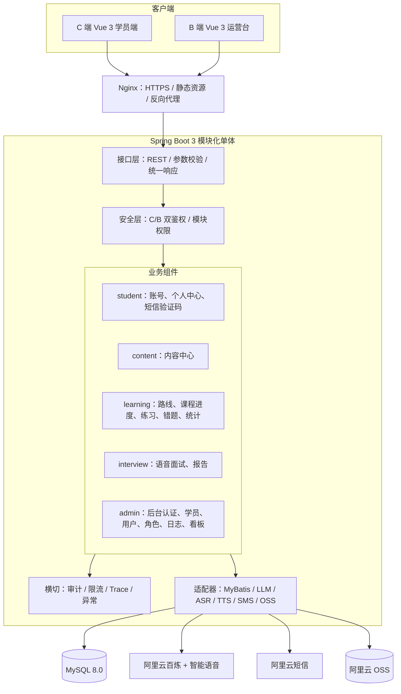
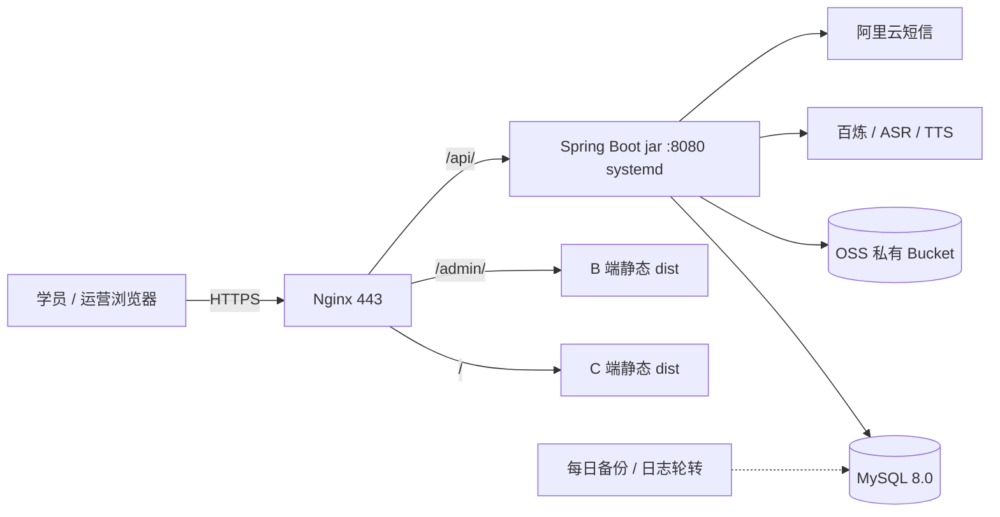
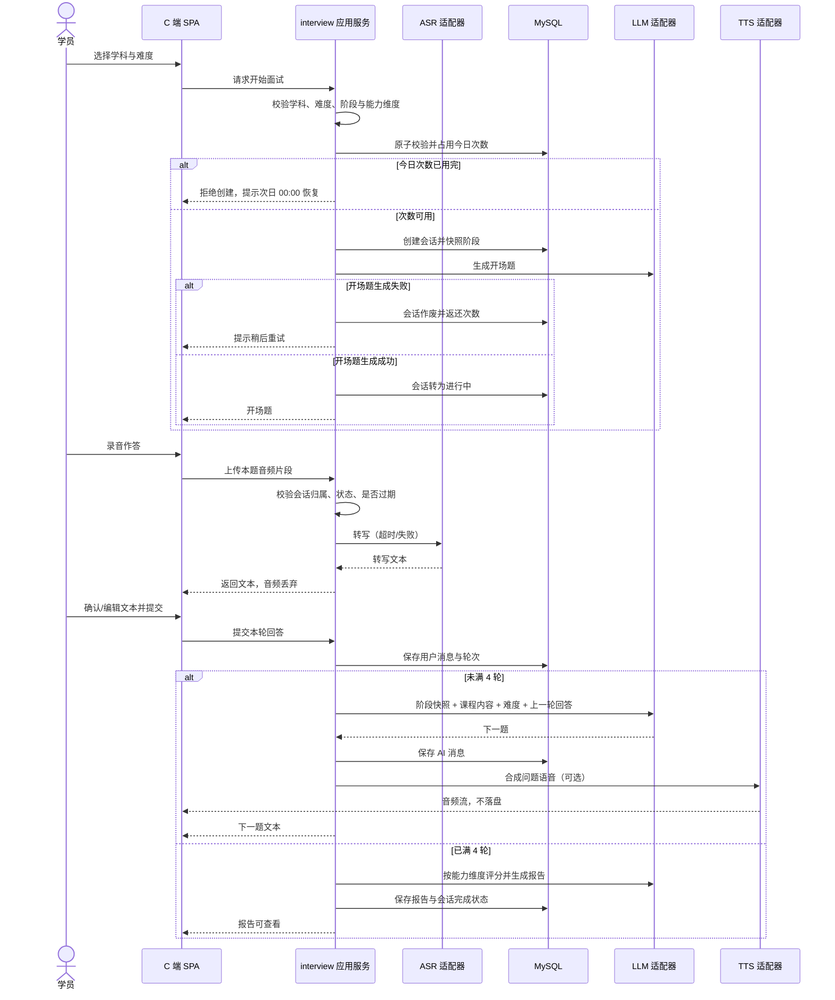
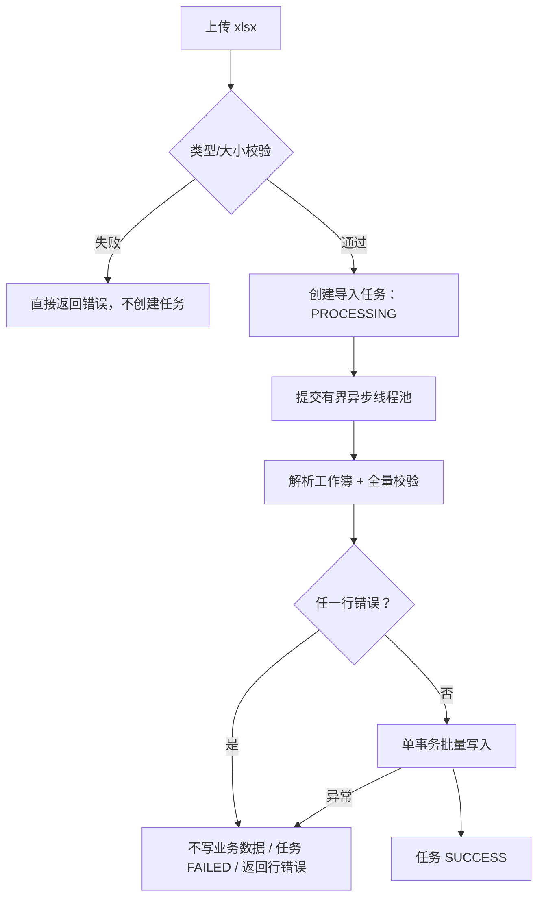

# 云枢智学 · 技术选型与整体架构

| 项目 | 内容 |
|---|---|
| 设计阶段 | 总体设计 · 第二阶段：技术选型与整体架构 |
| 文档版本 | v1.2（第七阶段：§2.6 Refresh Cookie 规格定稿 + CSRF 说明） |
| 编写日期 | 2026-10-31 |
| 状态 | 第五阶段评审定稿；第六阶段补充对象存储端口与开发依赖，不写业务代码、不建工程、不改原型 |
| 主要依据 | `docs/PRD.md`（v1.0）、`docs/design/01.功能模块梳理.md`（v1.0）、`docs/design/06.对象存储端口设计.md`（v1.0）、`docs/rules/database-rules.md`（v2.1）、`docs/rules/api-rules.md`（v2.2）、`prototype/` |
| 本阶段已确认 | Q12 JDK 17 + Spring Boot 3.x；Q13 Vue 3；Q14 单台云服务器；Q15 同一家国内云厂商 AI；Q16 阿里云短信 + OSS；Q28 AI 面试每日 3 次；**Q29 对象存储端口（见 06）** |
| 本阶段不做 | 数据库表/字段/索引/DDL、API 路径/请求响应结构/错误码、业务代码、工程初始化、原型修改；本轮按用户确认同步 PRD/01 的面试次数规则除外 |
| 本阶段不做 | 数据库表/字段/索引/DDL、API 路径/请求响应结构/错误码、业务代码、工程初始化、原型修改；本轮按用户确认同步 PRD/01 的面试次数规则除外 |

> 状态标记说明：
> - **【已确认】**：用户在本轮明确选择。
> - **【规则默认】**：rules 第 0 章的默认假设，尚未逐项确认。
> - **【本阶段建议】**：本文推导出的技术方案，待用户审核；不是既定事实。

---

## 1. 选型依据与硬约束

### 1.1 已确认的输入

1. **JDK 17 + Spring Boot 3.x**：全新工程，不保留 JDK 8 + Spring Boot 2.7。
2. **Vue 3 前端**：C 端与 B 端均重写为 Vue 3 SPA，不继续在原型原生 JS 上长期堆叠。
3. **单台云服务器部署**：Nginx + Spring Boot jar + MySQL，systemd 托管；不使用 Docker 作为一期生产形态。
4. **AI 同一家国内云厂商**：按本轮选择落地为阿里云；LLM、ASR、TTS 共用一套账号、密钥与配额体系。
5. **阿里云短信 + 阿里云 OSS**：短信、头像与封面文件均使用阿里云。
6. **AI 面试每日 3 次（Q28）**：每学员每天最多 3 次，按自然日 Asia/Shanghai 00:00 重置；创建会话即计 1 次，正常完成/提前结束/未完成/过期均计入；系统/AI 故障导致开场题未生成、会话未进入可作答状态的，作废并返还；续答不重复计数。

### 1.2 由 01 文档推导出的功能约束

| 约束 | 来源 | 对架构的影响 |
|---|---|---|
| 9 个 C 端模块、11 个 B 端模块、5 项公共支撑能力 | 01 第 3 章 | 模块边界固定；代码按业务域分包，不增删模块 |
| C 端与 B 端是两套用户、两套登录态 | 01 C-01、B-01 | 前端拆两套 SPA；后端两套认证链，token 不可混用 |
| 后台权限只到模块级 | 01 B-09 | 统一模块权限拦截，不做按钮级/数据行级 |
| 内容中心是唯一内容源 | 01 S-01 | 学科、路线、阶段、课程、题目、维度、难度只有一条写入路径 |
| 学习进度与统计口径统一 | 01 S-02 | 进度、掌握度、活跃、完成率由统一统计组件计算，页面不各算一套 |
| AI 能力包含简答判分、面试出题、面试评分/报告、ASR、TTS | 01 S-03 | 需要 AI 适配层、超时/重试/熔断与降级链路 |
| 语音面试音频不落地 | 01 C-07、S-03 | ASR 只回传文本；音频不写数据库、不写 OSS、不写本地临时长期文件 |
| AI 面试每日最多 3 次，创建即计，故障作废返还 | 01 C-07、Q28 | 创建入口需原子校验/占用当日额度；会话增加“创建中/已作废”状态；续答不重复计数 |
| 面试固定 4 轮，24 小时续答，超时过期，允许提前结束 | 01 C-07 | 会话状态与消息按轮次持久化；过期与断点恢复由服务端判定 |
| 阶段练习 7 天内续答 | 01 C-05 | 练习会话必须有进行中状态与过期时间；未完成不计掌握度 |
| 错题重练组成一次练习并记录 | 01 C-06 | 练习类型必须区分“阶段练习/错题重练”，统计显式排除重练 |
| 看板 6 组指标，P0/P1 分期 | 01 B-11 | 统计查询需要明确口径、时间范围和性能退路 |
| 操作日志覆盖后台登录与关键写操作 | 01 B-10、S-04 | 审计写入是横切能力；查询界面可 P1，但写入不能缺 |
| 短信验证码含频控与每日上限 | 01 C-01、S-05 | 验证码发送与校验需要原子计数，不能只靠内存判断 |

### 1.3 由 rules 推导出的技术约束

| 约束 | 来源 | 处理 |
|---|---|---|
| RESTful + JSON；统一 `/api/v1` 前缀 | api-rules 第 0、1 章 | 本阶段只确定风格，不定义具体路径 |
| JWT（Access + Refresh）；C/B 隔离 | api-rules 第 0、8 章 | 采用双 audience、双密钥/双认证链 |
| OpenAPI 3 | api-rules 第 0 章 | 后端使用 springdoc-openapi；本阶段不写契约 |
| 分页 `page` + `size`，`size ≤ 100` | api-rules 第 0、7 章 | 列表组件与后端分页统一 |
| 时间 RFC 3339 / UTC | api-rules 第 0 章、database-rules 第 0 章 | 库内 UTC，展示层转 `Asia/Shanghai` |
| MySQL 8.0 / utf8mb4 / InnoDB | database-rules 第 0 章 | **已确认并验证**：本机 MySQL 8.0.46 可执行 V1/V2，`utf8mb4_0900_ai_ci` 通过；默认 5.7.26 仅保留为旧环境，不作为开发基线 |
| Flyway 迁移；禁止 ORM 自动建表 | database-rules 第 0 章 | 采用 Flyway；持久层不得生成 DDL |
| 不建物理外键；软删除/状态表达删除 | database-rules 第 5、6 章 | 应用层保证引用完整性；B 端与题目只停用 |
| 事务短；AI、短信、文件调用不得放在事务内 | database-rules 第 7 章 | AI/短信/OSS 调用全部放在事务边界之外 |
| 批量导入单事务、失败整批回滚 | database-rules 第 7 章、api-rules 第 12 章 | 导入任务独立执行，整批校验后一次性提交 |
| 操作日志只追加，不允许更新/删除 | database-rules 第 9 章 | 审计组件只写、后台只读 |
| 所有列表分页；禁止 N+1、无条件全表统计 | database-rules 第 10 章 | 查询服务统一分页、批量查询与统计索引策略 |

### 1.4 环境与原型事实

| 项 | 当前事实 | 影响 |
|---|---|---|
| JDK | 默认 `1.8.0_241`；JDK 17 已安装于 `D:\software\jdk17`（17.0.21） | 启动工程前必须把 `JAVA_HOME` 指向 JDK 17；Maven 3.9.16 当前仍按默认 JDK 8 运行，需验证 `mvn -version` 显示 Java 17 |
| Maven | 3.9.16 已安装 | 可直接作为后端构建工具；受 `JAVA_HOME` 影响 |
| Node | v24.15.0，npm 11.12.1 | 可支撑 Vite / Vue 3 构建；pnpm 尚未安装，需 `corepack enable` 或 `npm i -g pnpm` |
| MySQL | 默认 5.7.26（phpstudy）；MySQL 8.0.46 已安装，服务默认停止 | 开发基线改为 8.0；已在 8.0.46 临时实例（3307）执行 V1/V2，32 张表、种子 3/18/3 通过；生产统一 `utf8mb4_0900_ai_ci` |
| Docker | Docker Desktop 29.7.2、Compose v5.5.0 已安装；仓库根 `docker-compose.yml` 提供 MySQL 8.0 + MinIO，Redis 仅在 `p1` profile | 仅用于本地依赖；一期生产仍为非容器化部署 |
| 后端工程 | 尚无 `pom.xml` 或 Java 代码 | 本阶段不初始化工程 |
| 原型 | 18 个页面，约 6.2k 行 HTML/CSS/JS，无构建链 | 作为页面与交互参考，不作为生产代码 |
| PRD 版本 | 仓库已更新至 v1.0（定稿冻结）；任务描述仍写作 v0.3 | 02 文档以 v1.0 为准；版本差异在第 10 章记录 |

### 1.5 选型原则

1. **先模块化单体，后按压力拆分**：本期单机构、低并发、事务边界集中，不引入微服务、消息队列和分布式事务。
2. **外部依赖全部适配器化**：LLM、ASR、TTS、短信、OSS 都通过端口接口调用，业务层不直接依赖厂商 SDK。
3. **先满足 P0，再为 P1 留出退路**：不为了未来可能的需求预埋 Redis、MQ、汇总表；但保留替换点。
4. **安全与合规优先于开发便利**：手机号、验证码、音频、日志脱敏、注销脱敏按规则落地。
5. **每个选择都能说明不选另一个的理由**：不以“业界常用”代替项目适配性。

---

## 2. 技术栈选型

### 2.1 选型总表

| # | 决策项 | 候选 | 结论 | 选它的理由 | 不选另一个的理由 | 已知风险 |
|---|---|---|---|---|---|---|
| 1 | 后端运行时 | JDK 17 + Spring Boot 3.x；JDK 8 + Spring Boot 2.7 | **JDK 17 + Spring Boot 3.x** | 全新工程，LTS，生态与安全支持更好；无 `javax→jakarta` 历史包袱 | JDK 8 / Boot 2.7 已停止主流支持，后续依赖升级受限 | 本机需安装 JDK 17；rules 第 0 章需回填 |
| 2 | Web 框架 | Spring MVC；Spring WebFlux | **Spring MVC** | 以阻塞式 JDBC/MySQL 为主，CRUD 与事务模型直观；团队与排障成本低 | WebFlux 的响应式复杂度对本项目收益低；AI 调用可用同步客户端 + 超时解决 | 后续若做流式 AI/TTS，需要局部引入流式响应 |
| 3 | 架构形态 | 模块化单体；微服务 | **模块化单体** | 单机构、低并发；练习提交等需要本地事务；一个部署包运维最简单 | 微服务会引入分布式事务、服务发现、链路治理，收益不足 | 包边界靠评审约束，可能出现跨模块直连 |
| 4 | 持久层 | MyBatis-Plus；Spring Data JPA | **MyBatis-Plus** | 统计 SQL、看板聚合、分页与显式 SQL 可控；与 database-rules 的“禁止自动 DDL”兼容 | JPA 在复杂统计与批量写入上需要更多绕行，且容易诱导实体自动建表 | 代码生成/魔法方法可能掩盖 SQL；需要 SQL 评审 |
| 5 | 数据库 | MySQL 8.0；PostgreSQL 16 | **MySQL 8.0** | rules 默认；本机与团队生态更接近；满足当前关系模型与统计需求 | PostgreSQL 能力足够，但无收益的迁移会增加学习与运维成本 | 本机 5.7.26 需升级；8.0 字符集/排序规则需固定 |
| 6 | 缓存 | 不引入 Redis + Caffeine 本地缓存；引入 Redis | **P0 不引入 Redis；Caffeine 本地缓存** | 单实例部署；短信频控按 rules 用数据库原子计数；减少一套中间件运维 | Redis 对单实例没有刚性收益，且增加部署、备份、故障面 | 未来多实例时本地缓存/限流不一致，需要迁移 Redis |
| 7 | 前端 | Vue 3 + Vite + TS；React 18；静态多页 + 原生 JS | **Vue 3 + Vite + TypeScript** | 18 页重写成本可控；Element Plus/Vant 覆盖后台表格与移动端；中文生态成熟 | 原生 JS 在练习、面试、看板等复杂交互上会失控；React 无团队偏好时成本不占优 | 6–9 人周重写成本；需新增构建链与前端规范 |
| 8 | 鉴权 | JWT Access + Refresh；服务端 Session | **JWT Access + Refresh** | 符合 api-rules；C/B 双端可用不同 audience/密钥隔离；前后端分离部署简单 | Session 需要共享存储（Redis/DB），与当前单实例、无 Redis 的取舍冲突 | 撤销、禁用即时生效、Refresh 轮换需要额外设计 |
| 9 | 大模型 | 阿里云百炼 Qwen；DeepSeek/其他 OpenAI 兼容服务 | **阿里云百炼 Qwen** | 与 ASR/TTS/SMS/OSS 同一云厂商，账号、合规、网络与计费统一 | 多厂商组合增加密钥、配额、故障面和联调成本；本项目无多模型路由需求 | 厂商锁定、模型升级/下线、成本与限流；需适配层 |
| 10 | ASR/TTS | 阿里云智能语音；浏览器 Web Speech API；开源自部署 | **阿里云智能语音，服务端代理** | 设备与浏览器兼容性更好；音频只在内存/流中经过，不落盘；与 LLM 同厂商 | 浏览器 Web Speech 仅部分浏览器可用，不能作为生产唯一链路；自部署 GPU 成本高 | 语音延迟、按量计费、弱网；需文字降级 |
| 11 | 短信 | 阿里云短信；腾讯云短信 | **阿里云短信** | 与 AI、OSS 同一账号体系；模板、签名、回执统一管理 | 腾讯云同样可用，但会多一套账号与运维 | 签名/模板审核周期；发送失败与限频 |
| 12 | 文件存储 | 阿里云 OSS；本地磁盘 + Nginx | **阿里云 OSS 私有 Bucket** | 头像/封面持久化、签名访问、备份与迁移更容易；不占应用服务器磁盘 | 本地磁盘在单机故障、扩容、备份上更脆弱 | OSS 成本、Bucket 权限与域名配置；开发环境需本地适配器 |
| 13 | 后端工程结构 | Maven 单模块；Maven 多模块 | **Maven 单模块，按业务包分层** | 当前团队与规模不需要多模块拆分；一个 jar 部署、构建快 | 多模块增加父子 POM 与依赖治理成本，收益在团队/产线扩大后才明显 | 包边界可能被打破；用评审与后续 ArchUnit 约束 |
| 14 | 前端工程结构 | pnpm monorepo；两个独立仓库 | **pnpm monorepo：`apps/student`、`apps/admin`、`packages/shared`** | C/B 两套 SPA 共享 API 客户端、类型、设计 token，减少重复 | 两仓库会重复工具链与契约类型，联调成本更高 | workspace 配置复杂度；构建缓存与发布流程需规范 |
| 15 | 日志与监控 | Logback + Actuator + Micrometer；云 APM | **Logback JSON + Actuator/Micrometer，预留 Prometheus** | 单机阶段足够定位问题；成本低；不引入额外 SaaS | 云 APM 功能强但增加费用与接入；当前请求量与团队规模不需要 | 缺少分布式追踪与告警平台；后续按需接入 |
| 16 | 部署 | Nginx + jar + systemd；Docker Compose；PaaS | **单台云服务器：Nginx + jar + systemd + MySQL 8.0** | 运维最简单，故障面小；生产不引入容器；符合单机构规模 | Docker Compose 增加镜像/网络/卷运维；PaaS 有成本与锁定 | 单点故障、手工发布、备份依赖脚本；需演练恢复 |
| 17 | 异步任务 | Spring `@Async` + 数据库任务状态；消息队列 | **`@Async` + 有界线程池 + 数据库任务状态** | 题库导入是低频 P1；不引入 MQ，减少运维 | MQ 可靠性更好，但当前没有跨服务/高吞吐需求 | 应用重启会中断任务；需将中断任务标记失败并可重试 |
| 18 | 容错 | Resilience4j；手写超时/重试 | **Resilience4j** | 统一超时、重试、熔断、舱壁，避免每个厂商客户端各写一套 | 手写策略容易不一致，难以观测 | 配置复杂度；需要为 AI/短信/OSS 分别设定阈值 |

> 说明：表中第 5、6、13–18 项属于【本阶段建议】，其中 MySQL 8.0 同时是 rules 的【规则默认】，仍需用户确认后回填；第 1–4、7–12 项的核心方向已由 Q12–Q16 确认。

### 2.2 后端与运行时

**结论：Java 17 + Spring Boot 3.x + Spring MVC + Spring Security 6 + Jakarta Validation + springdoc-openapi。**

- 使用 Spring Boot 3.x 的稳定版本线；具体小版本在工程初始化时锁定，不在本阶段写死。
- 不引入 Spring Cloud、注册中心、配置中心；单机应用不需要。
- 业务异常统一由 `@RestControllerAdvice` 处理；错误码登记留到 API 设计阶段。
- 定时任务只用 Spring `@Scheduled`；P0 仅用于必要的清理/重试，不引入 Quartz。

**不选 JDK 21 的原因**：JDK 21 的虚拟线程对以数据库 I/O 为主、并发量不高的本期收益有限；先锁定 JDK 17 可减少第三方依赖兼容性验证。后续若压测证明线程模型是瓶颈，再评估 21。

**不选 WebFlux 的原因**：本项目事务边界多、SQL 统计多，阻塞式模型更直接；AI/ASR/TTS 的长耗时通过超时、线程池和降级处理，不需要全站响应式。

### 2.3 持久层与数据库

**结论：MySQL 8.0 + InnoDB + utf8mb4 + MyBatis-Plus + Flyway + HikariCP。**

- 数据库按 rules 默认 MySQL 8.0；本机 5.7.26 仅用于开发，需升级到 8.0 或使用云数据库 8.0。
- Flyway 管理全部结构变更；应用启动校验迁移状态，禁止 ORM 自动建表。
- MyBatis-Plus 只用于通用 CRUD、分页与条件构造；统计、看板、批量导入使用显式 SQL。
- 不启用“自动逻辑删除”黑盒：题目、B 端用户、学科/课程的删除语义由显式状态字段表达，避免与“停用/注销”混淆。
- 参数绑定使用 `#{}`，禁止字符串拼接 SQL；看板 SQL 必须经过执行计划评审。

**不选 JPA 的原因**：本项目的难点在统计口径、批量导入、局部更新与显式 SQL，不在对象关系映射；JPA 的自动 DDL 风险也与 rules 冲突。

**已知风险**：MyBatis-Plus 的代码生成和通用方法容易让开发者绕过 SQL 评审；需要在团队规范中限制使用范围。

### 2.4 缓存与 Redis

**结论：P0 不引入 Redis；使用 Caffeine 做短 TTL 本地缓存，验证码频控与登录失败计数落 MySQL。**

候选：

| 方案 | 优点 | 缺点 | 结论 |
|---|---|---|---|
| 无缓存 / 纯 MySQL | 最简单，数据一致 | 热点内容与看板每次都查库 | 可作为兜底 |
| Caffeine 本地缓存 | 零额外中间件，适合单实例 | 多实例不一致，重启即失效 | **P0 采用** |
| Redis | 共享缓存、分布式限流、会话/验证码 | 多一套部署、备份、监控；当前单实例无刚性需求 | P1 视扩容再引入 |

**不选 Redis 的原因**：当前是一台应用服务器；短信频控按 database-rules 要求可在数据库原子判断；引入 Redis 的收益低于运维成本。

**开发环境**：`docker-compose.yml` 中的 Redis 服务带 `profiles: ["p1"]`，默认 `docker compose up -d` 不启动；只有 P1 需要时使用 `docker compose --profile p1 up -d`。

**风险与偿还**：一旦应用改为多实例，本地缓存、限流、登录锁定会不一致；届时必须迁移到 Redis 或粘性会话。偿还触发点写入第 8 章。

### 2.5 前端

**结论：Vue 3 + Vite + TypeScript，pnpm monorepo。**

| 方案 | 改造范围 | 粗略工期（不含后端） | 主要收益 | 主要代价 |
|---|---|---|---|---|
| **Vue 3（选用）** | 重写 18 页；C 端 H5、B 端后台两套 SPA；共享 API/类型/设计 token | 6–9 人周 | 组件化、路由、状态、表单校验、表格分页、权限菜单成熟 | 初期重写成本高，新增构建链 |
| React 18 | 重写 18 页；Ant Design / 移动端组件库 | 7–10 人周 | 生态强，适合已有 React 团队 | 与 Vue 收益相近，当前无团队优势 |
| 静态多页 + 原生 JS | 保留 HTML/CSS，补 API 封装、登录守卫、公共 UI 工具 | 2–4 人周 | 最快复用原型 | DOM/状态分散，复杂交互难维护，长期成本最高 |

**工程结构建议**

```text
web/
├── apps/
│   ├── student/        # C 端 H5，Vant + Pinia + Vue Router
│   └── admin/          # B 端后台，Element Plus + Pinia + Vue Router
├── packages/
│   ├── shared/         # API 客户端、类型、常量、设计 token
│   └── config/         # ESLint / TS / Vite 共享配置
└── pnpm-workspace.yaml
```

- 图表使用 ECharts；后台表格/表单用 Element Plus；C 端移动组件用 Vant。
- 前端只做展示与交互，权限菜单来自后端返回的模块集合；前端隐藏按钮不能替代后端校验。
- 语音采集使用浏览器 `MediaRecorder`；不支持时降级为文字输入。浏览器 `SpeechRecognition` 仅作为可选降级，不作为生产主链路。

**不选 React 的原因**：在团队没有明确 React 偏好的前提下，Vue 3 与 Element Plus/Vant 的组合更贴近本项目后台 + 移动 H5 的页面形态；若后续团队以 React 为主，架构不变，替换前端实现即可。

### 2.6 鉴权

**结论：Spring Security 6 + JWT Access/Refresh，C/B 双 audience、双密钥、双认证链。**

- C 端 token 只允许访问 C 端接口；B 端 token 只允许访问 B 端接口；跨端调用直接拒绝。
- Access Token 建议 30 分钟，Refresh Token 建议 7 天；具体值待认证接口设计确认（见 Q27）。
- Access Token 放前端内存；Refresh Token 放 `HttpOnly` Cookie，C/B 使用不同 Cookie 名称与路径：C 端 `ys_c_rt`（`Path=/api/v1/c`），B 端 `ys_b_rt`（`Path=/api/v1/admin`）；属性统一为 `HttpOnly; SameSite=Lax; Max-Age=604800`，`Secure` 按 profile 控制（dev 关、prod 开）。
- 每次鉴权校验账号状态，保证禁用/注销立即失效；高频校验可用 Caffeine 短 TTL 缓存，但不能只依赖 token 自包含。
- 刷新令牌轮换，旧令牌失效；注销、改密、禁用时撤销该账号的刷新令牌。
- **CSRF 说明（2026-11-01 定稿）**：Refresh Cookie 为 `SameSite=Lax`，跨站 POST 不携带 Cookie；且刷新/登出接口无请求体、要求 `Content-Type: application/json`，跨站简单请求无法满足该约束（浏览器会发起预检并被 CORS 拒绝）。因此 P0 不额外引入 CSRF Token，若后续放宽 SameSite 或增加跨站场景需重新评估。

**不选服务端 Session 的原因**：前后端分离 + 双端隔离下，JWT 更贴合部署；但必须接受“撤销与即时失效需要额外设计”的代价。

### 2.7 AI 能力

**结论：阿里云百炼 Qwen（LLM）+ 阿里云智能语音（ASR/TTS），服务端代理。ASR 为 P0；TTS 为 P1 可选能力，PRD v1.0 未把语音播报列为 P0 需求，P0 只返回文字。**

| 能力 | 选型 | 使用方式 | 降级 |
|---|---|---|---|
| 简答判分 | Qwen | 评分点结构化提示，返回逐点命中与得分率；超时 8–10 秒 | 参考答案 + 学员自评，记录降级标记 |
| 面试出题 | Qwen | 阶段快照 + 课程内容 + 难度 + 上一轮回答；单次超时 10 秒，失败重试 1 次 | 重试仍失败则结束会话并出“未完成”报告，不丢历史消息 |
| 面试评分/报告 | Qwen | 按学科能力维度评分，生成总评与建议 | 失败保留会话，返回可重试状态（具体交互待 Q20/Q21 确认） |
| ASR | 阿里云智能语音 | 浏览器上传单题音频片段 → 后端代理转写 → 返回文本；音频不落盘 | 文字输入 |
| TTS | 阿里云智能语音 | **P1 可选**；后端合成问题语音并流式返回；可开关 | P0 仅展示文字，不调用 TTS |

**不选“浏览器 Web Speech 作为主链路”的原因**：浏览器支持不一致、移动端不可控、转写质量不可观测；只能作为演示或降级。

**不选自部署开源模型的原因**：需要 GPU、模型运维与语音链路调优，超出本期团队与成本边界。

**厂商锁定风险**：通过 `LlmProvider`、`AsrProvider`、`TtsProvider` 三个端口隔离；提示词、评分规则、报告模板放在应用层，不写进厂商 SDK 调用处。

### 2.8 短信与文件存储

**结论：阿里云短信 + 对象存储端口（开发 S3/MinIO，生产阿里云 OSS）。**

- 短信：验证码发送、验证码登录、找回密码、换绑手机号、注销确认统一走 S-05。
- 验证码按 rules 存 MySQL，带有效期与发送频次；发送前做数据库原子计数，不依赖内存。
- 文件存储只依赖协议无关的 `ObjectStorage` 端口，方法签名只出现 `String key`/`String url` 等类型，不出现 OSS/S3 类型；详见 `06.对象存储端口设计.md`。
- **开发环境**：`storage.type=s3` + `S3StorageAdapter`，连接本地 MinIO；必须验证私有读、签名 URL 与 TTL 失效。
- **生产环境**：`storage.type=oss` + `OssStorageAdapter`，阿里云 OSS 私有 Bucket。
- OSS 与 S3 是两套适配器，不能通过改 endpoint 复用；`LocalStorageAdapter` 只用于单元测试，不作为开发实现。
- 上传限制类型与大小；图片做基本 MIME/魔数校验；不存音频、不存 Excel 导入原文件（临时文件处理完即删）。

**不选本地磁盘作为开发/生产实现的原因**：签名 URL、私有读、TTL 失效无法在本地磁盘验证，风险会被推迟到上线；生产还存在单机故障丢文件、扩容/迁移需同步目录、备份与 CDN 能力弱的问题。

### 2.9 构建、日志、监控与部署

**构建**

- 后端：Maven 单模块，`mvn clean verify`；JDK 17 toolchain。
- 前端：pnpm workspace，`pnpm build` 产出两个静态目录。
- 不在本阶段创建 `pom.xml`、`package.json` 或目录，只确定形态。

**日志与监控**

- Logback JSON 输出，MDC 注入 `traceId`；访问日志记录路径、方法、状态码、耗时、主体 id，不记录手机号明文、密码、token。
- Spring Boot Actuator：健康检查、指标、线程池、连接池；Micrometer 暴露 Prometheus 指标。
- 单机阶段以 journald/文件 + logrotate 为主；不引入 ELK、SkyWalking、Sentry。后续按故障定位需要接入。

**部署**

- Nginx 终止 HTTPS，托管 C 端 `/` 与 B 端 `/admin/` 静态资源，反向代理 `/api/` 到 `127.0.0.1:8080`。
- Spring Boot 以 systemd 服务运行，配置外置；MySQL 8.0 同机或云数据库；每日全量备份 + binlog。
- 发布：构建 jar 与前端 dist → 上传 → 备份旧版本 → 切换 → 健康检查 → 失败回滚。具体脚本在实施阶段编写。

---

## 3. 整体架构

### 3.1 逻辑分层图



### 3.2 部署图



### 3.3 架构原则

1. **一个可部署单元**：所有业务模块在同一个 Spring Boot 进程中，本地事务保证练习、答题、错题、统计的一致性。
2. **按业务域分包，不按技术层分包**：每个业务包内包含接口、应用服务、领域规则、仓储接口；减少跨包直连。
3. **外部依赖在适配器层**：AI、短信、OSS 的 SDK 只出现在 `integration` 包；业务层只依赖端口接口。
4. **内容只有一条写路径**：所有内容维护进入 `content`，C 端只读；避免 B/C 两端各自维护内容。
5. **统计只有一个口径来源**：`learning.stats` 统一计算完成度、掌握度、活跃、面试完成率；页面与看板只消费。
6. **事务不跨外部调用**：AI、短信、OSS、ASR/TTS 全部在事务外调用；结果回写单独提交。
7. **先读模型、后汇总表**：P0 用查询服务与索引支撑看板；P1 有性能证据后再引入汇总表。

---

## 4. 模块到组件的映射

### 4.1 后端包结构建议

```text
com.yunshu.zhixue
├── common
│   ├── api            # 统一响应、分页、错误码登记入口
│   ├── exception      # 业务异常、全局异常处理
│   ├── security       # C/B 认证链、JWT、当前用户、模块权限
│   ├── audit          # 审计注解、事件、落库
│   ├── ratelimit      # 本地限流、登录失败计数
│   ├── web            # TraceId、CORS、请求日志
│   └── config         # 配置属性、启动校验、开发 mock
├── content
│   ├── admin          # 学科、课程、题库、路线、面试设置的管理服务
│   ├── catalog        # C 端只读内容查询
│   ├── importjob      # 题库批量导入任务
│   └── domain         # 内容领域规则
├── learning
│   ├── route          # 主路线、路线详情
│   ├── progress       # 课程开始/完成、阶段/路线进度
│   ├── practice       # 练习会话、逐题作答、判分编排
│   ├── wrongbook      # 错题收集、移出、重练
│   ├── record         # 学习记录查询
│   ├── home           # 首页聚合读模型
│   └── stats          # 掌握度、活跃、看板统计
├── interview
│   ├── session        # 会话状态、续答、过期
│   ├── question       # 出题、提示词、阶段快照
│   ├── speech         # ASR/TTS 编排
│   ├── report         # 评分与报告
│   └── history        # 面试记录与对比
├── student
│   ├── auth           # 注册、登录、找回密码、验证码
│   ├── profile        # 昵称、头像、密码、换绑
│   └── account        # 自助注销
├── admin
│   ├── auth           # 后台登录、失败锁定
│   ├── student        # 学员管理
│   ├── user           # 系统用户
│   ├── role           # 角色与模块权限
│   ├── log            # 操作日志查询
│   └── dashboard      # 看板查询入口
└── integration
    ├── ai             # LlmProvider / AsrProvider / TtsProvider + 阿里云实现
    ├── sms            # 阿里云短信适配器
    ├── storage        # ObjectStorage 端口 + S3StorageAdapter / OssStorageAdapter
    └── cache          # Caffeine 适配器（可选）
```

### 4.2 模块映射表

| 模块 | 代码组件 / 包 | 核心职责 | 是否独立服务 |
|---|---|---|---|
| C-01 账号与认证 | `student.auth` + `integration.sms` | 注册、验证码/密码登录、找回密码、频控 | 否 |
| C-02 首页工作台 | `learning.home`（聚合读模型） | 路线卡片、继续学习、工具入口、最近动态 | 否 |
| C-03 学习路线 | `learning.route` + `content.catalog` | 路线列表/详情、加入/切换主路线、阶段引导 | 否 |
| C-04 课程学习与进度 | `learning.progress` + `content.catalog` | 开始学习、完成确认、阶段/路线进度 | 否 |
| C-05 阶段练习 | `learning.practice` + `integration.ai` | 创建练习、逐题作答、判分、续答、结果 | 否 |
| C-06 错题本 | `learning.wrongbook` | 收集、筛选、重练、答对移出 | 否 |
| C-07 AI 语音面试 | `interview.*` + `integration.ai` | 难度/学科选择、阶段快照、出题、ASR（P0）、TTS（P1 可选）、报告 | 否（外部 AI 为第三方） |
| C-08 学习与面试记录 | `learning.record` + `interview.history` | 课程、练习、掌握度趋势、面试历史/对比 | 否 |
| C-09 个人中心 | `student.profile` + `student.account` + `integration.sms` | 资料、密码、换绑、自助注销、退出 | 否 |
| B-01 后台认证 | `admin.auth` + `common.security` | 登录、失败锁定、菜单权限 | 否 |
| B-02 学科管理 | `content.admin.subject` | 学科增改、排序、启停 | 否 |
| B-03 课程库 | `content.admin.course` | 课程增改、筛选、排序 | 否 |
| B-04 刷题题库 | `content.admin.question` + `content.importjob` | 题目增改、停用、批量导入/回滚 | 否 |
| B-05 面试设置 | `content.admin.interviewconfig` | 难度档位、学科能力维度、配置校验 | 否 |
| B-06 学习路线管理 | `content.admin.path` | 路线、阶段、内容挂载、排序 | 否 |
| B-07 学员管理 | `admin.student` + `learning.stats` | 查询、重置密码、改路线、禁用/注销 | 否 |
| B-08 系统用户 | `admin.user` | 新增、编辑、停用、重置密码 | 否 |
| B-09 角色权限 | `admin.role` | 三类预置角色、模块权限 | 否 |
| B-10 操作日志 | `admin.log`（读）+ `common.audit`（写） | 日志查询、筛选、只读 | 否 |
| B-11 数据看板 | `admin.dashboard` + `learning.stats` | 6 组指标、时间范围、P0/P1 分期 | 否 |
| S-01 内容中心 | `content` | 学科→路线→阶段→课程/题目、维度、难度 | 否 |
| S-02 学习进度与统计 | `learning.*` + `learning.stats` | 进度、完成度、掌握度、错题状态、活跃 | 否 |
| S-03 AI 能力 | `integration.ai` + `interview.question/report` + `learning.practice` | 判分、出题、评分、ASR；TTS 为 P1 可选 | 否（外部依赖） |
| S-04 审计日志 | `common.audit` | 登录与关键写操作留痕 | 否 |
| S-05 短信验证码 | `integration.sms` + `student.auth` | 发送、校验、限频 | 否 |

### 4.3 是否拆独立服务

**结论：一期全部不拆独立服务。**

- 练习提交要同时写练习、作答、错题、统计，本地事务最可靠；拆服务会引入分布式事务或最终一致。
- 单机构、低并发，独立服务的部署、监控、网络与联调成本大于收益。
- AI、短信、OSS 本身已是外部服务，通过适配器调用即可，不需要再包一层内部微服务。
- 唯一预留的拆分点是“AI 调用/报告生成”若未来出现长耗时、独立扩容需求，可从 `integration.ai` 与 `interview` 中抽出，但当前不做。

---

## 5. 关键流程的架构级走线

> 本节只描述组件协作与事务/降级边界，不定义接口路径、请求响应结构或错误码。

### 5.1 语音面试一轮问答



**关键边界**

- 会话创建时已快照阶段；后续主路线变化不影响本场面试。
- 次数配额：每学员每天最多 3 次，按自然日 Asia/Shanghai 00:00 重置；创建会话即计 1 次；正常完成、提前结束、未完成、已过期均计入；续答不重复计数。
- 故障返还：开场题未生成、会话未进入可作答状态的，标记作废并释放本次占用；作废会话不计入记录、统计与完成率。
- 音频只在请求内存/流中经过，ASR 返回后丢弃；数据库与 OSS 都不保存音频。
- ASR 失败：前端切文字输入；已答内容不丢。
- LLM 失败：重试 1 次；仍失败则结束会话并出“未完成”报告，保留已有对话。
- TTS 失败：只返回文字，不阻断下一题。
- 24 小时过期由服务端判定；前端倒计时只作展示。

### 5.2 简答判分与降级

1. 学员提交简答答案，接口层校验练习归属、题目归属、会话状态。
2. **事务 A（短）**：保存原始答案与提交时间，标记“待判分”；不在事务内调用 AI。
3. **事务外**：调用 LLM，传入题干、参考答案、评分点、学员答案；超时 8–10 秒。
4. 成功：解析逐点命中与得分率；≥ 60% 判对。
5. **事务 B（短）**：回写判分结果、是否正确、得分、反馈、降级标记；同步错题本与统计。
6. 失败/超时：返回参考答案与 `degraded` 状态，前端切换为“学员自评”；学员提交自评后再次进入事务 B。
7. 幂等：同一练习同一题的重复提交返回已保存结果；错题移出以唯一约束兜底，重复答对不产生重复数据。

**为什么分两个事务**：rules 明确禁止在事务内调用大模型；长耗时调用会占用数据库连接与锁。代价是中途失败会出现“待判分”状态，需要前端可恢复与后端补偿。

**“评分中”交互**：P0 采用同步等待 + 前端加载态，超时即降级；若后续改为异步轮询/SSE，属于 API 设计阶段决策（见 Q21）。

### 5.3 题库批量导入整批回滚



**关键边界**

- 先全量校验，再单事务写入；任一行失败整批回滚，不允许部分成功。
- 校验包括题型、选项数量、答案完整性、简答评分点、重复题；具体规则由题库设计阶段细化。
- 使用有界线程池，避免大文件占满请求线程；任务状态落库，前端可查询进度。
- 单机无 MQ：应用重启会中断进行中的任务；启动时将残留 `PROCESSING` 标记为失败并提示重试。该妥协在第 8 章登记。
- 导入临时文件处理完即删，不进入 OSS。

### 5.4 看板统计聚合

- `admin.dashboard` 只做参数校验与结果组装；口径统一由 `learning.stats` 提供。
- P0：按所选时间范围实时执行聚合查询，限制最大范围与分页；热点结果可用 Caffeine 缓存 30–60 秒。
- P1：出现慢查询或数据量增长后，增加按日汇总表，由 `@Scheduled` 幂等刷新；接口契约不变。
- 统计 SQL 必须显式排除“错题重练”对掌握度、完成度的影响；具体 SQL 与索引在数据库设计阶段落地。
- 看板不返回个体追踪名单，不做导出，不做自定义报表。

### 5.5 首页聚合读取

- `learning.home` 作为 C 端首页的聚合读模型，一次读取主路线、当前阶段、下一门未完成课程、错题数、面试记录摘要、最近动态。
- 通过批量查询/一次联表避免 N+1；不逐卡片调用独立服务。
- 未加入主路线时返回“选择路线”引导状态，不报错。
- 首页只读，不产生学习事实；掌握度、最近练习、最近面试均来自 `learning.stats` 与 `interview.history`。
- 可选 30 秒本地缓存；缓存失效以课程完成、练习结束、面试结束事件为准。

---

## 6. 横切能力

### 6.1 C/B 双端认证隔离

- 两套登录入口、两套 token audience、两套签名密钥；C 端 token 不能访问 B 端接口，反之亦然。
- Spring Security 使用两条独立 `SecurityFilterChain`，分别匹配 C 端与 B 端路径；未匹配的请求默认拒绝。
- C/B Refresh Cookie 使用不同名称与路径；B 端后台不共享 C 端登录态。
- 每次请求校验账号状态：学员禁用/注销、后台用户停用立即拒绝；状态检查可有秒级本地缓存，但不能只信 token。
- 登录失败锁定、验证码频控按端独立统计。

### 6.2 模块级权限

- 角色只保存“可访问模块集合”；后台用户绑定一个预置角色。
- 后端接口声明所属模块，统一拦截器校验；无权限返回 403 与专属错误码（错误码留到 API 设计）。
- 前端菜单与路由按后端返回的模块集合生成，但**只作为体验**，不作为安全边界。
- 不做按钮级权限、不做数据行级权限；全机构数据共享。
- 超级管理员固定全模块；不允许删除角色或新建角色。

### 6.3 操作日志写入

- 通过 `@Audit` 注解 + AOP 捕获关键写操作；事务提交后发布审计事件，避免“业务回滚但日志记成功”。
- 登录成功/失败、重置密码、禁用/注销、角色权限变更、内容增删改、批量导入必须留痕。
- 记录操作人、角色、模块、动作、对象、时间、IP；IP 从 Nginx 可信代理头获取。
- 手机号、密码、验证码、token 不写日志；必要时脱敏。
- 审计表只追加；B-10 查询界面 P1，但写入能力随关键操作在 P0 落地。

### 6.4 限流

- Nginx 层做粗粒度 IP/连接限流；应用层用 Bucket4j 做接口级限流。
- 短信验证码：数据库原子计数，落实 60 秒/次、5 分钟有效、单号单日 10 次。
- B 端登录连续 5 次失败锁定 15 分钟，计数落库，重启不丢。
- 单实例下本地限流足够；多实例时迁 Redis（第 8 章偿还）。
- 超限返回 429 + 可读提示与等待时间（具体错误码留到 API 设计）。

### 6.5 异常与统一响应载体

- 沿用 api-rules 的统一响应约定；本阶段不新增字段、不定义错误码。
- 业务异常与系统异常分离；系统异常返回 5xx，不暴露堆栈、SQL、类名。
- 参数校验失败返回字段级明细；AI/短信/OSS 等外部依赖失败使用独立错误段。
- 每个请求生成 `traceId`，响应头与响应体回传；跨适配器调用传递，便于定位。
- 全局异常处理统一在 `common.exception`，业务代码不各自拼响应。

### 6.6 配置管理

- Spring Profiles：`dev` / `prod`；本地可用 `dev` + 外部依赖 mock。
- 密钥、数据库密码、存储/AI/SMS 凭证全部通过环境变量注入，不提交仓库。
- 启动时校验必填配置；缺失直接失败，不带着空配置运行。
- 对象存储按 `storage.type: local | s3 | oss` 装配：`dev` 默认 `s3`（MinIO），`prod` 只允许 `oss`；`local` 仅用于单元测试。配置结构见 06 第 6 章。
- 开发环境提供 AI/SMS 的 mock 实现；对象存储不 mock，开发期必须走真实 MinIO，验证签名 URL 与私有读。
- 功能开关：AI 总开关、TTS 开关、语音降级开关；用于故障时快速止血。

### 6.7 Trace 与日志

- `TraceIdFilter` 生成/透传 `traceId`，写入 MDC；响应回传。
- 访问日志不记录请求体中的密码、验证码、手机号明文、音频内容。
- AI 调用记录：模型名、耗时、token 用量、是否降级；不记录完整敏感答案（必要时摘要/脱敏）。
- 慢请求（>1s）单独采样，保留路径、耗时、主体 id 与参数摘要。

### 6.8 AI 面试每日次数配额

- **口径**：每学员每天最多 3 次，按自然日 `Asia/Shanghai` 00:00 重置；不按学科/难度拆分，未使用不累积。
- **占用**：开始面试时用数据库原子操作占用 1 次；并发创建不得突破上限；禁止“先查次数再插入”的非原子方式。
- **计数范围**：正常完成、提前结束、未完成、已过期均计入；续答已有会话不再占用。
- **返还**：系统/AI 故障导致开场题未生成、会话未进入可作答状态的，会话标记作废并释放本次占用；作废会话不计入记录、统计与完成率。
- **补偿**：创建中状态设置超时；定时任务将长时间停留在“创建中”的会话作废并释放占用，避免进程中断造成额度泄漏。
- **展示**：入口展示今日剩余次数；以服务端为准，前端不按本地时间自行扣减。

---

## 7. 非功能落地

### 7.1 性能

**容量基线（默认值 Q24，触发复核）**：≤ 5,000 名学员、≤ 100 并发在线、日常 ≤ 20 QPS、峰值 ≤ 50 QPS。

| 场景 | 目标 | 手段 |
|---|---|---|
| 普通读接口 | p95 ≤ 300ms | 分页、批量查询、必要索引、本地缓存 |
| 普通写接口 | p95 ≤ 500ms | 短事务、批量写入、避免事务内外部调用 |
| 看板 | ≤ 2s（P0 实时） | 限制时间范围、聚合 SQL、60 秒缓存；P1 汇总表 |
| 简答判分 | 前端等待 ≤ 10s，超时降级 | LLM 超时 8–10s、重试策略、降级自评 |
| 面试出题 | 单轮 ≤ 10s | 超时、重试 1 次、失败结束会话 |
| ASR | 单题片段 ≤ 3s（目标） | 限制音频时长/大小；失败切文字 |

- 所有列表强制分页，`size ≤ 100`；深分页由数据库设计阶段评估游标方案。
- 禁止 N+1；首页、看板、记录列表使用批量查询或一次联表。
- 大字段（题干、解析、总评）不在列表查询返回；详情按需加载。

### 7.2 安全

- 密码 BCrypt 哈希；禁止明文/可逆加密。
- JWT 签名密钥按 C/B 分离；Access 短期、Refresh 轮换；登出/改密/禁用撤销 Refresh。
- HTTPS/HSTS；CORS 白名单；CSP、X-Frame-Options 等安全头由 Nginx 配置。
- 所有入参校验：手机号、密码、验证码、URL、文件类型/大小；B 站链接限制域名白名单，防 SSRF/开放重定向。
- SQL 使用参数绑定；禁止字符串拼接；后台排序字段白名单。
- XSS：B 端录入的题干、解析、总评做转义/过滤；前端默认转义。
- OSS 私有 Bucket + 短期签名 URL；上传做 MIME/魔数校验；不信任文件名。
- 数据库账号最小权限；应用账号无 `DROP`/`GRANT`；报表查询可由只读账号承担（若拆库）。
- 敏感操作审计；日志脱敏；不在 URL 中放 token、验证码、密码。

### 7.3 合规（手机号与注销）

- 手机号最小化采集；日志与异常信息统一脱敏（如 `138****8000`）。
- 验证码只存哈希/短期凭证，不写日志；发送频控在数据库层原子判断。
- 注销：清除手机号、昵称、头像等身份信息，保留匿名 ID 与行为记录；手机号释放后可重新注册。
- 注销后不得通过关联表反推真实身份；匿名 ID 与身份表解耦。
- 音频不落盘、不进 OSS；ASR 供应方按数据协议处理，不用于训练（需在商务/合规确认）。
- 备份中的历史个人数据按保留周期滚动淘汰；备份访问受控。
- **已收口**：手机号加密存储（Q18 已定 AES-GCM + 盲索引）；日志保留周期（Q23 默认 1 年）；AI 供应方数据条款（Q20 默认按阿里云百炼条款，上线前复核）。

### 7.4 AI 不可用时的降级

| 能力 | 故障表现 | 系统行为 | 用户感知 |
|---|---|---|---|
| 简答判分 | 超时/报错/熔断 | 返回参考答案，标记降级，转学员自评 | 可继续完成练习，结果标记“自评” |
| 面试出题 | 超时/报错 | 重试 1 次；仍失败结束会话，保留对话 | 报告标注“未完成”，不丢已答内容 |
| 面试报告 | 生成失败 | 保留会话与消息，返回可重试状态 | 可稍后重试/查看已有对话（交互待 Q20） |
| ASR | 超时/失败 | 切换文字输入 | 仍可完成面试 |
| TTS | 合成失败 | 只展示文字 | 不影响答题 |
| 全厂商不可用 | 熔断打开 | 关闭 AI 功能开关，保留学习/刷题客观题 | 主线不中断 |

- 使用 Resilience4j 配置超时、重试、熔断、舱壁；不同能力使用不同实例，避免 ASR 故障拖垮判分。
- AI 调用全部在事务外；失败不写“成功”审计日志。
- 降级状态必须可观测：日志、指标、错误码分离；不得用 0 分表示失败。

---

## 8. 风险与技术债

| # | 风险/妥协 | 类型 | 影响 | 缓解 | 何时偿还 |
|---|---|---|---|---|---|
| 1 | 单台云服务器，无应用层高可用 | 可用性 | 主机故障即全站不可用 | 每日备份、健康检查、快速重建脚本；MySQL 同机需额外备份 | 用户量/ SLA 提升，或多实例需求出现 |
| 2 | 不引入 Redis | 扩展性 | 多实例时缓存、限流、登录锁定不一致 | P0 单实例；接口预留缓存/限流抽象 | 改多实例或看板缓存压力明显时 |
| 3 | 依赖单一 AI/语音厂商 | 外部依赖 | 限流、涨价、模型下线、语音质量波动 | 适配器隔离、熔断、文字/自评降级；保留备用厂商评估 | 合同续签或质量不达标时 |
| 4 | 前端 18 页重写 | 进度 | 6–9 人周投入，可能挤压后端联调 | 按 P0 页面优先；复用原型设计 token；冻结非 P0 页面 | 进入前端开发前锁定范围 |
| 5 | 看板 P0 实时聚合 | 性能 | 数据增长后慢查询、影响后台体验 | 限制时间范围、索引、60 秒缓存；P1 汇总表 | 出现慢查询或数据量达到阈值 |
| 6 | 导入任务在应用内异步执行 | 可靠性 | 重启中断、无法水平扩展 | 任务状态落库；启动标记残留失败；提示重试 | 导入频率/文件量上升，或需要多实例 |
| 7 | 本机 MySQL 5.7.26 与 rules 8.0 不一致 | 环境 | 开发/生产 SQL 行为差异 | 开发升级 8.0 或使用云 MySQL 8.0；SQL 兼容性检查 | 数据库设计开始前 |
| 8 | 手机号加密策略未定 | 合规/数据 | 影响唯一索引、查询、注销释放 | 先按“明文+脱敏展示”设计，预留加密适配；不先写死 | 数据库设计前（Q18） |
| 9 | 操作日志保留周期未定 | 数据量 | 日志表持续增长 | 先按时间索引与归档预案设计 | 上线前定保留期（Q23） |
| 10 | 无 CI（Docker 仅用于本地依赖） | 交付 | 手工发布易出错，回滚依赖脚本 | 发布清单、版本目录、健康检查、回滚脚本；生产仍非容器化 | 上线前补 CI；多环境时再评估容器 |
| 11 | JWT 撤销与禁用即时失效 | 安全 | token 未过期但账号已禁用 | 每请求校验状态 + 短 TTL 缓存；Refresh 轮换 | 认证接口设计阶段（Q27） |
| 12 | 语音链路依赖浏览器录音 | 兼容性 | iOS/旧浏览器录音权限/格式差异 | 文字输入兜底；设备矩阵测试；限制音频格式 | 联调阶段 |
| 13 | 面试每日次数依赖数据库原子占用 | 业务并发 | 并发创建可能超限，进程中断可能泄漏额度 | 原子占用 + “创建中”超时补偿；P0 单实例 | 多实例或额度争议出现时迁 Redis/集中配额 |

**明确为赶进度做的妥协**：不引入 Redis、不引入 MQ、不做容器化、不做看板预聚合、导入任务在进程内执行、单机部署。它们都有明确的偿还触发点，不隐藏为“以后再说”。

---

## 9. 问题收口记录（第五阶段）

> **本节已收口，不再作为待确认清单。** 以下 Q17–Q28 保留原始问题描述，用于追溯当时的候选与倾向；逐项结论、级别与回填位置以 `docs/design/05.设计评审与定稿.md` 第 6 章为准。Q17/Q20/Q23–Q27 为默认值执行，Q18/Q19/Q21/Q22 已确认，Q28 为已确认的每日 3 次规则。
>
> 编号从 Q17 开始，沿用 01 文档风格；引用时必须写作 `02-Q17`，避免与 03/04 同号问题混淆。

### 9.1 原阻塞项（均已收口）

#### Q17. 生产数据库形态与版本

- **问题**：生产 MySQL 8.0 是“同机自建”还是“云数据库 RDS”？本机 5.7.26 是否升级？
- **候选**：A 同机自建 MySQL 8.0；B 云数据库 MySQL 8.0；C 继续用 5.7。
- **倾向**：A 或 B，优先云数据库（备份/监控更省心）；不建议 C。
- **为什么问**：影响备份、连接池、慢查询、可用性与成本，也决定 database-rules 第 0 章的回填。
- **影响**：部署架构、数据库设计、运维脚本、故障恢复。

#### Q18. 手机号是否加密存储

- **问题**：手机号在数据库中明文、应用层加密，还是“明文 + 脱敏展示”？
- **候选**：A 明文存储 + 展示脱敏；B 应用层加密 + 盲索引；C 数据库透明加密。
- **倾向**：先明确合规要求；若无强制加密要求，A 最简单；若要求加密，选 B 并同时设计盲索引。
- **为什么问**：直接影响唯一索引、登录查询、注销释放手机号与数据迁移。
- **影响**：数据库设计、认证查询、注销合规、索引方案。

#### Q19. 看板 P0 的统计策略

- **问题**：P0 看板全部实时 SQL，还是先做部分汇总表？
- **候选**：A P0 实时 + P1 汇总；B P0 就引入日汇总表；C 只做核心指标，其余延后。
- **倾向**：A；在数据量未证明前不预埋汇总表。
- **为什么问**：影响查询性能、表结构、定时任务与 P1 范围。
- **影响**：B-11 实现、数据库设计、部署定时任务。

#### Q20. AI 具体模型、地域、超时与配额

- **问题**：Qwen 使用哪个模型档位？ASR/TTS 使用哪个地域与音频格式？超时/重试阈值是否按本文建议？
- **候选**：按成本优先 / 按质量优先 / 混合（判分用轻模型、报告用强模型）。
- **倾向**：先用中等档位 + 10 秒超时、1 次重试；联调后按准确率与成本调优。
- **为什么问**：影响提示词、评分稳定性、费用、语音格式与联调排期。
- **影响**：S-03、面试流程、降级策略、日志与成本监控。

#### Q21. “评分中”使用同步等待还是异步查询

- **问题**：简答提交后，前端同步等待判分结果，还是先返回“评分中”再轮询/SSE？
- **候选**：A 同步等待 + 超时降级；B 异步任务 + 轮询；C SSE/WebSocket 推送。
- **倾向**：P0 选 A，最简单且与“超时降级”一致；若判分耗时经常超过 5 秒再改 B。
- **为什么问**：影响接口形态、前端状态机、线程池与超时。
- **影响**：C-05、API 设计、前端交互。

#### Q22. 业务失败的 HTTP 约定

- **问题**：业务失败用“HTTP 200 + code != 0”，还是“HTTP 4xx + code”？
- **候选**：A 200 + code；B 4xx + code；C 按错误类型混合（不推荐）。
- **倾向**：A，前端统一处理最简单；但需在 api-rules 中定死。
- **为什么问**：影响全局异常处理、前端拦截器、监控告警与错误码登记。
- **影响**：所有接口、前端 API 客户端、可观测性。

### 9.2 原非阻塞项（均已收口）

#### Q23. 操作日志保留周期与归档

- **问题**：日志保留 6 个月、1 年还是更久？如何归档？
- **倾向**：至少 1 年，按时间分区/归档；第五阶段按默认值收口为在线 1 年、超期归档。
- **影响**：日志表增长、备份、查询性能。

#### Q24. 容量与性能基线

- **问题**：学员规模、并发、峰值 QPS 是否按本文建议的 5,000 / 100 / 50 设定？
- **倾向**：先按该基线压测，再调整服务器规格。
- **影响**：单机规格、连接池、缓存、压测验收。

#### Q25. 短信签名/模板与 OSS Bucket/域名

- **问题**：短信签名与模板是否已申请？OSS Bucket、访问域名、备案是否就绪？
- **倾向**：开发期用 mock；上线前完成审核与备案。
- **影响**：S-05、封面/头像上传、部署。

#### Q26. 备份 RPO/RTO 与 CI/CD

- **问题**：可接受的数据丢失窗口与恢复时间？是否需要自动化发布？
- **倾向**：RPO ≤ 24h、RTO ≤ 4h；先脚本化，后补 CI。
- **影响**：备份策略、发布流程、运维成本。

#### Q27. JWT 有效期与 Refresh 撤销策略

- **问题**：Access 30 分钟、Refresh 7 天是否接受？Refresh 是否落库可撤销？
- **倾向**：接受；Refresh 哈希落库，支持注销/改密/禁用撤销。
- **影响**：认证接口、数据库设计、前端登录态。

---

## 10. 与既有文档的一致性检查

> 本节只记录差异；PRD/01 已按用户确认同步，rules 已同步至 v2.1，差异已在本轮统一回填。

| # | 文档/位置 | 既有假设或表述 | 本文结论 | 处理 |
|---|---|---|---|---|
| 1 | api-rules 第 0 章 | Spring Boot 2.7（受 JDK 8 约束） | JDK 17 + Spring Boot 3.x | **已回填**（api-rules v2.1） |
| 2 | database-rules 第 0 章 | ORM/持久层“待定” | MyBatis-Plus | **已回填**（database-rules v2.1） |
| 3 | database-rules 第 0 章 | MySQL 8.0 | 接受；已用 8.0.46 验证 V1/V2 | **已回填并验证** |
| 4 | database-rules 第 3 章 | 内容型表包含“面试主题” | PRD v1.0 与 01 已删除面试主题 | **已回填** |
| 5 | database-rules 第 9.7 条 | “面试主题关联维度” | 已无面试主题；维度被报告/会话使用 | **已回填** |
| 6 | api-rules 第 16 章 | 短信验证码存储 Redis/DB 待定 | 选 MySQL 原子计数，不引入 Redis | **已回填**（api-rules v2.1） |
| 7 | api-rules 第 16 章 | 大模型服务商待定 | 阿里云百炼 Qwen | **已回填**（api-rules v2.1） |
| 8 | api-rules 第 16 章 | 图片/封面存储待定 | 阿里云 OSS | **已回填**（api-rules v2.1） |
| 9 | api-rules 第 16 章 | “评分中”轮询/SSE 待定 | P0 同步等待 + 超时降级 | **已确认 Q21**（05 §6） |
| 10 | api-rules 第 16 章 | 业务失败 HTTP 约定待定 | 200 + code | **已确认 Q22**（05 §6） |
| 11 | database-rules 第 13 章 | 看板实时/汇总待定 | P0 实时，P1 汇总 | **已确认 Q19**（05 §6） |
| 12 | database-rules 第 13 章 | 手机号是否加密待定 | 应用层加密 + 盲索引 | **已确认 Q18**（05 §6） |
| 13 | database-rules 第 13 章 | 日志保留期限待定 | 在线 1 年，超期归档 | **默认值执行 Q23**（05 §6） |
| 14 | database-rules 第 13 章 | 部署形态（单库/主从/云数据库）待定 | 单台云服务器 + MySQL 8.0 | **默认值执行 Q17**（05 §6） |
| 15 | PRD 文档头 | 任务描述写 v0.3；仓库已更新至 v1.0 | 02 按 v1.0 为准 | **已同步**；任务描述版本差异仅记录 |
| 16 | api-rules 第 0 章 | JWT Access + Refresh | 接受；增加 C/B 双 audience、双密钥 | **已回填细节** |
| 17 | database-rules 第 0 章 | Flyway、UTC、utf8mb4、InnoDB | 接受 | 无需回填，按默认执行 |
| 18 | database-rules / api-rules 文件头 | 依据 PRD v0.3 | 当前 PRD v1.0 | **已回填**：更新依据版本，并复核面试次数规则 |
| 19 | 02 §2.8/§4.1、api-rules §12 | 开发环境 `LocalStorageAdapter`；存储接口按 OSS SDK 形态描述 | 改为协议无关 `ObjectStorage` 端口；dev `S3StorageAdapter`(MinIO)，prod `OssStorageAdapter`，按 `storage.type` 装配 | **已回填**（06 v1.0；api-rules v2.2） |

---

## 11. 本阶段结论快照

### 11.1 一句话技术栈

**Java 17 + Spring Boot 3.x 模块化单体 + MySQL 8.0 + MyBatis-Plus + Vue 3/Vite/TypeScript + 单台云服务器 Nginx/systemd + 阿里云（Qwen / ASR / 短信 / OSS；TTS 为 P1 可选）；P0 生产不引入 Redis、MQ、Docker（Docker 仅用于本地依赖：MySQL 8.0 + MinIO）。**

### 11.2 架构分层

1. **客户端**：C 端 Vue 3 H5、B 端 Vue 3 后台，两套 SPA、两套登录态。
2. **接入层**：Nginx 终止 HTTPS、托管静态资源、反向代理 API。
3. **应用层**：一个 Spring Boot 单体，按 `student/content/learning/interview/admin` 业务域分包。
4. **横切层**：C/B 认证、模块权限、审计、限流、统一异常、TraceId、配置。
5. **适配层**：MyBatis、阿里云 LLM/ASR/TTS、短信；对象存储经 `ObjectStorage` 端口（dev `S3StorageAdapter`/MinIO，prod `OssStorageAdapter`/OSS）。
6. **数据层**：MySQL 8.0；P0 不引入 Redis；Flyway 管理迁移。

### 11.3 最大 3 个风险

1. **单机部署 + 无 Redis**：可用性与横向扩展受限；靠备份、快速重建与后续 Redis/多实例偿还。
2. **AI/语音单一厂商依赖**：限流、成本、模型变化与语音质量波动；靠适配器、熔断、文字/自评降级，保留备选厂商。
3. **前端重写与看板实时查询**：6–9 人周的前端投入、P0 看板可能随数据增长变慢；靠 P0 范围冻结、索引/缓存与 P1 汇总表偿还。

### 11.4 问题收口清单（第五阶段）

- **已确认**：Q12–Q16、Q18、Q19、Q21、Q22、Q28。
- **默认值执行**：Q17 同机自建 MySQL 8.0；Q20 Qwen 中等档位、10 秒超时、重试 1 次；Q23 日志在线 1 年；Q24 5,000 学员/100 并发/50 QPS；Q25 开发期 mock、上线前申请；Q26 RPO ≤ 24h、RTO ≤ 4h；Q27 Access 30 分钟/Refresh 7 天、刷新轮换。
- **不阻塞开工**：上述默认项均有触发复核条件，明细见 `docs/design/05.设计评审与定稿.md` 第 6 章。

> 第五阶段评审已完成；未写业务代码、未初始化工程、未修改原型。工程初始化前需按 05 第 9 章完成 JDK 17、MySQL 8.0、pnpm 与外部账号准备。

---

## 版本记录

| 版本 | 日期 | 说明 |
|---|---|---|
| v0.2 | 2026-10-31 | 技术选型与整体架构初稿；Q12–Q28 |
| v1.0 | 2026-11-01 | 第五阶段评审定稿：版本号与 rules 引用统一为 v1.0；TTS 降为 P1 可选；回填 JDK 17 / MySQL 8.0.46 / pnpm 环境事实；第 9 章改为问题收口记录，第 10 章回填状态与第 11.4 节收口结论同步 05 |
| v1.1 | 2026-11-01 | 第六阶段补充：新增 02-Q29 对象存储端口（见 06）；dev 改用 S3StorageAdapter+MinIO，prod 用 OssStorageAdapter；更新 §2.4/§2.8/§4.1/§6.6/§11.2；Docker 环境改为已就绪；Redis 开发 compose 默认不启动（p1 profile） |
