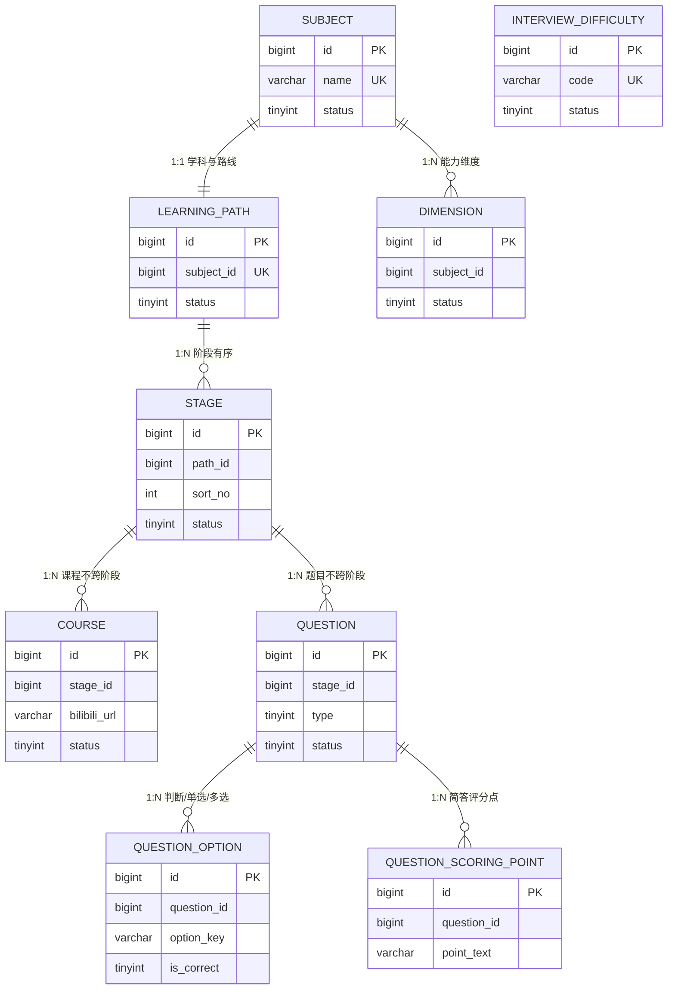
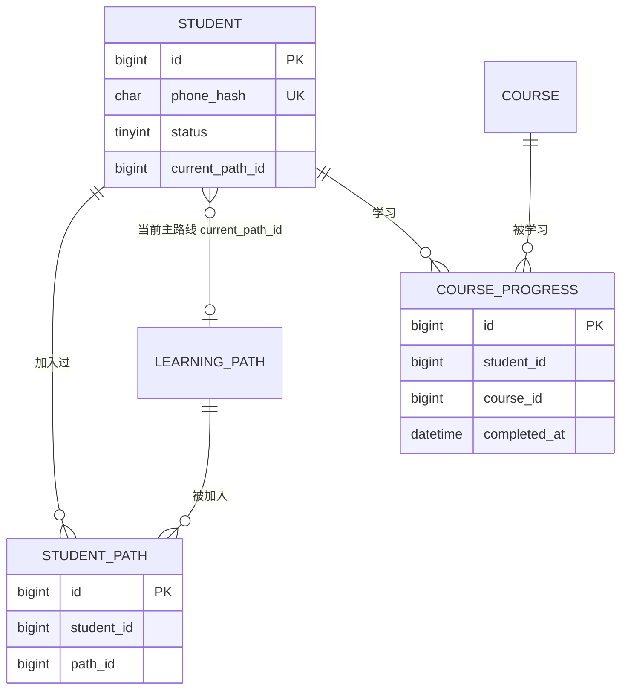
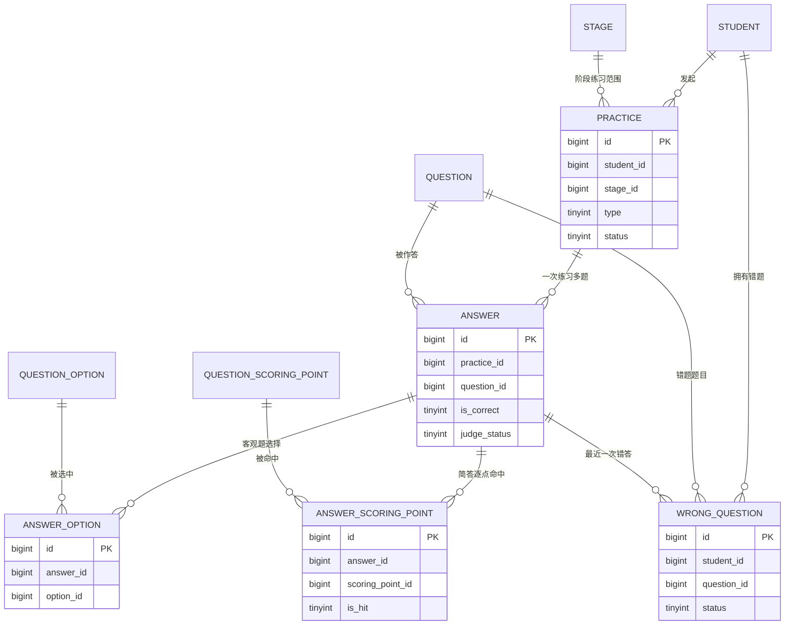
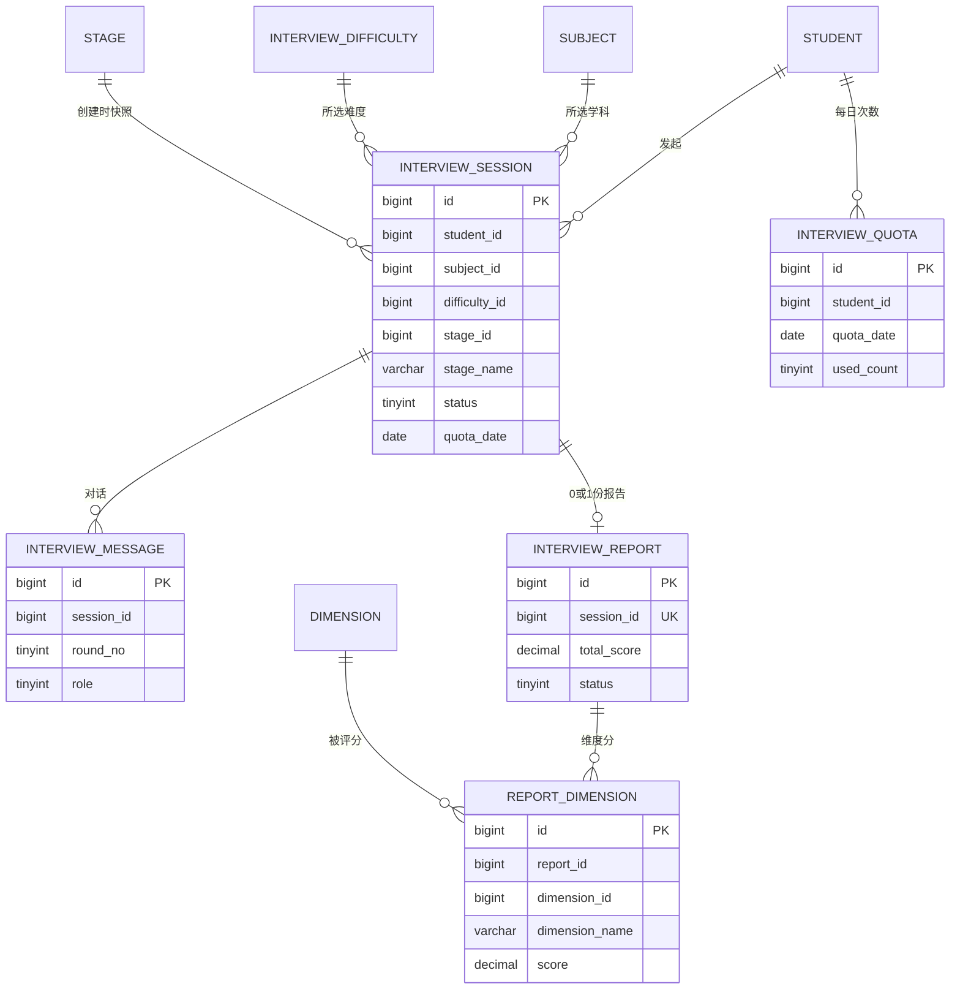
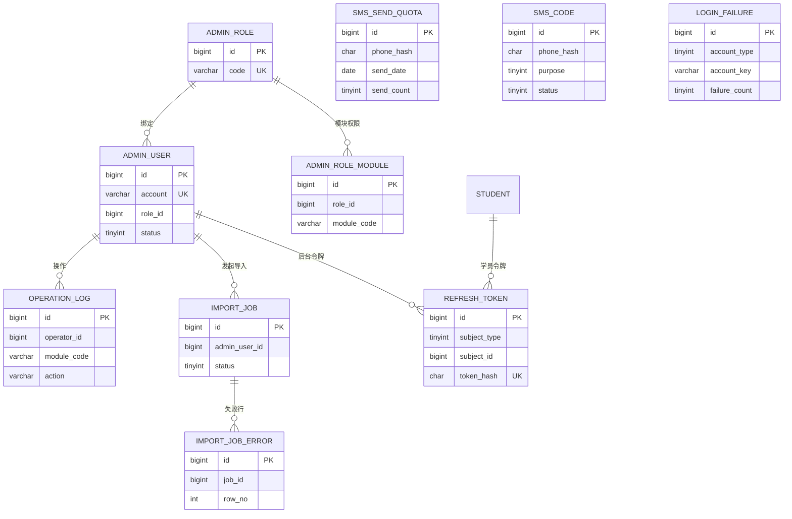

# 云枢智学 · 数据库设计

| 项目 | 内容 |
|---|---|
| 文档版本 | v1.0（定稿） |
| 定稿日期 | 2026-11-01 |
| 设计阶段 | 第三阶段：概念模型 → 逻辑模型 → 物理设计 → DDL 草案与种子数据 |
| 依据 | `docs/PRD.md` v1.0、`docs/design/01.功能模块梳理.md` v1.0、`docs/design/02.技术选型与整体架构.md` v1.0、`docs/rules/database-rules.md` v2.1 |
| 优先级 | PRD v1.0 > 02 技术选型 > 03 数据库设计 > 04 API 契约 > 01 模块职责 > rules；冲突在第 9 章逐条记录，评审裁定见 `docs/design/05.设计评审与定稿.md` 第 8 章 |
| 交付物 | 本文档；`docs/design/schema/V1__init_schema.sql`；`docs/design/schema/V2__seed_baseline.sql` |
| 边界 | 本阶段不写 Java 代码、不做工程初始化、不定义 API 路径/请求响应/错误码、不做 Redis 设计；不修改 PRD/01/02/rules |

## 0. 结论摘要

### 0.1 本轮四项阻塞决策

| 编号 | 问题 | 已确认结论 | 对表结构的影响 |
|---|---|---|---|
| Q18 | 手机号存储 | **应用层加密 + 盲索引** | `student.phone_cipher` 存 AES-GCM 密文，`student.phone_hash` 存 HMAC-SHA256；唯一索引落 `phone_hash`；登录按 hash 精确查；注销时两列置 NULL |
| Q2 | 题目选项与答案存储 | **全规范化** | `question_option`、`question_scoring_point`、`answer_option`、`answer_scoring_point` 四张子表；不用 JSON 数组 |
| Q19 | 看板 P0 统计 | **P0 实时 SQL + 索引 + 60 秒 Caffeine 缓存，不建汇总表** | V1 不新增日汇总表、不新增统计定时任务；为六组指标补索引 |
| Q29 | 面试难度是否按学科启用 | **全局难度** | `interview_difficulty` 不加 `subject_id`；不建 `subject_difficulty`；PRD 6.5 措辞按“全局至少一个启用档位”解释 |

### 0.2 规模结论

- **表总数：32 张**。
- PRD 第 8 章 20 个概念实体 → **25 张表**：17 个实体沿用为 17 张表；Question、Answer、Role 三个实体拆分后变为 8 张表。
- **新增 7 张支撑表**：`interview_quota`、`sms_send_quota`、`sms_code`、`login_failure`、`refresh_token`、`import_job`、`import_job_error`。
- 无“合并”实体。
- 不建物理外键；所有逻辑外键列均有索引或包含在联合索引前导列中。
- 掌握度、完成度不落冗余列；面试阶段名、报告维度名做快照，理由见第 7 章。
- 所有表使用 `utf8mb4`，排序规则统一为 `utf8mb4_0900_ai_ci`（MySQL 8.0）；V1/V2 已在 MySQL 8.0.46 执行验证，见 7.1 第 12 条。

### 0.3 DDL 交付说明

| 文件 | 内容 | 工程落位 |
|---|---|---|
| `V1__init_schema.sql` | 32 张表的结构、索引、注释；不含种子数据 | 工程初始化后整体移入 `src/main/resources/db/migration` |
| `V2__seed_baseline.sql` | 3 个预置角色、18 条角色模块权限、3 个面试难度档位；幂等 | 同上 |

两个脚本均带表级/字段级注释与回滚说明。V1/V2 已在 MySQL 8.0.46 临时实例执行验证：32 张表、全部 InnoDB、全部 `utf8mb4_0900_ai_ci`；V2 种子为 3 个角色、18 条权限、3 个难度档位。

---

## 1. 设计依据与建模原则

### 1.1 依据与版本核对

| 文档 | 评审时版本 | 定稿版本 | 处理 |
|---|---|---|---|
| `CLAUDE.md` | — | 当前 | 遵守设计阶段规则：不写业务代码、不擅自加需求、数据库工作先读 rules |
| `docs/PRD.md` | v0.5 | **v1.0（冻结）** | 需求基线，优先 |
| `docs/design/01.功能模块梳理.md` | v0.4 | **v1.0** | 模块职责与流程 |
| `docs/design/02.技术选型与整体架构.md` | v0.2 | **v1.0** | 技术选型与架构基线 |
| `docs/rules/database-rules.md` | v2.0 | **v2.1** | 数据库约束；已按 03 定稿同步 |
| `prototype/index.html` | 页脚写“对应 PRD v0.4” | 不改原型 | 原型版本标注滞后于 PRD v1.0，记入 9.3 |

### 1.2 建模原则

1. **可追溯**：每张表、每个业务字段能回指 PRD 条目、01 模块或 rules；纯技术支撑字段在第 9 章逐项登记。
2. **四层内容模型不变**：学科 → 学习路线 → 阶段 →（课程/题目）；不引入知识点层，不允许题目跨阶段，不引入课时/分 P。
3. **全规范化优先**：题目选项、正确答案、简答评分点、学员选择、逐点命中全部落关联表；不使用逗号数组或 JSON 代替关联表。
4. **状态只停用不硬删**：题目、课程、学科、路线、阶段、维度、后台用户均用状态字段；历史作答、历史会话、历史日志保留。
5. **不建物理外键**：引用完整性由应用层与迁移脚本保证；每个逻辑外键列建索引或作为联合索引前导列。
6. **统计不落冗余列**：掌握度、完成度、路线进度实时计算；只有练习结果、面试报告等“事实结果”落列。
7. **快照只用于历史可读**：面试会话的 `stage_name`、报告维度的 `dimension_name` 是快照；注释写明来源与维护责任。
8. **P0 不用 Redis**：验证码频控、登录失败计数、面试每日配额全部落 MySQL，用唯一索引 + 行锁/条件更新保证原子性。
9. **MySQL 8.0 基线**：开发与生产统一 MySQL 8.0；V1 不使用窗口函数、CTE、CHECK、降序索引、JSON_TABLE 等非必要新语法，排序规则统一 `utf8mb4_0900_ai_ci`，见 7.1.12。
10. **索引有场景**：每个非唯一索引对应一个查询；单表非唯一索引不超过 5 个；状态、布尔等低区分度列只做联合索引后缀。

### 1.3 PRD 第 8 章 20 个概念实体 → 物理表映射

| # | PRD 概念实体 | 物理表 | 处理 | 说明 |
|---:|---|---|---|---|
| 1 | Subject 学科 | `subject` | 沿用 | 字段与 PRD 8 一致；补 `created_by/updated_by`、`sort_no`、`cover_url` |
| 2 | LearningPath 学习路线 | `learning_path` | 沿用 | `subject_id` 唯一，落实“学科与路线一一对应” |
| 3 | Stage 阶段 | `stage` | 沿用 | 补 `status`；B 端“删除阶段”改为停用，历史会话仍可读 |
| 4 | Course 课程 | `course` | 沿用 | `duration_seconds` 落实“时长选填”；`bilibili_url` 一门一链接 |
| 5 | Question 题目 | `question` + `question_option` + `question_scoring_point` | **拆分** | 题干/解析/题型/状态留主表；选项与正确答案拆 `question_option`；简答评分点拆 `question_scoring_point` |
| 6 | Student 学员 | `student` | 沿用 | 手机号拆为 `phone_cipher` + `phone_hash`（Q18）；补 `current_path_id`、`last_login_at`、`cancelled_at` |
| 7 | StudentPath 学员路线 | `student_path` | 沿用 | 只记“加入过”的历史；当前主路线在 `student.current_path_id` |
| 8 | CourseProgress 课程进度 | `course_progress` | 沿用 | 无 `status`；无记录=未开始，`completed_at IS NULL`=学习中，非空=已完成 |
| 9 | Practice 练习 | `practice` | 沿用 | `type` 区分阶段练习/错题重练；`stage_id` 对跨阶段错题重练可为 NULL |
| 10 | Answer 作答 | `answer` + `answer_option` + `answer_scoring_point` | **拆分** | 作答主表存文本/判定/得分/降级；客观题选择拆 `answer_option`；简答逐点命中拆 `answer_scoring_point` |
| 11 | WrongQuestion 错题 | `wrong_question` | 沿用 | 补 `status`（在册/已移出）、`last_wrong_answer_id`；唯一键保证一人一题一条 |
| 12 | Dimension 能力维度 | `dimension` | 沿用 | 补 `status`；被报告引用后只停用 |
| 13 | InterviewDifficulty 面试难度 | `interview_difficulty` | 沿用 | 全局表，无 `subject_id`（Q29）；种子 3 档 |
| 14 | InterviewSession 面试会话 | `interview_session` | 沿用 | 补 `quota_date`、`current_round`、`void_reason`；`stage_id + stage_name` 快照 |
| 15 | InterviewMessage 面试消息 | `interview_message` | 沿用 | 只存转写文本；`(session_id, round_no, role)` 唯一；无音频字段 |
| 16 | InterviewReport 面试报告 | `interview_report` | 沿用 | 补 `suggestions` 落改进建议；`status` 正常/未完成 |
| 17 | ReportDimension 报告维度分 | `report_dimension` | 沿用 | 补 `dimension_name` 快照，保证维度改名后历史可读 |
| 18 | AdminUser 后台用户 | `admin_user` | 沿用 | 补 `display_name`（原型姓名）、`last_login_at`、`password_reset_required` |
| 19 | Role 角色 | `admin_role` + `admin_role_module` | **拆分** | 角色主表只存名称/编码；模块权限拆关联表，落实 PRD 2.3 模块矩阵；表名加 `admin_` 前缀避开 MySQL 保留字风险 |
| 20 | OperationLog 操作日志 | `operation_log` | 沿用 | 补操作人/角色名快照、`result`、`trace_id`；只追加 |

### 1.4 新增的 7 张支撑表

| 表 | 来源 | 为什么必须新增 | 不新增的后果 |
|---|---|---|---|
| `interview_quota` | PRD 5.7 / 13 章 #21；rules 9.10 | 每日 3 次需要独立计数行做原子占用与返还 | 无法在并发下保证不超 3 次；续答/作废无法幂等 |
| `sms_send_quota` | PRD 5.1；02 §6.4；rules 11.3 | 60 秒/次、单号单日 10 次需要行级原子计数；P0 无 Redis | 只能内存计数，重启丢失，多发/刷短信无法阻止 |
| `sms_code` | PRD 5.1；S-05 | 验证码需要 5 分钟有效、一次性使用、可审计 | 验证码无法校验与失效；明文存码有安全风险 |
| `login_failure` | PRD 11；02 §6.4；rules 11.4 | C 端 5 次失败、B 端 5 次/15 分钟锁定需要落库 | 本地缓存承载安全边界，重启即绕过 |
| `refresh_token` | 02 §2.6；rules 11 | 登出/改密/禁用/注销需要撤销 Refresh Token | 只能等过期，账号处置不彻底 |
| `import_job` | PRD 6.4；02 §5.3 | 批量导入需要任务状态、进度与整批回滚记录 | 前端无法查询进度；重启后残留任务不可见 |
| `import_job_error` | PRD 6.4；02 §5.3 | 需要返回失败行号、列、原因 | 只能返回笼统失败，运营无法修正 |

### 1.5 数量分类

| 分类 | 数量 | 说明 |
|---|---:|---|
| PRD 实体沿用 | 17 个实体 / 17 张表 | 不含 Question、Answer、Role |
| PRD 实体拆分 | 3 个实体 / 8 张表 | Question→3，Answer→3，Role→2 |
| 新增支撑表 | 7 张 | 见 1.4 |
| **合计** | **32 张** | 其中 25 张承载 PRD 8 实体，7 张为支撑 |

---

## 2. 概念模型与 ER 图

### 2.1 业务域划分

| 业务域 | 表 | 说明 |
|---|---|---|
| 内容域 | `subject`、`learning_path`、`stage`、`course`、`question`、`question_option`、`question_scoring_point`、`dimension`、`interview_difficulty` | 后台维护，C 端只读；内容只停用不物理删除，历史引用保留；题目编辑后的历史展示见 Q33 |
| 学员与学习域 | `student`、`student_path`、`course_progress` | 身份、主路线、课程完成 |
| 练习域 | `practice`、`answer`、`answer_option`、`answer_scoring_point`、`wrong_question` | 阶段练习/错题重练、判分、错题本 |
| 面试域 | `interview_session`、`interview_message`、`interview_report`、`report_dimension`、`interview_quota` | 4 轮语音面试、报告、每日次数 |
| 后台与审计域 | `admin_role`、`admin_user`、`admin_role_module`、`operation_log`、`import_job`、`import_job_error` | 后台账号、模块权限、审计、批量导入 |
| 认证支撑域 | `sms_send_quota`、`sms_code`、`login_failure`、`refresh_token` | P0 无 Redis 的频控、验证码、锁定、Token 撤销 |

### 2.2 内容域 ER



### 2.3 学员与学习域 ER



### 2.4 练习域 ER



### 2.5 面试域 ER



### 2.6 后台与认证支撑域 ER



> `sms_send_quota`、`sms_code` 以手机号 hash 关联，不直接外键到 `student`；`login_failure` 为多态账号键（学员 phone_hash / 后台 account），因此图中独立列出，不画实体外键。

### 2.7 关键基数说明

| 关系 | 基数 | 说明 |
|---|---|---|
| 学科—路线 | 1:1 | `learning_path.subject_id` 唯一 |
| 路线—阶段 | 1:N | 阶段有序；停用不物理删除 |
| 阶段—课程/题目 | 1:N | 课程、题目均不可跨阶段复用 |
| 学员—路线 | M:N（历史）+ 1 当前 | `student_path` 记录加入历史；`student.current_path_id` 只指向一条当前主路线 |
| 学员—课程进度 | 1:N | `(student_id, course_id)` 唯一；无记录=未开始 |
| 练习—作答 | 1:N | `(practice_id, question_id)` 唯一；逐题提交 |
| 学员—错题 | M:N | `(student_id, question_id)` 唯一；移出后保留行，状态=2 |
| 面试会话—消息 | 1:N | 固定 4 轮，每轮 AI+学员各一条；`(session_id, round_no, role)` 唯一 |
| 面试会话—报告 | 1:0..1 | 正常完成/提前结束有报告；过期/作废无正式报告 |
| 报告—维度分 | 1:N | `(report_id, dimension_id)` 唯一 |
| 学员—面试配额 | 1:N（按日） | `(student_id, quota_date)` 唯一；每天一行 |
| 角色—模块 | M:N | `(role_id, module_code)` 唯一；仅三类预置角色 |

---

## 3. 表清单

> 量级口径：低 < 1 万行；中 1 万–100 万行；高 > 100 万行。按 5,000 学员、课程/题库规模中等的基线估算，详细见第 8 章。

| # | 表名 | 中文名 | 用途 | 模块 | 预估量级 | 状态列 |
|---:|---|---|---|---|---|---|
| 1 | `admin_role` | 后台角色 | 三类预置角色 | admin | 低 | 否 |
| 2 | `admin_user` | 后台用户 | B 端账号，只停用不删除 | admin | 低 | 是 |
| 3 | `admin_role_module` | 角色模块权限 | 角色可访问模块集合 | admin | 低 | 否 |
| 4 | `subject` | 学科 | 学习方向，与路线 1:1 | content | 低 | 是 |
| 5 | `learning_path` | 学习路线 | 一个学科一条 | content | 低 | 是 |
| 6 | `stage` | 阶段 | 路线下有序阶段 | content | 低 | 是 |
| 7 | `course` | 课程 | 一门课一个 B 站链接 | content | 低-中 | 是 |
| 8 | `question` | 题目 | 题干、题型、解析、参考答案 | content | 中 | 是 |
| 9 | `question_option` | 题目选项 | 判断/单选/多选选项与正确答案标记 | content | 中 | 否 |
| 10 | `question_scoring_point` | 简答评分点 | 简答逐点评分依据 | content | 低-中 | 否 |
| 11 | `dimension` | 能力维度 | 学科下维度，报告评分用 | content | 低 | 是 |
| 12 | `interview_difficulty` | 面试难度 | 全局简单/中等/困难 | content | 低 | 是 |
| 13 | `student` | 学员 | 身份、密码、手机号、当前主路线 | student | 中 | 是 |
| 14 | `student_path` | 学员路线历史 | 加入过哪些路线 | learning | 低-中 | 否 |
| 15 | `course_progress` | 课程进度 | 开始/完成课程 | learning | 中 | 否 |
| 16 | `practice` | 练习 | 阶段练习/错题重练会话 | learning | 中-高 | 是 |
| 17 | `answer` | 作答 | 每题作答与判分结果 | learning | 高 | 否（有 `judge_status`） |
| 18 | `answer_option` | 作答选择项 | 客观题选中的选项 | learning | 高 | 否 |
| 19 | `answer_scoring_point` | 作答评分点命中 | 简答逐点命中结果 | learning | 中-高 | 否 |
| 20 | `wrong_question` | 错题 | 错题在册/移出状态 | learning | 中 | 是 |
| 21 | `interview_session` | 面试会话 | 4 轮面试主记录 | interview | 中-高 | 是 |
| 22 | `interview_message` | 面试消息 | 转写文本，无音频 | interview | 高 | 否 |
| 23 | `interview_report` | 面试报告 | 总分、总评、建议 | interview | 中-高 | 是 |
| 24 | `report_dimension` | 报告维度分 | 各维度得分 | interview | 中-高 | 否 |
| 25 | `interview_quota` | 面试每日配额 | 每日 3 次原子占用/返还 | interview | 中-高 | 否 |
| 26 | `operation_log` | 操作日志 | B 端登录与关键写操作审计 | admin | 中 | 否（有 `result`） |
| 27 | `sms_send_quota` | 短信发送频控 | 60 秒/10 次日限 | auth | 中 | 否 |
| 28 | `sms_code` | 短信验证码 | 5 分钟有效验证码 | auth | 中-高（需清理） | 是 |
| 29 | `login_failure` | 登录失败计数 | C/B 端失败与锁定 | auth | 低 | 否（有 `locked_until`） |
| 30 | `refresh_token` | 刷新令牌 | 持久化撤销 | auth | 中 | 否（有 `revoked_at`） |
| 31 | `import_job` | 题库导入任务 | 批量导入状态与进度 | admin | 低 | 是 |
| 32 | `import_job_error` | 导入失败行 | 行号、列、错误原因 | admin | 低-中 | 否 |

## 4. 字段字典

### 4.0 通用约定

- `id`：`BIGINT UNSIGNED NOT NULL AUTO_INCREMENT`，主键；来源 rules §3.1。
- `created_at`：`DATETIME(3) NOT NULL DEFAULT CURRENT_TIMESTAMP(3)`，UTC；来源 rules §3.2、§4。
- `updated_at`：`DATETIME(3) NOT NULL DEFAULT CURRENT_TIMESTAMP(3) ON UPDATE CURRENT_TIMESTAMP(3)`，UTC；来源 rules §3.2、§4。`operation_log.updated_at` 仅为满足规则，业务上永不更新。
- `created_by` / `updated_by`：`BIGINT UNSIGNED NOT NULL DEFAULT 0`，0=系统/种子；来源 rules §3.3。
- `version`：`INT NOT NULL DEFAULT 0`，乐观锁；来源 rules §3.4，仅用于 `course_progress`、`practice`、`interview_session`、`interview_quota`，以及新增的 `sms_send_quota`、`login_failure` 原子计数行。
- 状态/枚举均用 `TINYINT UNSIGNED`，不用 MySQL `ENUM`；取值见第 6 章。
- `TEXT` 在 MySQL 5.7 不能设置默认值，表中“默认 —”表示由应用写入，不允许空字符串替代业务空值。

### 4.1 内容域

#### 4.1.1 `subject` 学科

| 字段 | 类型 | 可空 | 默认 | 说明 / 来源 |
|---|---|---|---|---|
| `id` | BIGINT UNSIGNED | 否 | 自增 | 主键；rules §3.1 |
| `name` | VARCHAR(50) | 否 | — | 学科名称；PRD 6.2/8 |
| `description` | VARCHAR(500) | 否 | `''` | 学科简介；PRD 6.2/8 |
| `cover_url` | VARCHAR(512) | 否 | `''` | 封面 OSS key/URL；PRD 6.2，空用占位图 |
| `sort_no` | INT UNSIGNED | 否 | 0 | 排序号；PRD 6.2/8 |
| `status` | TINYINT UNSIGNED | 否 | 1 | 1启用 2停用；PRD 6.2/rules §6 |
| `created_by` | BIGINT UNSIGNED | 否 | 0 | 创建人；rules §3.3 |
| `updated_by` | BIGINT UNSIGNED | 否 | 0 | 最后修改人；rules §3.3 |
| `created_at` | DATETIME(3) | 否 | CURRENT_TIMESTAMP(3) | 创建时间 UTC；rules §3.2 |
| `updated_at` | DATETIME(3) | 否 | CURRENT_TIMESTAMP(3) / ON UPDATE | 更新时间 UTC；rules §3.2 |

#### 4.1.2 `learning_path` 学习路线

| 字段 | 类型 | 可空 | 默认 | 说明 / 来源 |
|---|---|---|---|---|
| `id` | BIGINT UNSIGNED | 否 | 自增 | 主键；rules §3.1 |
| `subject_id` | BIGINT UNSIGNED | 否 | — | 所属学科；唯一，学科与路线 1:1；PRD 4/5.3/8 |
| `name` | VARCHAR(100) | 否 | — | 路线名称；PRD 6.6/8 |
| `description` | VARCHAR(500) | 否 | `''` | 路线简介；PRD 6.6/8 |
| `status` | TINYINT UNSIGNED | 否 | 1 | 1启用 2停用；PRD 6.6/rules §6 |
| `created_by` | BIGINT UNSIGNED | 否 | 0 | 创建人；rules §3.3 |
| `updated_by` | BIGINT UNSIGNED | 否 | 0 | 最后修改人；rules §3.3 |
| `created_at` | DATETIME(3) | 否 | CURRENT_TIMESTAMP(3) | 创建时间 UTC；rules §3.2 |
| `updated_at` | DATETIME(3) | 否 | CURRENT_TIMESTAMP(3) / ON UPDATE | 更新时间 UTC；rules §3.2 |

#### 4.1.3 `stage` 阶段

| 字段 | 类型 | 可空 | 默认 | 说明 / 来源 |
|---|---|---|---|---|
| `id` | BIGINT UNSIGNED | 否 | 自增 | 主键；rules §3.1 |
| `path_id` | BIGINT UNSIGNED | 否 | — | 所属路线；PRD 5.3/6.6/8 |
| `name` | VARCHAR(100) | 否 | — | 阶段名称；PRD 6.6/8 |
| `description` | VARCHAR(500) | 否 | `''` | 阶段简介/目标；PRD 6.6 |
| `sort_no` | INT UNSIGNED | 否 | 0 | 阶段排序号；PRD 6.6/8 |
| `status` | TINYINT UNSIGNED | 否 | 1 | 1启用 2停用；PRD 6.6“删除”改为停用，rules §9.9 |
| `created_by` | BIGINT UNSIGNED | 否 | 0 | 创建人；rules §3.3 |
| `updated_by` | BIGINT UNSIGNED | 否 | 0 | 最后修改人；rules §3.3 |
| `created_at` | DATETIME(3) | 否 | CURRENT_TIMESTAMP(3) | 创建时间 UTC；rules §3.2 |
| `updated_at` | DATETIME(3) | 否 | CURRENT_TIMESTAMP(3) / ON UPDATE | 更新时间 UTC；rules §3.2 |

#### 4.1.4 `course` 课程

| 字段 | 类型 | 可空 | 默认 | 说明 / 来源 |
|---|---|---|---|---|
| `id` | BIGINT UNSIGNED | 否 | 自增 | 主键；rules §3.1 |
| `stage_id` | BIGINT UNSIGNED | 否 | — | 所属阶段；课程不跨阶段；PRD 4/6.3/8 |
| `title` | VARCHAR(200) | 否 | — | 课程标题；PRD 5.4/6.3/8 |
| `bilibili_url` | VARCHAR(512) | 否 | — | B 站视频链接；一门课一个链接；PRD 4/6.3 |
| `description` | TEXT | 否 | — | 课程简介；PRD 6.3 |
| `duration_seconds` | INT UNSIGNED | 是 | NULL | 时长（秒，选填）；NULL=未填；PRD 5.4/6.3 |
| `cover_url` | VARCHAR(512) | 否 | `''` | 封面 OSS key/URL；空用占位图；PRD 6.3 |
| `sort_no` | INT UNSIGNED | 否 | 0 | 排序号；PRD 6.3/8 |
| `status` | TINYINT UNSIGNED | 否 | 1 | 1启用 2停用；PRD 6.3/rules §6 |
| `created_by` | BIGINT UNSIGNED | 否 | 0 | 创建人；rules §3.3 |
| `updated_by` | BIGINT UNSIGNED | 否 | 0 | 最后修改人；rules §3.3 |
| `created_at` | DATETIME(3) | 否 | CURRENT_TIMESTAMP(3) | 创建时间 UTC；rules §3.2 |
| `updated_at` | DATETIME(3) | 否 | CURRENT_TIMESTAMP(3) / ON UPDATE | 更新时间 UTC；rules §3.2 |

#### 4.1.5 `question` 题目

| 字段 | 类型 | 可空 | 默认 | 说明 / 来源 |
|---|---|---|---|---|
| `id` | BIGINT UNSIGNED | 否 | 自增 | 主键；rules §3.1 |
| `stage_id` | BIGINT UNSIGNED | 否 | — | 所属阶段；不跨阶段复用；PRD 4/6.4/8 |
| `type` | TINYINT UNSIGNED | 否 | — | 1判断 2单选 3多选 4简答；PRD 6.4/8 |
| `content` | TEXT | 否 | — | 题干；PRD 6.4/8 |
| `content_hash` | CHAR(64) | 否 | — | 规范化题干 SHA-256 hex；批量导入重复题判定；PRD 6.4，设计补充 |
| `analysis` | TEXT | 否 | — | 解析；PRD 6.4/8 |
| `reference_answer` | TEXT | 是 | NULL | 简答参考答案；其他题型 NULL；PRD 6.4/8 |
| `status` | TINYINT UNSIGNED | 否 | 1 | 1启用 2停用；只停用不硬删；PRD 6.4/rules §6 |
| `created_by` | BIGINT UNSIGNED | 否 | 0 | 创建人；rules §3.3 |
| `updated_by` | BIGINT UNSIGNED | 否 | 0 | 最后修改人；rules §3.3 |
| `created_at` | DATETIME(3) | 否 | CURRENT_TIMESTAMP(3) | 创建时间 UTC；rules §3.2 |
| `updated_at` | DATETIME(3) | 否 | CURRENT_TIMESTAMP(3) / ON UPDATE | 更新时间 UTC；rules §3.2 |

#### 4.1.6 `question_option` 题目选项

| 字段 | 类型 | 可空 | 默认 | 说明 / 来源 |
|---|---|---|---|---|
| `id` | BIGINT UNSIGNED | 否 | 自增 | 主键；rules §3.1 |
| `question_id` | BIGINT UNSIGNED | 否 | — | 题目；PRD 6.4/8；Q2 全规范化 |
| `option_key` | VARCHAR(8) | 否 | — | 选项标识 A/B/C…；判断题 A=正确、B=错误；PRD 6.4 |
| `content` | VARCHAR(1000) | 否 | — | 选项内容；PRD 6.4/8 |
| `is_correct` | TINYINT(1) | 否 | 0 | 0否 1是；判断/单选恰 1、多选至少 2（应用校验）；PRD 6.4；Q2 |
| `sort_no` | INT UNSIGNED | 否 | 0 | 选项排序号；PRD 6.4 |
| `created_at` | DATETIME(3) | 否 | CURRENT_TIMESTAMP(3) | 创建时间 UTC；rules §3.2 |
| `updated_at` | DATETIME(3) | 否 | CURRENT_TIMESTAMP(3) / ON UPDATE | 更新时间 UTC；rules §3.2 |

#### 4.1.7 `question_scoring_point` 简答评分点

| 字段 | 类型 | 可空 | 默认 | 说明 / 来源 |
|---|---|---|---|---|
| `id` | BIGINT UNSIGNED | 否 | 自增 | 主键；rules §3.1 |
| `question_id` | BIGINT UNSIGNED | 否 | — | 简答题目；PRD 6.4/8；Q2 |
| `point_text` | VARCHAR(500) | 否 | — | 评分点内容；PRD 6.4/8 |
| `sort_no` | INT UNSIGNED | 否 | 0 | 评分点排序号；PRD 6.4 |
| `created_at` | DATETIME(3) | 否 | CURRENT_TIMESTAMP(3) | 创建时间 UTC；rules §3.2 |
| `updated_at` | DATETIME(3) | 否 | CURRENT_TIMESTAMP(3) / ON UPDATE | 更新时间 UTC；rules §3.2 |

#### 4.1.8 `dimension` 能力维度

| 字段 | 类型 | 可空 | 默认 | 说明 / 来源 |
|---|---|---|---|---|
| `id` | BIGINT UNSIGNED | 否 | 自增 | 主键；rules §3.1 |
| `subject_id` | BIGINT UNSIGNED | 否 | — | 所属学科；PRD 6.5/8 |
| `name` | VARCHAR(50) | 否 | — | 维度名称；PRD 6.5/8 |
| `sort_no` | INT UNSIGNED | 否 | 0 | 排序号；PRD 6.5/8 |
| `status` | TINYINT UNSIGNED | 否 | 1 | 1启用 2停用；被报告引用后只停用；PRD 6.5/rules §9.7 |
| `created_by` | BIGINT UNSIGNED | 否 | 0 | 创建人；rules §3.3 |
| `updated_by` | BIGINT UNSIGNED | 否 | 0 | 最后修改人；rules §3.3 |
| `created_at` | DATETIME(3) | 否 | CURRENT_TIMESTAMP(3) | 创建时间 UTC；rules §3.2 |
| `updated_at` | DATETIME(3) | 否 | CURRENT_TIMESTAMP(3) / ON UPDATE | 更新时间 UTC；rules §3.2 |

#### 4.1.9 `interview_difficulty` 面试难度

| 字段 | 类型 | 可空 | 默认 | 说明 / 来源 |
|---|---|---|---|---|
| `id` | BIGINT UNSIGNED | 否 | 自增 | 主键；rules §3.1 |
| `code` | VARCHAR(20) | 否 | — | easy/medium/hard；PRD 6.5/8 |
| `name` | VARCHAR(20) | 否 | — | 简单/中等/困难；PRD 6.5/8；全局唯一 |
| `description` | VARCHAR(500) | 否 | `''` | 难度描述；PRD 6.5/8 |
| `focus` | VARCHAR(500) | 否 | `''` | 考察重点；PRD 6.5/8 |
| `sort_no` | INT UNSIGNED | 否 | 0 | 排序号；PRD 6.5 |
| `status` | TINYINT UNSIGNED | 否 | 1 | 1启用 2停用；停用后 C 端不可选；PRD 6.5/rules §6 |
| `created_by` | BIGINT UNSIGNED | 否 | 0 | 创建人；rules §3.3 |
| `updated_by` | BIGINT UNSIGNED | 否 | 0 | 最后修改人；rules §3.3 |
| `created_at` | DATETIME(3) | 否 | CURRENT_TIMESTAMP(3) | 创建时间 UTC；rules §3.2 |
| `updated_at` | DATETIME(3) | 否 | CURRENT_TIMESTAMP(3) / ON UPDATE | 更新时间 UTC；rules §3.2 |

### 4.2 学员与学习域

#### 4.2.1 `student` 学员

| 字段 | 类型 | 可空 | 默认 | 说明 / 来源 |
|---|---|---|---|---|
| `id` | BIGINT UNSIGNED | 否 | 自增 | 主键；注销后作为匿名行为关联 ID，不对外暴露；rules §3.1/§9.14 |
| `phone_cipher` | VARBINARY(255) | 是 | NULL | AES-GCM 密文（IV+密文+tag）；注销置 NULL；Q18 |
| `phone_hash` | CHAR(64) | 是 | NULL | HMAC-SHA256 hex；唯一；登录/查重按此列；注销置 NULL；Q18 |
| `password_hash` | VARCHAR(100) | 否 | — | bcrypt/argon2 哈希；注销置不可用随机哈希；PRD 5.1/11；rules §11.1 |
| `nickname` | VARCHAR(50) | 是 | NULL | 昵称；注销置 NULL；PRD 5.10/8 |
| `avatar_url` | VARCHAR(512) | 是 | NULL | 头像 OSS key/URL；注销置 NULL；PRD 5.10 |
| `status` | TINYINT UNSIGNED | 否 | 1 | 1正常 2禁用 3已注销；PRD 7.6/8；rules §6 |
| `current_path_id` | BIGINT UNSIGNED | 是 | NULL | 当前主路线；同一时间仅一条；未选路线 NULL；PRD 5.3；rules §9.3 |
| `last_login_at` | DATETIME(3) | 是 | NULL | 最近登录时间 UTC；活跃统计；PRD 6.10，设计补充 |
| `password_reset_required` | TINYINT(1) | 否 | 0 | 首次登录强制改密；后台重置密码后置 1；PRD 6.7 |
| `cancelled_at` | DATETIME(3) | 是 | NULL | 注销时间；status=3 时写入；PRD 5.10/7.6 |
| `created_at` | DATETIME(3) | 否 | CURRENT_TIMESTAMP(3) | 注册时间 UTC；PRD 6.7；rules §3.2 |
| `updated_at` | DATETIME(3) | 否 | CURRENT_TIMESTAMP(3) / ON UPDATE | 更新时间 UTC；rules §3.2 |

#### 4.2.2 `student_path` 学员路线历史

| 字段 | 类型 | 可空 | 默认 | 说明 / 来源 |
|---|---|---|---|---|
| `id` | BIGINT UNSIGNED | 否 | 自增 | 主键；rules §3.1 |
| `student_id` | BIGINT UNSIGNED | 否 | — | 学员；PRD 5.3/8 |
| `path_id` | BIGINT UNSIGNED | 否 | — | 学习路线；PRD 5.3/8 |
| `joined_at` | DATETIME(3) | 否 | CURRENT_TIMESTAMP(3) | 首次加入时间；换回不重置；PRD 8 |
| `created_at` | DATETIME(3) | 否 | CURRENT_TIMESTAMP(3) | 创建时间 UTC；rules §3.2 |
| `updated_at` | DATETIME(3) | 否 | CURRENT_TIMESTAMP(3) / ON UPDATE | 更新时间 UTC；rules §3.2 |

#### 4.2.3 `course_progress` 课程进度

| 字段 | 类型 | 可空 | 默认 | 说明 / 来源 |
|---|---|---|---|---|
| `id` | BIGINT UNSIGNED | 否 | 自增 | 主键；rules §3.1 |
| `student_id` | BIGINT UNSIGNED | 否 | — | 学员；PRD 5.4/8 |
| `course_id` | BIGINT UNSIGNED | 否 | — | 课程；PRD 5.4/8 |
| `started_at` | DATETIME(3) | 否 | CURRENT_TIMESTAMP(3) | 开始学习时间；直接标记完成时=完成时间；PRD 5.4/8 |
| `completed_at` | DATETIME(3) | 是 | NULL | 完成时间；NULL=未完成；PRD 5.4/8 |
| `version` | INT | 否 | 0 | 乐观锁；rules §3.4 |
| `created_at` | DATETIME(3) | 否 | CURRENT_TIMESTAMP(3) | 创建时间 UTC；rules §3.2 |
| `updated_at` | DATETIME(3) | 否 | CURRENT_TIMESTAMP(3) / ON UPDATE | 更新时间 UTC；rules §3.2 |

#### 4.2.4 `practice` 练习

| 字段 | 类型 | 可空 | 默认 | 说明 / 来源 |
|---|---|---|---|---|
| `id` | BIGINT UNSIGNED | 否 | 自增 | 主键；rules §3.1 |
| `student_id` | BIGINT UNSIGNED | 否 | — | 学员；PRD 5.5/8 |
| `stage_id` | BIGINT UNSIGNED | 是 | NULL | 阶段练习必填；错题重练跨阶段为 NULL；PRD 5.5/5.6/8，设计补充 |
| `type` | TINYINT UNSIGNED | 否 | — | 1阶段练习 2错题重练；PRD 5.5/5.6/8 |
| `status` | TINYINT UNSIGNED | 否 | 1 | 1进行中 2已完成 3已作废；PRD 9/8；rules §6 |
| `started_at` | DATETIME(3) | 否 | CURRENT_TIMESTAMP(3) | 开始时间；PRD 5.5/8 |
| `finished_at` | DATETIME(3) | 是 | NULL | 完成/作废时间；PRD 5.5/8 |
| `expire_at` | DATETIME(3) | 否 | — | 续答截止；创建+7天；PRD 5.5/13#1 |
| `question_count` | INT UNSIGNED | 否 | 0 | 题目总数快照；PRD 5.5/8 |
| `correct_count` | INT UNSIGNED | 否 | 0 | 答对题数；结果页；PRD 5.5 |
| `correct_rate` | DECIMAL(5,2) | 是 | NULL | 正确率 0.00–100.00；完成时写入；PRD 5.5/8 |
| `version` | INT | 否 | 0 | 乐观锁；rules §3.4 |
| `created_at` | DATETIME(3) | 否 | CURRENT_TIMESTAMP(3) | 创建时间 UTC；rules §3.2 |
| `updated_at` | DATETIME(3) | 否 | CURRENT_TIMESTAMP(3) / ON UPDATE | 更新时间 UTC；rules §3.2 |

#### 4.2.5 `answer` 作答

| 字段 | 类型 | 可空 | 默认 | 说明 / 来源 |
|---|---|---|---|---|
| `id` | BIGINT UNSIGNED | 否 | 自增 | 主键；rules §3.1 |
| `practice_id` | BIGINT UNSIGNED | 否 | — | 练习；PRD 5.5/8 |
| `question_id` | BIGINT UNSIGNED | 否 | — | 题目；PRD 5.5/8 |
| `answer_text` | TEXT | 是 | NULL | 简答作答文本；客观题 NULL；PRD 5.5/8；Q2 |
| `is_correct` | TINYINT(1) | 是 | NULL | 0否 1是；待判分/待自评 NULL；PRD 5.5/8 |
| `score` | DECIMAL(5,2) | 是 | NULL | 0.00–100.00；客观题 0/100，简答得分率；PRD 5.5/8 |
| `feedback` | TEXT | 是 | NULL | 判分反馈；简答逐点反馈；PRD 8 Answer 反馈 |
| `judge_status` | TINYINT UNSIGNED | 否 | 1 | 1待判分 2已判分 3待自评 4自评完成；PRD 5.5；设计补充 |
| `is_degraded` | TINYINT(1) | 否 | 0 | 0否 1是；简答 AI 失败降级；PRD 5.5/8 |
| `judged_at` | DATETIME(3) | 是 | NULL | 判分/自评完成时间；PRD 5.5 |
| `created_at` | DATETIME(3) | 否 | CURRENT_TIMESTAMP(3) | 创建时间 UTC；rules §3.2 |
| `updated_at` | DATETIME(3) | 否 | CURRENT_TIMESTAMP(3) / ON UPDATE | 更新时间 UTC；rules §3.2 |

#### 4.2.6 `answer_option` 作答选择项

| 字段 | 类型 | 可空 | 默认 | 说明 / 来源 |
|---|---|---|---|---|
| `id` | BIGINT UNSIGNED | 否 | 自增 | 主键；rules §3.1 |
| `answer_id` | BIGINT UNSIGNED | 否 | — | 作答；PRD 5.5/8；Q2 |
| `option_id` | BIGINT UNSIGNED | 否 | — | 被选中的题目选项；PRD 5.5/8；Q2 |
| `created_at` | DATETIME(3) | 否 | CURRENT_TIMESTAMP(3) | 创建时间 UTC；rules §3.2 |
| `updated_at` | DATETIME(3) | 否 | CURRENT_TIMESTAMP(3) / ON UPDATE | 更新时间 UTC；rules §3.2 |

#### 4.2.7 `answer_scoring_point` 作答评分点命中

| 字段 | 类型 | 可空 | 默认 | 说明 / 来源 |
|---|---|---|---|---|
| `id` | BIGINT UNSIGNED | 否 | 自增 | 主键；rules §3.1 |
| `answer_id` | BIGINT UNSIGNED | 否 | — | 作答；PRD 5.5/8；Q2 |
| `scoring_point_id` | BIGINT UNSIGNED | 否 | — | 评分点；PRD 5.5/8；Q2 |
| `is_hit` | TINYINT(1) | 否 | 0 | 0未命中 1命中；PRD 5.5“逐点命中” |
| `created_at` | DATETIME(3) | 否 | CURRENT_TIMESTAMP(3) | 创建时间 UTC；rules §3.2 |
| `updated_at` | DATETIME(3) | 否 | CURRENT_TIMESTAMP(3) / ON UPDATE | 更新时间 UTC；rules §3.2 |

#### 4.2.8 `wrong_question` 错题

| 字段 | 类型 | 可空 | 默认 | 说明 / 来源 |
|---|---|---|---|---|
| `id` | BIGINT UNSIGNED | 否 | 自增 | 主键；rules §3.1 |
| `student_id` | BIGINT UNSIGNED | 否 | — | 学员；PRD 5.6/8 |
| `question_id` | BIGINT UNSIGNED | 否 | — | 题目；PRD 5.6/8 |
| `status` | TINYINT UNSIGNED | 否 | 1 | 1在册 2已移出；再次答错复用同一条；PRD 5.6；设计补充 |
| `first_added_at` | DATETIME(3) | 否 | CURRENT_TIMESTAMP(3) | 首次加入时间；PRD 8“加入时间” |
| `last_added_at` | DATETIME(3) | 否 | CURRENT_TIMESTAMP(3) | 最近一次答错加入时间；PRD 5.6，设计补充 |
| `removed_at` | DATETIME(3) | 是 | NULL | 最近一次答对移出时间；在册 NULL；PRD 5.6 |
| `last_wrong_answer_id` | BIGINT UNSIGNED | 是 | NULL | 最近一次错答；展示“我的答案”；PRD 5.6，设计补充 |
| `created_at` | DATETIME(3) | 否 | CURRENT_TIMESTAMP(3) | 创建时间 UTC；rules §3.2 |
| `updated_at` | DATETIME(3) | 否 | CURRENT_TIMESTAMP(3) / ON UPDATE | 更新时间 UTC；rules §3.2 |

### 4.3 面试域

#### 4.3.1 `interview_session` 面试会话

| 字段 | 类型 | 可空 | 默认 | 说明 / 来源 |
|---|---|---|---|---|
| `id` | BIGINT UNSIGNED | 否 | 自增 | 主键；rules §3.1 |
| `student_id` | BIGINT UNSIGNED | 否 | — | 学员；PRD 5.7/8 |
| `subject_id` | BIGINT UNSIGNED | 否 | — | 所选学科；PRD 5.7/8 |
| `difficulty_id` | BIGINT UNSIGNED | 否 | — | 所选难度；PRD 5.7/8；Q29 全局 |
| `stage_id` | BIGINT UNSIGNED | 否 | — | 创建时快照阶段；PRD 5.7/8；rules §9.9 |
| `stage_name` | VARCHAR(100) | 否 | — | 阶段名快照；不随改名/停用更新；PRD 5.7/8；rules §9.9 |
| `status` | TINYINT UNSIGNED | 否 | 1 | 1创建中 2进行中 3正常完成 4未完成 5已过期 6已作废；PRD 9；rules §6 |
| `current_round` | TINYINT UNSIGNED | 否 | 0 | 已完成作答轮次 0–4；PRD 5.7 固定 4 轮；设计补充 |
| `quota_date` | DATE | 否 | — | 次数占用归属日（Asia/Shanghai）；跨日作废按此返还；PRD 5.7/13#21；设计补充 |
| `started_at` | DATETIME(3) | 是 | NULL | 转“进行中”时间；PRD 5.7/8 |
| `finished_at` | DATETIME(3) | 是 | NULL | 完成/未完成/过期/作废时间；PRD 5.7/8 |
| `expire_at` | DATETIME(3) | 否 | — | 创建中=创建+5分钟；进行中=开始+24小时；PRD 5.7/13#4 |
| `void_reason` | TINYINT UNSIGNED | 是 | NULL | 1开场题失败 2创建超时 3其他系统/AI故障；PRD 5.7/10；设计补充 |
| `version` | INT | 否 | 0 | 乐观锁；rules §3.4 |
| `created_at` | DATETIME(3) | 否 | CURRENT_TIMESTAMP(3) | 创建时间；创建即计 1 次；PRD 5.7 |
| `updated_at` | DATETIME(3) | 否 | CURRENT_TIMESTAMP(3) / ON UPDATE | 更新时间 UTC；rules §3.2 |

#### 4.3.2 `interview_message` 面试消息

| 字段 | 类型 | 可空 | 默认 | 说明 / 来源 |
|---|---|---|---|---|
| `id` | BIGINT UNSIGNED | 否 | 自增 | 主键；rules §3.1 |
| `session_id` | BIGINT UNSIGNED | 否 | — | 面试会话；PRD 5.7/8 |
| `round_no` | TINYINT UNSIGNED | 否 | — | 1开场 2–4追问；PRD 5.7 |
| `role` | TINYINT UNSIGNED | 否 | — | 1 AI 提问 2学员回答；PRD 5.7/8 |
| `content` | TEXT | 否 | — | 转写/文本内容；不保存音频；PRD 5.7/13#16 |
| `created_at` | DATETIME(3) | 否 | CURRENT_TIMESTAMP(3) | 创建时间 UTC；rules §3.2 |
| `updated_at` | DATETIME(3) | 否 | CURRENT_TIMESTAMP(3) / ON UPDATE | 更新时间 UTC；rules §3.2 |

#### 4.3.3 `interview_report` 面试报告

| 字段 | 类型 | 可空 | 默认 | 说明 / 来源 |
|---|---|---|---|---|
| `id` | BIGINT UNSIGNED | 否 | 自增 | 主键；rules §3.1 |
| `session_id` | BIGINT UNSIGNED | 否 | — | 面试会话；一 session 一报告；PRD 5.8/8 |
| `total_score` | DECIMAL(5,2) | 否 | 0.00 | 总分 0.00–100.00；PRD 5.8/8 |
| `summary` | TEXT | 否 | — | 总评文字；PRD 5.8/8 |
| `suggestions` | TEXT | 否 | — | 改进建议 2–3 条，换行分隔；PRD 5.8 |
| `status` | TINYINT UNSIGNED | 否 | 1 | 1正常 2未完成（提前结束）；PRD 5.8/9；rules §6 |
| `created_at` | DATETIME(3) | 否 | CURRENT_TIMESTAMP(3) | 创建时间 UTC；rules §3.2 |
| `updated_at` | DATETIME(3) | 否 | CURRENT_TIMESTAMP(3) / ON UPDATE | 更新时间 UTC；rules §3.2 |

#### 4.3.4 `report_dimension` 报告维度分

| 字段 | 类型 | 可空 | 默认 | 说明 / 来源 |
|---|---|---|---|---|
| `id` | BIGINT UNSIGNED | 否 | 自增 | 主键；rules §3.1 |
| `report_id` | BIGINT UNSIGNED | 否 | — | 报告；PRD 5.8/8 |
| `dimension_id` | BIGINT UNSIGNED | 否 | — | 能力维度；PRD 5.8/8 |
| `dimension_name` | VARCHAR(50) | 否 | — | 报告生成时维度名快照；历史可读；设计补充 |
| `score` | DECIMAL(5,2) | 否 | 0.00 | 维度得分 0.00–100.00；PRD 5.8/8 |
| `created_at` | DATETIME(3) | 否 | CURRENT_TIMESTAMP(3) | 创建时间 UTC；rules §3.2 |
| `updated_at` | DATETIME(3) | 否 | CURRENT_TIMESTAMP(3) / ON UPDATE | 更新时间 UTC；rules §3.2 |

#### 4.3.5 `interview_quota` 面试每日配额

| 字段 | 类型 | 可空 | 默认 | 说明 / 来源 |
|---|---|---|---|---|
| `id` | BIGINT UNSIGNED | 否 | 自增 | 主键；rules §3.1 |
| `student_id` | BIGINT UNSIGNED | 否 | — | 学员；PRD 5.7/13#21 |
| `quota_date` | DATE | 否 | — | 配额归属日（Asia/Shanghai）；不是 UTC 时间；PRD 5.7；rules §9.10 |
| `used_count` | TINYINT UNSIGNED | 否 | 0 | 已占用 0–3；原子条件更新；PRD 5.7；rules §9.10 |
| `version` | INT | 否 | 0 | 乐观锁/计数版本；rules §3.4 |
| `created_at` | DATETIME(3) | 否 | CURRENT_TIMESTAMP(3) | 创建时间 UTC；rules §3.2 |
| `updated_at` | DATETIME(3) | 否 | CURRENT_TIMESTAMP(3) / ON UPDATE | 更新时间 UTC；rules §3.2 |

### 4.4 后台与审计域

#### 4.4.1 `admin_role` 后台角色

| 字段 | 类型 | 可空 | 默认 | 说明 / 来源 |
|---|---|---|---|---|
| `id` | BIGINT UNSIGNED | 否 | 自增 | 主键；rules §3.1 |
| `name` | VARCHAR(50) | 否 | — | 角色名称；PRD 2.2/6.8 |
| `code` | VARCHAR(30) | 否 | — | super_admin/content_ops/student_ops；PRD 2.3/6.8 |
| `description` | VARCHAR(200) | 否 | `''` | 角色说明；PRD 2.2 |
| `created_by` | BIGINT UNSIGNED | 否 | 0 | 创建人；rules §3.3 |
| `updated_by` | BIGINT UNSIGNED | 否 | 0 | 最后修改人；rules §3.3 |
| `created_at` | DATETIME(3) | 否 | CURRENT_TIMESTAMP(3) | 创建时间 UTC；rules §3.2 |
| `updated_at` | DATETIME(3) | 否 | CURRENT_TIMESTAMP(3) / ON UPDATE | 更新时间 UTC；rules §3.2 |

#### 4.4.2 `admin_user` 后台用户

| 字段 | 类型 | 可空 | 默认 | 说明 / 来源 |
|---|---|---|---|---|
| `id` | BIGINT UNSIGNED | 否 | 自增 | 主键；rules §3.1 |
| `account` | VARCHAR(50) | 否 | — | 登录账号；唯一；PRD 6.8/8 |
| `password_hash` | VARCHAR(100) | 否 | — | bcrypt/argon2；PRD 6.8/11；rules §11.1 |
| `display_name` | VARCHAR(50) | 否 | — | 姓名/显示名；原型 users + PRD 6.8 |
| `role_id` | BIGINT UNSIGNED | 否 | — | 绑定角色；PRD 6.8/8 |
| `status` | TINYINT UNSIGNED | 否 | 1 | 1正常 2停用；PRD 6.8；rules §6 |
| `last_login_at` | DATETIME(3) | 是 | NULL | 最近登录；原型用户列表；PRD 6.9 |
| `password_reset_required` | TINYINT(1) | 否 | 0 | 重置密码后首次登录强制改密；PRD 6.7/6.8 |
| `created_by` | BIGINT UNSIGNED | 否 | 0 | 创建人；rules §3.3 |
| `updated_by` | BIGINT UNSIGNED | 否 | 0 | 最后修改人；rules §3.3 |
| `created_at` | DATETIME(3) | 否 | CURRENT_TIMESTAMP(3) | 创建时间 UTC；rules §3.2 |
| `updated_at` | DATETIME(3) | 否 | CURRENT_TIMESTAMP(3) / ON UPDATE | 更新时间 UTC；rules §3.2 |

#### 4.4.3 `admin_role_module` 角色模块权限

| 字段 | 类型 | 可空 | 默认 | 说明 / 来源 |
|---|---|---|---|---|
| `id` | BIGINT UNSIGNED | 否 | 自增 | 主键；rules §3.1 |
| `role_id` | BIGINT UNSIGNED | 否 | — | 角色；PRD 2.3/6.8 |
| `module_code` | VARCHAR(50) | 否 | — | 模块编码；PRD 2.3/6.8；取值见 6.2 |
| `created_by` | BIGINT UNSIGNED | 否 | 0 | 创建人；rules §3.3 |
| `updated_by` | BIGINT UNSIGNED | 否 | 0 | 最后修改人；rules §3.3 |
| `created_at` | DATETIME(3) | 否 | CURRENT_TIMESTAMP(3) | 创建时间 UTC；rules §3.2 |
| `updated_at` | DATETIME(3) | 否 | CURRENT_TIMESTAMP(3) / ON UPDATE | 更新时间 UTC；rules §3.2 |

#### 4.4.4 `operation_log` 操作日志

| 字段 | 类型 | 可空 | 默认 | 说明 / 来源 |
|---|---|---|---|---|
| `id` | BIGINT UNSIGNED | 否 | 自增 | 主键；rules §3.1 |
| `operator_id` | BIGINT UNSIGNED | 否 | 0 | 操作人；0=系统/未知账号；PRD 6.9 |
| `operator_name` | VARCHAR(50) | 否 | `''` | 操作人姓名快照；PRD 6.9，设计补充 |
| `role_name` | VARCHAR(50) | 否 | `''` | 角色名快照；PRD 6.9，设计补充 |
| `module_code` | VARCHAR(50) | 否 | — | 模块；PRD 6.9 |
| `action` | VARCHAR(50) | 否 | — | 动作；PRD 6.9 |
| `target_type` | VARCHAR(50) | 否 | `''` | 对象类型；PRD 6.9 |
| `target_id` | BIGINT UNSIGNED | 是 | NULL | 对象主键；PRD 6.9 |
| `result` | TINYINT UNSIGNED | 否 | 1 | 1成功 2失败；PRD 6.9 登录记录；02 §6.3 |
| `detail` | VARCHAR(1000) | 否 | `''` | 变更摘要；禁止敏感明文；PRD 6.9；02 §6.3 |
| `ip` | VARCHAR(45) | 否 | `''` | 请求 IP；PRD 6.9 |
| `trace_id` | VARCHAR(64) | 否 | `''` | 链路 traceId；02 §6.7 |
| `created_at` | DATETIME(3) | 否 | CURRENT_TIMESTAMP(3) | 操作时间 UTC；PRD 6.9 |
| `updated_at` | DATETIME(3) | 否 | CURRENT_TIMESTAMP(3) / ON UPDATE | 仅满足 rules §3.2；只追加，业务永不更新 |

### 4.5 认证与导入支撑域

#### 4.5.1 `sms_send_quota` 短信发送频控

| 字段 | 类型 | 可空 | 默认 | 说明 / 来源 |
|---|---|---|---|---|
| `id` | BIGINT UNSIGNED | 否 | 自增 | 主键；rules §3.1 |
| `phone_hash` | CHAR(64) | 否 | — | 手机号 HMAC-SHA256 hex；PRD 5.1；Q18 |
| `send_date` | DATE | 否 | — | 发送归属日（Asia/Shanghai）；PRD 5.1 |
| `send_count` | TINYINT UNSIGNED | 否 | 0 | 当日已发送 0–10；PRD 5.1 |
| `last_sent_at` | DATETIME(3) | 是 | NULL | 最近发送时间 UTC；60 秒频控；PRD 5.1 |
| `version` | INT | 否 | 0 | 原子计数版本；rules §3.4 |
| `created_at` | DATETIME(3) | 否 | CURRENT_TIMESTAMP(3) | 创建时间 UTC；rules §3.2 |
| `updated_at` | DATETIME(3) | 否 | CURRENT_TIMESTAMP(3) / ON UPDATE | 更新时间 UTC；rules §3.2 |

#### 4.5.2 `sms_code` 短信验证码

| 字段 | 类型 | 可空 | 默认 | 说明 / 来源 |
|---|---|---|---|---|
| `id` | BIGINT UNSIGNED | 否 | 自增 | 主键；rules §3.1 |
| `phone_hash` | CHAR(64) | 否 | — | 手机号 HMAC-SHA256 hex；PRD 5.1；Q18 |
| `purpose` | TINYINT UNSIGNED | 否 | — | 1注册 2验证码登录 3重置密码 4换绑 5注销确认；PRD 5.1/5.10/6.1 |
| `code_hash` | CHAR(64) | 否 | — | 验证码 HMAC-SHA256；禁止明文；PRD 5.1/rules §11.2 |
| `expire_at` | DATETIME(3) | 否 | — | 发送+5分钟；PRD 5.1 |
| `used_at` | DATETIME(3) | 是 | NULL | 使用时间；PRD 5.1 |
| `status` | TINYINT UNSIGNED | 否 | 1 | 1未使用 2已使用 3已过期 4已作废；PRD 5.1；设计补充 |
| `request_ip` | VARCHAR(45) | 否 | `''` | 请求 IP；PRD 11 安全 |
| `created_at` | DATETIME(3) | 否 | CURRENT_TIMESTAMP(3) | 发送时间 UTC；rules §3.2 |
| `updated_at` | DATETIME(3) | 否 | CURRENT_TIMESTAMP(3) / ON UPDATE | 更新时间 UTC；rules §3.2 |

#### 4.5.3 `login_failure` 登录失败计数

| 字段 | 类型 | 可空 | 默认 | 说明 / 来源 |
|---|---|---|---|---|
| `id` | BIGINT UNSIGNED | 否 | 自增 | 主键；rules §3.1 |
| `account_type` | TINYINT UNSIGNED | 否 | — | 1学员 2后台用户；PRD 5.1/11 |
| `account_key` | VARCHAR(100) | 否 | — | 学员=phone_hash；后台=account；不存手机号明文；Q18 |
| `failure_count` | TINYINT UNSIGNED | 否 | 0 | 连续失败次数；PRD 5.1/11 |
| `first_failed_at` | DATETIME(3) | 是 | NULL | 本轮首次失败；PRD 11 |
| `last_failed_at` | DATETIME(3) | 是 | NULL | 最近失败；PRD 11 |
| `locked_until` | DATETIME(3) | 是 | NULL | B 端 5 次锁 15 分钟；C 端由 failure_count≥5 强制验证码；PRD 11/5.1 |
| `version` | INT | 否 | 0 | 原子计数版本；rules §3.4 |
| `created_at` | DATETIME(3) | 否 | CURRENT_TIMESTAMP(3) | 创建时间 UTC；rules §3.2 |
| `updated_at` | DATETIME(3) | 否 | CURRENT_TIMESTAMP(3) / ON UPDATE | 更新时间 UTC；rules §3.2 |

#### 4.5.4 `refresh_token` 刷新令牌

| 字段 | 类型 | 可空 | 默认 | 说明 / 来源 |
|---|---|---|---|---|
| `id` | BIGINT UNSIGNED | 否 | 自增 | 主键；rules §3.1 |
| `subject_type` | TINYINT UNSIGNED | 否 | — | 1学员 2后台用户；02 §2.6 |
| `subject_id` | BIGINT UNSIGNED | 否 | — | student.id 或 admin_user.id；02 §2.6 |
| `token_hash` | CHAR(64) | 否 | — | Refresh Token SHA-256/HMAC；禁止明文；02 §2.6 |
| `expires_at` | DATETIME(3) | 否 | — | 过期时间；TTL 待 Q27 |
| `revoked_at` | DATETIME(3) | 是 | NULL | 撤销时间；NULL=有效；02 §2.6 |
| `revoke_reason` | TINYINT UNSIGNED | 是 | NULL | 1登出 2改密 3禁用 4注销 5轮换 6其他；设计补充 |
| `replaced_by_id` | BIGINT UNSIGNED | 是 | NULL | 轮换后的新 token id；02 §2.6 |
| `created_at` | DATETIME(3) | 否 | CURRENT_TIMESTAMP(3) | 签发时间 UTC；rules §3.2 |
| `updated_at` | DATETIME(3) | 否 | CURRENT_TIMESTAMP(3) / ON UPDATE | 更新时间 UTC；rules §3.2 |

#### 4.5.5 `import_job` 题库导入任务

| 字段 | 类型 | 可空 | 默认 | 说明 / 来源 |
|---|---|---|---|---|
| `id` | BIGINT UNSIGNED | 否 | 自增 | 主键；rules §3.1 |
| `admin_user_id` | BIGINT UNSIGNED | 否 | — | 发起人；PRD 6.4；02 §5.3 |
| `file_name` | VARCHAR(255) | 否 | — | 上传文件名；不保存文件；PRD 6.4 |
| `status` | TINYINT UNSIGNED | 否 | 1 | 1处理中 2全部成功 3全部失败；PRD 9/6.4；02 §5.3 |
| `total_rows` | INT UNSIGNED | 否 | 0 | 总行数；PRD 6.4 |
| `success_rows` | INT UNSIGNED | 否 | 0 | 成功行数；PRD 6.4 |
| `failed_rows` | INT UNSIGNED | 否 | 0 | 失败行数；PRD 6.4 |
| `error_message` | VARCHAR(1000) | 否 | `''` | 整体错误摘要；PRD 6.4 |
| `started_at` | DATETIME(3) | 是 | NULL | 开始处理；02 §5.3 |
| `finished_at` | DATETIME(3) | 是 | NULL | 结束时间；02 §5.3 |
| `created_at` | DATETIME(3) | 否 | CURRENT_TIMESTAMP(3) | 创建时间 UTC；rules §3.2 |
| `updated_at` | DATETIME(3) | 否 | CURRENT_TIMESTAMP(3) / ON UPDATE | 更新时间 UTC；rules §3.2 |

#### 4.5.6 `import_job_error` 导入失败行

| 字段 | 类型 | 可空 | 默认 | 说明 / 来源 |
|---|---|---|---|---|
| `id` | BIGINT UNSIGNED | 否 | 自增 | 主键；rules §3.1 |
| `job_id` | BIGINT UNSIGNED | 否 | — | 导入任务；PRD 6.4；02 §5.3 |
| `row_no` | INT UNSIGNED | 否 | — | Excel 行号；PRD 6.4 |
| `column_name` | VARCHAR(50) | 否 | `''` | 出错列名；PRD 6.4 |
| `error_message` | VARCHAR(500) | 否 | — | 错误原因；PRD 6.4 |
| `raw_row` | TEXT | 是 | NULL | 原始行文本（脱敏）；PRD 6.4，设计补充 |
| `created_at` | DATETIME(3) | 否 | CURRENT_TIMESTAMP(3) | 创建时间 UTC；rules §3.2 |
| `updated_at` | DATETIME(3) | 否 | CURRENT_TIMESTAMP(3) / ON UPDATE | 更新时间 UTC；rules §3.2 |

## 5. 索引设计

### 5.1 索引原则

1. 主键统一 `id`；业务唯一性用 `uk_`；普通查询用 `idx_`。
2. 不建物理外键，但逻辑外键列必须有索引或位于联合索引前导列。
3. 单表非唯一索引不超过 5 个；状态、布尔等低区分度列只做联合索引后缀。
4. 统计查询使用半开区间 `>= ? AND < ?`，禁止 `DATE(created_at) = ?` 导致索引失效。
5. 列表分页统一 `ORDER BY id` 兜底；面试记录、练习记录按时间倒序时用 `(student_id, created_at)`。
6. 深分页、`LIKE '%x'`、`SELECT *` 不在本期设计中使用。

### 5.2 索引清单

| 表 | 索引定义（名称：字段顺序） | 支撑查询 / 说明 |
|---|---|---|
| `admin_role` | `uk_admin_role_code(code)`；`uk_admin_role_name(name)` | 角色编码/名称唯一；种子幂等 |
| `admin_user` | `uk_admin_user_account(account)`；`idx_admin_user_role_id(role_id)`；`idx_admin_user_status(status)` | 登录按账号；按角色筛用户；状态过滤 |
| `admin_role_module` | `uk_admin_role_module(role_id, module_code)`；`idx_admin_role_module_code(module_code)` | 角色权限唯一；按模块反查角色 |
| `subject` | `uk_subject_name(name)`；`idx_subject_status_sort(status, sort_no)` | 学科名唯一；C 端启用学科排序 |
| `learning_path` | `uk_learning_path_subject(subject_id)`；`idx_learning_path_status(status)` | 学科 1:1 路线；启用过滤 |
| `stage` | `idx_stage_path_sort(path_id, sort_no)`；`idx_stage_status(status)` | 路线下阶段排序；启用过滤 |
| `course` | `idx_course_stage_sort(stage_id, sort_no)`；`idx_course_status(status)` | 阶段课程排序；启用过滤 |
| `question` | `idx_question_stage_status_type(stage_id, status, type)`；`idx_question_stage_content_hash(stage_id, content_hash)` | 阶段题库/题型筛选；导入重复题判定 |
| `question_option` | `uk_question_option_key(question_id, option_key)`；`idx_question_option_sort(question_id, sort_no)` | 选项唯一；按题排序 |
| `question_scoring_point` | `uk_question_scoring_point_sort(question_id, sort_no)` | 评分点唯一、按题排序 |
| `dimension` | `uk_dimension_subject_name(subject_id, name)`；`idx_dimension_subject_status_sort(subject_id, status, sort_no)` | 学科维度名唯一；启用维度排序 |
| `interview_difficulty` | `uk_interview_difficulty_code(code)`；`uk_interview_difficulty_name(name)`；`idx_interview_difficulty_status_sort(status, sort_no)` | 难度编码/名称唯一；C 端启用排序 |
| `student` | `uk_student_phone_hash(phone_hash)`；`idx_student_current_path_id(current_path_id)`；`idx_student_status_created_at(status, created_at)`；`idx_student_last_login_at(last_login_at)`；`idx_student_created_at(created_at)` | 手机号登录/查重；当前路线；学员列表/新增；活跃（登录）；看板新增趋势 |
| `student_path` | `uk_student_path(student_id, path_id)`；`idx_student_path_path_id(path_id)` | 加入路线唯一；按路线查学员 |
| `course_progress` | `uk_course_progress(student_id, course_id)`；`idx_course_progress_course_id(course_id)`；`idx_course_progress_student_completed(student_id, completed_at)`；`idx_course_progress_completed_at(completed_at)`；`idx_course_progress_started_at(started_at)` | 完成幂等；课程维度统计；学员完成记录；完成数趋势；活跃（开始学习） |
| `practice` | `idx_practice_student_stage_type_status_finished(student_id, stage_id, type, status, finished_at)`；`idx_practice_student_created(student_id, created_at)`；`idx_practice_stage_type_status_finished(stage_id, type, status, finished_at)`；`idx_practice_status_expire(status, expire_at)`；`idx_practice_created_at(created_at)` | 掌握度取最近一次；练习记录；阶段/看板统计；超时作废；活跃/趋势 |
| `answer` | `uk_answer(practice_id, question_id)`；`idx_answer_question_id(question_id)`；`idx_answer_practice_correct(practice_id, is_correct)` | 一次练习每题唯一；按题反查；题型正确率 |
| `answer_option` | `uk_answer_option(answer_id, option_id)`；`idx_answer_option_option_id(option_id)` | 已选选项唯一；按选项反查 |
| `answer_scoring_point` | `uk_answer_scoring_point(answer_id, scoring_point_id)`；`idx_answer_scoring_point_point_id(scoring_point_id)` | 逐点命中唯一；按评分点反查 |
| `wrong_question` | `uk_wrong_question(student_id, question_id)`；`idx_wrong_question_student_status(student_id, status)`；`idx_wrong_question_question_id(question_id)`；`idx_wrong_question_last_answer(last_wrong_answer_id)` | 一人一题一条；错题本在册筛选；按题反查；我的答案 |
| `interview_session` | `idx_interview_session_student_created(student_id, created_at)`；`idx_interview_session_status_expire(status, expire_at)`；`idx_interview_session_subject_difficulty(subject_id, difficulty_id)`；`idx_interview_session_created_at(created_at)`；`idx_interview_session_stage_id(stage_id)` | 学员面试记录；超时清理；学科/难度筛选；看板/活跃；阶段反查 |
| `interview_message` | `uk_interview_message_round_role(session_id, round_no, role)` | 每轮每角色唯一；按会话顺序读取 |
| `interview_report` | `uk_interview_report_session(session_id)` | 一 session 一报告 |
| `report_dimension` | `uk_report_dimension(report_id, dimension_id)`；`idx_report_dimension_dimension_id(dimension_id)` | 报告维度唯一；维度平均分 |
| `interview_quota` | `uk_interview_quota(student_id, quota_date)`；`idx_interview_quota_date(quota_date)` | 每日配额唯一；按日清理/统计 |
| `operation_log` | `idx_operation_log_operator_created(operator_id, created_at)`；`idx_operation_log_module_created(module_code, created_at)`；`idx_operation_log_created_at(created_at)`；`idx_operation_log_target(target_type, target_id)` | 按人/模块/时间/对象筛选 |
| `sms_send_quota` | `uk_sms_send_quota(phone_hash, send_date)`；`idx_sms_send_quota_date(send_date)` | 手机号+日唯一；按日清理 |
| `sms_code` | `idx_sms_code_phone_purpose_status_expire(phone_hash, purpose, status, expire_at)`；`idx_sms_code_status_expire(status, expire_at)` | 验证码校验；过期清理 |
| `login_failure` | `uk_login_failure(account_type, account_key)`；`idx_login_failure_last_failed(last_failed_at)` | 账号+端唯一；清理 |
| `refresh_token` | `uk_refresh_token_hash(token_hash)`；`idx_refresh_token_subject_revoked(subject_type, subject_id, revoked_at)`；`idx_refresh_token_expires(expires_at)`；`idx_refresh_token_replaced(replaced_by_id)` | 令牌校验；批量撤销；过期清理；轮换链 |
| `import_job` | `idx_import_job_admin_created(admin_user_id, created_at)`；`idx_import_job_status(status)` | 我的导入记录；处理中任务恢复 |
| `import_job_error` | `idx_import_job_error_job_row(job_id, row_no)` | 按任务读取失败行 |

### 5.3 关键查询与索引匹配

| 查询 | 使用索引 | 说明 |
|---|---|---|
| 最近一次阶段练习（掌握度） | `practice(student_id, stage_id, type, status, finished_at)` | 等值前四列 + 时间倒序，避免 filesort |
| 阶段完成度 | `course(stage_id)` + `course_progress(student_id, course_id)` | 左连接统计；课程数走阶段索引 |
| 错题本列表 | `wrong_question(student_id, status)` | 默认全部在册；按阶段筛选需 join `question` |
| 面试记录列表 | `interview_session(student_id, created_at)` | 时间倒序；排除 `status=6` |
| 面试超时清理 | `interview_session(status, expire_at)` | 范围扫描待处理会话 |
| 每日配额占用 | `interview_quota(student_id, quota_date)` 唯一 | 行锁 + 条件更新 |
| 看板学员新增 | `student(status, created_at)` 或 `created_at` 前缀 | 状态过滤 + 时间范围 |
| 看板课程完成 | `course_progress(completed_at)` | 时间范围 |
| 看板练习趋势 | `practice(created_at)` | 时间范围 |
| 看板面试趋势 | `interview_session(created_at)` | 时间范围；排除作废 |
| 看板维度平均分 | `report_dimension(dimension_id)` | 按维度聚合 |
| 短信 60 秒/日限 | `sms_send_quota(phone_hash, send_date)` 唯一 | 行锁原子判断 |
| 验证码校验 | `sms_code(phone_hash, purpose, status, expire_at)` | 取最新未使用未过期 |
| B 端登录锁定 | `login_failure(account_type, account_key)` 唯一 | 行锁原子计数 |
| 批量撤销 Refresh Token | `refresh_token(subject_type, subject_id, revoked_at)` | 登出/改密/禁用/注销 |

---

## 6. 枚举字典

> 与 rules 第 6 章一致的状态保持不变；新增枚举在 6.2 标注“需回填 rules 第 6 章”。代码中必须使用常量，禁止散落魔法数字。

### 6.1 rules 第 6 章既有枚举

| 表.字段 | 取值 | 业务含义 | 来源 |
|---|---|---|---|
| `student.status` | 1 / 2 / 3 | 正常 / 禁用 / 已注销 | PRD 7.6、rules §6 |
| `practice.status` | 1 / 2 / 3 | 进行中 / 已完成 / 已作废 | PRD 9、rules §6 |
| `practice.type` | 1 / 2 | 阶段练习 / 错题重练 | PRD 5.5/5.6 |
| `interview_session.status` | 1 / 2 / 3 / 4 / 5 / 6 | 创建中 / 进行中 / 正常完成 / 未完成 / 已过期 / 已作废 | PRD 9、rules §6 |
| `interview_report.status` | 1 / 2 | 正常 / 未完成（提前结束） | PRD 5.8、rules §6 |
| `question.status` | 1 / 2 | 启用 / 停用 | PRD 6.4、rules §6 |
| `subject.status` | 1 / 2 | 启用 / 停用 | PRD 6.2、rules §6 |
| `learning_path.status` | 1 / 2 | 启用 / 停用 | PRD 6.6、rules §6 |
| `course.status` | 1 / 2 | 启用 / 停用 | PRD 6.3、rules §6 |
| `admin_user.status` | 1 / 2 | 正常 / 停用 | PRD 6.8、rules §6 |

### 6.2 新增/补充枚举（需回填 rules 第 6 章）

| 表.字段 | 取值 | 业务含义 | 来源/原因 |
|---|---|---|---|
| `stage.status` | 1 / 2 | 启用 / 停用 | PRD 6.6“删除阶段”+ rules §9.9 历史会话保留 |
| `dimension.status` | 1 / 2 | 启用 / 停用 | PRD 6.5；被报告引用后只停用（rules §9.7） |
| `wrong_question.status` | 1 / 2 | 在册 / 已移出 | PRD 5.6；移出后再次答错复用同一行 |
| `question.type` | 1 / 2 / 3 / 4 | 判断 / 单选 / 多选 / 简答 | PRD 5.5/6.4 |
| `answer.judge_status` | 1 / 2 / 3 / 4 | 待判分 / 已判分 / 待自评 / 自评完成 | PRD 5.5 简答降级；02 §5.2 |
| `answer.is_degraded` | 0 / 1 | 否 / 是（简答 AI 失败转自评） | PRD 5.5 |
| `interview_session.void_reason` | 1 / 2 / 3 | 开场题生成失败 / 创建超时 / 其他系统或 AI 故障 | PRD 5.7/10；02 §6.8；可空 |
| `interview_session.current_round` | 0–4 | 已完成作答轮次；0=尚未作答，4=4轮完成 | PRD 5.7 固定 4 轮 |
| `interview_message.role` | 1 / 2 | AI 提问 / 学员回答 | PRD 5.7 |
| `interview_message.round_no` | 1–4 | 开场 / 追问 1–3 | PRD 5.7 |
| `interview_difficulty.code` | easy / medium / hard | 简单 / 中等 / 困难 | PRD 6.5；Q29 全局 |
| `admin_role_module.module_code` | subject / course / question / interview_settings / learning_path / student / admin_user / role / operation_log / dashboard / notice / message | PRD 2.3 的 10 个模块 + V3 公告 notice + V4 消息 message | PRD 2.3/6.8；V3/V4 |
| `sms_code.purpose` | 1 / 2 / 3 / 4 / 5 | 注册 / 验证码登录 / 重置密码 / 换绑手机号 / 注销确认 | PRD 5.1/5.10 |
| `sms_code.status` | 1 / 2 / 3 / 4 | 未使用 / 已使用 / 已过期 / 已作废 | PRD 5.1；设计补充 |
| `login_failure.account_type` | 1 / 2 | 学员 / 后台用户 | PRD 5.1/11 |
| `refresh_token.subject_type` | 1 / 2 | 学员 / 后台用户 | 02 §2.6 |
| `refresh_token.revoke_reason` | 1 / 2 / 3 / 4 / 5 / 6 | 登出 / 改密 / 禁用 / 注销 / 轮换 / 其他 | 02 §2.6；设计补充 |
| `operation_log.result` | 1 / 2 | 成功 / 失败 | PRD 6.9；02 §6.3 |
| `import_job.status` | 1 / 2 / 3 | 处理中 / 全部成功 / 全部失败 | PRD 6.4/9；02 §5.3 |

### 6.3 状态机与表字段对应

| 状态机 | 表.字段 | 允许流转 | 触发 |
|---|---|---|---|
| 学员账号 | `student.status` | 1→2；2→1；1→3；2→3（3 不可逆） | 禁用/启用；自助或后台注销（正常或禁用均可注销） |
| 练习 | `practice.status` | 1→2；1→3 | 全部作答；7 天超时 |
| 面试会话 | `interview_session.status` | 1→2→3；1→6；2→4；2→5 | 开场成功；4 轮完成；开场失败/创建超时；提前结束；24h 过期 |
| 面试报告 | `interview_report.status` | 1 或 2 | 正常完成=1；提前结束=2；过期/作废不生成 |
| 题库导入 | `import_job.status` | 1→2；1→3 | 全部校验/写入成功；任一行失败整批回滚 |
| 题目/后台用户 | `question.status`、`admin_user.status` | 1↔2 | 只停用/启用，不物理删除 |

## 7. 关键建模难题与关键 SQL

### 7.1 十二个建模难题的明确答案

#### 7.1.1 每日面试 3 次配额：日期口径、并发占用、幂等返还、续答不重复计数

**结论：用 `interview_quota(student_id, quota_date, used_count, version)` 一行一日一学员，`quota_date` 由应用按 `Asia/Shanghai` 自然日计算；占用与退还在短事务内用条件更新完成；会话表冗余 `quota_date` 作为跨日退还依据；续答不调用占用逻辑。**

- **日期口径**：`quota_date` 是 `DATE`，由应用使用 `LocalDate.now(ZoneId.of("Asia/Shanghai"))` 计算后传入。禁止用 `UTC_DATE()`、`DATE(created_at)` 或数据库服务器本地时区推导，否则北京时间 00:00–08:00 会算到前一天。`interview_session.quota_date` 在创建时复制同一值，之后不变；跨午夜作废时按会话快照日退还，而不是按作废当天。
- **并发占用**：创建会话的同一事务内执行“确保配额行存在 + 条件递增”。`UPDATE ... WHERE used_count < 3` 会对唯一索引 `uk_interview_quota(student_id, quota_date)` 命中的行加排他锁；并发请求串行等待，后到事务重新判断 `used_count`，因此不会超卖。以 `UPDATE` 的影响行数作为唯一成功判据：1=占用成功，0=当日 3 次已用完，回滚并返回“今日次数已用完”。
- **为什么不用“先查再改”**：`SELECT used_count` 后应用判断再 `UPDATE` 在并发下会同时读到 2，两个请求都通过；条件更新把判断和写入合并为一条原子语句，是本期无 Redis 时的正确做法。
- **幂等返还**：只有“创建中（status=1）→ 已作废（status=6）”的状态迁移可以触发返还。先执行 `UPDATE interview_session SET status=6 ... WHERE id=? AND status=1`，影响行数为 1 才继续执行 `used_count = used_count - 1`；重复调用时状态已不是 1，影响行数为 0，不会二次返还。状态迁移本身是幂等闸门，不需要额外的“已返还”字段。
- **哪些情况计次**：创建会话提交即计 1 次；正常完成、提前结束、未完成、24 小时过期均不返还；开场题生成失败、创建 5 分钟超时、其他导致“未进入可作答状态”的系统/AI 故障，置 status=6 并返还。系统/AI 故障发生在已经可作答之后（已有学员回答）时，按未完成处理，不返还。
- **续答为什么不再计次**：续答入口只读取已有 `interview_session`，不经过创建接口，也不调用配额占用。会话行本身（`id`、`status`、`quota_date`、`created_at`）证明这一次已经计过；`used_count` 在创建事务里已经加过。若续答也调用占用，才会重复计数。
- **过期处理**：`expire_at` 在创建中为“创建时间+5 分钟”，转进行中时改为“开始时间+24 小时”。定时任务按 `(status, expire_at)` 扫描：status=1 且超时 → status=6、原因=创建超时、返还；status=2 且超时 → status=5、不返还。
- **不按学科/难度拆分**：一张表只按学员+日期，不建 `subject_id`/`difficulty_id`，符合已确认的“每人每天总共 3 次”。

#### 7.1.2 学员注销后的手机号释放、身份推断与匿名历史

**结论：`student.phone_hash` 可空且唯一；注销时清空密文、盲索引、昵称、头像、当前路线，状态置 3，不物理删除学员行；历史统计继续挂在原 `student.id` 上。**

- **释放手机号**：MySQL 唯一索引允许多个 `NULL`。注销事务将 `phone_cipher`、`phone_hash`、`nickname`、`avatar_url`、`current_path_id` 置 `NULL`，`password_hash` 置为不可用的随机哈希，`status=3`，写 `cancelled_at`。同一手机号重新注册会插入新 `student` 行，新行写入新的 `phone_hash`，唯一约束不冲突。
- **防止身份推断**：数据库只存 AES-GCM 密文和 HMAC-SHA256 盲索引，不存手机号明文；登录、查重、短信频控都用盲索引。日志与操作日志只写掩码（如 `138****1234`）或“手机号已变更”，禁止写密文、明文、验证码、密码、Token。`student.id` 只作为内部匿名行为关联 ID，不对外暴露；后台列表展示注销状态和脱敏信息。
- **历史为什么不断**：`student_path`、`course_progress`、`practice`、`answer`、`wrong_question`、`interview_session` 等全部保留原 `student_id`。看板“学员总数/历史学习数据”仍可统计；活跃统计用 `last_login_at`、学习/练习/面试行为，不依赖手机号。注销学员不会被物理删除，因此不需要归档表，也不会出现“归档后统计口径变化”。
- **同号重新注册**：视为新学员、新 ID，旧历史不自动合并。这样既满足“释放手机号”，又避免把两个人的行为拼到一条历史里；是否需要“同号找回旧历史”属于产品新需求，本期不做。
- **密钥风险**：盲索引可防“只拿到数据库”的离线枚举，但不能防“同时拿到数据库和 HMAC 密钥”的攻击；密钥托管与轮换是 Q31，必须在认证模块编码前确定。

#### 7.1.3 掌握度/完成度统计：最近一次、索引、不冗余、错题重练排除

**结论：掌握度实时取“最近一次已完成阶段练习”的 `correct_rate`；完成度实时按 `course_progress` 与启用课程数计算；两者都不建冗余汇总列；所有掌握度 SQL 强制 `practice.type=1`。**

- **掌握度口径**：`practice.type=1`（阶段练习）、`status=2`（已完成）、按 `finished_at DESC, id DESC` 取第一条，返回 `correct_rate`、`question_count`、`finished_at`。`question_count < 10` 时前端标注“样本较少”，但仍展示计算值，不参与加权是展示层规则，不是数据库规则。
- **为什么不在 `student` 或 `stage` 上放 `mastery_rate`**：掌握度是“最近一次”的派生值，练习完成后可重算；冗余列会带来“练习作废/补答/数据修复后未同步”的漂移。以已完成练习为事实源，查询是单表索引命中，5,000 学员规模不需要汇总列。
- **索引**：`practice(student_id, stage_id, type, status, finished_at)` 前四列等值、最后一列倒序，覆盖“某学员某阶段最近一次阶段练习”。`finished_at` 相同毫秒的极端情况用 `id` 兜底排序，只在该 tie 上产生极小排序。
- **完成度口径**：`course_progress` 以 `(student_id, course_id)` 唯一，`completed_at IS NOT NULL` 即完成；阶段完成度 = 该阶段启用课程中已完成数 / 启用课程总数。默认分母只算 `course.status=1`；课程停用后是否仍计入历史分母是 Q32（非阻塞，默认不计入）。
- **为什么不冗余**：完成标记本身是事实，重复完成只更新 `completed_at`；分母由课程表实时算，课程增删停用后口径自动一致。冗余 `completed_course_count` 会在课程停用/恢复时失真。
- **错题重练排除**：掌握度 SQL 固定 `type=1`；完成度只读 `course_progress`，错题重练根本不写课程进度；看板练习指标同时给出 `type=1` 与 `type=2` 两个计数，掌握度/平均正确率只用 `type=1`。详见 7.2.6。

#### 7.1.4 四种题型统一存储：选项、正确答案、评分点、多选全对、简答逐点

**结论：题目主表只放题型与题干；选项放 `question_option`，正确答案用 `question_option.is_correct`；简答评分点放 `question_scoring_point`；作答选择放 `answer_option`，简答逐点命中放 `answer_scoring_point`。不使用 JSON 数组。**

- **判断/单选/多选**：`question_option` 的 `option_key` 为 A/B/C/D…；判断题固定 A=正确、B=错误；单选恰 1 个 `is_correct=1`；多选至少 2 个 `is_correct=1`。作答时 `answer_option` 每选中一个选项一行，行存在=选中，未选中不写行。
- **判分**：判断题、单选题、多选题统一用“选中集合 = 正确集合”判对；多选题必须全对才 `is_correct=1`，少选/多选/错选均为 0，不给部分分。集合相等在应用层用选项 ID 集合比较，SQL 侧只需读取 `answer_option` 与 `question_option`；不把正确答案拼成字符串比较，避免选项顺序、空格、大小写问题。
- **简答**：`question.reference_answer` 存参考答案，`question_scoring_point` 存等权评分点；作答文本存 `answer.answer_text`，模型逐点判定后每个评分点写一条 `answer_scoring_point(is_hit)`。`answer.score = 命中数 / 总评分点数 * 100`（保留两位），`answer.is_correct = (score >= 60)`；这正对应 PRD“得分率 ≥ 60% 视为正确”。
- **简答降级**：模型超时/失败时 `judge_status=3`（待自评）、`is_degraded=1`，展示参考答案；学员自评“答对/答错”后 `judge_status=4`，`is_correct` 置 1/0，`score` 置 100/0，`judged_at` 写入。降级不伪造逐点命中，`answer_scoring_point` 保持空。
- **为什么拆子表**：选项、正确答案、评分点需要按题编辑、按选项/评分点反查、按题型统计；JSON 数组无法建索引、无法保证唯一性、无法做外键式完整性校验，也违反 rules 第 12 章“禁止用 JSON 数组替代关联表”。拆表后批量导入可以逐行校验“判断题 2 个选项、单选恰 1 个正确、多选至少 2 个正确、简答至少 1 个评分点”。
- **编辑边界**：题目一旦有作答，题型不建议修改（改变题型会使历史 `answer_option` 语义失效）；题干/选项内容修改会影响历史题目展示，是否做题目版本快照是 Q33（非阻塞）。本期只允许停用后新建。

#### 7.1.5 面试阶段快照：`stage_id` + `stage_name` 冗余、停用/改名后的历史可读

**结论：`interview_session` 同时保存 `stage_id` 和创建时的 `stage_name`；`stage_name` 只写一次、永不随阶段改名或停用更新。**

- **为什么冗余**：面试记录和报告需要回答“当时面的是哪个阶段”。如果只存 `stage_id`，阶段改名后历史显示新名字，阶段停用后还要处理“是否还能 join 展示”的问题；存快照名可以直接展示历史原文。
- **谁维护**：只有创建面试会话的服务在插入时写入 `stage_name`；后续任何阶段管理操作都不更新该字段。`stage_id` 仍保留用于按阶段统计、反查阶段详情；阶段只停用不物理删除（rules §9.9），所以 `stage_id` 不会悬空。
- **改名/停用后的表现**：C 端历史记录显示快照名；B 端按 `stage_id` 聚合时仍归到同一阶段；阶段停用后不再允许新建该阶段面试，但历史会话和报告照常可读。
- **不冗余其他阶段字段**：只快照 `stage_name`，不快照阶段排序、状态等；这些不是历史语义的一部分，避免无意义冗余。

#### 7.1.6 面试消息只存对话文本：轮次编号、顺序、过期会话保留

**结论：`interview_message` 只存转写/文本，不存音频；固定 4 轮，每轮 AI 与学员各一条，唯一键保证不重复；过期/未完成会话的消息照常保留。**

- **轮次编号**：`round_no=1` 为开场题，`round_no=2/3/4` 为三次追问；`role=1` 为 AI 提问，`role=2` 为学员回答。即“开场 1 轮 + 追问 3 轮”，共 4 轮、最多 8 条消息。
- **顺序**：唯一键 `uk_interview_message_round_role(session_id, round_no, role)` 保证同一轮同一角色只有一条；读取按 `round_no ASC, role ASC`（AI=1 在学员=2 前），不依赖自增 ID 排序。`interview_session.current_round` 记录已完成作答的轮次（0–4），用于续答定位和报告生成。
- **过期/未完成**：24 小时过期只改会话状态，不删消息；提前结束生成未完成报告，已有消息保留；作废会话（开场未生成）通常没有消息，若有部分 AI 文本也保留用于排障（不含音频）。
- **音频**：表结构没有 `audio_url`、`audio_path` 等字段；ASR 在调用侧完成，只把转写文本写入 `content`。这样既满足 PRD“音频不存储”，也避免对象存储生命周期与数据库不一致。
- **为什么不用一个 JSON 存整段对话**：需要按轮次续答、按角色读取、按会话唯一约束防重复、按消息排查模型问题；子表更直接，且符合 rules 第 12 章。

#### 7.1.7 无 Redis 的验证码与登录失败：表、60 秒/5 分钟/10 次、B 端锁定、清理

**结论：发送频控用 `sms_send_quota`，验证码用 `sms_code`，登录失败用 `login_failure`；三者都用唯一键 + 行锁 + 条件更新实现原子边界，不依赖本地缓存。**

- **60 秒/5 分钟/10 次/日**：`sms_send_quota(phone_hash, send_date)` 唯一，`last_sent_at` 判 60 秒，`send_count` 判 10 次/日；`sms_code.expire_at` 判 5 分钟。`send_date` 用 `Asia/Shanghai` 自然日，和面试配额同一口径。
- **发送流程**：短事务内确保配额行存在、`SELECT ... FOR UPDATE` 锁行、校验 `last_sent_at` 与 `send_count`、递增并写 `sms_code`（未使用），提交后再调用短信网关。网关调用不在事务内，避免长事务；网关失败时把该 `sms_code` 置 4（已作废），配额是否返还见 Q40（默认已消耗，防止刷网关）。
- **验证流程**：按 `(phone_hash, purpose, status=1, expire_at)` 取最新一条并 `FOR UPDATE`，应用比对 `code_hash`；比对成功后 `UPDATE ... SET status=2, used_at=... WHERE id=? AND status=1`，影响行数 1 才算成功。两个并发请求只有一个能把 1 改成 2，验证码天然一次性。
- **B 端 5 次/15 分钟锁定**：`login_failure(account_type=2, account_key=account)` 唯一；失败时锁行递增，`failure_count>=5` 写 `locked_until=UTC_TIMESTAMP(3)+15 分钟`；登录成功或验证码通过后清零。C 端 `account_type=1`，`account_key=phone_hash`，连续 5 次失败后强制走短信验证码/重置密码，不写 15 分钟锁定（与 PRD 一致）。
- **为什么不用本地缓存**：本地缓存重启丢失、多实例不一致，不能作为安全边界；本期单机也不把安全计数放 Caffeine。数据库行锁在 5,000 学员、低并发下足够。
- **清理**：定时任务删除 `sms_code` 中过期超过 7 天的行、`sms_send_quota` 中 `send_date` 早于 7 天前的行、`login_failure` 中 `last_failed_at` 早于 30 天且未锁定的行；分批删除，避免长事务。

#### 7.1.8 Refresh Token 撤销：持久化、只存哈希、批量失效

**结论：Refresh Token 持久化到 `refresh_token`，只存 SHA-256/HMAC 哈希，不存明文；登出、改密、禁用、注销都按主体批量撤销；轮换用 `replaced_by_id` 记录链。**

- **存储**：`token_hash` 唯一；数据库泄露时无法直接使用。明文只在签发响应中出现一次，服务端不落日志。
- **校验**：按 `token_hash` 查行，要求 `revoked_at IS NULL` 且 `expires_at > UTC_TIMESTAMP(3)`；同时校验主体状态（学员非禁用/注销，后台用户非停用）。
- **轮换**：每次刷新签发新 token，旧行 `revoked_at=now`、`revoke_reason=5`、`replaced_by_id=新行 id`；新行插入。旧 token 再次使用会被拒绝，便于发现重放。
- **批量失效**：登出撤销当前主体全部有效 token（reason=1）；改密 reason=2；禁用 reason=3；注销 reason=4。SQL 按 `(subject_type, subject_id, revoked_at)` 索引批量更新，不需要逐条查。
- **Access Token**：短期 JWT，不落库；TTL 与 Refresh TTL 是 Q27（非阻塞），表结构已预留 `expires_at`，不因 TTL 未定而改表。
- **清理**：过期超过 30 天的 token 行可分批删除；保留最近一段用于审计/重放排查。

#### 7.1.9 操作日志：只追加、时间分区、保留与归档

**结论：`operation_log` 只追加，不更新、不删除；`updated_at` 仅为满足 rules 字段约定而存在，业务上永不更新；V1 不分区，保留与归档按 Q23 后续处理。**

- **只追加**：应用层不提供 update/delete 接口；数据库账号权限也不授予业务账号 delete（运维账号除外）。`updated_at` 在插入后不再变化；不因为“修改日志”而更新。
- **为什么 V1 不分区**：MySQL 分区要求所有唯一键包含分区列，`operation_log` 主键只有 `id`，按 `created_at` 分区需要改主键为 `(id, created_at)`，与 rules 的 `id` 主键约定冲突；当前数据量小，先用普通表 + `created_at` 索引。
- **保留**：PRD/01 明确“不导出日志”，但未定保留年限（Q23）。默认建议在线保留 1 年，超期归档到冷存储/归档表后再删除；归档需运维审批，不开放给业务页面。
- **归档能力**：按 `created_at` 范围分批 `INSERT INTO operation_log_archive SELECT ...` 后删除原表行；归档表结构相同，不放业务库热路径。是否允许归档、保留多久，等 Q23 确认后落地。
- **敏感信息**：`detail` 只写变更摘要，禁止手机号、验证码、密码、Token 明文；`operator_name`/`role_name` 做快照，账号改名后历史仍可读。

#### 7.1.10 题目与后台用户只停用：历史引用、同名重建

**结论：`question` 和 `admin_user` 都不物理删除，只用 `status=2` 停用；历史作答、错题、报告、日志继续引用原 ID；题目可新建同题干，后台账号不可新建同名账号。**

- **题目**：停用后不再出现在新练习/新面试选题中，但历史 `answer.question_id`、`wrong_question.question_id` 仍可 join 展示；解析、选项、评分点保留。需要“同题干再次启用”时直接改回 `status=1`；需要“新建同题干”时允许插入新行，因为题干没有唯一约束，`content_hash` 只是普通索引，用于批量导入提示重复，不阻止人工新建。历史作答仍指向旧题目 ID，不会串题。
- **后台用户**：`admin_user.account` 唯一，停用后账号仍占用；不能新建同名账号，只能重新启用原账号或使用新账号名。这样操作日志的 `operator_id` 不会指向复用账号，责任链清晰。
- **为什么不做软删除时间戳**：状态列已能表达停用；再加 `deleted_at` 会让唯一索引和查询条件复杂化。rules 允许状态软删除，本期统一用 `status`。
- **批量导入重复题**：导入时按 `(stage_id, content_hash)` 查同阶段重复，默认拒绝并给出行号；是否允许“同题干不同选项”作为新题，是 Q44（非阻塞，默认拒绝完全同题干）。

#### 7.1.11 看板六组指标的索引支撑与全表扫描风险

**结论：P0 六组指标全部走现有索引或小表全扫描；唯一无法避免的是 `COUNT(*)` 学员总数，5,000 行可接受；不建汇总表，结果用 60 秒 Caffeine 缓存。**

- **规模**：学员总数 `COUNT(*)` 走最小索引/全索引扫描，5,000 行可接受；新增学员走 `student(created_at)`；活跃学员用 `last_login_at`、`course_progress.started_at`、`practice.created_at`、`interview_session.created_at` 四个索引分别取并集。
- **学习**：课程完成数走 `course_progress(completed_at)`；平均完成度按 `course(status)` + `course_progress` 聚合；阶段完成走课程与进度唯一键。
- **刷题**：练习次数/平均正确率走 `practice(stage_id, type, status, finished_at)` 或 `practice(created_at)`；题型正确率走 `answer(practice_id, is_correct)` + `question` 主键。
- **面试**：会话数/完成率走 `interview_session(created_at)`；平均总分走 `interview_report(session_id)`；维度平均分走 `report_dimension(dimension_id)`。
- **内容效果**：课程维度走 `course_progress(course_id)`；阶段/路线分布走 `course(stage_id)`、`stage(path_id)`。
- **趋势**：新增学员走 `student(created_at)`，练习走 `practice(created_at)`，面试走 `interview_session(created_at)`；按上海日期分组只对时间范围内的行做 `DATE_ADD(..., INTERVAL 8 HOUR)`，范围过滤仍走索引。
- **没有索引就会全扫的 P0 指标**：新增学员趋势（无 `student.created_at` 时）、课程完成趋势（无 `course_progress.completed_at` 时）、练习/面试趋势（无 `created_at` 时）、维度平均分（无 `report_dimension.dimension_id` 时）、内容效果（无 `course_progress.course_id` 时）。这些索引已在本版补齐；学员总数仍会扫索引，但数据量小。
- **P1 触发条件**：若 `answer`/`interview_message` 超过 1,000 万行且看板 P95 超过 2 秒，再评估汇总表/归档；Q19 已确认 P0 不建汇总表，不能提前加。

#### 7.1.12 MySQL 版本与排序规则基线

**结论：开发、测试、生产统一 MySQL 8.0，所有表使用 `utf8mb4` + `utf8mb4_0900_ai_ci`；V1/V2 已在 MySQL 8.0.46 空库执行通过，32 张表、种子数据均验证。旧的 MySQL 5.7.26 实例不再作为开发基线。**

- **版本基线**：JDK 17 与 MySQL 8.0 同属已确认技术栈（02 §2.3、database-rules §0）。本机原有 5.7.26 只说明旧环境存在，不代表目标环境；工程初始化时以 8.0.46 为准。
- **排序规则**：`utf8mb4_0900_ai_ci` 是 MySQL 8.0 规则，5.7 不认识。V1 已从 `utf8mb4_unicode_ci` 统一切换为 `utf8mb4_0900_ai_ci`，避免“开发一套、生产一套”的比较/排序差异。
- **迁移状态**：项目尚未初始化，V1 尚未进入 Flyway 历史，因此可以直接修改 V1 文件；一旦 V1 被 Flyway 应用，禁止再改原文件，只能新增 V3 做 `ALTER TABLE ... CONVERT TO CHARACTER SET utf8mb4 COLLATE utf8mb4_0900_ai_ci`。
- **验证记录**：在 MySQL 8.0.46 临时实例（端口 3307）分别验证旧 `unicode_ci` 与 `0900` 两种脚本；最终 V1 全量采用 `utf8mb4_0900_ai_ci`，并在空库 `yunshu_final` 重跑最终文件，结果为 32 张表、全部 InnoDB、全部 0900、物理外键 0、V2 种子 3/18/3。
- **剩余动作**：工程初始化时创建正式库 `yunshu`，库默认排序规则 `utf8mb4_0900_ai_ci`；用专用账号执行 V1/V2，记录 Flyway checksum；不要使用 root 账号运行业务。

### 7.2 关键 SQL 草案

> 以下 SQL 为设计草案，使用 `?` 占位；时间参数由应用以 UTC 传入，`quota_date`/`send_date` 由应用按 `Asia/Shanghai` 计算。所有写操作需在事务中执行，异常回滚。

#### 7.2.1 掌握度：最近一次已完成阶段练习

```sql
SELECT
  p.id,
  p.correct_rate,
  p.question_count,
  p.finished_at
FROM practice p
WHERE p.student_id = ?
  AND p.stage_id = ?
  AND p.type = 1          -- 只算阶段练习，错题重练不计
  AND p.status = 2        -- 只算已完成，进行中/作废不计
ORDER BY p.finished_at DESC, p.id DESC
LIMIT 1;
```

#### 7.2.2 完成度：阶段启用课程完成比例

```sql
SELECT
  s.id AS stage_id,
  COUNT(c.id) AS total_courses,
  SUM(CASE WHEN cp.completed_at IS NOT NULL THEN 1 ELSE 0 END) AS completed_courses,
  ROUND(
    SUM(CASE WHEN cp.completed_at IS NOT NULL THEN 1 ELSE 0 END) * 100.0
    / NULLIF(COUNT(c.id), 0),
    2
  ) AS completion_rate
FROM stage s
JOIN course c
  ON c.stage_id = s.id
 AND c.status = 1
LEFT JOIN course_progress cp
  ON cp.course_id = c.id
 AND cp.student_id = ?
WHERE s.id = ?
  AND s.status = 1
GROUP BY s.id;
```

> 课程停用后是否仍计入历史分母是 Q32；本 SQL 默认只算启用课程。

#### 7.2.3 错题移出与再次加入

答对后移出（与写入 `answer` 同事务）：

```sql
UPDATE wrong_question
SET status = 2,
    removed_at = UTC_TIMESTAMP(3),
    updated_at = UTC_TIMESTAMP(3)
WHERE student_id = ?
  AND question_id = ?
  AND status = 1;
```

答错后加入；若已在册则刷新最近答错信息，若已移出则复用同一行置回在册：

```sql
INSERT INTO wrong_question
  (student_id, question_id, status, first_added_at, last_added_at,
   last_wrong_answer_id, created_at, updated_at)
VALUES
  (?, ?, 1, UTC_TIMESTAMP(3), UTC_TIMESTAMP(3), ?, UTC_TIMESTAMP(3), UTC_TIMESTAMP(3))
ON DUPLICATE KEY UPDATE
  status = 1,
  last_added_at = VALUES(last_added_at),
  last_wrong_answer_id = VALUES(last_wrong_answer_id),
  removed_at = NULL,
  updated_at = VALUES(updated_at);
```

#### 7.2.4 每日面试配额占用与返还

占用（创建会话同一事务）：

```sql
START TRANSACTION;

-- 1) 确保当天配额行存在；已存在时不做业务修改
INSERT INTO interview_quota
  (student_id, quota_date, used_count, version, created_at, updated_at)
VALUES
  (?, ?, 0, 0, UTC_TIMESTAMP(3), UTC_TIMESTAMP(3))
ON DUPLICATE KEY UPDATE updated_at = updated_at;

-- 2) 条件递增：影响行数 1=成功，0=当日已满
UPDATE interview_quota
SET used_count = used_count + 1,
    version = version + 1,
    updated_at = UTC_TIMESTAMP(3)
WHERE student_id = ?
  AND quota_date = ?
  AND used_count < 3;

-- 3) 影响行数为 1 才插入会话；否则 ROLLBACK
INSERT INTO interview_session
  (student_id, subject_id, difficulty_id, stage_id, stage_name, status,
   current_round, quota_date, expire_at, version, created_at, updated_at)
VALUES
  (?, ?, ?, ?, ?, 1, 0, ?, DATE_ADD(UTC_TIMESTAMP(3), INTERVAL 5 MINUTE),
   0, UTC_TIMESTAMP(3), UTC_TIMESTAMP(3));

COMMIT;
```

作废并返还（只允许创建中状态；重复调用不二次返还）：

```sql
START TRANSACTION;

-- 1) 状态迁移是幂等闸门；影响行数必须为 1
UPDATE interview_session
SET status = 6,
    void_reason = ?,
    finished_at = UTC_TIMESTAMP(3),
    version = version + 1,
    updated_at = UTC_TIMESTAMP(3)
WHERE id = ?
  AND status = 1;

-- 2) 仅当上一步影响行数为 1 时执行；按会话快照的 quota_date 返还
UPDATE interview_quota
SET used_count = used_count - 1,
    version = version + 1,
    updated_at = UTC_TIMESTAMP(3)
WHERE student_id = ?
  AND quota_date = ?
  AND used_count > 0;

COMMIT;
```

> 应用需先读出该会话的 `student_id`、`quota_date`（创建后不变）再执行第二条。跨午夜作废仍退到原占用日。

#### 7.2.5 看板 P0 核心指标

**规模：总数、新增、活跃**

```sql
SELECT COUNT(*) AS total_students FROM student;

SELECT COUNT(*) AS new_students
FROM student
WHERE created_at >= ? AND created_at < ?;

SELECT COUNT(DISTINCT student_id) AS active_students
FROM (
  SELECT id AS student_id
  FROM student
  WHERE last_login_at >= ? AND last_login_at < ?
  UNION ALL
  SELECT student_id
  FROM course_progress
  WHERE started_at >= ? AND started_at < ?
  UNION ALL
  SELECT student_id
  FROM practice
  WHERE created_at >= ? AND created_at < ?
  UNION ALL
  SELECT student_id
  FROM interview_session
  WHERE created_at >= ? AND created_at < ?
    AND status <> 6
) t;
```

**学习：完成课程数、平均完成度**

```sql
SELECT COUNT(*) AS completed_courses
FROM course_progress
WHERE completed_at >= ? AND completed_at < ?;

-- 按“学员+阶段”计算完成率再平均；分母只含已产生进度的课程，口径见 Q35
SELECT ROUND(AVG(rate), 2) AS avg_completion_rate
FROM (
  SELECT
    cp.student_id,
    c.stage_id,
    SUM(CASE WHEN cp.completed_at IS NOT NULL THEN 1 ELSE 0 END) * 100.0
      / NULLIF(COUNT(*), 0) AS rate
  FROM course c
  JOIN course_progress cp ON cp.course_id = c.id
  WHERE c.status = 1
  GROUP BY cp.student_id, c.stage_id
) t;
```

**刷题：练习量、平均正确率、题型正确率**

```sql
SELECT
  COUNT(*) AS practice_count,
  ROUND(SUM(correct_count) * 100.0 / NULLIF(SUM(question_count), 0), 2) AS avg_correct_rate
FROM practice
WHERE type = 1
  AND status = 2
  AND finished_at >= ? AND finished_at < ?;

SELECT
  q.type,
  COUNT(*) AS answer_count,
  ROUND(SUM(a.is_correct) * 100.0 / NULLIF(COUNT(*), 0), 2) AS correct_rate
FROM answer a
JOIN practice p ON p.id = a.practice_id
JOIN question q ON q.id = a.question_id
WHERE p.type = 1
  AND p.status = 2
  AND p.finished_at >= ? AND p.finished_at < ?
  AND a.is_correct IS NOT NULL
GROUP BY q.type;
```

**面试：场次、完成率、平均总分、维度平均分**

```sql
SELECT
  COUNT(*) AS session_count,
  ROUND(SUM(status = 3) * 100.0 / NULLIF(COUNT(*), 0), 2) AS completion_rate
FROM interview_session
WHERE status <> 6
  AND created_at >= ? AND created_at < ?;

SELECT ROUND(AVG(r.total_score), 2) AS avg_total_score
FROM interview_report r
JOIN interview_session s ON s.id = r.session_id
WHERE s.status <> 6
  AND s.created_at >= ? AND s.created_at < ?;

SELECT
  rd.dimension_id,
  rd.dimension_name,
  ROUND(AVG(rd.score), 2) AS avg_score
FROM report_dimension rd
JOIN interview_report r ON r.id = rd.report_id
JOIN interview_session s ON s.id = r.session_id
WHERE s.status <> 6
  AND s.created_at >= ? AND s.created_at < ?
GROUP BY rd.dimension_id, rd.dimension_name;
```

**内容效果：课程学习人数与完成率**

```sql
SELECT
  c.id,
  c.title,
  COUNT(DISTINCT cp.student_id) AS learners,
  ROUND(
    SUM(CASE WHEN cp.completed_at IS NOT NULL THEN 1 ELSE 0 END) * 100.0
    / NULLIF(COUNT(cp.id), 0),
    2
  ) AS completion_rate
FROM course c
LEFT JOIN course_progress cp ON cp.course_id = c.id
WHERE c.status = 1
GROUP BY c.id, c.title
ORDER BY learners DESC
LIMIT 10;
```

**趋势：按 Asia/Shanghai 自然日**

```sql
SELECT
  DATE(DATE_ADD(created_at, INTERVAL 8 HOUR)) AS stat_date,
  COUNT(*) AS new_students
FROM student
WHERE created_at >= ? AND created_at < ?
GROUP BY stat_date
ORDER BY stat_date;

-- practice / interview_session 同法：替换表名和时间列，面试加 status <> 6
```

> 以上结果由应用做 60 秒 Caffeine 缓存；P0 不建汇总表。UTC+8 为中国标准时间，无夏令时。

#### 7.2.6 错题重练在统计中的排除

```sql
-- 掌握度：已排除（固定 type=1）
SELECT p.correct_rate
FROM practice p
WHERE p.student_id = ?
  AND p.stage_id = ?
  AND p.type = 1
  AND p.status = 2
ORDER BY p.finished_at DESC, p.id DESC
LIMIT 1;

-- 看板练习量：阶段练习与错题重练分列，不混算
SELECT
  SUM(type = 1) AS stage_practice_count,
  SUM(type = 2) AS wrong_retry_count
FROM practice
WHERE student_id = ?
  AND status = 2
  AND finished_at >= ? AND finished_at < ?;
```

> 完成度只读 `course_progress`，错题重练不写课程进度；错题重练答对仍会执行 7.2.3 的移出错题本，但不影响掌握度/完成度。

## 8. 容量与增长估算

### 8.1 估算口径

| 假设 | 取值 |
|---|---|
| 注册学员 | 5,000 |
| 日活学员 | 1,000（20%） |
| 峰值并发 | 150 |
| 峰值读/写 | 100 QPS / 20 TPS |
| 课程/阶段 | 30 门课程、6 个阶段、每阶段约 5 门 |
| 题库 | 每阶段约 50 题，共约 300 题；选项约 4 个/题 |
| 练习 | 50% 学员每周 1 次阶段练习，每次 10 题；20% 产生错题重练 |
| 面试 | 日均 500 场（10% 学员），每场 4 轮 8 条消息 |
| 后台 | 20 个后台用户，日均 50 次操作 |
| 保留 | 业务数据 3 年；验证码/频控短期清理 |

### 8.2 表量级估算（3 年）

| 分组 | 表 | 3 年预估行数 | 量级 | 说明 |
|---|---|---|---:|---|
| 内容/配置 | `subject` / `learning_path` | <100 | 小 | 学科与路线 1:1 |
| 内容/配置 | `stage` / `course` | <100 | 小 | 阶段/课程 |
| 内容/配置 | `question` | ~3,000 | 小 | 题目 |
| 内容/配置 | `question_option` | ~12,000 | 小 | 选项 |
| 内容/配置 | `question_scoring_point` | ~2,000 | 小 | 简答评分点 |
| 内容/配置 | `dimension` / `interview_difficulty` | <100 | 小 | 维度/难度 |
| 学员/学习 | `student` | 5,000 | 小 | 含注销，不物理删除 |
| 学员/学习 | `student_path` | ~7,500 | 小 | 学员-路线 |
| 学员/学习 | `course_progress` | ~150,000 | 中 | 5,000×30 上限 |
| 学员/学习 | `practice` | ~468,000 | 中 | 约 156,000/年 |
| 学员/学习 | `answer` | ~4,700,000 | 大 | 约 1,560,000/年 |
| 学员/学习 | `answer_option` | ~7,500,000 | 大 | 客观题多选，约 2,500,000/年 |
| 学员/学习 | `answer_scoring_point` | ~2,800,000 | 大 | 简答逐点，约 940,000/年 |
| 学员/学习 | `wrong_question` | ~250,000 | 中 | 每人约 50 条在册/历史 |
| 面试 | `interview_session` | ~547,000 | 中 | 约 182,500/年 |
| 面试 | `interview_message` | ~4,400,000 | 大 | 约 1,460,000/年 |
| 面试 | `interview_report` | ~547,000 | 中 | 一 session 一报告 |
| 面试 | `report_dimension` | ~1,640,000 | 大 | 约 3 维/报告 |
| 面试 | `interview_quota` | ~547,000 | 中 | 一人一日一行 |
| 管理/审计 | `admin_role` / `admin_user` / `admin_role_module` | <100 | 小 | 3 角色、20 用户、18 权限 |
| 管理/审计 | `operation_log` | ~1,100,000 | 大 | 约 365,000/年 |
| 支持 | `sms_code` | 清理后 <3,000 | 小 | 无清理则约 120,000/年 |
| 支持 | `sms_send_quota` | 清理后 <3,000 | 小 | 按手机号+日 |
| 支持 | `login_failure` | ~5,000 | 小 | 按账号+端，不按次 |
| 支持 | `refresh_token` | ~120,000 | 中 | 按登录签发，需清理 |
| 支持 | `import_job` / `import_job_error` | <10,000 | 小 | P1 批量导入 |

### 8.3 容量结论与最先瓶颈

- **磁盘**：按上表，业务表加索引预计 10–20 GB；`answer`、`interview_message` 的 TEXT 是主要变量；100 GB SSD 足够 3 年。
- **最先瓶颈 1：`answer_option`**。它是写入量最大的表（多选一题多行），且带 `option_id` 反查索引，写放大明显。5,000 学员规模下不构成问题；若单日出现集中刷题，先观察写入延迟，再评估去掉低频反查索引或归档。
- **最先瓶颈 2：`interview_message`**。每场 8 条、日均 500 场，3 年约 440 万条；若日面试量到 5,000 场（全员每日 1 场），一年就超过 1,400 万条。内容为 TEXT，历史会话又要保留，优先做归档而不是删数据。
- **最先瓶颈 3：`answer` 及其统计 join**。看板题型正确率要 join `practice`、`question`，数据量大时即使索引命中也会变慢；60 秒缓存能挡住重复查询，P1 再评估按练习/会话归档。
- **热点行：`interview_quota`**。同一学员同一天的并发双击会竞争同一行，但不同学员不互相阻塞；3 次上限使单行更新很快，不构成全局瓶颈。
- **增长失控点：`sms_code` / `sms_send_quota`**。若不清理，最坏 5,000×10 次/日=5 万行/日，一年 1,800 万行；必须上线清理任务，7 天窗口足够。
- **审计增长：`operation_log`**。20 个后台用户、日均 50 次操作，3 年约 110 万行，普通表可承受；Q23 确认保留年限后再归档。

### 8.4 P1 动作（不在本期实现）

1. 定时清理 `sms_code`、`sms_send_quota`、`login_failure`、过期 `refresh_token`。
2. 对 `answer`、`answer_option`、`interview_message` 设计归档表/冷存储；不直接按 `created_at` 分区（唯一键不含分区列，需单独评审）。
3. `operation_log` 按 Q23 做保留/归档，不开放业务导出。
4. 慢查询监控：看板 SQL、错题本列表、面试记录列表优先。
5. 只有当数据量/延迟超过阈值时才考虑汇总表或分区；P0 维持实时查询 + 60 秒 Caffeine。

---

## 9. 一致性与变更清单

### 9.1 与 PRD 第 8 章概念模型的差异

| 类型 | 内容 | 原因 |
|---|---|---|
| 拆分 | `Question` → `question` + `question_option` + `question_scoring_point` | 选项/正确答案/评分点需要独立行、唯一约束和反查索引 |
| 拆分 | `Answer` → `answer` + `answer_option` + `answer_scoring_point` | 客观题多选、简答逐点命中，不能用 JSON 数组 |
| 拆分 | `Role` → `admin_role` + `admin_role_module` | 角色与模块权限一对多；权限用独立行，避免 JSON 数组，支持按模块鉴权 |
| 新增 | `interview_quota` | 每日 3 次配额需要独立行做原子占用/返还 |
| 新增 | `sms_send_quota`、`sms_code` | 无 Redis 下的 60 秒/5 分钟/10 次频控与一次性验证码 |
| 新增 | `login_failure` | C/B 端连续失败计数与 B 端 15 分钟锁定 |
| 新增 | `refresh_token` | JWT 刷新令牌撤销/轮换，登出/改密/禁用/注销批量失效 |
| 新增 | `import_job`、`import_job_error` | P1 批量导入的整批结果与逐行失败原因 |
| 新增字段 | `student.phone_cipher`、`phone_hash`、`password_reset_required`、`cancelled_at` | Q18 加密+盲索引；注销释放手机号；后台重置强制改密 |
| 新增字段 | `question.content_hash` | 批量导入重复题判定；普通索引，不唯一 |
| 新增字段 | `interview_session.stage_name`、`quota_date`、`current_round`、`void_reason` | 阶段快照、跨日退还、续答定位、作废原因 |
| 新增字段 | `wrong_question.status`、`first_added_at`、`last_added_at`、`removed_at` | 错题移出后保留历史，再次答错复用同一行 |
| 新增字段 | `answer.judge_status`、`is_degraded`、`judged_at` | 简答判分中/待自评/降级/完成时间 |
| 新增字段 | `practice.version`、`course_progress.version`、`interview_quota.version` | rules §3.4 乐观锁 |
| 新增表名调整 | `admin_role`（而非 `role`） | `role` 在 MySQL 8.0 是保留字，避免转义风险 |

> 20 个概念实体映射为 25 张表，另加 7 张支撑表，共 32 张；详见第 1 章。`InterviewReport` 与 `ReportDimension` 是 PRD 第 8 章的两个独立实体，分别落 `interview_report` 与 `report_dimension`，不是“报告拆成两张表”；此前本文把 `report_dimension` 误写成报告拆分，已在 v1.0 修正。`report_dimension` 通过 `report_id` 归属报告，一个报告 3 个维度行。

### 9.2 与 rules 的冲突/待回填

| 编号 | 冲突或差异 | 当前处理 | 需要回填 |
|---|---|---|---|
| C1 | Q18 前 rules 可能按手机号明文唯一；本设计改为 `phone_cipher` + `phone_hash` 唯一 | 按用户确认执行 | rules §5 唯一约束、§11 手机号存储 |
| C2 | Q19 前可能预留汇总表；本设计 P0 不建汇总表 | 按用户确认执行 | rules §0 Q19、§9 看板 |
| C3 | Q29 前难度可能按学科；本设计全局 `interview_difficulty` | 按用户确认执行 | rules §9.8、PRD 6.5 措辞 |
| C4 | rules 要求 `utf8mb4_0900_ai_ci`；旧 V1 曾为兼容本地 5.7 使用 `utf8mb4_unicode_ci` | **已关闭**：V1 全量改为 0900，并在 MySQL 8.0.46 验证 | rules §14.1 已一致 |
| C5 | rules §6 未定义 `stage.status`、`dimension.status`、`wrong_question.status`、`answer.judge_status` 等 | 第 6 章枚举字典已定义 | **已回填** rules §6 |
| C6 | rules §0/§11 未列 `sms_send_quota`、`sms_code`、`login_failure`、`refresh_token`、`import_job`、`import_job_error`、`interview_quota` | 本设计新增并说明原因 | **已回填** rules §11/§13 |
| C7 | rules 要求所有表有 `updated_at`；`operation_log` 只追加 | 保留字段但业务永不更新 | rules §9.13 注释 |
| C8 | `practice.stage_id` 在错题重练跨阶段时为 NULL，rules 未明确 | DDL 允许 NULL 并注释 | **已回填** rules §9.5 |
| C9 | `admin_role` 与 rules 可能写的 `role` 不同 | 避免 MySQL 保留字 | **已回填** rules 表清单 |
| C10 | `question.content_hash` 是技术字段，PRD 第 8 章没有 | 仅用于导入查重，不改变业务 | **已在 PRD 第 8 章技术说明登记** |
| C11 | 新增枚举 `import_job.status`、`sms_code.status` 等 | 第 6 章已定义 | **已回填** rules §6 |

### 9.3 文档版本一致性（v1.0 已关闭）

| 文档 | v1.0 状态 | 处理 |
|---|---|---|
| `docs/design/02.技术选型与整体架构.md` | v1.0（定稿） | 原 v0.2 已升版；rules 引用同步为 v1.0 |
| `docs/rules/database-rules.md` | v2.1 | 依据版本同步 PRD v1.0、01/02 v1.0、03/04 v1.0 |
| `docs/rules/api-rules.md` | v2.1 | 同上 |
| `prototype/index.html` | 页脚仍写 PRD v0.4 | 原型不改功能；前端实现时统一按 PRD v1.0 与 04 契约字段调整 |
| `docs/design/01.功能模块梳理.md` | v1.0（定稿） | 已同步 PRD v1.0 |
| `docs/PRD.md` | v1.0（定稿冻结） | 第 8 章保留 20 个业务概念实体；7 张支撑表在本文 1.4 记录，不回填概念模型 |

### 9.4 评审回填记录（v1.0 已执行）

1. **PRD 第 8 章**：**不新增 7 张支撑表**（保持 20 个业务概念实体）；已在 PRD 8 章末补充“技术支撑表不入概念模型”的说明，并登记手机号加密/盲索引。支撑表明细只在本文 1.4 维护。
2. **PRD 6.5**：明确面试难度为全局三档，不与学科绑定（Q29）。
3. **PRD 5.7/6.5**：明确“创建即计次、系统故障未进入可作答才返还、续答不重复计次、跨日按原配额日返还”。
4. **rules §0**：已关闭 Q18/Q19/Q29；Q17/Q23/Q24/Q26/Q27 按默认值执行；Q30/Q31 已在本轮环境验证/默认收口。
5. **rules §5**：手机号唯一约束改为 `phone_hash`；补可空唯一与注销处理。
6. **rules §6**：补第 6.2 节新增枚举。
7. **rules §9**：补 `interview_quota` 原子占用/返还、`sms_code`/`login_failure`、`refresh_token`、`import_job`、`operation_log` 只追加。
8. **rules §11**：补 7 张支撑表及“无 Redis 时用数据库行锁”的边界。
9. **rules §14.1**：已改为 MySQL 8.0 基线，V1 使用 `utf8mb4_0900_ai_ci`，不再保留 5.7 兼容分支。
10. **02 文档**：统一版本号，并把数据库章节链接到本文件。
11. **原型页脚**：PRD v0.4 → v1.0；本轮不改原型功能，前端实现时一并处理。

### 9.5 仍需注意的设计歧义

- 课程停用后完成度分母：默认只算启用课程（03-Q32，已按默认值收口）。
- 题目编辑后历史作答/错题展示：默认展示当前题目，题型有作答后禁止修改（03-Q33，P1 再评估版本表）。
- 看板口径：总数含注销；完成度按学员+阶段平均；正确率按题量加权；面试完成率排除作废（03-Q35，默认值）。
- 面试完成率分母：排除创建中/作废，含未完成/过期（03-Q36，默认值）。
- 操作日志：在线 1 年，超期归档（03-Q37，默认值）。
- Refresh Token：7 天，每次刷新轮换，旧 token 撤销（03-Q39，默认值）。
- 短信网关失败：不返还当日发送次数，验证码置作废（03-Q40，默认值）。
- 手机号加密/HMAC 密钥托管与轮换（Q31，影响是否加 `phone_key_version`）。

---

## 10. 问题收口记录（Q30 起）

> 本节原为“待确认问题”。第五阶段已按三级收口规则处理：**已定 / 默认值执行 / 延后 P1**。逐项结论与回填位置以 `docs/design/05.设计评审与定稿.md` 第 6 章为准；本节保留数据库视角的结论摘要。

### 10.1 原阻塞项（已关闭）

| 编号 | 问题 | 收口结论 | 级别 | 回填位置 |
|---|---|---|---|---|
| Q30 | 生产 MySQL 8.0 与本地 5.7 的排序规则如何落地？ | 统一 MySQL 8.0 + `utf8mb4_0900_ai_ci`；V1/V2 已在 8.0.46 验证 | **默认值执行（已环境验证）** | 本文 7.1.12、V1 头部、rules §0/§14.1 |
| Q31 | 手机号 AES/HMAC 密钥放哪、是否轮换？ | 环境变量/密钥管理注入，AES 与 HMAC 分离；P0 不轮换，不加 `phone_key_version` | **默认值执行**（触发：安全评审要求轮换时加版本列） | rules §11、03 §4.1 |

### 10.2 原非阻塞项（已收口）

| 编号 | 问题 | 收口结论 | 级别 | 回填位置 |
|---|---|---|---|---|
| Q32 | 课程停用后，历史完成度分母是否仍算该课程？ | 只算启用课程；停用课程不计入新分母 | 默认值 | 04 §6.4、本文 §9.5 |
| Q33 | 题目/选项编辑后，历史作答和错题本展示当前版本还是作答时快照？ | 展示当前题目；题型有作答后禁止修改；版本表 P1 再评估 | 默认值 | 04 §6.10.4.1、本文 §9.5 |
| Q34 | 错题重练跨阶段时 `practice.stage_id` 是否允许 NULL？ | 允许 NULL；错题本按题目所属阶段展示 | 默认值 | V1 `practice.stage_id`、rules §9.5 |
| Q35 | 看板“学员总数/平均完成度/平均正确率/面试完成率”的精确口径？ | 总数含注销；完成度按学员+阶段平均；正确率按题量加权；面试完成率排除作废、含未完成/过期 | 默认值 | 04 §6.10.11、本文 §7.2 |
| Q36 | 面试“提前结束”报告状态、过期是否出报告？ | 提前结束=报告 status 2；过期/作废不出正式报告 | 默认值 | V1 `interview_report.status`、04 §7.2 |
| Q37 | 操作日志保留多久、是否允许归档？ | 在线 1 年，超期归档；不开放导出 | 默认值 | rules §9.13、04 §6.10.10 |
| Q38 | 容量达到什么阈值触发归档/汇总表？ | `answer`/`interview_message` >1,000 万行且 P95 >2s 时评估 | **延后 P1** | 05 §11 |
| Q39 | Refresh Token TTL 与是否每次刷新都轮换？ | Refresh 7 天，每次刷新轮换，旧 token 立即撤销 | 默认值 | rules §8、04 §6.1 |
| Q40 | 短信网关调用失败是否返还当日发送次数？ | 不返还，防刷；验证码置作废 | 默认值 | rules §9.10、04 §6.1 |
| Q41 | 单选/多选/判断/简答的选项数与评分点数校验规则？ | 判断 2 项；单选 ≥2 项且恰 1 正确；多选 ≥2 项且 ≥2 正确；简答 ≥1 评分点 | 默认值 | 04 §6.10.4.1、rules §6 |
| Q42 | `student.id` 直接作为匿名行为 ID 是否足够？ | 足够；不对外暴露，不新增 `anonymous_id` | 默认值 | V1 `student.id` 注释 |
| Q43 | C 端登录/注销是否写后台操作日志？ | 不写 `operation_log`；用应用日志/登录失败表 | 默认值 | 04 §6.1、rules §9 |
| Q44 | 批量导入重复题按什么范围判定？ | 同阶段 + 同 `content_hash` 拒绝；人工新建不受限 | 默认值 | V1 `question.content_hash`、04 §6.10.4 |
| Q45 | `interview_session.current_round` 表示“已提问”还是“已作答”？ | 数据库存“已完成作答轮次”0–4；接口 `currentRound` = 当前待答轮次（进行中为 DB+1，完成后=4） | 默认值 | 本文 §4.3.2、04 §7.2 |
| Q46 | 创建中 5 分钟、进行中 24 小时的过期时间是否最终确认？ | 创建中 5 分钟；开场成功转进行中后 24 小时；创建中超时作废返还，进行中超时过期不返还 | 默认值 | 本文 §7.1.1、04 §6.7.3 |

### 10.3 下一步

1. 本文与 V1/V2 已定稿；工程初始化时按 `docs/design/05.设计评审与定稿.md` 第 9 章创建正式库并执行迁移。
2. `practice_question` 与 `idempotency_record` 两张表属于 04-Q35/04-Q36 的默认方案，但**不在本轮新增**；需用户确认 V5 迁移后再补，分别阻塞练习续答与创建类接口的完整验收。
3. 其余 Q30–Q46 均已有结论；若触发条件出现，按 05 §6 的触发复核，不在代码中静默改口径。

---

## 版本记录

| 版本 | 日期 | 说明 |
|---|---|---|
| v1.0（待评审） | 2026-10-31 | 32 张表、索引、枚举、DDL、种子数据；Q30–Q46 |
| v1.0（定稿） | 2026-11-01 | 第五阶段评审定稿：修正 `InterviewReport` 拆分误写（改为 `Role` 拆分）；补 `student` 2→3 注销流转；MySQL 8.0 + `utf8mb4_0900_ai_ci` 基线并记录 V1/V2 在 8.0.46 的验证结果；Q30–Q46 全部收口；明确 PRD 8 章不新增支撑表；登记 `practice_question`/`idempotency_record` 为 V5 前置 |
| v1.1 | 2026-11-01 | 实现回填：V3 新增第 33 张表 `notice`（公告，状态草稿/已发布/已下线、置顶、失效时间）与第 11 个模块码 `notice`；`practice_question`/`idempotency_record` 顺延为 V4 |
| v1.2 | 2026-11-01 | 实现回填：V4 新增第 34、35 张表 `message`（消息稿件）与 `message_receive`（每人一条的收件：已读/软删）与第 12 个模块码 `message`；全体消息走懒投递（收件行在学员首次访问时补齐），`practice_question`/`idempotency_record` 顺延为 V5 |
| v1.3 | 2026-11-01 | 实现回填：V5 新增第 36、37 张表 `practice_question`（练习题目快照，05 G-03）与 `idempotency_record`（幂等结果 24 小时持久化，05 G-04）；至此评审登记的 4 项实现补充项 G-01～G-04 全部关闭 |
