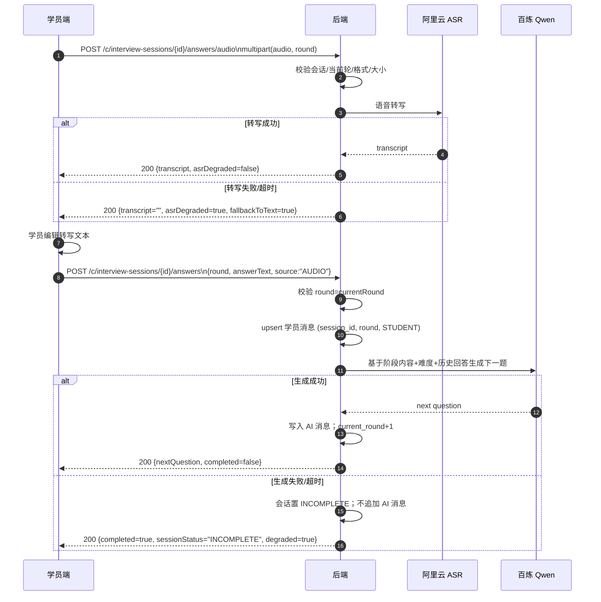
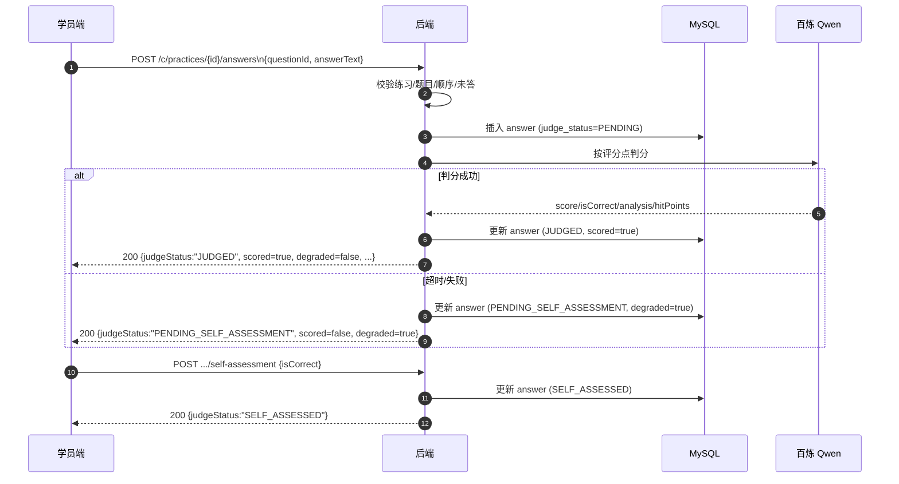
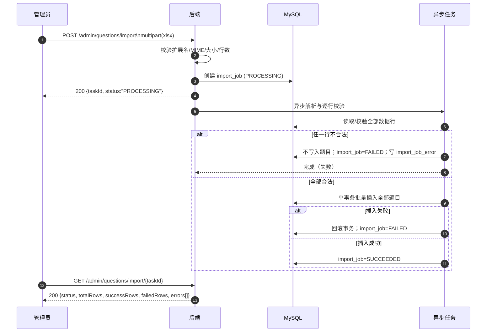
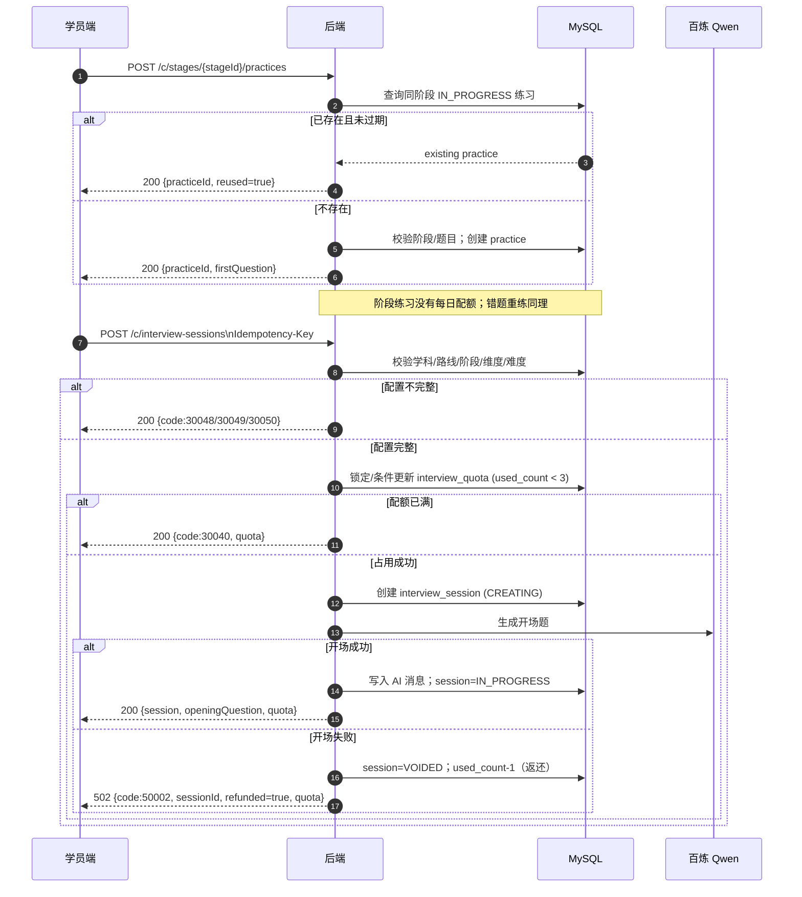
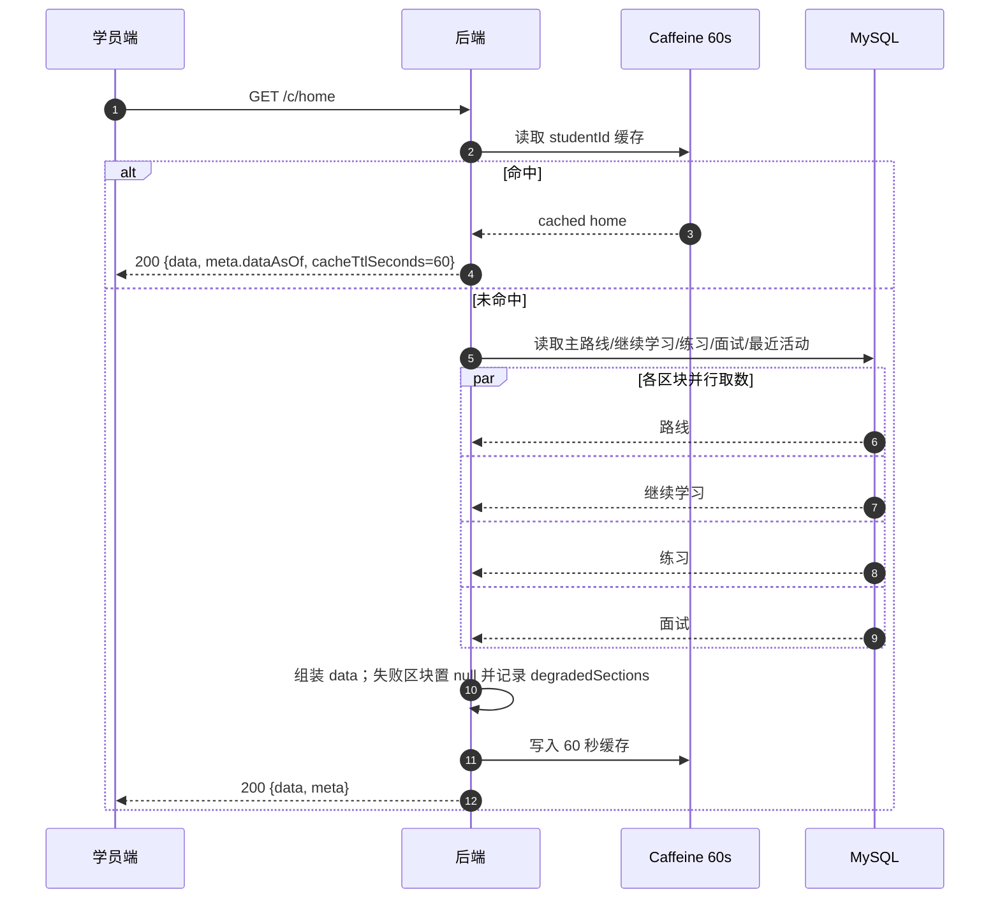
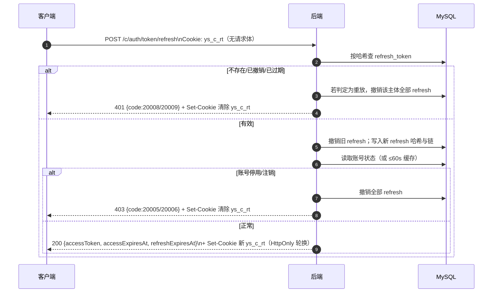

# 云枢智学 · API 接口设计

> 版本：v1.2（Refresh Token 交付方式定稿为 HttpOnly Cookie，JSON body 方案作废）
> 阶段：项目设计第 4 阶段
> 日期：2026-11-01
> 状态：接口契约定稿，认证链路进入工程实现
>
> 本文件只描述接口契约、全局约定、状态流转与前端联调所需的结构，不包含 Java 代码、Controller、DTO、SQL、DDL 或工程配置。

## 0. 摘要、依据与冲突

### 0.1 本阶段结论摘要

| 项目 | 结论 |
|---|---|
| 接口总数 | **111 个端侧接口**：C 端 42 个，B 端 69 个 |
| 公共支撑 | S-01～S-05 共 5 组能力，通过 C/B 已有接口承载，不重复计数；映射见第 5.3 节 |
| 基础路径 | C 端 `/api/v1/c/**`，B 端 `/api/v1/admin/**` |
| 业务失败响应 | 已确认 **HTTP 200 + 业务 code**；认证/授权/限流/协议错误保留 401、403、429、400、405、415、500、502 |
| 简答判分 | 已确认 **同步等待**；超时或 AI 失败返回降级标记，不返回业务错误码 |
| 面试推进 | 已确认 **提交回答即返回下一题或结束结果**；续答复用会话详情接口 |
| 上传 | 已确认 **服务端中转**；私有 OSS；数据库只存 object key |
| 状态变更 | 只能调用专用动作接口；通用 `PATCH`/`PUT` 不接受 `status` |
| 枚举 | 对外使用稳定字符串，不返回数据库数字枚举 |

### 0.2 设计依据与输入文件

| 文件 | 本文件采用的内容 |
|---|---|
| `CLAUDE.md` | 设计阶段边界、先确认再落地、冲突只记录不自行调和 |
| `docs/PRD.md` v1.0 | 第 5、6、9、10、11、13 章：功能、状态机、异常、非功能、默认值 |
| `docs/design/01.功能模块梳理.md` v1.0 | 9 个 C 端模块、11 个 B 端模块、5 项公共支撑能力 |
| `docs/design/02.技术选型与整体架构.md` v1.0 | Spring MVC、Security 6、springdoc-openapi、双 audience JWT、单机部署、P0 无 Redis |
| `docs/design/03.数据库设计.md` v1.0 | 32 张表、字段、状态、配额、快照、错题排除、索引 |
| `docs/rules/api-rules.md` v2.2 | 路径、方法、响应、错误码、分页、状态机、幂等、限流、评审清单 |
| `docs/rules/database-rules.md` v2.1 | 第 9 章项目特定约束：配额、注销、快照、错题排除 |
| `prototype/` | 页面字段、交互路径、按钮与空态反推 |

### 0.3 必须记录的输入冲突与缺口

以下问题在 v1.0 定稿时已按第五阶段评审结论处理：能回填的回填，需新增表/字段的保留为 **V5 前置**，不在本文件擅自加表。编号一律加文档前缀：本文件写 `04-Qnn`，03 写 `03-Qnn`，见 05 第 7 章。

| 编号 | 冲突/缺口 | 影响 | 本文件处理 |
|---|---|---|---|
| C-01 | 任务描述称 `02.技术选型与整体架构.md` 为 v1.0，仓库实际文件头曾为 **v0.2**；`api-rules.md`、`database-rules.md` 也引用 02 v1.0 | 版本追溯、评审基线 | **已关闭**：02 已升 v1.0，rules 同步 v2.1 |
| C-02 | 任务描述称 `student_activity` 是接口出参与校验规则的直接来源；`03.数据库设计.md` **没有 `student_activity` 表** | 首页、学员详情、看板的“最近活跃”出参 | 按 03 现有字段派生：`student.last_login_at`、`course_progress.started_at`、`practice.created_at`、`interview_session.created_at`；不虚构表 |
| C-03 | `03` 已用 Q32 表示“课程停用后的完成率分母”，本阶段 Q32 表示“面试对话推进方式” | 问题编号冲突 | **已关闭**：保留文档前缀 `03-Q32`/`04-Q32`；映射见 05 第 7 章 |
| C-04 | `03` 没有“练习题目快照表”（如 `practice_question`），`practice` 只有 `question_count` | 续答时“做到第几题、剩余哪些题、题目顺序”无法强一致 | **默认方案 A**：创建练习时锁定题目集合与顺序；`practice_question` 作为 V5 迁移前置，本轮不加表；见 04-Q35 |
| C-05 | `03` 没有幂等键持久化表或字段 | 创建面试/练习、批量导入的 `Idempotency-Key` 无法按 api-rules 9.2 保存 24 小时 | **默认方案 A**：新增通用 `idempotency_record`；作为 V5 迁移前置，本轮不加表；见 04-Q36 |
| C-06 | `03` 没有文件元数据表 | 孤儿文件无法按数据库引用精确清理 | 上传接口按“数据库只存 key”设计；P0 前缀巡检 + 人工确认；`file_asset` 延后 P1；见 04-Q47 |
| C-07 | api-rules 8.6 要求权限不足返回 403，不得用 404 掩盖；同时要避免通过状态码枚举他人资源 | C 端越权访问的返回策略 | 采用 **403 + 同一业务码** 处理“不存在/不属于当前学员”，状态码与响应体完全一致；见 4.4 与 11.3 |
| C-08 | TTS 是否 P0 尚未确认（api-rules Q31） | 是否增加语音合成接口 | **已关闭**：PRD v1.0 未要求 TTS，02 已降为 P1 可选；本文件 P0 不提供 TTS 接口；见 04-Q37 |
| C-09 | `03` 没有 `question.sort_no` 或练习题目顺序字段 | 练习题目顺序只能按主键或创建时间推导 | 本文件按 `question.id` 升序作为 P0 稳定顺序；记录为 Q35 的一部分 |

### 0.4 本阶段已确认的四项决策

> 以下编号均为 `04-Qnn`，与 03 的同号问题不是同一议题；完整映射见 05 第 7 章。

| 编号 | 问题 | 已确认结论 |
|---|---|---|
| Q22 | 业务失败响应约定 | **HTTP 200 + 业务 code**；认证、授权、限流、协议错误保留对应 HTTP 状态 |
| Q21 | 简答“评分中”通知方式 | **同步等待**；AI 超时/失败返回 `scored=false`、`degraded=true` 的降级结果，不新增轮询接口 |
| Q32 | 面试对话推进方式 | **提交回答即返回下一题或结束结果**；续答复用 `GET /c/interview-sessions/{id}` |
| Q34 | OSS 上传形态 | **服务端中转**；前端 multipart 上传到后端，后端校验后写私有存储，返回 `key/url/expireAt`。开发期用 MinIO `presignPut` 验证直传可行性；若改为前端直传，必须重新评审接口契约（见 06 §8） |

---

## 1. 设计依据与全局约定

### 1.1 基础路径与版本

| 端 | 基础路径 | 说明 |
|---|---|---|
| C 端 | `/api/v1/c` | 学员端 SPA；除注册、登录、验证码、刷新外均需 C audience access token |
| B 端 | `/api/v1/admin` | 管理端 SPA；除登录、刷新外均需 B audience access token + 模块权限 |
| 内部 | `/api/v1/internal` | 仅供服务内部/运维使用的受控接口；本阶段不对外暴露，不纳入 111 个端侧接口 |

版本策略：

1. 主版本放在路径 `/v1`；P0 不引入 Header 版本协商。
2. 向后兼容的新增字段、新增枚举值、新增可选查询参数不升版本。
3. 破坏性变更（删除字段、改变字段语义、改变状态机、改变错误码含义）必须新增 `/v2` 或经评审后统一升级。
4. 本文件所有路径均为相对基础路径的写法；第 5 章清单中的完整路径已包含 `/api/v1`。

### 1.2 内容类型与字符集

| 场景 | 约定 |
|---|---|
| JSON 请求 | `Content-Type: application/json; charset=utf-8` |
| JSON 响应 | `Content-Type: application/json; charset=utf-8` |
| 文件上传 | `Content-Type: multipart/form-data` |
| 文件下载 | `application/vnd.openxmlformats-officedocument.spreadsheetml.sheet` 等明确 MIME |
| 字符集 | 全链路 UTF-8；数据库 `utf8mb4` |
| 空值 | JSON 使用 `null`；不使用空字符串表示“无” |
| 未知字段 | 请求体默认拒绝未知字段（`additionalProperties: false`），避免前端误传 `status` 等敏感字段 |

### 1.3 时间、日期与配额日期

| 类型 | 格式 | 示例 | 说明 |
|---|---|---|---|
| 时间点 | RFC 3339，UTC，带 `Z`，毫秒可选 | `2026-10-31T06:30:00Z` | 所有 `xxxAt` 字段；服务端统一输出 UTC |
| 业务日期 | `YYYY-MM-DD` | `2026-10-31` | 仅用于按自然日聚合的字段，如 `quotaDate`、看板 `startDate/endDate` |
| 时长 | 整数秒 | `60` | 字段名以 `Seconds` 结尾，如 `retryAfterSeconds` |
| 百分比 | 数字，0–100，最多两位小数 | `66.67` | 字段名以 `Rate` 结尾；不使用字符串 `%` |

`quotaDate` 的语义：

1. 由服务端按 **Asia/Shanghai** 计算，前端不得自行计算或回传。
2. 面试每日 3 次的自然日边界为上海时间 00:00；接口同时返回 `resetsAt`（下一次重置的 UTC 时间点）。
3. 跨午夜续答的会话以创建时写入 `interview_session.quota_date` 的快照为准，不因跨日重新计数。
4. `quotaDate` 不是 UTC 日期，不能把 `2026-10-31T16:00:00Z` 直接截断成 `2026-10-31`。

### 1.4 traceId 与请求追踪

1. 服务端为每个请求生成 `traceId`；若请求头带 `X-Trace-Id`，则沿用（限 64 字符，仅允许字母、数字、`-`、`_`）。
2. 响应体统一返回 `traceId`，同时响应头返回 `X-Trace-Id`。
3. 日志、操作日志、错误响应使用同一个 `traceId`。
4. 前端报错时展示 `traceId` 的短码或复制完整值，便于服务端定位；不得把 token、验证码、手机号明文写入前端错误上报。

### 1.5 请求头约定

| Header | 必填 | 适用 | 说明 |
|---|---|---|---|
| `Authorization: Bearer <accessToken>` | 受保护接口必填 | C/B | C 与 B token 不可互用 |
| `Content-Type` | 有请求体时必填 | JSON/上传 | 见 1.2 |
| `Accept` | 否 | 全部 | 默认 `application/json` |
| `X-Trace-Id` | 否 | 全部 | 前端可传入；服务端生成并回传 |
| `Idempotency-Key` | 见接口 | 创建类 POST | 建议 UUID；同一学员/管理员 + 同一路径 + 同一 key 视为同一请求 |
| `X-Client-Version` | 否 | C/B | 前端版本，仅用于日志与兼容排查，不参与鉴权 |
| `If-None-Match` | 否 | 静态资源/下载 | P0 不使用 ETag 做业务缓存 |

禁止：

- 不得把 access token、refresh token、验证码、密码放在 URL 查询参数中。
- 不得在日志中打印 `Authorization`、密码、验证码、完整手机号、音频内容、完整作答文本。
- 不得用 `X-User-Id`、`X-Role` 等自定义头代替服务端鉴权。

### 1.6 标识、字段命名与返回约定

| 项 | 约定 |
|---|---|
| 资源 ID | 路径中使用服务端主键的字符串形式；P0 为自增 ID，前端不得假设连续或可枚举 |
| 字段命名 | JSON 使用 `lowerCamelCase`；数据库使用 `snake_case`，由后端映射 |
| 时间字段 | 以 `At` 结尾，如 `createdAt`、`expireAt`；业务日期以 `Date` 结尾，如 `quotaDate` |
| 布尔字段 | 以 `is`/`has`/`can` 开头或使用明确形容词，如 `isCorrect`、`hasPath`、`canStart` |
| 金额/分数 | 分数为数字；P0 没有支付金额 |
| 列表字段 | 统一复数命名，如 `items`、`questions`、`degradedSections` |
| 空列表 | 返回 `[]`，不返回 `null` |
| 空对象 | 返回 `{}` 或 `null` 需在具体接口注明；默认返回 `null` 表示“无此对象” |

### 1.7 枚举对外表达

1. 所有对外枚举使用 **稳定大写字符串**，不返回数据库数字。
2. 数据库数字到 API 字符串的映射由后端适配层完成；前端不得依赖数字。
3. 系统级稳定枚举（题型、练习类型、状态）由前端 i18n 常量维护中文文案；动态业务字典（学科、路线、阶段、维度、难度档位）必须从接口读取，不得硬编码中文。
4. 新增系统枚举值属于契约变更：后端先发兼容版本，前端未知值必须降级显示原始 code，不得崩溃；前端发版后再补中文文案。
5. 本文件使用的稳定枚举见第 3.4 节。

### 1.8 请求体、校验与安全边界

1. 请求体大小：普通 JSON ≤ 256 KB；批量排序 ≤ 500 条；图片 ≤ 2 MB；音频 ≤ 2 MB 且 ≤ 60 秒；导入文件 ≤ 5 MB。
2. 所有字符串入库前做 `trim`；密码、验证码、token 不做 `trim` 以外的规范化。
3. 所有路径参数、查询参数、请求体字段均做类型、长度、范围、枚举白名单校验。
4. 富文本不进入 P0；课程简介、题目解析按纯文本处理，前端渲染时转义。
5. 禁止客户端传入 `studentId` 作为“当前学员”；当前学员一律从 token 解析。
6. B 端不得通过请求体传入 `operatorId`；操作人一律从 token 解析。
7. 任何资源更新都必须校验归属或模块权限；不得只依赖前端隐藏按钮。

---

## 2. 统一响应载体

### 2.1 成功响应

所有成功响应统一为：

```json
{
  "code": 0,
  "message": "ok",
  "data": {},
  "traceId": "4f1c2a7e9b6d4c1e"
}
```

| 字段 | 类型 | 必填 | 说明 |
|---|---|---|---|
| `code` | integer | 是 | `0` 表示成功；非 0 见第 3 章 |
| `message` | string | 是 | 成功固定 `ok`；失败为可展示的简短中文 |
| `data` | object/array/null | 是 | 业务数据；无数据时保留 `null`，不得省略字段 |
| `traceId` | string | 是 | 请求追踪 ID；与响应头 `X-Trace-Id` 一致 |

约定：

- 创建成功统一返回 **HTTP 200**，不使用 201；`data` 中返回新资源 ID 或完整资源。
- 删除/停用类动作成功返回 `data: null` 或 `{ "status": "DISABLED" }`，按接口详述。
- 不返回 `timestamp`、`path` 等额外字段；需要时放在 `data` 内。

### 2.2 失败响应

业务失败（参数、状态、配额、配置、导入校验等）：

```json
{
  "code": 30040,
  "message": "今日面试次数已用完，请明天再试",
  "data": null,
  "traceId": "4f1c2a7e9b6d4c1e"
}
```

认证/授权/限流/协议/系统错误仍使用对应 HTTP 状态，但响应体结构相同：

```json
{
  "code": 20002,
  "message": "登录已过期，请重新登录",
  "data": null,
  "traceId": "4f1c2a7e9b6d4c1e"
}
```

HTTP 状态使用边界：

| 类别 | HTTP 状态 | 是否使用统一响应体 |
|---|---|---|
| 业务失败（含配额、状态、校验后的业务规则、导入行错误） | **200** | 是 |
| 资源归属失败 / 无权访问 | **403** | 是 |
| 未登录、token 无效/过期、audience 不匹配 | **401** | 是 |
| 限流、B 端登录锁定 | **429** | 是 |
| JSON 语法错误、字段类型错误 | **400** | 是 |
| 方法不支持 | **405** | 是 |
| Content-Type 不支持 | **415** | 是 |
| 请求体过大 | **413** | 是 |
| 外部依赖失败（短信、OSS、面试开场生成） | **502** | 是 |
| 未处理系统异常 | **500** | 是 |
| 服务不可用/维护 | **503** | 是 |

> 说明：Q22 的“200 + code”适用于**业务失败**；协议错误、鉴权错误、限流、系统/外部依赖错误保留 HTTP 语义，避免 Nginx、监控和前端拦截器把系统故障误判为业务成功。

### 2.3 分页包装

偏移分页（`page` + `size`）用于后台列表、题库、学员列表、C 端记录等需要总条数的场景：

```json
{
  "code": 0,
  "message": "ok",
  "data": {
    "items": [],
    "page": 1,
    "size": 20,
    "total": 137,
    "hasNext": true
  },
  "traceId": "4f1c2a7e9b6d4c1e"
}
```

| 字段 | 类型 | 说明 |
|---|---|---|
| `items` | array | 当前页数据 |
| `page` | integer | 从 1 开始 |
| `size` | integer | 默认 20，最大 100 |
| `total` | integer | 满足过滤条件的总条数；偏移分页必返回 |
| `hasNext` | boolean | `page * size < total` |

游标分页（`cursor` + `limit`）用于操作日志等追加型、深翻页列表：

```json
{
  "code": 0,
  "message": "ok",
  "data": {
    "items": [],
    "nextCursor": "eyJjcmVhdGVkQXQiOiIyMDI2LTEwLTMxVDA2OjMwOjAwWiIsImlkIjoxMjM0fQ",
    "hasMore": false
  },
  "traceId": "4f1c2a7e9b6d4c1e"
}
```

| 字段 | 类型 | 说明 |
|---|---|---|
| `items` | array | 当前批数据 |
| `nextCursor` | string/null | 下一页游标；`hasMore=false` 时为 `null` |
| `hasMore` | boolean | 是否还有下一页 |

游标是不透明字符串，前端不得解析；服务端内部由 `(createdAt, id)` 或 `(id)` 生成，并做签名/编码校验。

### 2.4 字段级校验错误

字段级校验失败仍使用业务失败 HTTP 200 + `code=10001`，`data.errors` 给出字段路径：

```json
{
  "code": 10001,
  "message": "请求参数校验失败",
  "data": {
    "errors": [
      {
        "field": "phone",
        "code": "PATTERN",
        "message": "手机号格式不正确"
      },
      {
        "field": "password",
        "code": "LENGTH",
        "message": "密码长度需为 8–32 位"
      }
    ]
  },
  "traceId": "4f1c2a7e9b6d4c1e"
}
```

约定：

- `field` 使用 JSON 路径，如 `items[2].sortNo`；嵌套对象用 `.`。
- `code` 是稳定机器码（`REQUIRED`、`PATTERN`、`LENGTH`、`RANGE`、`ENUM`、`FORMAT`），不是业务错误码。
- 一次最多返回 20 条字段错误；超出时截断并在 `data.truncated=true` 标记。
- 字段级错误不得把密码、验证码、token 的原值回显。

### 2.5 降级标记的承载位置

降级不是失败：HTTP 200、`code=0`，在业务对象内用布尔字段和状态字段表达。

| 场景 | 承载字段 | 说明 |
|---|---|---|
| 简答判分 AI 超时/失败 | `data.judge.scored=false`、`data.judge.degraded=true`、`data.judge.judgeStatus="PENDING_SELF_ASSESSMENT"` | 学员可自评；练习继续 |
| 语音转写失败 | `data.asrDegraded=true`、`data.transcript=""`、`data.fallbackToText=true` | 会话不消耗轮次；前端切文字输入 |
| 面试追问生成失败 | `data.completed=true`、`data.sessionStatus="INCOMPLETE"`、`data.degraded=true` | 生成不完整报告；不返回 5xx |
| 首页某区块取数失败 | `data.degradedSections[]` | 其他区块正常返回 |
| 后台看板某指标失败 | `data.degradedSections[]` | 其他指标正常返回 |
| TTS 失败（若未来启用） | `data.ttsDegraded=true` | P0 不启用 |

禁止：

- 不得用业务错误码表示“AI 判分降级”。
- 不得在降级时把 `scored` 置为 `true` 或伪造分数。
- 不得因单个区块降级而让整个聚合接口失败。

### 2.6 幂等重放响应

对同一幂等键的重复请求：

- 若首次已成功：返回首次成功的 `code/data`，并增加 `data.replayed=true`（仅创建类接口）。
- 若首次仍在处理：返回 `code=0`、`data.status="PROCESSING"` 或对应资源的当前状态，不启动第二次副作用。
- 若同一 key 携带不同请求体：返回 `code=10010`，不执行。
- 若首次失败且未产生副作用：允许同 key 重试；若已产生副作用，按首次结果返回。

> 幂等键持久化载体在 03 中缺失，见 Q36；在补表/字段前，实现不得声称满足 api-rules 9.2 的 24 小时持久化要求。

---

## 3. 错误码体系

### 3.1 分段规则

| 分段 | 用途 | HTTP 状态 |
|---|---|---|
| `0` | 成功 | 200 |
| `10000–19999` | 通用、协议、参数、分页、幂等、系统 | 200/400/405/413/415/500/503 |
| `20000–29999` | 认证、授权、账号状态、token | 401/403/429 |
| `30000–39999` | C 端业务 | 200/403/429 |
| `40000–49999` | B 端业务 | 200/403 |
| `50000–59999` | 外部依赖 | 502 |

规则：

1. 一个业务码只表达一种语义；不同失败不得复用同一码。
2. 同一语义在 C/B 两端可复用同一码，但必须保证含义一致；本项目 C/B 业务码分段隔离。
3. 业务码一经发布不得改变含义；废弃码保留，不复用。
4. `message` 可优化文案，前端不得依赖 `message` 做分支，必须依赖 `code`。
5. 字段级校验统一 `10001`，不把每个字段都定义成独立业务码。

### 3.2 通用与协议错误码

| code | HTTP | 含义 | 触发条件 | 前端处理 |
|---|---|---|---|---|
| `0` | 200 | 成功 | — | 正常取 `data` |
| `10001` | 200 | 参数校验失败 | 字段缺失、类型/长度/范围/枚举不合法 | 展示 `data.errors`，聚焦首个错误字段 |
| `10002` | 400 | 请求体格式错误 | JSON 语法错误、无法反序列化 | 提示“请求格式错误”，上报 traceId |
| `10003` | 405 | 请求方法不支持 | 路径存在但方法不允许 | 检查前端调用；不重试 |
| `10004` | 415 | Content-Type 不支持 | JSON 接口收到非 JSON、上传接口非 multipart | 修正请求头 |
| `10005` | 413 | 请求体过大 | JSON > 256 KB、上传超过接口上限 | 压缩/裁剪后重试 |
| `10006` | 200 | 排序字段不支持 | `sortBy` 不在白名单 | 使用接口文档列出的排序字段 |
| `10007` | 200 | 分页超出上限 | `page * size > 10000` 或 `page > 500` | 缩小筛选范围，改用游标接口（如日志） |
| `10008` | 200 | 日期范围非法 | `startDate > endDate`、跨度超过允许值 | 修正日期范围 |
| `10009` | 200 | 幂等键缺失或格式非法 | 必填 `Idempotency-Key` 缺失/超长/非法字符 | 生成 UUID 后重试 |
| `10010` | 200 | 幂等键冲突 | 同一 key 携带不同请求体 | 换新 key；检查是否重复提交了不同内容 |
| `10100` | 500 | 系统内部错误 | 未捕获异常 | 展示通用错误 + traceId；可重试一次 |
| `10101` | 503 | 服务暂不可用 | 维护、启动中、依赖未就绪 | 稍后重试；展示维护提示 |

### 3.3 认证、授权与账号状态

| code | HTTP | 含义 | 触发条件 | 前端处理 |
|---|---|---|---|---|
| `20001` | 401 | 未登录 | 缺少 `Authorization` | 跳登录；C/B 分别跳对应登录页 |
| `20002` | 401 | Access Token 已过期 | JWT `exp` 到期 | 用 refresh token 换新 access；失败则跳登录 |
| `20003` | 401 | Access Token 无效 | 签名错误、格式错误、已撤销 | 清理本地 token，跳登录 |
| `20004` | 403 | 无模块权限 | B 端角色无该模块权限 | 展示无权限；隐藏入口；不重试 |
| `20005` | 403 | 账号已停用 | 学员/管理员状态为停用 | 清理 token；提示联系管理员 |
| `20006` | 403 | 账号已注销 | 学员已注销 | 清理 token；跳登录 |
| `20007` | 401 | Token 端侧不匹配 | C token 调 B 接口，或反之；audience 不符 | 清理错误端 token；不得跨端复用 |
| `20008` | 401 | Refresh Token 无效/已撤销 | 哈希不匹配、已轮换、已登出 | 服务端随响应清 Cookie；前端清内存 access，跳登录 |
| `20009` | 401 | Refresh Token 已过期 | 超过 7 天（Q27 默认值） | 服务端随响应清 Cookie；前端跳登录 |
| `20010` | 403 | 必须先修改密码 | 后台重置密码后首次登录 | 跳“修改密码”流程 |
| `20011` | 429 | 后台登录失败次数过多，账号锁定 | 15 分钟内连续 5 次失败 | 展示 `data.unlockAt`；倒计时；不再自动重试 |

### 3.4 C 端业务错误码

| code | HTTP | 含义 | 触发条件 | 前端处理 |
|---|---|---|---|---|
| `30001` | 200 | 手机号已注册 | 注册时手机号已存在 | 提示直接登录/找回密码 |
| `30002` | 200 | 验证码错误或已过期 | 验证码不匹配、超过有效期、已使用 | 提示重新获取；保留手机号 |
| `30003` | 429 | 验证码发送过于频繁 | 60 秒内重复发送 | 按 `data.retryAfterSeconds` 倒计时 |
| `30004` | 429 | 单日验证码发送次数超限 | 同一手机号当日超过 10 次 | 展示次日再试；按 `resetsAt` |
| `30005` | 200 | 密码不符合要求 | 长度/字符组合不满足规则 | 展示字段提示 |
| `30006` | 200 | 手机号或密码错误 | 登录凭证不匹配 | 统一文案，不区分手机号是否存在 |
| `30007` | 200 | 密码错误次数过多，需验证码登录 | 连续失败达到阈值 | 切换验证码登录/找回密码 |
| `30008` | 200 | 原密码错误 | 修改密码时旧密码不匹配 | 提示重输旧密码 |
| `30009` | 200 | 新手机号已被占用 | 换绑目标手机号已注册 | 提示更换手机号 |
| `30010` | 200 | 新手机号与原手机号相同 | 换绑无变化 | 提示无需换绑 |
| `30011` | 200 | 注销确认验证码错误或过期 | 注销二次验证失败 | 重新获取验证码 |
| `30020` | 403 | 练习不存在或无权访问 | 练习 ID 不存在、不属于当前学员 | 返回练习列表；不展示“他人资源” |
| `30021` | 200 | 练习已结束 | 对已 `FINISHED` 的练习作答/提交 | 跳结果页；不重试 |
| `30022` | 200 | 练习已过期 | 超过 `expireAt`（7 天） | 提示重新开始；练习置作废 |
| `30023` | 200 | 练习不在进行中 | 状态不是 `IN_PROGRESS` | 刷新详情；按状态跳转 |
| `30024` | 200 | 题目不属于该练习 | `questionId` 不在练习题目集合 | 刷新题目列表；不提交 |
| `30025` | 200 | 该题已作答 | 已判分后再次提交不同答案 | 展示已有判分；不覆盖 |
| `30026` | 200 | 练习已作废 | 状态 `VOIDED` | 返回列表；提示重新开始 |
| `30027` | 200 | 阶段没有可用题目 | 创建练习时题目数为 0 | 返回阶段页；提示等待内容 |
| `30028` | 200 | 错题本为空 | 创建错题重练时无错题 | 返回错题本空态 |
| `30029` | 403 | 错题不存在或无权访问 | 题目 ID 不存在、不在当前学员错题本 | 刷新错题列表 |
| `30030` | 200 | 当前判分状态不允许自评 | 已判分或已自评 | 刷新详情 |
| `30031` | 200 | 课程/路线/阶段不可学习 | 已停用、不属于当前路线、内容不完整 | 返回上一级；刷新内容 |
| `30033` | 200 | 练习尚有未作答题目 | 未答完就提交 | 继续作答；`data.unansweredCount` 提示 |
| `30034` | 200 | 练习尚未结束，无最终结果 | 进行中读取结果页 | 返回练习详情；不展示结果 |
| `30040` | 200 | 今日面试次数已用完 | 当日已用 3 次；并发创建失败 | 展示 `quotaDate/resetsAt`；禁用开始按钮 |
| `30041` | 403 | 面试会话不存在或无权访问 | 会话 ID 不存在、不属于当前学员 | 返回面试记录；不展示“他人会话” |
| `30042` | 200 | 面试已过期 | 超过 `expireAt`（24 小时） | 展示过期；可重新开始（重新计次） |
| `30043` | 200 | 面试已作废 | 创建中开场生成失败/创建超时等 `VOIDED` | 展示原因；次数已返还；可重试 |
| `30044` | 200 | 面试不在进行中 | 状态不是 `IN_PROGRESS` | 刷新详情；按状态跳转 |
| `30045` | 200 | 面试已完成 | 已 `COMPLETED` 后继续作答 | 跳报告 |
| `30046` | 200 | 面试轮次非法 | `round` 不在 1–4、跳轮、小于当前轮 | 刷新详情；使用 `currentRound` |
| `30047` | 200 | 该轮已提交且下一题已生成 | 同一轮重复提交不同内容 | 展示已提交内容与下一题；不覆盖 |
| `30048` | 200 | 学科面试配置不完整 | 无维度、无难度、无路线/阶段/课程/题目 | 提示联系运营；禁用开始 |
| `30049` | 200 | 难度档位已停用 | 选择的难度 `status=0` | 刷新选项；选择可用难度 |
| `30050` | 200 | 学科无可用阶段 | 路线无启用阶段，或阶段无启用题目 | 提示等待内容；禁用开始 |
| `30051` | 200 | 报告尚未生成 | 会话刚结束，报告异步生成中 | 轮询/重试报告接口（P0 允许短轮询；见 Q21 说明） |
| `30052` | 200 | 该会话无报告 | 作废/无有效作答/报告不存在 | 返回记录页；展示空态 |
| `30053` | 200 | 当前状态不允许提前结束 | 已结束/已作废 | 刷新详情 |
| `30054` | 200 | 当前轮次尚未完成 | 提前结束时仍有未提交轮次 | 提示先提交或确认结束 |
| `30060` | 200 | 音频格式不支持 | 非 webm/ogg/mp4/m4a/wav 等白名单 | 重新录制；展示支持格式 |
| `30061` | 200 | 音频过大或时长超限 | > 2 MB 或 > 60 秒 | 缩短录音后重试 |
| `30062` | 200 | 音频为空 | 文件 0 字节/无音轨 | 重新录制 |
| `30070` | 200 | 图片格式不支持 | 非 jpeg/png/webp | 重新选择图片 |
| `30071` | 200 | 图片过大 | > 2 MB | 压缩后重试 |
| `30072` | 200 | 图片尺寸超限 | 超过 4096×4096 | 裁剪后重试 |
| `30073` | 200 | 上传文件为空 | 0 字节 | 重新选择文件 |

### 3.5 B 端业务错误码

| code | HTTP | 含义 | 触发条件 | 前端处理 |
|---|---|---|---|---|
| `40001` | 200 | 学科名称已存在 | 同学科名称重复 | 修改名称 |
| `40002` | 200 | 学科不存在 | 学科 ID 不存在 | 刷新列表 |
| `40003` | 200 | 该学科已存在学习路线 | 一个学科只允许一条路线 | 跳转已有路线编辑 |
| `40004` | 200 | 学习路线不存在 | 路线 ID 不存在 | 刷新列表 |
| `40005` | 200 | 阶段不存在 | 阶段 ID 不存在 | 刷新路线 |
| `40006` | 200 | 阶段排序不合法 | 排序项缺失、重复、跨路线 | 刷新后重排 |
| `40007` | 200 | 课程不存在 | 课程 ID 不存在 | 刷新列表 |
| `40008` | 200 | B 站链接不合法 | 非 http(s)、非 bilibili.com/b23.tv 白名单 | 修正链接 |
| `40009` | 200 | 课程所属阶段不合法 | 阶段不存在或不属于同学科 | 重新选择阶段 |
| `40010` | 200 | 题目不存在 | 题目 ID 不存在 | 刷新列表 |
| `40011` | 200 | 题目已产生作答，题型不可修改 | 已有 `answer` 引用后改题型 | 保留题型；新建题目 |
| `40012` | 200 | 选项配置不合法 | 选择题选项数/正确答案数不合法 | 按题型规则修正 |
| `40013` | 200 | 简答题评分点缺失 | 简答题未配置评分点 | 补充评分点 |
| `40014` | 200 | 同阶段存在重复题目 | 题干/内容重复 | 修改题干或使用已有题 |
| `40015` | 200 | 面试维度不存在 | 维度 ID 不存在 | 刷新维度列表 |
| `40016` | 200 | 维度名称已存在 | 同学科下维度重名 | 修改名称 |
| `40017` | 200 | 难度档位不存在 | 难度 ID 不存在 | 刷新难度列表 |
| `40018` | 200 | 难度编码或名称已存在 | 新建/编辑重复 | 修改编码/名称 |
| `40019` | 200 | 导入文件类型不支持 | 非 `.xlsx` | 下载模板并使用 xlsx |
| `40020` | 200 | 导入文件过大 | > 5 MB | 拆分文件 |
| `40021` | 200 | 导入任务不存在 | taskId 不存在/不属于当前管理员 | 刷新导入记录 |
| `40022` | 200 | 导入任务仍在处理中 | 查询时状态 `PROCESSING` | 2 秒后重试；最多 60 次 |
| `40023` | 200 | 导入文件为空或无数据行 | 只有表头/空文件 | 按模板填写 |
| `40024` | 200 | 导入行校验失败 | 任一行不合法；整批回滚 | 展示 `data.errors` 行号与原因；修正后重传 |
| `40025` | 200 | 学员不存在 | 学员 ID 不存在 | 刷新列表 |
| `40026` | 200 | 学员已注销 | 对已注销学员执行管理动作 | 只读查看；不可恢复 |
| `40027` | 200 | 不能停用当前登录账号 | 管理员停用自己 | 取消操作 |
| `40028` | 200 | 后台账号已存在 | 登录名重复 | 修改登录名 |
| `40029` | 200 | 后台账号不存在 | 管理员 ID 不存在 | 刷新列表 |
| `40030` | 200 | 角色不存在 | 角色 ID 不存在 | 刷新角色 |
| `40031` | 200 | 超级管理员权限不可修改 | 修改 `super_admin` 模块 | 取消操作 |
| `40032` | 200 | 模块编码不合法 | 不在预置模块白名单 | 刷新模块列表 |
| `40033` | 200 | 看板时间范围不支持 | 非 `TODAY/7D/30D` | 使用允许范围 |
| `40034` | 200 | 该资源已停用 | 重复停用 | 刷新状态 |
| `40035` | 200 | 该资源已启用 | 重复启用 | 刷新状态 |
| `40036` | 200 | 后台账号或密码错误 | 登录凭证不匹配 | 统一文案；累计失败次数 |

### 3.6 外部依赖错误码

| code | HTTP | 含义 | 触发条件 | 前端处理 |
|---|---|---|---|---|
| `50001` | 502 | 短信发送失败 | 阿里云短信返回失败/超时 | 提示稍后重试；默认不返还当日发送次数，见 04-Q43 / 03-Q40 |
| `50002` | 502 | 面试开场题生成失败 | LLM 超时/失败，且会话无法开始 | 展示“创建失败，次数已返还”；允许重试；`data` 带 `sessionId/refunded/quota` |
| `50004` | 502 | 文件上传失败 | OSS 写入失败 | 重新上传；不保存半成品 |
| `50006` | 502 | AI 返回内容无法解析 | 开场题返回结构不合法且重试后仍失败 | 同 `50002` |

说明：

- 简答判分、面试追问、ASR、TTS 的失败按 **降级** 处理，不使用 5xxxx；见 2.5。
- `50002` 只用于“会话尚未进入可作答状态”的开场失败；一旦学员已可作答，后续追问失败按 `INCOMPLETE` 降级，不返回 502。

### 3.7 PRD 第 10 章异常边界对照

| PRD 第 10 章场景 | 接口行为 | 错误码/标记 |
|---|---|---|
| 课程视频链接失效 | 后端不做外链可用性探测；详情返回原链接 | 无错误码；前端播放失败提示 |
| 简答判分超时 | 同步等待超时后返回降级结果 | 200 + `judge.scored=false/degraded=true` |
| 面试中途断网/关页 | 重进调用会话详情，返回当前轮与已答消息 | 200；不重新生成 |
| 今日面试次数用完 | 创建接口拒绝 | 200 + `30040` |
| 面试开场题生成失败 | 会话置 `VOIDED` 并返还次数 | 502 + `50002`，`data.refunded=true` |
| 面试创建超时/客户端未收到响应 | 重试创建；服务端按会话状态返回 | 若首次已创建：200 + 现有会话或 30040；见 Q36 |
| 并发点击开始面试 | 配额行锁/条件更新，只有一个成功 | 失败方 200 + `30040` |
| 学科无维度/难度/阶段 | 创建前校验 | `30048` / `30049` / `30050` |
| 学员无学习路线 | 首页/路线接口返回空态 | 200 + `hasPath=false`，不是错误 |
| 已被作答的题目被删除 | 题库只停用，不物理删除 | B 端 `POST /disable`；历史作答保留 |
| 已注销学员的历史记录 | 后台详情返回脱敏/只读 | 200；不返回手机号明文 |
| 批量导入行错误 | 整批回滚，返回行号与原因 | 200 + `40024` + `data.errors[]` |

### 3.8 API 对外枚举

| 枚举 | 对外值 | 说明 |
|---|---|---|
| 学员状态 | `ACTIVE` / `DISABLED` / `CANCELLED` | 数据库 1/2/3 由后端映射（1 正常 / 2 禁用 / 3 已注销） |
| 练习类型 | `STAGE` / `WRONG_RETRY` | 错题重练不计掌握度/完成度 |
| 练习状态 | `IN_PROGRESS` / `FINISHED` / `VOIDED` | 7 天过期由系统置 `VOIDED` |
| 题型 | `TRUE_FALSE` / `SINGLE_CHOICE` / `MULTIPLE_CHOICE` / `SHORT_ANSWER` | 稳定系统枚举 |
| 判分状态 | `PENDING` / `JUDGED` / `PENDING_SELF_ASSESSMENT` / `SELF_ASSESSED` | `PENDING` 仅在极短窗口出现 |
| 面试状态 | `CREATING` / `IN_PROGRESS` / `COMPLETED` / `INCOMPLETE` / `EXPIRED` / `VOIDED` | `CREATING` 仅服务端内部短暂状态，通常不对外返回 |
| 报告状态 | `NORMAL` / `INCOMPLETE` | 不完整报告需前端标注 |
| 难度 | 由接口返回 `code`，预置 `EASY` / `MEDIUM` / `HARD` | 全局难度；不从数字推断 |
| 导入状态 | `PROCESSING` / `SUCCEEDED` / `FAILED` | 失败为整批回滚 |
| 作答来源 | `TEXT` / `AUDIO` | 语音最终仍以文本提交 |
| 后台角色 | 由接口返回 `code`，预置 `SUPER_ADMIN` / `CONTENT_OPS` / `STUDENT_OPS` | 角色不可删除 |

---

## 4. 认证与授权

### 4.1 双端 token 模型

| 项 | C 端 | B 端 |
|---|---|---|
| 登录主体 | `student` | `admin_user` |
| audience | `c` | `admin` |
| 签名密钥 | 独立 C 密钥 | 独立 B 密钥 |
| Access Token | JWT，30 分钟 | JWT，30 分钟 |
| Refresh Token | 不透明随机串，7 天（Q27 默认值） | 同左，独立 B 链 |
| Refresh 交付 | `HttpOnly` Cookie `ys_c_rt`，`Path=/api/v1/c` | `HttpOnly` Cookie `ys_b_rt`，`Path=/api/v1/admin` |
| Refresh Cookie 属性 | `HttpOnly; SameSite=Lax; Max-Age=604800`；`Secure` 按 profile（dev 关、prod 开）；CSRF 说明见 02 §2.6 | 同左 |
| Refresh 存储 | `refresh_token` 表存哈希 | 同表，按 audience/主体隔离 |
| 权限来源 | 仅本人数据 | 角色 + `admin_role_module` 模块权限 |
| 跨端使用 | 拒绝 | 拒绝 |

> Access/Refresh 时长来自 api-rules 第 8 章默认值与 02 设计；Q27 尚未最终确认，本文件按 30 分钟/7 天设计，回填时以确认值为准。

### 4.2 获取、刷新、登出与失效

| 动作 | C 端 | B 端 | 说明 |
|---|---|---|---|
| 获取 | `POST /c/auth/login/password`、`/login/sms`、`/register` | `POST /admin/auth/login` | 响应体返回 accessToken、过期时间、主体摘要；refresh 经 `Set-Cookie` 下发（HttpOnly），不进响应体 |
| 刷新 | `POST /c/auth/token/refresh` | `POST /admin/auth/token/refresh` | **无请求体**，从对应 Cookie 读取 refresh；比对哈希后轮换并重发 Set-Cookie |
| 登出 | `POST /c/auth/logout` | `POST /admin/auth/logout` | **无请求体**，清除 Cookie（`Max-Age=0`）并撤销该条 refresh；access 自然过期 |
| 改密 | `PUT /c/students/me/password` | 后台重置密码 | 改密后撤销该主体全部 refresh token；access 依赖每请求状态校验/≤60 秒缓存 |
| 停用/注销 | B 端学员管理 | B 端账号管理 | 撤销全部 refresh token；后续请求 403/20005、20006 |
| 刷新轮换 | 每次刷新签发新 refresh，旧 refresh 立即撤销 | 同左 | 旧 refresh 重用视为泄露，撤销该主体全部 refresh |

> Refresh Token 一律以 HttpOnly Cookie 交付（2026-11-01 定稿，见 05 §6 #52）；早期"refresh 放 JSON body"的方案作废。`20008`/`20009` 语义不变，发生时由**服务端**随响应清除对应 Cookie，前端只清理内存 access，不操作 Cookie。

刷新响应（同时携带 `Set-Cookie: ys_c_rt=…; HttpOnly; SameSite=Lax; Path=/api/v1/c; Max-Age=604800`）：

```json
{
  "code": 0,
  "message": "ok",
  "data": {
    "accessToken": "eyJ...",
    "accessExpiresAt": "2026-10-31T07:00:00Z",
    "refreshExpiresAt": "2026-11-07T06:30:00Z"
  },
  "traceId": "4f1c2a7e9b6d4c1e"
}
```

### 4.3 401 与 403 的判定边界

| 判定 | HTTP | 典型 code | 处理 |
|---|---|---|---|
| 没有 token / token 格式错误 / 签名错误 / 过期 | 401 | `20001`–`20003` | 尝试刷新；失败跳登录 |
| token audience 不匹配（C 调 B 或 B 调 C） | 401 | `20007` | 清理错误端 token；禁止跨端 |
| refresh 无效/已撤销/过期 | 401 | `20008`/`20009` | 跳登录 |
| token 有效，但账号停用/注销 | 403 | `20005`/`20006` | 清理 token；展示原因 |
| token 有效，但 B 端角色无模块权限 | 403 | `20004` | 隐藏入口；展示无权限 |
| token 有效，但访问他人 C 端资源 | 403 | `30020`/`30029`/`30041` | 与“资源不存在”返回完全一致；见 4.4 |
| 其他业务状态不允许 | 200 | 3xxxx/4xxxx | 按业务码处理 |

### 4.4 越权访问与防枚举策略

C 端资源（练习、作答、错题、面试会话、报告、课程进度）必须做归属校验。策略：

1. **不存在**与**不属于当前学员**返回完全相同的 HTTP 状态、业务码和文案：
   - 练习：`403` + `30020`，`message="练习不存在或无权访问"`
   - 错题：`403` + `30029`
   - 面试：`403` + `30041`
   - 报告随会话，统一 `30041`
2. 不使用 404，避免通过 404/403 差异枚举他人资源 ID；也不使用“资源存在但无权”这种可区分文案。
3. 资源 ID 为自增时，枚举风险仍存在；接口层统一响应只能降低信息泄露，不能替代限流。P0 对高频 C 端资源查询做账号级软限流（见 9.5），但不在本阶段新增 Nginx 复杂规则。
4. B 端后台用户已通过模块权限校验，资源不存在使用业务码 `40002/40004/40007/40010/40025/40029`，HTTP 200；不与 C 端防枚举策略混用。
5. 管理端操作日志记录每次越权尝试的 `operatorId/studentId?/targetId/result=DENIED/traceId`，不记录敏感内容。

> 该策略与 api-rules 8.6 “权限不足返回 403、不用 404 掩盖”一致；但与“资源不存在通常返回 404”的常见 REST 习惯不同。已在 C-07 记录，等待评审确认。

### 4.5 每请求账号状态校验

1. 所有受保护接口在鉴权后校验账号状态；不得只信任 JWT 中的状态快照。
2. P0 使用数据库查询或 ≤60 秒本地 Caffeine 缓存；缓存键包含主体 ID + audience；停用/注销/改密后主动失效对应缓存。
3. B 端模块权限每次从角色/模块关系读取或短缓存；权限变更后 ≤60 秒生效。
4. 管理员重置学员密码后，学员现有 refresh token 全部撤销；access token 在过期前仍可能通过签名校验，但状态校验不拦截“改密”本身；涉及敏感操作（改密、注销、换绑）要求重新验证当前密码/验证码。

### 4.6 敏感操作

以下操作必须写 `operation_log`，并记录操作人、角色、模块、目标、结果、IP、traceId：

- 学员：注册、登录失败、改密、换绑手机号、注销。
- 后台：登录、重置密码、停用/启用、注销学员、修改当前路线、角色模块变更、内容启停、批量导入。
- 接口层不得提供修改/删除操作日志的入口。

---

## 5. 接口清单总表

### 5.1 C 端接口（9 组，42 个）

| # | 方法 | 完整路径 | 用途 | 权限 | 幂等性 | 对应 PRD |
|---:|---|---|---|---|---|---|
| **C-01 账号与认证（7）** | | | | | | |
| 1 | POST | `/api/v1/c/auth/sms-codes` | 发送短信验证码 | 公开 | 60 秒/10 次日限流 | PRD 第 5 章 注册登录 |
| 2 | POST | `/api/v1/c/auth/register` | 手机号注册 | 公开 | 手机号唯一；验证码一次性 | PRD 第 5 章 注册 |
| 3 | POST | `/api/v1/c/auth/login/password` | 密码登录 | 公开 | 无（失败计数） | PRD 第 5 章 登录 |
| 4 | POST | `/api/v1/c/auth/login/sms` | 验证码登录 | 公开 | 验证码一次性 | PRD 第 5 章 登录 |
| 5 | POST | `/api/v1/c/auth/password/reset` | 找回/重置密码 | 公开 | 验证码一次性 | PRD 第 5 章 找回密码 |
| 6 | POST | `/api/v1/c/auth/token/refresh` | 刷新 access token | 公开（凭 refresh） | refresh 轮换 | PRD 第 5 章 登录 |
| 7 | POST | `/api/v1/c/auth/logout` | 退出登录 | C 登录 | 撤销当前 refresh | PRD 第 5 章 退出 |
| **C-02 首页（1）** | | | | | | |
| 8 | GET | `/api/v1/c/home` | 首页聚合数据 | C 本人 | 只读；60 秒缓存 | PRD 第 5 章 首页 |
| **C-03 学习路线（3）** | | | | | | |
| 9 | GET | `/api/v1/c/learning-paths` | 路线列表与进度 | C 本人 | 只读 | PRD 第 5 章 学习路线 |
| 10 | GET | `/api/v1/c/learning-paths/{pathId}` | 路线详情、阶段、掌握度 | C 本人 | 只读 | PRD 第 5 章 学习路线 |
| 11 | PUT | `/api/v1/c/students/me/current-path` | 设置/切换主路线 | C 本人 | 天然幂等（同 pathId） | PRD 第 5 章 学习路线 |
| **C-04 课程与进度（3）** | | | | | | |
| 12 | GET | `/api/v1/c/stages/{stageId}` | 阶段详情、课程、阶段进度 | C 本人 | 只读 | PRD 第 5 章 课程学习 |
| 13 | POST | `/api/v1/c/courses/{courseId}/start` | 开始学习课程 | C 本人 | 唯一键去重；重复返回已有进度 | PRD 第 5 章 课程学习 |
| 14 | POST | `/api/v1/c/courses/{courseId}/complete` | 标记课程完成 | C 本人 | 重复完成返回首次结果 | PRD 第 5 章 课程学习 |
| **C-05 阶段练习（7）** | | | | | | |
| 15 | POST | `/api/v1/c/stages/{stageId}/practices` | 创建阶段练习 | C 本人 | 进行中练习复用；见 Q36 | PRD 第 5 章 阶段练习 |
| 16 | POST | `/api/v1/c/practices/wrong-questions` | 创建错题重练 | C 本人 | 进行中错题重练复用 | PRD 第 5 章 错题本、错题重练 |
| 17 | GET | `/api/v1/c/practices/{practiceId}` | 练习详情与断点续答 | C 本人 | 只读 | PRD 第 5 章 阶段练习 |
| 18 | POST | `/api/v1/c/practices/{practiceId}/answers` | 提交单题作答并判分 | C 本人 | `(practiceId,questionId)` 天然唯一 | PRD 第 5 章 阶段练习 |
| 19 | POST | `/api/v1/c/practices/{practiceId}/answers/{questionId}/self-assessment` | 简答降级后的学员自评 | C 本人 | 重复自评返回首次结果 | PRD 第 5 章 阶段练习 |
| 20 | POST | `/api/v1/c/practices/{practiceId}/submit` | 提交/结束练习 | C 本人 | 重复提交返回首次结果 | PRD 第 5 章 阶段练习 |
| 21 | GET | `/api/v1/c/practices/{practiceId}/result` | 练习结果 | C 本人 | 只读 | PRD 第 5 章 阶段练习 |
| **C-06 错题本（2）** | | | | | | |
| 22 | GET | `/api/v1/c/wrong-questions` | 错题列表 | C 本人 | 只读 | PRD 第 5 章 错题本 |
| 23 | GET | `/api/v1/c/wrong-questions/{questionId}` | 错题详情 | C 本人 | 只读 | PRD 第 5 章 错题本 |
| **C-07 AI 语音面试（9）** | | | | | | |
| 24 | GET | `/api/v1/c/interview-options` | 学科、难度、可用性 | C 本人 | 只读 | PRD 第 5 章 AI 面试 |
| 25 | GET | `/api/v1/c/interview-quota` | 今日面试余量 | C 本人 | 只读 | PRD 第 5 章 AI 面试 |
| 26 | POST | `/api/v1/c/interview-sessions` | 创建面试并返回开场题 | C 本人 | `Idempotency-Key` 必填；见 Q36 | PRD 第 5 章 AI 面试 |
| 27 | GET | `/api/v1/c/interview-sessions` | 面试历史列表 | C 本人 | 只读 | PRD 第 5 章 学习记录 |
| 28 | GET | `/api/v1/c/interview-sessions/{sessionId}` | 会话详情与续答 | C 本人 | 只读 | PRD 第 5 章 AI 面试 |
| 29 | POST | `/api/v1/c/interview-sessions/{sessionId}/answers` | 提交一轮文字回答 | C 本人 | `(sessionId,round)` 唯一 | PRD 第 5 章 AI 面试 |
| 30 | POST | `/api/v1/c/interview-sessions/{sessionId}/answers/audio` | 语音转写（不落盘） | C 本人 | 同一轮重复上传不追加消息 | PRD 第 5 章 AI 面试 |
| 31 | POST | `/api/v1/c/interview-sessions/{sessionId}/finish` | 提前结束面试 | C 本人 | 重复结束返回首次结果 | PRD 第 5 章 AI 面试 |
| 32 | GET | `/api/v1/c/interview-sessions/{sessionId}/report` | 面试报告 | C 本人 | 只读 | PRD 第 5 章 面试报告 |
| **C-08 学习与面试记录（4）** | | | | | | |
| 33 | GET | `/api/v1/c/records/courses` | 课程完成记录 | C 本人 | 只读 | PRD 第 5 章 学习记录 |
| 34 | GET | `/api/v1/c/records/practices` | 练习记录 | C 本人 | 只读 | PRD 第 5 章 学习记录 |
| 35 | GET | `/api/v1/c/records/mastery-trend` | 阶段掌握度趋势 | C 本人 | 只读 | PRD 第 5 章 学习记录 |
| 36 | GET | `/api/v1/c/interview-sessions/compare` | 两次面试对比 | C 本人 | 只读 | PRD 第 5 章 面试记录 |
| **C-09 个人中心（6）** | | | | | | |
| 37 | GET | `/api/v1/c/students/me` | 个人资料 | C 本人 | 只读 | PRD 第 5 章 个人中心 |
| 38 | PATCH | `/api/v1/c/students/me` | 修改昵称/头像 | C 本人 | 天然幂等 | PRD 第 5 章 个人中心 |
| 39 | PUT | `/api/v1/c/students/me/password` | 修改密码 | C 本人 | 改密后全端失效 | PRD 第 5 章 个人中心 |
| 40 | POST | `/api/v1/c/students/me/phone-change` | 换绑手机号 | C 本人 | 双验证码一次性 | PRD 第 5 章 个人中心 |
| 41 | POST | `/api/v1/c/students/me/cancel` | 注销账号 | C 本人 | 二次确认；重复注销返回首次结果 | PRD 第 5 章 个人中心 |
| 42 | POST | `/api/v1/c/uploads/images` | 上传头像等图片 | C 本人 | 每次上传生成新 key | PRD 第 5 章 个人中心、第 11 章 |

### 5.2 B 端接口（11 组 + 上传，69 个）

| # | 方法 | 完整路径 | 用途 | 权限模块 | 幂等性 | 对应 PRD |
|---:|---|---|---|---|---|---|
| **B-01 后台认证（4）** | | | | | | |
| 1 | POST | `/api/v1/admin/auth/login` | 后台登录 | 公开 | 5 次/15 分钟锁定 | PRD 第 6 章 后台登录 |
| 2 | POST | `/api/v1/admin/auth/token/refresh` | 刷新后台 token | 公开（凭 refresh） | refresh 轮换 | PRD 第 6 章 后台登录 |
| 3 | POST | `/api/v1/admin/auth/logout` | 后台退出 | B 登录 | 撤销当前 refresh | PRD 第 6 章 后台登录 |
| 4 | GET | `/api/v1/admin/auth/me` | 当前管理员、角色、模块 | B 登录 | 只读 | PRD 第 6 章 后台登录 |
| **B-02 学科管理（7）** | | | | | | |
| 5 | GET | `/api/v1/admin/subjects` | 学科列表 | `subject` | 只读 | PRD 第 6 章 学科管理 |
| 6 | POST | `/api/v1/admin/subjects` | 新增学科 | `subject` | 名称唯一 | PRD 第 6 章 学科管理 |
| 7 | GET | `/api/v1/admin/subjects/{id}` | 学科详情 | `subject` | 只读 | PRD 第 6 章 学科管理 |
| 8 | PATCH | `/api/v1/admin/subjects/{id}` | 编辑学科（不含状态） | `subject` | 天然幂等 | PRD 第 6 章 学科管理 |
| 9 | POST | `/api/v1/admin/subjects/{id}/enable` | 启用学科 | `subject` | 重复启用返回 40035 | PRD 第 6 章 学科管理 |
| 10 | POST | `/api/v1/admin/subjects/{id}/disable` | 停用学科 | `subject` | 重复停用返回 40034 | PRD 第 6 章 学科管理 |
| 11 | PUT | `/api/v1/admin/subjects/order` | 学科排序 | `subject` | 全量排序，幂等 | PRD 第 6 章 学科管理 |
| **B-03 课程管理（7）** | | | | | | |
| 12 | GET | `/api/v1/admin/courses` | 课程列表 | `course` | 只读 | PRD 第 6 章 课程管理 |
| 13 | POST | `/api/v1/admin/courses` | 新增课程 | `course` | 无唯一名称；建议幂等键 | PRD 第 6 章 课程管理 |
| 14 | GET | `/api/v1/admin/courses/{id}` | 课程详情 | `course` | 只读 | PRD 第 6 章 课程管理 |
| 15 | PATCH | `/api/v1/admin/courses/{id}` | 编辑课程（不含状态） | `course` | 天然幂等 | PRD 第 6 章 课程管理 |
| 16 | POST | `/api/v1/admin/courses/{id}/enable` | 启用课程 | `course` | 重复启用返回 40035 | PRD 第 6 章 课程管理 |
| 17 | POST | `/api/v1/admin/courses/{id}/disable` | 停用课程 | `course` | 重复停用返回 40034 | PRD 第 6 章 课程管理 |
| 18 | PUT | `/api/v1/admin/courses/order` | 课程排序 | `course` | 全量排序，幂等 | PRD 第 6 章 课程管理 |
| **B-04 题库与导入（9）** | | | | | | |
| 19 | GET | `/api/v1/admin/questions` | 题目列表 | `question` | 只读 | PRD 第 6 章 题库管理 |
| 20 | POST | `/api/v1/admin/questions` | 新增题目 | `question` | 内容重复校验 | PRD 第 6 章 题库管理 |
| 21 | GET | `/api/v1/admin/questions/{id}` | 题目详情（含选项/评分点） | `question` | 只读 | PRD 第 6 章 题库管理 |
| 22 | PATCH | `/api/v1/admin/questions/{id}` | 编辑题目（不含状态/题型） | `question` | 天然幂等 | PRD 第 6 章 题库管理 |
| 23 | POST | `/api/v1/admin/questions/{id}/enable` | 启用题目 | `question` | 重复启用返回 40035 | PRD 第 6 章 题库管理 |
| 24 | POST | `/api/v1/admin/questions/{id}/disable` | 停用题目 | `question` | 重复停用返回 40034 | PRD 第 6 章 题库管理 |
| 25 | GET | `/api/v1/admin/questions/import-template` | 下载导入模板 | `question` | 只读 | PRD 第 6 章 批量导入（P1） |
| 26 | POST | `/api/v1/admin/questions/import` | 上传并启动导入任务 | `question` | 异步；整批回滚 | PRD 第 6 章 批量导入（P1） |
| 27 | GET | `/api/v1/admin/questions/import/{taskId}` | 查询导入任务 | `question` | 只读 | PRD 第 6 章 批量导入（P1） |
| **B-05 面试设置（10）** | | | | | | |
| 28 | GET | `/api/v1/admin/interview-difficulties` | 难度档位列表 | `interview_settings` | 只读 | PRD 第 6 章 面试设置 |
| 29 | PATCH | `/api/v1/admin/interview-difficulties/{id}` | 编辑难度说明/重点 | `interview_settings` | 天然幂等 | PRD 第 6 章 面试设置 |
| 30 | POST | `/api/v1/admin/interview-difficulties/{id}/enable` | 启用难度 | `interview_settings` | 重复启用返回 40035 | PRD 第 6 章 面试设置 |
| 31 | POST | `/api/v1/admin/interview-difficulties/{id}/disable` | 停用难度 | `interview_settings` | 重复停用返回 40034 | PRD 第 6 章 面试设置 |
| 32 | GET | `/api/v1/admin/dimensions?subjectId=` | 学科维度列表 | `interview_settings` | 只读 | PRD 第 6 章 面试设置 |
| 33 | POST | `/api/v1/admin/dimensions` | 新增维度 | `interview_settings` | 学科内名称唯一 | PRD 第 6 章 面试设置 |
| 34 | PATCH | `/api/v1/admin/dimensions/{id}` | 编辑维度 | `interview_settings` | 天然幂等 | PRD 第 6 章 面试设置 |
| 35 | POST | `/api/v1/admin/dimensions/{id}/enable` | 启用维度 | `interview_settings` | 重复启用返回 40035 | PRD 第 6 章 面试设置 |
| 36 | POST | `/api/v1/admin/dimensions/{id}/disable` | 停用维度 | `interview_settings` | 重复停用返回 40034 | PRD 第 6 章 面试设置 |
| 37 | PUT | `/api/v1/admin/dimensions/order` | 学科维度排序 | `interview_settings` | 全量排序，幂等 | PRD 第 6 章 面试设置 |
| **B-06 学习路线与阶段（12）** | | | | | | |
| 38 | GET | `/api/v1/admin/learning-paths` | 路线列表 | `learning_path` | 只读 | PRD 第 6 章 学习路线 |
| 39 | POST | `/api/v1/admin/learning-paths` | 新增路线（学科 1:1） | `learning_path` | 学科唯一 | PRD 第 6 章 学习路线 |
| 40 | GET | `/api/v1/admin/learning-paths/{id}` | 路线详情（含阶段） | `learning_path` | 只读 | PRD 第 6 章 学习路线 |
| 41 | PATCH | `/api/v1/admin/learning-paths/{id}` | 编辑路线（不含状态） | `learning_path` | 天然幂等 | PRD 第 6 章 学习路线 |
| 42 | POST | `/api/v1/admin/learning-paths/{id}/enable` | 启用路线 | `learning_path` | 重复启用返回 40035 | PRD 第 6 章 学习路线 |
| 43 | POST | `/api/v1/admin/learning-paths/{id}/disable` | 停用路线 | `learning_path` | 重复停用返回 40034 | PRD 第 6 章 学习路线 |
| 44 | POST | `/api/v1/admin/learning-paths/{id}/stages` | 新增阶段 | `learning_path` | 路线内名称唯一 | PRD 第 6 章 学习路线 |
| 45 | PATCH | `/api/v1/admin/stages/{id}` | 编辑阶段 | `learning_path` | 天然幂等 | PRD 第 6 章 学习路线 |
| 46 | POST | `/api/v1/admin/stages/{id}/enable` | 启用阶段 | `learning_path` | 重复启用返回 40035 | PRD 第 6 章 学习路线 |
| 47 | POST | `/api/v1/admin/stages/{id}/disable` | 停用阶段（UI“删除”映射） | `learning_path` | 重复停用返回 40034 | PRD 第 6 章 学习路线 |
| 48 | PUT | `/api/v1/admin/learning-paths/{id}/stages/order` | 阶段排序 | `learning_path` | 全量排序，幂等 | PRD 第 6 章 学习路线 |
| 49 | GET | `/api/v1/admin/stages/{stageId}/contents` | 阶段已挂载课程/题目 | `learning_path` | 只读 | PRD 第 6 章 学习路线 |
| **B-07 学员管理（7）** | | | | | | |
| 50 | GET | `/api/v1/admin/students` | 学员列表 | `student` | 只读 | PRD 第 6 章 学员管理 |
| 51 | GET | `/api/v1/admin/students/{id}` | 学员详情与最近活跃 | `student` | 只读 | PRD 第 6 章 学员管理 |
| 52 | POST | `/api/v1/admin/students/{id}/reset-password` | 重置学员密码 | `student` | 生成一次性临时密码 | PRD 第 6 章 学员管理 |
| 53 | PUT | `/api/v1/admin/students/{id}/current-path` | 调整学员主路线 | `student` | 同 pathId 幂等 | PRD 第 6 章 学员管理 |
| 54 | POST | `/api/v1/admin/students/{id}/disable` | 停用学员 | `student` | 重复停用返回 40034 | PRD 第 6 章 学员管理 |
| 55 | POST | `/api/v1/admin/students/{id}/enable` | 启用学员 | `student` | 重复启用返回 40035 | PRD 第 6 章 学员管理 |
| 56 | POST | `/api/v1/admin/students/{id}/cancel` | 注销学员（二次确认） | `student` | 重复注销返回 40026 | PRD 第 6 章 学员管理 |
| **B-08 后台账号（7）** | | | | | | |
| 57 | GET | `/api/v1/admin/admin-users` | 后台账号列表 | `admin_user` | 只读 | PRD 第 6 章 账号管理 |
| 58 | POST | `/api/v1/admin/admin-users` | 新增后台账号 | `admin_user` | 登录名唯一 | PRD 第 6 章 账号管理 |
| 59 | GET | `/api/v1/admin/admin-users/{id}` | 账号详情 | `admin_user` | 只读 | PRD 第 6 章 账号管理 |
| 60 | PATCH | `/api/v1/admin/admin-users/{id}` | 编辑昵称/角色（不含状态/密码） | `admin_user` | 天然幂等 | PRD 第 6 章 账号管理 |
| 61 | POST | `/api/v1/admin/admin-users/{id}/disable` | 停用账号 | `admin_user` | 重复停用返回 40034；不能停自己 | PRD 第 6 章 账号管理 |
| 62 | POST | `/api/v1/admin/admin-users/{id}/enable` | 启用账号 | `admin_user` | 重复启用返回 40035 | PRD 第 6 章 账号管理 |
| 63 | POST | `/api/v1/admin/admin-users/{id}/reset-password` | 重置后台密码 | `admin_user` | 生成一次性临时密码 | PRD 第 6 章 账号管理 |
| **B-09 角色权限（3）** | | | | | | |
| 64 | GET | `/api/v1/admin/roles` | 角色列表 | `role` | 只读 | PRD 第 6 章 角色权限 |
| 65 | GET | `/api/v1/admin/roles/{id}` | 角色详情与模块 | `role` | 只读 | PRD 第 6 章 角色权限 |
| 66 | PUT | `/api/v1/admin/roles/{id}/modules` | 设置角色模块权限 | `role` | 全量覆盖，幂等 | PRD 第 6 章 角色权限 |
| **B-10 操作日志（1）** | | | | | | |
| 67 | GET | `/api/v1/admin/operation-logs` | 操作日志查询（只读） | `operation_log` | 只读；游标分页 | PRD 第 6 章 操作日志 |
| **B-11 数据看板（1）** | | | | | | |
| 68 | GET | `/api/v1/admin/dashboard` | 看板聚合指标 | `dashboard` | 只读；60 秒缓存 | PRD 第 6 章 数据看板 |
| **B-12 文件上传（1）** | | | | | | |
| 69 | POST | `/api/v1/admin/uploads/images` | 上传学科封面等图片 | 对应内容模块 | 每次生成新 key | PRD 第 6 章 学科/课程、第 11 章 |

### 5.3 公共支撑能力映射（5 组，不重复计数）

| 支撑组 | 能力 | 承载接口 | 说明 |
|---|---|---|---|
| **S-01 内容中心** | 学科、路线、阶段、课程、题目、面试维度的读写与状态管理 | C-03 `9–10`；C-04 `12`；B-02 `5–11`；B-03 `12–18`；B-04 `19–27`；B-06 `38–49` | 内容读取走 C 端，内容维护走 B 端；不新增独立“内容中心”路径 |
| **S-02 学习进度与统计** | 课程进度、阶段掌握度、练习统计、面试统计、看板 | C-02 `8`；C-04 `13–14`；C-08 `33–36`；B-07 `51`；B-11 `68` | 掌握度/完成度实时计算；看板 60 秒 Caffeine 缓存 |
| **S-03 AI 能力** | 简答判分、面试开场/追问、报告生成、ASR | C-05 `18–19`；C-07 `26–32` | 无独立 AI 代理接口；AI 调用在业务接口内完成；TTS 不在 P0 |
| **S-04 审计日志** | 操作日志写入与查询 | B-10 `67`；各写操作内部写入 | 只增不改；无删除/修改/导出接口 |
| **S-05 短信验证码** | 注册、登录、找回密码、换绑、注销验证码 | C-01 `1` | 60 秒/10 次日限流；数据库原子计数 |

### 5.4 覆盖检查

| 模块范围 | 模块数 | 是否覆盖 | 说明 |
|---|---:|---|---|
| C 端模块 | 9 | 是 | C-01～C-09 均有接口；C-06 的“错题重练”复用 C-05 的 `POST /practices/wrong-questions` |
| B 端模块 | 11 | 是 | B-01～B-11 均有接口；B-12 上传为跨模块支撑，不新增业务模块 |
| 公共支撑 | 5 | 是 | S-01～S-05 均映射到已有接口，无新增模块级能力 |
| PRD 未定义能力 | — | 未新增 | 未增加知识点、题目难度、面试主题、导出、删除日志、TTS 等未确认能力 |

---

## 6. 接口详述

### 6.0 阅读约定

1. 所有接口默认返回统一响应体；表中“成功 data”只写 `data` 内部结构。
2. 未标“必填”的字段为可选；所有字段均需做类型、长度、枚举校验。
3. “C 本人”表示从 C audience token 解析出的 `studentId`，请求体不得传 `studentId`。
4. “B 模块”表示除登录态外还需 `admin_role_module` 中对应 `module_code`；无权限统一 `403 + 20004`。
5. 失败码只列主要业务码；字段校验失败统一 `10001`，未登录统一 `20001`，不再逐行重复。
6. 所有列表默认 `page=1,size=20`，`size` 最大 100；游标接口单独说明。
7. 所有时间字段为 RFC 3339 UTC；`quotaDate` 为 Asia/Shanghai 业务日期。

### 6.1 C-01 账号与认证

#### 6.1.1 `POST /api/v1/c/auth/sms-codes`

| 项 | 内容 |
|---|---|
| 权限 | 公开 |
| 请求体 | `phone` string 必填，中国大陆手机号；`purpose` enum 必填：`REGISTER`/`LOGIN`/`RESET_PASSWORD`/`CHANGE_PHONE_OLD`/`CHANGE_PHONE_NEW`/`CANCEL` |
| 成功 data | `{ "sent": true, "expireSeconds": 300, "retryAfterSeconds": 60, "remainingToday": 9 }` |
| 失败 | `30003` 60 秒内重复；`30004` 当日超 10 次；`50001` 短信网关失败；`10001` 手机号格式错误 |
| 限流 | 同一手机号 60 秒 1 次、自然日 10 次；按 `sms_send_quota` 原子更新 |
| 安全 | 不返回验证码；日志不记录手机号明文与验证码 |

#### 6.1.2 `POST /api/v1/c/auth/register`

请求体：

| 字段 | 类型 | 必填 | 约束 |
|---|---|---|---|
| `phone` | string | 是 | 中国大陆手机号 |
| `code` | string | 是 | 6 位数字；`purpose=REGISTER` 且未使用 |
| `password` | string | 是 | 8–32 位，至少包含字母和数字 |
| `nickname` | string | 否 | 1–20 字符；缺省使用“学员+手机号后四位” |

成功 `data`：`accessToken`、`accessExpiresAt`、`refreshExpiresAt`、`student`（`id`、`nickname`、`phoneMasked`、`currentPathId`、`hasPassword`）；refresh 经 `Set-Cookie` 下发（见 §4.1/§4.2），不进响应体。

失败：`30001` 手机号已注册；`30002` 验证码错误/过期；`30005` 密码不合规。

#### 6.1.3 `POST /api/v1/c/auth/login/password`

请求体：`phone`、`password` 必填。

成功 `data`：同注册的 token + `student`。

失败：`30006` 手机号或密码错误（统一文案，不区分手机号是否存在）；`30007` 连续失败需验证码登录；`20005` 账号停用；`20006` 账号注销。

#### 6.1.4 `POST /api/v1/c/auth/login/sms`

请求体：`phone`、`code` 必填，`code` 的 `purpose=LOGIN`。

成功 `data`：同密码登录。失败：`30002`、`30006`、`20005`、`20006`。

#### 6.1.5 `POST /api/v1/c/auth/password/reset`

请求体：`phone`、`code`（`purpose=RESET_PASSWORD`）、`newPassword` 必填。

成功 `data: null`。失败：`30002`、`30005`、`20005`。重置成功后撤销该学员全部 refresh token。

#### 6.1.6 `POST /api/v1/c/auth/token/refresh`

请求体：无。从 Cookie `ys_c_rt`（`Path=/api/v1/c`）读取 refresh；比对哈希后轮换。

成功 `data`：新的 `accessToken`、`accessExpiresAt`、`refreshExpiresAt`；同时 `Set-Cookie` 重发新 refresh（HttpOnly）。

失败：`20007` audience 不匹配；`20008` 无效/已撤销；`20009` 已过期——失败时服务端随响应清除 `ys_c_rt`。旧 refresh 立即失效；检测到旧 token 重用则撤销该学员全部 refresh token。

#### 6.1.7 `POST /api/v1/c/auth/logout`

请求体：无。从 Cookie `ys_c_rt` 读取 refresh 并撤销，响应携带 `Set-Cookie: ys_c_rt=; Max-Age=0` 清除 Cookie。成功 `data: null`。重复登出返回成功（幂等）。Cookie 缺失或 `20008` 均视为已登出，返回成功。

### 6.2 C-02 首页

#### 6.2.1 `GET /api/v1/c/home`

无查询参数。权限：C 本人。

成功 `data`：

```json
{
  "hasPath": true,
  "currentPath": {
    "pathId": 11,
    "pathName": "Java 后端成长路线",
    "subjectName": "Java",
    "stageCount": 4,
    "completedStageCount": 1,
    "progressRate": 25.00,
    "masteryRate": 72.50
  },
  "continueLearning": {
    "stageId": 103,
    "stageName": "Spring 基础",
    "courseId": 501,
    "courseName": "Spring IoC 入门",
    "progressStatus": "IN_PROGRESS"
  },
  "practice": {
    "stageId": 103,
    "stageName": "Spring 基础",
    "canStart": true,
    "inProgressPracticeId": null,
    "lastFinishedAt": "2026-10-30T12:20:00Z"
  },
  "interview": {
    "quotaDate": "2026-10-31",
    "limit": 3,
    "used": 1,
    "remaining": 2,
    "canStart": true,
    "lastReportId": 9001
  },
  "recentActivities": [
    { "type": "PRACTICE_FINISHED", "title": "完成阶段练习", "occurredAt": "2026-10-30T12:20:00Z" }
  ],
  "notices": [],
  "meta": {
    "dataAsOf": "2026-10-31T06:30:00Z",
    "cacheTtlSeconds": 60,
    "degradedSections": []
  }
}
```

规则：

1. 无主路线时 `hasPath=false`，`currentPath/continueLearning/practice/interview` 为 `null`；不是错误。
2. 单个区块取数失败时仍返回 200，该区块置 `null`，并在 `meta.degradedSections` 增加 `{ "section": "interview", "code": 50002, "message": "..." }`。
3. 缓存 60 秒；`meta.dataAsOf` 为数据快照时间，前端展示“数据可能有延迟”时使用该字段。
4. 不返回手机号、token、完整作答文本。

### 6.3 C-03 学习路线

| 接口 | 请求 | 成功 data | 主要失败 | 说明 |
|---|---|---|---|---|
| `GET /api/v1/c/learning-paths` | 无 | `{items:[{pathId,pathName,subjectId,subjectName,stageCount,courseCount,questionCount,progressRate,masteryRate,isCurrent}], currentPathId}` | `20001` | 只返回启用学科下的启用路线；无路线返回空数组 |
| `GET /api/v1/c/learning-paths/{pathId}` | pathId | `{path:{...}, currentStageId, stages:[{stageId,stageName,sortNo,courseCount,completedCourseCount,questionCount,masteryRate,status}]}` | `30031` 路线不可用；`30020` 不存在/无权 | 只返回当前学员可见的启用路线 |
| `PUT /api/v1/c/students/me/current-path` | `{pathId}` | `{currentPathId,pathName,updatedAt}` | `30031`；`30020` | 幂等；切换路线不删除历史进度；不改变已完成课程/练习 |

`PUT current-path` 的 `pathId` 必须是启用路线且学科启用；否则 `30031`。响应中的 `pathName` 是快照展示值，不改变历史记录。

### 6.4 C-04 课程与进度

| 接口 | 请求 | 成功 data | 主要失败 | 说明 |
|---|---|---|---|---|
| `GET /api/v1/c/stages/{stageId}` | path 参数 | `{stage:{stageId,stageName,pathId,pathName,sortNo,status}, courses:[{courseId,title,coverUrl,durationSeconds,sortNo,progressStatus,startedAt,completedAt}], progress:{completedCourseCount,courseCount,progressRate,masteryRate}, practice:{canStart,questionCount}}` | `30031` 阶段不可访问；`30020` | `coverUrl` 为短时签名 URL；课程列表只返回启用课程，已开始但停用的课程仍可显示（`status=DISABLED`） |
| `POST /api/v1/c/courses/{courseId}/start` | 无 body | `{courseId,progressStatus:"IN_PROGRESS",startedAt}` | `30031` 课程不可学习；`20001` | 唯一键 `(student_id,course_id)` 去重；重复调用返回首次 `startedAt` |
| `POST /api/v1/c/courses/{courseId}/complete` | 无 body | `{courseId,progressStatus:"COMPLETED",startedAt,completedAt}` | `30031`；`20001` | 重复调用返回首次 `completedAt`；未 start 时补建进度并直接完成，避免前端丢状态 |

说明：

- 课程停用后，已开始学员仍可完成；未开始学员不可新开始。
- 完成度分母按 PRD/03 规则计算；停用课程是否计入分母属 03-Q32，待统一确认，本接口只返回计算后的 `progressRate`，不返回分母口径。

### 6.5 C-05 阶段练习

#### 6.5.1 `POST /api/v1/c/stages/{stageId}/practices`

无请求体。权限：C 本人。

成功 `data`：

```json
{
  "practiceId": 7001,
  "type": "STAGE",
  "status": "IN_PROGRESS",
  "questionCount": 10,
  "answeredCount": 0,
  "expireAt": "2026-11-07T06:30:00Z",
  "reused": false,
  "firstQuestion": {
    "questionId": 301,
    "type": "SINGLE_CHOICE",
    "content": "Spring IoC 的核心作用是？",
    "options": [
      { "optionId": 3011, "content": "依赖注入" },
      { "optionId": 3012, "content": "事务管理" }
    ]
  }
}
```

规则：

1. 阶段必须属于当前路线且启用，否则 `30031`；阶段无启用题目返回 `30027`。
2. 若该学员在同一阶段已有未过期 `IN_PROGRESS` 阶段练习，返回该练习并置 `reused=true`，不重复创建；此时 `firstQuestion` 为当前待答题（字段名保持不变，避免前端分支）。
3. 练习有效期 7 天；`expireAt` 由服务端计算。
4. 只返回第一题，不返回正确答案、解析、评分点。
5. 题目顺序 P0 按 `question.id` 升序；由于 03 无练习题目快照表，集合变化风险见 Q35。

#### 6.5.2 `POST /api/v1/c/practices/wrong-questions`

请求体（均可选）：

| 字段 | 类型 | 约束 |
|---|---|---|
| `subjectId` | integer | 仅取该学科错题 |
| `stageId` | integer | 仅取该阶段错题 |

成功 `data`：同阶段练习创建，`type="WRONG_RETRY"`；`firstQuestion` 同结构。

失败：`30028` 错题本为空；`30031` 筛选范围不可用。错题重练不计入阶段掌握度与课程完成度；结果页需标注“错题重练”。

#### 6.5.3 `GET /api/v1/c/practices/{practiceId}`

成功 `data`：

```json
{
  "practice": {
    "practiceId": 7001,
    "type": "STAGE",
    "status": "IN_PROGRESS",
    "stageId": 103,
    "stageName": "Spring 基础",
    "startedAt": "2026-10-31T06:00:00Z",
    "expireAt": "2026-11-07T06:00:00Z",
    "questionCount": 10,
    "answeredCount": 3,
    "remainingCount": 7,
    "currentIndex": 4
  },
  "currentQuestion": {
    "questionId": 304,
    "type": "SHORT_ANSWER",
    "content": "请说明 Bean 生命周期的主要阶段。",
    "options": []
  },
  "answered": [
    {
      "questionId": 301,
      "myAnswer": { "selectedOptionIds": [3011], "answerText": null },
      "judge": {
        "judgeStatus": "JUDGED",
        "scored": true,
        "degraded": false,
        "isCorrect": true,
        "score": 100,
        "correctOptionIds": [3011],
        "analysis": "……",
        "referenceAnswer": null,
        "hitPoints": []
      },
      "answeredAt": "2026-10-31T06:05:00Z"
    }
  ],
  "canSubmit": false
}
```

规则：

1. 只返回未答题的题干与选项；已答题返回判分、正确答案、解析。
2. `currentIndex` 从 1 开始；全部答完时 `currentQuestion=null`、`canSubmit=true`。
3. 状态 `FINISHED`/`VOIDED` 时不再返回 `currentQuestion`；前端按状态跳结果/列表。
4. 归属失败统一 `30020` + 403；不存在与不属于当前学员响应完全一致。
5. 断线恢复不生成新练习、不重新判分；已答内容原样返回。

#### 6.5.4 `POST /api/v1/c/practices/{practiceId}/answers`

请求体：

| 字段 | 类型 | 必填 | 约束 |
|---|---|---|---|
| `questionId` | integer | 是 | 必须等于当前未答题 |
| `selectedOptionIds` | integer[] | 条件 | 选择/判断题必填；单选只能 1 个；多选至少 1 个 |
| `answerText` | string | 条件 | 简答题必填；1–2000 字符 |
| `source` | string | 否 | `TEXT`（P0 默认）；语音最终也以 `TEXT` 提交 |
| `clientRequestId` | string | 否 | 前端请求 ID，仅用于日志关联，不作为幂等依据 |

成功 `data`：

```json
{
  "answer": {
    "questionId": 304,
    "judgeStatus": "JUDGED",
    "scored": true,
    "degraded": false,
    "isCorrect": false,
    "score": 60,
    "correctOptionIds": [],
    "analysis": "……",
    "referenceAnswer": "……",
    "hitPoints": [
      { "point": "Bean 实例化", "hit": true },
      { "point": "依赖注入", "hit": false }
    ],
    "answeredAt": "2026-10-31T06:10:00Z"
  },
  "progress": {
    "answeredCount": 4,
    "remainingCount": 6,
    "currentIndex": 5,
    "practiceStatus": "IN_PROGRESS"
  },
  "nextQuestion": {
    "questionId": 305,
    "type": "TRUE_FALSE",
    "content": "……",
    "options": []
  }
}
```

判分规则：

1. 选择/判断/多选：服务端确定性判分，`scored=true`、`degraded=false`。
2. 简答：同步调用 AI；成功返回 `score/isCorrect/analysis/referenceAnswer/hitPoints`。
3. 简答 AI 超时/失败：HTTP 200、`code=0`，返回 `judgeStatus="PENDING_SELF_ASSESSMENT"`、`scored=false`、`degraded=true`、`score=null`；不得返回 5xxxx。
4. 判分后写入 `answer`；`is_correct` 在降级时按 `NULL` 处理，学员自评后再写。
5. 重复提交：
   - `(practiceId, questionId)` 唯一；首次成功后，重复请求返回首次 `answer`，不重复判分，且 `replayed=true`。
   - 已判分后提交**不同内容**：返回 `30025`，不覆盖已有结果；响应可带 `existingAnswer`。
   - 并发重复：依赖数据库唯一键；失败方读取首次结果返回，不产生第二次 AI 调用。
6. 只能按顺序作答；`questionId` 不是当前题返回 `30024` 或 `30025`（已答则 30025）。
7. 练习不在 `IN_PROGRESS`：`30021/30022/30023/30026` 按状态返回。

#### 6.5.5 `POST /api/v1/c/practices/{practiceId}/answers/{questionId}/self-assessment`

请求体：`{ "isCorrect": true }` 必填 boolean。

成功 `data`：更新后的 `answer`（`judgeStatus="SELF_ASSESSED"`、`scored=false`、`degraded=true`、`isCorrect` 为学员自评值）。

失败：`30030` 当前状态不允许自评；`30020` 归属失败。重复自评返回首次结果，不重复写。

#### 6.5.6 `POST /api/v1/c/practices/{practiceId}/submit`

无请求体。

成功 `data`：

```json
{
  "practiceId": 7001,
  "status": "FINISHED",
  "questionCount": 10,
  "answeredCount": 10,
  "correctCount": 7,
  "correctRate": 70.00,
  "durationSeconds": 620,
  "masteryRate": 70.00,
  "masteryEligible": true,
  "finishedAt": "2026-10-31T06:20:00Z"
}
```

规则：

1. 只有 `IN_PROGRESS` 可提交；未答完返回 `30033`；已结束重复提交返回首次结果（幂等）。
2. `WRONG_RETRY` 的 `masteryEligible=false`，`masteryRate=null`，不更新阶段掌握度。
3. 提交后状态 `FINISHED`；结果页读取 `/result`。
4. 过期练习提交返回 `30022`；系统置 `VOIDED` 后返回 `30026`。

#### 6.5.7 `GET /api/v1/c/practices/{practiceId}/result`

成功 `data`：

```json
{
  "practiceId": 7001,
  "type": "STAGE",
  "status": "FINISHED",
  "stageId": 103,
  "stageName": "Spring 基础",
  "questionCount": 10,
  "answeredCount": 10,
  "correctCount": 7,
  "correctRate": 70.00,
  "masteryRate": 70.00,
  "durationSeconds": 620,
  "finishedAt": "2026-10-31T06:20:00Z",
  "wrongQuestions": [
    {
      "questionId": 304,
      "type": "SHORT_ANSWER",
      "content": "……",
      "myAnswer": { "selectedOptionIds": [], "answerText": "……" },
      "correctOptionIds": [],
      "referenceAnswer": "……",
      "analysis": "……",
      "score": 60,
      "degraded": false
    }
  ]
}
```

失败：`30034` 练习尚未结束；`30020` 归属失败；`30026` 已作废。

### 6.6 C-06 错题本

| 接口 | 请求 | 成功 data | 主要失败 | 说明 |
|---|---|---|---|---|
| `GET /api/v1/c/wrong-questions` | `page`、`size`、`subjectId?`、`stageId?` | `{items:[{questionId,type,contentPreview,subjectId,subjectName,stageId,stageName,lastWrongAt,addedAt}],page,size,total,hasNext}` | `20001` | 只返回 `status=IN_BOOK`；按 `last_added_at desc, question_id desc` 排序；不含完整解析 |
| `GET /api/v1/c/wrong-questions/{questionId}` | path 参数 | `{question:{questionId,type,content,options:[{optionId,content,isCorrect}]},myLastAnswer:{selectedOptionIds,answerText},correctOptionIds,referenceAnswer,analysis,scoringPoints,lastWrongAt,addedAt}` | `30029` 不存在/已移出/无权 | 只读；不提供手动移除接口；答对后由系统置 `REMOVED` |

规则：

1. 错题本只记录阶段练习中的错误；错题重练答对后自动移出，答错则刷新 `last_added_at`。
2. 错题重练入口复用 `POST /api/v1/c/practices/wrong-questions`。
3. 错题详情只在当前学员错题本内可访问；不存在与不属于当前学员统一 `403 + 30029`。

### 6.7 C-07 AI 语音面试

#### 6.7.1 `GET /api/v1/c/interview-options`

无查询参数。成功 `data`：

```json
{
  "items": [
    {
      "subjectId": 1,
      "subjectName": "Java",
      "pathId": 11,
      "pathName": "Java 后端成长路线",
      "stageId": 103,
      "stageName": "Spring 基础",
      "dimensionCount": 3,
      "difficulties": [
        { "difficultyId": 1, "code": "EASY", "name": "简单", "description": "基础概念", "focus": "基础概念、核心用法", "status": "ENABLED" },
        { "difficultyId": 2, "code": "MEDIUM", "name": "中等", "description": "场景与取舍", "focus": "原理理解、场景应用", "status": "ENABLED" },
        { "difficultyId": 3, "code": "HARD", "name": "困难", "description": "底层与边界", "focus": "底层机制、边界条件", "status": "ENABLED" }
      ],
      "canStart": true,
      "reasonCode": null,
      "reasonMessage": null,
      "remainingQuota": 2
    }
  ],
  "quotaDate": "2026-10-31",
  "serverTime": "2026-10-31T06:30:00Z"
}
```

规则：

1. 只返回当前学员主路线下启用学科；无路线时返回空数组。
2. `canStart=false` 时 `reasonCode` 为 `NO_PATH`/`NO_STAGE`/`NO_DIMENSION`/`NO_QUESTION`/`QUOTA_EXHAUSTED`，只用于前端引导；真正创建时返回对应业务码。
3. 难度档位来自 `interview_difficulty`，不硬编码中文；维度数量来自 `dimension`。
4. `remainingQuota` 是当前 `quotaDate` 的余量；与 `/interview-quota` 一致。

#### 6.7.2 `GET /api/v1/c/interview-quota`

成功 `data`：

```json
{
  "quotaDate": "2026-10-31",
  "limit": 3,
  "used": 1,
  "remaining": 2,
  "resetsAt": "2026-10-31T16:00:00Z",
  "serverTime": "2026-10-31T06:30:00Z"
}
```

规则：

1. `quotaDate` 由服务端按 Asia/Shanghai 计算；`resetsAt` 是上海次日 00:00 的 UTC 时间。
2. 只统计创建时已占用次数；作废返还后 `used/remaining` 立即反映。
3. 不进 Redis；直接读 `interview_quota`，必要时加短缓存但不得超过 5 秒。

#### 6.7.3 `POST /api/v1/c/interview-sessions`

请求头：`Idempotency-Key` **必填**（UUID）。请求体：

| 字段 | 类型 | 必填 | 约束 |
|---|---|---|---|
| `subjectId` | integer | 是 | 当前路线下启用学科 |
| `difficultyId` | integer | 是 | 启用难度档位 |

成功 `data`：

```json
{
  "session": {
    "sessionId": 8001,
    "subjectId": 1,
    "subjectName": "Java",
    "difficultyId": 2,
    "difficultyCode": "MEDIUM",
    "difficultyName": "中等",
    "stageId": 103,
    "stageName": "Spring 基础",
    "status": "IN_PROGRESS",
    "currentRound": 1,
    "quotaDate": "2026-10-31",
    "startedAt": "2026-10-31T06:31:00Z",
    "expireAt": "2026-11-01T06:31:00Z"
  },
  "openingQuestion": {
    "messageId": 8101,
    "round": 1,
    "role": "AI",
    "content": "请先介绍一下 Spring IoC 的理解。",
    "createdAt": "2026-10-31T06:31:00Z"
  },
  "quota": {
    "quotaDate": "2026-10-31",
    "limit": 3,
    "used": 2,
    "remaining": 1,
    "resetsAt": "2026-10-31T16:00:00Z"
  },
  "reused": false
}
```

创建与配额规则：

1. **先校验**配置：学科、路线、阶段、维度、题目；任一缺失返回 `30048/30049/30050`，不扣次数。
2. **原子占用**：对 `(student_id, quota_date)` 做条件更新/行锁；`used_count < 3` 才成功；并发点击只有一个成功，失败方 `30040`。
3. **创建成功即计数**；不等待开场题生成完成后再计。
4. **开场题生成失败**：会话置 `VOIDED`、返还次数；返回 HTTP 502 + `50002`，`data` 至少包含 `sessionId`、`refunded=true`、`quota`。前端提示“创建失败，次数已返还”。
5. **创建中 5 分钟 / 进行中 24 小时**：创建中 `expireAt` 为创建后 5 分钟；开场成功后改为“开始时间 + 24 小时”。响应返回的是最终 `expireAt`（进行中 24 小时）。续答不重新计数；进行中过期后新开会话重新计次；创建中超时作废并返还次数。
6. **幂等**：同一 `Idempotency-Key` 重复请求必须返回首次会话，不得二次扣减。当前 03 无幂等键持久化载体，**V3 补表前不得宣称满足 24 小时幂等**；P0 过渡方案为同一学员 + 学科 + 难度 + 60 秒内 `IN_PROGRESS` 会话复用（`reused=true`），仅降低双击风险，不替代持久化幂等。
7. `reused=true` 时不扣次数、不改变 `startedAt/expireAt`。

#### 6.7.4 `GET /api/v1/c/interview-sessions`

查询参数：`page`、`size`、`subjectId?`、`status?`、`startDate?`、`endDate?`。

成功 `data`：偏移分页；`items` 每项：

```json
{
  "sessionId": 8001,
  "subjectId": 1,
  "subjectName": "Java",
  "difficultyCode": "MEDIUM",
  "difficultyName": "中等",
  "stageName": "Spring 基础",
  "status": "COMPLETED",
  "currentRound": 4,
  "startedAt": "2026-10-31T06:31:00Z",
  "finishedAt": "2026-10-31T06:45:00Z",
  "totalScore": 82.50,
  "reportStatus": "NORMAL",
  "quotaDate": "2026-10-31"
}
```

规则：

1. 默认按 `started_at desc, id desc`；`VOIDED` 也返回，前端单独标注“已作废/次数已返还”。
2. `reportStatus` 在报告未生成时为 `null`；不返回报告正文。
3. 日期过滤按 `quota_date`（上海业务日），不是 UTC 时间截断。

#### 6.7.5 `GET /api/v1/c/interview-sessions/{sessionId}`

成功 `data`：

```json
{
  "session": {
    "sessionId": 8001,
    "subjectId": 1,
    "subjectName": "Java",
    "difficultyId": 2,
    "difficultyCode": "MEDIUM",
    "difficultyName": "中等",
    "stageId": 103,
    "stageName": "Spring 基础",
    "status": "IN_PROGRESS",
    "currentRound": 2,
    "quotaDate": "2026-10-31",
    "startedAt": "2026-10-31T06:31:00Z",
    "expireAt": "2026-11-01T06:31:00Z",
    "finishedAt": null,
    "voidReason": null
  },
  "messages": [
    { "messageId": 8101, "round": 1, "role": "AI", "content": "请先介绍一下 Spring IoC 的理解。", "createdAt": "2026-10-31T06:31:00Z" },
    { "messageId": 8102, "round": 1, "role": "STUDENT", "content": "IoC 是控制反转……", "createdAt": "2026-10-31T06:32:00Z" },
    { "messageId": 8103, "round": 2, "role": "AI", "content": "你提到依赖注入，能展开说说吗？", "createdAt": "2026-10-31T06:32:05Z" }
  ],
  "currentQuestion": {
    "messageId": 8103,
    "round": 2,
    "role": "AI",
    "content": "你提到依赖注入，能展开说说吗？",
    "createdAt": "2026-10-31T06:32:05Z"
  },
  "canAnswer": true,
  "canFinish": true,
  "reportAvailable": false
}
```

规则：

1. 断线重进以本接口恢复：返回全部消息、当前轮、当前问题；不生成新问题、不重复扣次。
2. `messages` 按 `round_no asc, role` 排序；`role` 仅 `AI`/`STUDENT`。
3. 语音只存最终文本，不返回音频、不返回音频 URL。
4. `status=EXPIRED/VOIDED/COMPLETED` 时 `canAnswer=false`；`VOIDED` 返回 `voidReason`。
5. `currentRound` 为**当前待答轮次**（1–4），与数据库 `current_round`（已完成作答轮次 0–4）的映射为：`IN_PROGRESS` 时 `currentRound = current_round + 1`；`COMPLETED` 后固定为 4。示例中创建成功返回 1，表示第 1 轮待答，数据库仍为 0。
6. 归属失败统一 `403 + 30041`，与不存在完全一致。

#### 6.7.6 `POST /api/v1/c/interview-sessions/{sessionId}/answers`

请求体：

| 字段 | 类型 | 必填 | 约束 |
|---|---|---|---|
| `round` | integer | 是 | 必须等于 `currentRound`，范围 1–4 |
| `answerText` | string | 是 | 1–2000 字符；语音转写后可编辑 |
| `source` | string | 否 | `TEXT`（默认）/`AUDIO`；P0 均以文本落库 |
| `clientRequestId` | string | 否 | 仅日志关联 |

成功 `data`：

```json
{
  "studentMessage": {
    "messageId": 8104,
    "round": 2,
    "role": "STUDENT",
    "content": "依赖注入是 IoC 的一种实现方式……",
    "createdAt": "2026-10-31T06:33:00Z"
  },
  "nextQuestion": {
    "messageId": 8105,
    "round": 3,
    "role": "AI",
    "content": "如果同一个接口有多个实现，Spring 如何选择？",
    "createdAt": "2026-10-31T06:33:03Z"
  },
  "completed": false,
  "sessionStatus": "IN_PROGRESS",
  "degraded": false,
  "reportAvailable": false,
  "progress": { "answeredRounds": 2, "currentRound": 3 }
}
```

规则：

1. 校验会话 `IN_PROGRESS`、未过期、`round=currentRound`；否则 `30042/30043/30044/30045/30046`。
2. 保存学员消息后调用 AI 生成下一题；成功返回 `nextQuestion`，`currentRound+1`。
3. 第 4 轮回答后：`nextQuestion=null`、`completed=true`、`sessionStatus="COMPLETED"`，随后生成报告。
4. 追问生成失败：不回滚已保存回答；`completed=true`、`sessionStatus="INCOMPLETE"`、`degraded=true`；报告按不完整状态生成。不得返回 5xx。
5. 重复提交：
   - 唯一键 `(session_id, round_no, role=STUDENT)`；同一轮重复请求不新增消息。
   - 与首次内容相同：返回首次的 `studentMessage`、已有 `nextQuestion`，`replayed=true`。
   - 内容不同且下一题已生成：返回 `30047`，不覆盖、不重新生成，避免对话分叉。
   - 内容不同且下一题尚未生成（首个请求仍在处理）：返回当前处理中状态或 `30047`；不得并行触发两次 AI。
6. 不接受 `studentId`、`sessionId`、`status`、`score` 等字段；未知字段 10001。
7. 语音路径也必须最终调用本接口落库；`source=AUDIO` 仅用于统计，不改变轮次推进。

#### 6.7.7 `POST /api/v1/c/interview-sessions/{sessionId}/answers/audio`

`Content-Type: multipart/form-data`。

| 字段 | 类型 | 必填 | 约束 |
|---|---|---|---|
| `audio` | file | 是 | `webm/ogg/mp4/m4a/wav`；≤ 2 MB；≤ 60 秒 |
| `round` | integer | 是 | 必须等于 `currentRound` |

成功 `data`：

```json
{
  "round": 2,
  "transcript": "依赖注入是 IoC 的一种实现方式……",
  "asrDegraded": false,
  "fallbackToText": false,
  "durationSeconds": 18.4
}
```

规则：

1. **只转写，不落库、不追加消息、不推进轮次**；前端将 `transcript` 放入可编辑文本框，用户确认后调用 `/answers`。
2. **音频不写磁盘、不写 OSS、不写数据库**；请求结束即释放。
3. ASR 超时/失败：HTTP 200、`code=0`、`transcript=""`、`asrDegraded=true`、`fallbackToText=true`；会话仍 `IN_PROGRESS`，不消耗轮次。
4. 同一轮重复上传：每次只返回新转写结果，不产生消息；最终以 `/answers` 的一次提交为准，因此不会追加。
5. 音频格式/大小/空文件：`30060/30061/30062`；不是降级。
6. 权限与会话状态校验同 `/answers`；`round` 不匹配返回 `30046`。

#### 6.7.8 `POST /api/v1/c/interview-sessions/{sessionId}/finish`

请求体：`{ "confirm": true }`。

成功 `data`：

```json
{
  "sessionId": 8001,
  "status": "INCOMPLETE",
  "finishedAt": "2026-10-31T06:40:00Z",
  "answeredRounds": 2,
  "reportAvailable": false
}
```

规则：

1. 仅在 `IN_PROGRESS` 可提前结束；已结束重复调用返回首次结果（幂等）。
2. 当前轮未回答且 `confirm=false`：`30054`；`confirm=true` 时结束为 `INCOMPLETE`。
3. 已答满 4 轮后状态应为 `COMPLETED`，`finish` 返回已有结果。
4. 报告可异步生成；`reportAvailable=false` 时前端调用报告接口会得到 `30051`，可短轮询（2 秒，最多 15 次），不引入 SSE。

#### 6.7.9 `GET /api/v1/c/interview-sessions/{sessionId}/report`

成功 `data`：

```json
{
  "sessionId": 8001,
  "status": "NORMAL",
  "totalScore": 82.50,
  "summary": "整体表达清晰，对 IoC 理解较好，但对多实现选择场景不够深入。",
  "suggestions": ["补充 Spring 自动装配的优先级", "练习用场景解释设计取舍"],
  "dimensions": [
    { "dimensionId": 1, "dimensionName": "基础概念", "score": 88.00 },
    { "dimensionId": 2, "dimensionName": "原理理解", "score": 80.00 },
    { "dimensionId": 3, "dimensionName": "场景应用", "score": 79.50 }
  ],
  "generatedAt": "2026-10-31T06:46:00Z"
}
```

失败：`30041` 归属失败；`30051` 报告尚未生成；`30052` 无报告/会话作废。`status=INCOMPLETE` 时 `totalScore` 为 `null` 或仅返回已答轮次评分，前端必须标注“报告不完整”。

### 6.8 C-08 学习与面试记录

| 接口 | 请求 | 成功 data | 主要失败 | 说明 |
|---|---|---|---|---|
| `GET /api/v1/c/records/courses` | `page`、`size`、`subjectId?`、`stageId?` | `{items:[{courseId,title,subjectName,stageName,startedAt,completedAt}],page,size,total,hasNext}` | `20001` | 只返回 `COMPLETED` 课程；按完成时间倒序 |
| `GET /api/v1/c/records/practices` | `page`、`size`、`type?`、`status?`、`subjectId?` | `{items:[{practiceId,type,status,stageName,questionCount,correctCount,correctRate,masteryRate,masteryEligible,startedAt,finishedAt}],page,size,total,hasNext}` | `20001` | 包含阶段练习和错题重练；错题重练 `masteryEligible=false` |
| `GET /api/v1/c/records/mastery-trend` | `stageId` 必填；`limit?` 默认 20，最大 50 | `{stageId,stageName,points:[{practiceId,finishedAt,correctRate,masteryRate}]}` | `30031`；`30020` | 只取 `STAGE` 且 `FINISHED` 的练习；按完成时间升序 |
| `GET /api/v1/c/interview-sessions/compare` | `baseSessionId`、`targetSessionId` 必填 | `{base:{sessionId,subjectName,finishedAt,totalScore},target:{...},dimensions:[{dimensionId,dimensionName,baseScore,targetScore,delta}],totalDelta}` | `30041`；`30052` | 仅允许同一学科、两份 `NORMAL` 报告；否则 `30052` |

说明：

- 掌握度趋势只用于阶段练习；错题重练不进入趋势。
- 面试历史列表复用 `GET /api/v1/c/interview-sessions`（C-07），不重复定义。
- 对比接口路径为静态段，必须优先于 `/{sessionId}` 匹配；Spring MVC 按具体路径优先级处理，前端按此路径调用。

### 6.9 C-09 个人中心

| 接口 | 请求 | 成功 data | 主要失败 | 说明 |
|---|---|---|---|---|
| `GET /api/v1/c/students/me` | 无 | `{studentId,nickname,phoneMasked,avatarUrl,status,currentPath:{pathId,pathName},hasPassword,createdAt}` | `20001` | 不返回完整手机号；`avatarUrl` 为短时签名 URL |
| `PATCH /api/v1/c/students/me` | `nickname?`、`avatarKey?` | 同上资料 | `10001`；`30070` | 只允许昵称/头像；禁止 `status`、`phone`、`password`；未知字段拒绝 |
| `PUT /api/v1/c/students/me/password` | `oldPassword`、`newPassword` | `null` | `30008`；`30005` | 成功后撤销全部 refresh token；要求重新登录 |
| `POST /api/v1/c/students/me/phone-change` | `oldCode`、`newPhone`、`newCode` | `{phoneMasked,changedAt}` | `30002`、`30009`、`30010`、`30011` | 原号/新号双重验证码；成功后撤销全部 refresh token，重新登录 |
| `POST /api/v1/c/students/me/cancel` | `code`、`confirmText`（必须为“注销”） | `null` | `30011`；`20006` | 二次确认；注销后手机号释放、历史记录保留但脱敏；不可恢复 |
| `POST /api/v1/c/uploads/images` | multipart `file`、`purpose=AVATAR` | `{key,url,expireAt}` | `30070–30073`；`50004` | 私有 OSS；只返回短时 URL；数据库存 `key` |

个人中心规则：

1. `PATCH` 不接受 `status`；学员不能自行停用/启用。
2. 头像更新流程：先上传拿 `key`，再 `PATCH` `avatarKey`；未绑定到资料的 `key` 属孤儿文件，按 Q47 处理。
3. 改密/换绑/注销会撤销 refresh token；access token 依赖每请求状态校验与短缓存，最迟 60 秒失效。
4. 注销后登录返回 `20006`；后台可见历史但手机号脱敏。

### 6.10 B 端接口详述

#### 6.10.1 B-01 后台认证

| 接口 | 请求 | 成功 data | 主要失败 | 说明 |
|---|---|---|---|---|
| `POST /api/v1/admin/auth/login` | `username`、`password` | `{accessToken,accessExpiresAt,refreshExpiresAt,admin:{adminId,username,displayName,roleId,roleCode,roleName},modules:["subject",...],mustChangePassword}`；refresh 经 `Set-Cookie`（`ys_b_rt`，`Path=/api/v1/admin`）下发 | `40036` 账号或密码错误；`20011` 锁定；`20005` 停用；`20010` 必须先改密 | 连续 5 次失败锁 15 分钟；登录成功写审计 |
| `POST /api/v1/admin/auth/token/refresh` | 无（从 Cookie `ys_b_rt` 读取） | 新 accessToken + 过期时间；重发 Set-Cookie | `20007/20008/20009`（失败时服务端清 Cookie） | 轮换；旧 refresh 立即失效 |
| `POST /api/v1/admin/auth/logout` | 无（从 Cookie `ys_b_rt` 读取） | `null`；`Set-Cookie: ys_b_rt=; Max-Age=0` | 幂等，`20008` 可视为已登出 | 撤销当前 refresh |
| `GET /api/v1/admin/auth/me` | 无 | `{admin,role,modules}` | `20001/20005` | 前端刷新页面时恢复菜单与权限 |

`modules` 只返回 `admin_role_module` 中的模块编码；`super_admin` 固定返回全部 10 个业务模块（不含上传这一支撑动作）。

#### 6.10.2 B-02 学科管理

| 接口 | 请求 | 成功 data | 主要失败 | 说明 |
|---|---|---|---|---|
| `GET /api/v1/admin/subjects` | `page`、`size`、`keyword?`、`status?` | 偏移分页；`items:[{id,name,description,coverUrl,sortNo,status,pathId,createdAt,updatedAt}]` | `20004` | 按 `sortNo asc,id asc`；`coverUrl` 为签名 URL |
| `POST /api/v1/admin/subjects` | `name` 必填 1–50；`description?` ≤500；`coverKey?`；`sortNo?` | `{id,name,status:"ENABLED",...}` | `40001`；`10001` | 写审计；名称唯一（未删除/停用也占用） |
| `GET /api/v1/admin/subjects/{id}` | path | 学科详情 + `pathId/pathName` | `40002` | 只读 |
| `PATCH /api/v1/admin/subjects/{id}` | `name?`、`description?`、`coverKey?`、`sortNo?` | 更新后详情 | `40002`、`40001` | **禁止 `status`**；未知字段 10001 |
| `POST /api/v1/admin/subjects/{id}/enable` | 无 | `{id,status:"ENABLED"}` | `40002`、`40035` | 重复启用 40035 |
| `POST /api/v1/admin/subjects/{id}/disable` | 无 | `{id,status:"DISABLED"}` | `40002`、`40034` | 停用不物理删除；C 端不再展示 |
| `PUT /api/v1/admin/subjects/order` | `{items:[{id,sortNo}]}` | `null` | `10001`、`40002` | 全量排序；ID 不得重复；必须覆盖全部启用学科 |

#### 6.10.3 B-03 课程管理

| 接口 | 请求 | 成功 data | 主要失败 | 说明 |
|---|---|---|---|---|
| `GET /api/v1/admin/courses` | `page`、`size`、`subjectId?`、`stageId?`、`status?`、`keyword?` | 偏移分页；`items:[{id,title,subjectId,subjectName,stageId,stageName,bilibiliUrl,coverUrl,durationSeconds,sortNo,status,createdAt,updatedAt}]` | `20004` | 按 `sortNo asc,id asc` |
| `POST /api/v1/admin/courses` | `title` 1–100、`subjectId`、`stageId`、`bilibiliUrl`、`coverKey?`、`description?` ≤1000、`durationSeconds?`、`sortNo?` | `{id,status:"ENABLED",...}` | `40007/40009/40008` | 阶段必须属于同学科；写审计 |
| `GET /api/v1/admin/courses/{id}` | path | 课程详情 | `40007` | 只读 |
| `PATCH /api/v1/admin/courses/{id}` | `title?`、`stageId?`、`bilibiliUrl?`、`coverKey?`、`description?`、`durationSeconds?`、`sortNo?` | 更新后详情 | `40007/40009/40008` | **禁止 `status`**；`stageId` 用于阶段挂载/移动，必须同学科 |
| `POST /api/v1/admin/courses/{id}/enable` | 无 | `{id,status:"ENABLED"}` | `40007/40035` | 重复启用 40035 |
| `POST /api/v1/admin/courses/{id}/disable` | 无 | `{id,status:"DISABLED"}` | `40007/40034` | 停用不删除；已开始学员仍可完成 |
| `PUT /api/v1/admin/courses/order` | `{items:[{id,sortNo}]}` | `null` | `10001/40007` | 建议按阶段分组排序；跨阶段排序由阶段过滤 |

B 站链接校验：仅允许 `https://`（可兼容 `http://` 仅本地调试）且 host 属于 `bilibili.com`、`www.bilibili.com`、`b23.tv`；不做短链跳转跟随。P0 不做外链可用性探测。

#### 6.10.4 B-04 题库与批量导入

| 接口 | 请求 | 成功 data | 主要失败 | 说明 |
|---|---|---|---|---|
| `GET /api/v1/admin/questions` | `page`、`size`、`subjectId?`、`stageId?`、`type?`、`status?`、`keyword?` | 偏移分页；`items:[{id,type,contentPreview,subjectId,subjectName,stageId,stageName,status,createdAt,updatedAt}]` | `20004` | 列表不返回完整选项/解析 |
| `POST /api/v1/admin/questions` | `type`、`subjectId`、`stageId`、`content`、`options[]`、`scoringPoints[]`、`analysis?` | `{id,status:"ENABLED",...}` | `40012/40013/40014` | 选项/评分点规则见 6.10.4.1 |
| `GET /api/v1/admin/questions/{id}` | path | 题目完整详情（选项、正确答案、评分点、解析） | `40010` | 只读 |
| `PATCH /api/v1/admin/questions/{id}` | `content?`、`options?`、`scoringPoints?`、`analysis?`、`stageId?` | 更新后详情 | `40010/40011/40012/40013/40014` | **禁止 `type/status`**；已有作答时题型不可改；`stageId` 用于阶段挂载 |
| `POST /api/v1/admin/questions/{id}/enable` | 无 | `{id,status:"ENABLED"}` | `40010/40035` | 重复启用 40035 |
| `POST /api/v1/admin/questions/{id}/disable` | 无 | `{id,status:"DISABLED"}` | `40010/40034` | 停用不物理删除；历史作答保留 |
| `GET /api/v1/admin/questions/import-template` | 无 | xlsx 文件流 | `20004` | `Content-Disposition: attachment`；模板含字段说明与示例行 |
| `POST /api/v1/admin/questions/import` | multipart `file`（xlsx，≤5 MB，≤1000 行） | `{taskId,status:"PROCESSING",createdAt}` | `40019/40020/40023` | 异步；整批回滚；文件类型/大小/行数校验 |
| `GET /api/v1/admin/questions/import/{taskId}` | path | `{taskId,status,totalRows,successRows,failedRows,errors:[{rowNo,column,message}],createdAt,finishedAt}` | `40021`；`40022` 仍在处理 | 轮询间隔 2 秒，最多 60 次；`FAILED` 时 `successRows=0` |

##### 6.10.4.1 题目配置规则

| 题型 | `options` | 正确答案 | `scoringPoints` |
|---|---|---|---|
| `TRUE_FALSE` | 固定 2 个选项（正确/错误） | 恰好 1 个 `isCorrect=true` | 可为空 |
| `SINGLE_CHOICE` | 2–8 个 | 恰好 1 个 | 可为空 |
| `MULTIPLE_CHOICE` | 2–8 个 | 至少 2 个 | 可为空 |
| `SHORT_ANSWER` | 空数组 | 无 | 至少 1 条；用于 AI 判分对照 |

- 选项 ID 由服务端生成；编辑时前端传 `optionId` 表示更新，传 `null` 表示新增；不得通过编辑删除已被作答引用的选项，只能停用题目。
- 简答题 `referenceAnswer` 可为空，但评分点不能为空，否则 `40013`。
- 题目内容重复校验按同阶段 + 规范化题干；命中返回 `40014`。
- 导入失败整批回滚：任一行失败，`import_job` 置 `FAILED`，不写入任何题目；错误行号从 Excel 数据行（含表头下一行）计数。

#### 6.10.5 B-05 面试设置

| 接口 | 请求 | 成功 data | 主要失败 | 说明 |
|---|---|---|---|---|
| `GET /api/v1/admin/interview-difficulties` | 无 | `{items:[{id,code,name,description,focus,sortNo,status}]}` | `20004` | 全局难度，固定 3 档；按 `sortNo` |
| `PATCH /api/v1/admin/interview-difficulties/{id}` | `name?`、`description?`、`focus?`、`sortNo?` | 更新后对象 | `40017/40018` | **禁止 `code/status`**；`code` 是稳定标识 |
| `POST /api/v1/admin/interview-difficulties/{id}/enable` | 无 | `{id,status:"ENABLED"}` | `40017/40035` | 启用后 C 端可重新选择；允许全部停用，全部停用时 C 端入口按 PRD 5.7 置灰 |
| `POST /api/v1/admin/interview-difficulties/{id}/disable` | 无 | `{id,status:"DISABLED"}` | `40017/40034` | 停用不删除；历史会话保留难度快照 |
| `GET /api/v1/admin/dimensions?subjectId=` | `subjectId` 必填 | `{items:[{id,subjectId,name,description,sortNo,status}]}` | `40002` | 按 `sortNo` |
| `POST /api/v1/admin/dimensions` | `subjectId`、`name` 1–50、`description?`、`sortNo?` | `{id,status:"ENABLED",...}` | `40002/40016` | 同学科名称唯一 |
| `PATCH /api/v1/admin/dimensions/{id}` | `name?`、`description?`、`sortNo?` | 更新后对象 | `40015/40016` | **禁止 `subjectId/status`**；维度不跨学科移动 |
| `POST /api/v1/admin/dimensions/{id}/enable` | 无 | `{id,status:"ENABLED"}` | `40015/40035` | — |
| `POST /api/v1/admin/dimensions/{id}/disable` | 无 | `{id,status:"DISABLED"}` | `40015/40034` | 停用后 C 端配置校验可能 `30048` |
| `PUT /api/v1/admin/dimensions/order` | `{subjectId,items:[{id,sortNo}]}` | `null` | `10001/40002/40015` | 全量排序；ID 必须属于该学科 |

#### 6.10.6 B-06 学习路线与阶段

| 接口 | 请求 | 成功 data | 主要失败 | 说明 |
|---|---|---|---|---|
| `GET /api/v1/admin/learning-paths` | `page?`、`size?`、`subjectId?`、`status?` | 偏移分页；`items:[{id,name,subjectId,subjectName,description,status,stageCount,createdAt,updatedAt}]` | `20004` | 学科 1:1；可按学科筛选 |
| `POST /api/v1/admin/learning-paths` | `subjectId`、`name` 1–50、`description?`、`sortNo?` | `{id,status:"ENABLED",...}` | `40003/40002` | 一个学科只允许一条路线 |
| `GET /api/v1/admin/learning-paths/{id}` | path | 路线详情 + `stages:[{id,name,description,sortNo,status,courseCount,questionCount}]` | `40004` | 只读 |
| `PATCH /api/v1/admin/learning-paths/{id}` | `name?`、`description?`、`sortNo?` | 更新后详情 | `40004` | **禁止 `subjectId/status`** |
| `POST /api/v1/admin/learning-paths/{id}/enable` | 无 | `{id,status:"ENABLED"}` | `40004/40035` | — |
| `POST /api/v1/admin/learning-paths/{id}/disable` | 无 | `{id,status:"DISABLED"}` | `40004/40034` | 停用不删除；C 端不可见 |
| `POST /api/v1/admin/learning-paths/{id}/stages` | `name` 1–50、`description?`、`sortNo?` | `{stageId,name,status:"ENABLED",...}` | `40004` | 路线内名称唯一；排序默认末尾 |
| `PATCH /api/v1/admin/stages/{id}` | `name?`、`description?`、`sortNo?` | 更新后阶段 | `40005` | **禁止 `status`** |
| `POST /api/v1/admin/stages/{id}/enable` | 无 | `{id,status:"ENABLED"}` | `40005/40035` | — |
| `POST /api/v1/admin/stages/{id}/disable` | 无 | `{id,status:"DISABLED"}` | `40005/40034` | UI“删除阶段”映射到此接口；不物理删除 |
| `PUT /api/v1/admin/learning-paths/{id}/stages/order` | `{items:[{id,sortNo}]}` | `null` | `10001/40004/40006` | 全量排序；ID 必须属于该路线 |
| `GET /api/v1/admin/stages/{stageId}/contents` | path | `{courses:[...],questions:[...]}` | `40005` | 已挂载内容；挂载通过 `PATCH /admin/courses/{id}` 或 `PATCH /admin/questions/{id}` 的 `stageId` 完成 |

规则：

1. 阶段停用后，C 端不再展示；历史练习/面试仍保留 `stage_name` 快照。
2. 课程/题目挂载不设独立“批量挂载”接口；单条 `PATCH stageId` 是显式操作，符合“不隐式批量”。
3. 路线停用不影响学员已有进度；新学员不可选该路线。
4. 删除语义统一为停用；PRD 的“删除阶段”与 03 的状态字段保持一致。

#### 6.10.7 B-07 学员管理

| 接口 | 请求 | 成功 data | 主要失败 | 说明 |
|---|---|---|---|---|
| `GET /api/v1/admin/students` | `page`、`size`、`phone?`（精确）、`nickname?`、`pathId?`、`status?`、`startDate?`、`endDate?` | 偏移分页；`items:[{id,nickname,phoneMasked,status,currentPathName,lastLoginAt,createdAt}]` | `20004` | 手机号走盲索引精确匹配，不支持模糊；分页上限见 9.1 |
| `GET /api/v1/admin/students/{id}` | path | `{student:{id,nickname,phoneMasked,status,currentPath,createdAt,lastLoginAt},progress:{completedCourses,courseCount,masteryRate,lastActiveAt},recentActivities:[...],interviewSummary:{total,completed,lastFinishedAt}}` | `40025` | 最近活跃由 `last_login_at`、`course_progress.started_at`、`practice.created_at`、`interview_session.created_at` 派生；03 无 `student_activity` 表 |
| `POST /api/v1/admin/students/{id}/reset-password` | 无 | `{temporaryPassword,mustChangePassword:true,resetAt}` | `40025/40026` | 一次性明文仅本次响应返回；写审计；撤销全部 refresh token |
| `PUT /api/v1/admin/students/{id}/current-path` | `{pathId}` | `{studentId,currentPathId,updatedAt}` | `40025/40026/40004` | 幂等；写审计；不删除历史进度 |
| `POST /api/v1/admin/students/{id}/disable` | 无 | `{id,status:"DISABLED"}` | `40025/40026/40034` | 撤销 refresh；写审计 |
| `POST /api/v1/admin/students/{id}/enable` | 无 | `{id,status:"ACTIVE"}` | `40025/40026/40035` | 已注销不可启用 |
| `POST /api/v1/admin/students/{id}/cancel` | `{confirmText:"注销",reason?}` | `{id,status:"CANCELLED",cancelledAt}` | `40025/40026` | 二次确认；撤销 refresh；手机号释放；历史保留脱敏；写审计 |

#### 6.10.8 B-08 后台账号

| 接口 | 请求 | 成功 data | 主要失败 | 说明 |
|---|---|---|---|---|
| `GET /api/v1/admin/admin-users` | `page`、`size`、`roleId?`、`status?`、`keyword?` | 偏移分页；`items:[{id,username,displayName,roleId,roleName,status,lastLoginAt,createdAt}]` | `20004` | 不返回密码哈希 |
| `POST /api/v1/admin/admin-users` | `username` 4–32、`displayName` 1–50、`password` 8–32、`roleId` | `{id,username,displayName,roleId,status:"ACTIVE",mustChangePassword:true}` | `40028/40030` | 登录名唯一；首次登录强制改密 |
| `GET /api/v1/admin/admin-users/{id}` | path | 账号详情 + 角色 | `40029` | 只读 |
| `PATCH /api/v1/admin/admin-users/{id}` | `displayName?`、`roleId?` | 更新后详情 | `40029/40030` | **禁止 `status/password/username`** |
| `POST /api/v1/admin/admin-users/{id}/disable` | 无 | `{id,status:"DISABLED"}` | `40029/40027/40034` | 不能停用自己；撤销 refresh |
| `POST /api/v1/admin/admin-users/{id}/enable` | 无 | `{id,status:"ACTIVE"}` | `40029/40035` | — |
| `POST /api/v1/admin/admin-users/{id}/reset-password` | 无 | `{temporaryPassword,mustChangePassword:true,resetAt}` | `40029` | 一次性明文；撤销 refresh；写审计 |

#### 6.10.9 B-09 角色权限

| 接口 | 请求 | 成功 data | 主要失败 | 说明 |
|---|---|---|---|---|
| `GET /api/v1/admin/roles` | 无 | `{items:[{id,code,name,description,moduleCount,builtIn:true}]}` | `20004` | 固定 3 个角色，不提供新增/删除 |
| `GET /api/v1/admin/roles/{id}` | path | `{id,code,name,description,modules:["subject",...]}` | `40030` | 只读 |
| `PUT /api/v1/admin/roles/{id}/modules` | `{moduleCodes:["subject",...]}` | `{id,moduleCodes}` | `40030/40031/40032` | 全量覆盖；`super_admin` 不可改；写审计；≤60 秒生效 |

模块白名单：`subject`、`course`、`question`、`interview_settings`、`learning_path`、`student`、`admin_user`、`role`、`operation_log`、`dashboard`、`notice`、`message`（`notice` 为 V3 公告模块，授权 super_admin / content_ops；`message` 为 V4 消息模块，授权 super_admin / student_ops）。上传不是独立模块，按调用方所属内容模块鉴权。

#### 6.10.10 B-10 操作日志

`GET /api/v1/admin/operation-logs`

| 参数 | 类型 | 必填 | 说明 |
|---|---|---|---|
| `cursor` | string | 否 | 上一页 `nextCursor`；不透明 |
| `limit` | integer | 否 | 默认 20，最大 100 |
| `operatorId?` | integer | 否 | 操作人 |
| `moduleCode?` | string | 否 | 模块白名单 |
| `action?` | string | 否 | 动作编码，如 `SUBJECT_DISABLE` |
| `targetType?` | string | 否 | `SUBJECT/COURSE/QUESTION/STUDENT/ADMIN_USER/ROLE/...` |
| `targetId?` | string | 否 | 目标 ID |
| `result?` | string | 否 | `SUCCESS/DENIED/FAILED` |
| `startAt?`/`endAt?` | RFC3339 | 否 | 时间范围；跨度 ≤ 90 天 |

成功 `data`：游标分页；`items:[{id,operatorId,operatorName,roleName,moduleCode,action,targetType,targetId,result,detail,ip,traceId,createdAt}]`；`nextCursor`、`hasMore`；**不返回 `total`**。

约束：

- 只读；不提供 `DELETE`/`PATCH`/导出接口。
- `detail` 不返回密码、验证码、token、完整手机号、音频、完整作答文本。
- 日志表只增不改；数据库层不提供业务更新/删除。

#### 6.10.11 B-11 数据看板

`GET /api/v1/admin/dashboard?range=TODAY|7D|30D`

成功 `data`：

```json
{
  "range": "7D",
  "startDate": "2026-10-25",
  "endDate": "2026-10-31",
  "sections": {
    "overview": { "studentTotal": 5000, "activeStudentCount": 1200, "newStudentCount": 80 },
    "learning": { "courseCompletionCount": 3200, "courseCompletionRate": 64.00, "stageMasteryRate": 71.20 },
    "practice": { "practiceCount": 2100, "practiceCompletionRate": 78.50, "averageCorrectRate": 69.30 },
    "interview": { "sessionCount": 360, "completionRate": 82.00, "averageScore": 76.40 },
    "content": { "subjectCount": 6, "courseCount": 120, "questionCount": 3000 },
    "users": { "adminUserCount": 8, "activeAdminCount": 5 }
  },
  "meta": {
    "dataAsOf": "2026-10-31T06:30:00Z",
    "cacheTtlSeconds": 60,
    "degradedSections": []
  }
}
```

规则：

1. `range` 只允许 `TODAY/7D/30D`，否则 `40033`；日期按 Asia/Shanghai 自然日。
2. 各区块独立取数；单区块失败时置 `null` 并写入 `meta.degradedSections`，不得整包失败。
3. 60 秒 Caffeine 缓存；`meta.dataAsOf` 表示快照时间。
4. 指标口径（活跃学员、完成率分母、面试完成率分母）以 03 第 7 章和 05 第 6 章 #33 的收口结论为准；本接口只承载结果，不在 API 层重新定义口径。
5. 看板只读；不提供导出（P0 不做）。

#### 6.10.12 B-12 图片上传

`POST /api/v1/admin/uploads/images`

multipart：

| 字段 | 类型 | 必填 | 约束 |
|---|---|---|---|
| `file` | file | 是 | jpeg/png/webp；≤2 MB；≤4096×4096 |
| `purpose` | string | 是 | `SUBJECT_COVER`/`COURSE_COVER` |

成功 `data`：`{key,url,expireAt}`。失败：`30070–30073`、`50004`。权限：调用方必须至少拥有 `subject` 或 `course` 模块；服务端按 `purpose` 二次校验。

#### 6.10.13 B-13 消息通知（模块 `message`；V4 新增）

稿件（`message`）与收件（`message_receive`）分离：已读/删除都是收件侧状态，撤回只改稿件状态。
受众 `audience`：`ALL` 全体学员（懒投递，发送只记人数快照，学员首次访问消息中心时补齐收件行，注册之前发的消息不推给新学员）/ `SPECIFIED` 指定学员（发送时直接落收件行，单次 ≤200 人，已注销学员会被剔除）。

| 方法 | 路径 | 说明 | 失败 |
|---|---|---|---|
| `GET` | `/api/v1/admin/messages` | 列表：`keyword`（标题）、`status`（`DRAFT`/`SENT`/`REVOKED`）、分页；含 `targetCount`/`readCount` | `10001`、`20004` |
| `POST` | `/api/v1/admin/messages` | 新建草稿：`title`(≤100)、`content`(≤2000)、`type`(SYSTEM/STUDY/ACTIVITY)、`audience`(ALL/SPECIFIED) | `10001/10002`、`20004` |
| `GET` | `/api/v1/admin/messages/{id}` | 详情 | `40039` |
| `PATCH` | `/api/v1/admin/messages/{id}` | 编辑（部分更新，仅草稿） | `10001`、`40039`、`40040`、`40041` |
| `POST` | `/api/v1/admin/messages/{id}/send` | 发送（仅草稿）；定向时 body 带 `studentIds` | `40039`、`40040`、`40041` |
| `POST` | `/api/v1/admin/messages/{id}/revoke` | 撤回（仅已发送，C 端立即不可见，收件行保留） | `40039`、`40040` |
| `DELETE` | `/api/v1/admin/messages/{id}` | 删除（仅草稿） | `40039`、`40040` |

状态机：`DRAFT → SENT → REVOKED`（终态）。已发送不可编辑、不可删除；已撤回不可重发、不可删除。
错误码：`40039` 消息不存在、`40040` 消息当前状态不允许该操作、`40041` 消息接收人不合法（空名单/不存在/已注销/超 200 人）。

#### 6.10.14 C-10 消息中心

| 方法 | 路径 | 说明 | 失败 |
|---|---|---|---|
| `GET` | `/api/v1/c/messages` | 消息列表；未读在前、发送时间倒序 | `10001` |
| `GET` | `/api/v1/c/messages/unread-count` | 未读数 `{unreadCount}` | — |
| `POST` | `/api/v1/c/messages/{messageId}/read` | 标记单条已读（幂等，`readAt` 不覆盖） | `40039` |
| `POST` | `/api/v1/c/messages/read-all` | 全部已读，返回 `{updated}` | — |
| `DELETE` | `/api/v1/c/messages/{messageId}` | 删除（收件侧软删，不影响他人） | `40039` |

成员语义由 access token 决定，路径中不含学员 ID，不存在越权读他人消息的可能；消息不存在统一返回 `40039`，不区分"没这条消息"与"这条消息不是发给你的"。

---

#### 6.10.15 B-13 孤儿文件巡检（04-Q47 P0 方案 A）

| 方法 | 路径 | 说明 | 失败 |
|---|---|---|---|
| `GET` | `/api/v1/admin/system/orphan-files` | 只读巡检，返回孤儿候选清单与分前缀统计 | `20004` |

成功 `data`：`{prefixes,items,truncated,scannedObjects,orphanCount,orphanBytes,scannedAt}`。
`prefixes` 为 `subject` / `course` / `avatar` 三个业务前缀各自的对象数、候选数、候选字节数；
`items` 最多 200 条明细（`{key,prefix,size,lastModified}`），超出只截断明细，统计值仍是全量。

约束：

1. **只读，绝不删除对象**。接口与定时任务都只报告，不提供任何删除入口。
2. 权限按 `operation_log` 模块在方法内判定（跨模块支撑接口，不用类上固定 `@RequireModule`）；
   该模块只有 super_admin 拥有，其余角色 `403 + 20004`。
3. 被引用 key 的来源固定为三列：`subject.cover_url`、`course.cover_url`、`student.avatar_url`。
   其余前缀（stage / question）不开放上传用途——没有列承接 key，开放即稳定产生孤儿。
4. 判定是**当前快照**语义：刚上传尚未保存的 key 也会出现在候选里，因此只能人工确认后处理。
5. 单个前缀列举失败时跳过该前缀并告警，不阻断其余前缀；定时任务每日 03:00 执行、
   只打日志摘要并自身捕获异常，不影响主营业务。
6. 单月候选超过 100 个是 P1-01 新增 `file_asset` 表的触发条件（05 §11）。

---

## 7. 状态流转接口

### 7.1 练习状态

状态：`IN_PROGRESS`（进行中）、`FINISHED`（已结束）、`VOIDED`（已作废/过期）。

| 动作 | 接口 | 允许的前置状态 | 结果状态 | 失败返回 |
|---|---|---|---|---|
| 创建阶段练习 | `POST /c/stages/{stageId}/practices` | 无练习 | `IN_PROGRESS` | `30027` 无题；`30031` 阶段不可用 |
| 创建错题重练 | `POST /c/practices/wrong-questions` | 无练习 | `IN_PROGRESS` | `30028` 错题本为空；`30031` 筛选不可用 |
| 提交单题作答 | `POST /c/practices/{id}/answers` | `IN_PROGRESS` 且该题未答 | 状态不变 | `30021/30022/30023/30024/30025/30026` |
| 简答自评 | `POST /c/practices/{id}/answers/{questionId}/self-assessment` | `PENDING_SELF_ASSESSMENT` | 状态不变；判分状态 `SELF_ASSESSED` | `30030` |
| 提交练习 | `POST /c/practices/{id}/submit` | `IN_PROGRESS` 且全部已答 | `FINISHED` | `30033` 未答完；`30022` 过期；`30026` 作废 |
| 读取结果 | `GET /c/practices/{id}/result` | `FINISHED` | 状态不变 | `30034` 未结束；`30026` 作废 |
| 系统过期 | 无公开接口（访问时判定/定时任务） | `IN_PROGRESS` 且 `now > expire_at` | `VOIDED` | 访问时 `30022` |

规则：

1. 作答不改变练习状态；只有 `submit` 结束练习。
2. `submit` 后不可再作答；重复 submit 返回首次结果，不改变状态。
3. 错题重练与阶段练习共用状态机，但 `type=WRONG_RETRY` 不写掌握度、不影响阶段完成度。
4. 不存在“撤回提交”“重新开始同一练习”接口；重新开始创建新练习。

### 7.2 面试状态

状态：`CREATING`（内部）、`IN_PROGRESS`、`COMPLETED`、`INCOMPLETE`、`EXPIRED`、`VOIDED`。

| 动作 | 接口 | 允许的前置状态 | 结果状态 | 失败返回 |
|---|---|---|---|---|
| 创建会话 | `POST /c/interview-sessions` | 无会话 | `CREATING` → `IN_PROGRESS` | `30040/30048/30049/30050`；开场失败 `50002` → `VOIDED` |
| 语音转写 | `POST /c/interview-sessions/{id}/answers/audio` | `IN_PROGRESS` 且 `round=currentRound` | 状态不变 | `30042/30043/30044/30045/30046/30060–30062`；ASR 失败为 200 降级 |
| 提交一轮回答 | `POST /c/interview-sessions/{id}/answers` | `IN_PROGRESS` 且 `round=currentRound` | 第 1–3 轮：`IN_PROGRESS`；第 4 轮：`COMPLETED`；AI 追问失败：`INCOMPLETE` | `30042–30047`；失败不重复扣次 |
| 提前结束 | `POST /c/interview-sessions/{id}/finish` | `IN_PROGRESS` | `INCOMPLETE`（或已满 4 轮时 `COMPLETED`） | `30053/30054` |
| 读取报告 | `GET /c/interview-sessions/{id}/report` | `COMPLETED`/`INCOMPLETE` | 状态不变 | `30051` 未生成；`30052` 无报告 |
| 系统过期 | 无公开接口 | `IN_PROGRESS` 且 `now > expire_at` | `EXPIRED` | 访问时 `30042` |
| 系统作废 | 无公开接口 | 创建中开场失败/创建超时 | `VOIDED` | `30043`；次数按规则返还。已进入 `IN_PROGRESS` 后的系统/AI 失败按 `INCOMPLETE`，不作废、不返还 |

规则：

1. `CREATING` 只用于服务端内部事务窗口，通常不对外返回；客户端看到 `IN_PROGRESS` 时开场题已存在。
2. `currentRound` 表示当前待答轮次，不因 `finish`/过期回退；数据库 `current_round` 表示已完成作答轮次，两者按 7.2 第 5 条映射。
3. 每轮回答最多 4 轮；第 4 轮回答成功即 `COMPLETED`，不需要再调用 `finish`。
4. `finish` 可提前结束；若当前轮未答且未确认，`30054`；确认后按 `INCOMPLETE` 生成报告。
5. `VOIDED`/`EXPIRED` 不允许作答；`COMPLETED` 后重复提交返回 `30045`。
6. 报告状态由报告生成结果决定：`NORMAL` 或 `INCOMPLETE`；报告未生成时 `reportAvailable=false`。

### 7.3 学员状态

| 动作 | 接口 | 前置 | 结果 | 失败 |
|---|---|---|---|---|
| 注册 | `POST /c/auth/register` | 无账号 | `ACTIVE` | `30001/30002/30005` |
| 停用 | `POST /admin/students/{id}/disable` | `ACTIVE` | `DISABLED` | `40025/40026/40034` |
| 启用 | `POST /admin/students/{id}/enable` | `DISABLED` | `ACTIVE` | `40025/40026/40035` |
| 注销 | `POST /c/students/me/cancel` 或 B 端注销 | `ACTIVE`/`DISABLED` | `CANCELLED` | `30011/40026` |

`CANCELLED` 为终态，不可恢复；`DISABLED` 可通过后台启用恢复。学员个人中心 `PATCH` 不接受 `status`。

### 7.4 内容与后台账号状态

| 资源 | 启用 | 停用 | 说明 |
|---|---|---|---|
| 学科 | `POST /admin/subjects/{id}/enable` | `POST /admin/subjects/{id}/disable` | 不物理删除 |
| 课程 | `POST /admin/courses/{id}/enable` | `POST /admin/courses/{id}/disable` | 已开始学员仍可完成 |
| 题目 | `POST /admin/questions/{id}/enable` | `POST /admin/questions/{id}/disable` | 历史作答保留 |
| 难度 | `POST /admin/interview-difficulties/{id}/enable` | `POST /admin/interview-difficulties/{id}/disable` | 全局；允许全部停用，C 端入口置灰 |
| 维度 | `POST /admin/dimensions/{id}/enable` | `POST /admin/dimensions/{id}/disable` | 停用可能导致 C 端配置不完整 |
| 路线 | `POST /admin/learning-paths/{id}/enable` | `POST /admin/learning-paths/{id}/disable` | 学科 1:1 |
| 阶段 | `POST /admin/stages/{id}/enable` | `POST /admin/stages/{id}/disable` | UI“删除”映射为停用 |
| 后台账号 | `POST /admin/admin-users/{id}/enable` | `POST /admin/admin-users/{id}/disable` | 不能停用自己 |
| 角色 | 预置启用 | 不提供停用/删除 | `super_admin` 权限不可改 |

### 7.5 禁止通过通用更新接口改状态

1. 所有 `PATCH`/`PUT` 的资源更新 schema 均设置 `additionalProperties: false`，且**不定义 `status` 字段**。
2. 前端传入 `status` 时返回 `10001`，字段错误 `field="status"`，不得静默忽略。
3. 禁止 `PATCH /c/practices/{id}`、`PATCH /c/interview-sessions/{id}` 这类通用状态更新；本文件未定义此类接口。
4. `PUT /c/students/me/current-path` 只改主路线，不改状态。
5. `PATCH /admin/questions/{id}` 不接受 `type`；题型变更需新建题目，已有作答时返回 `40011`。
6. 所有状态动作写 `operation_log`（B 端）或安全审计（C 端敏感动作）。

---

## 8. 关键时序图

### 8.1 学员语音面试一轮问答



要点：

- 音频接口只转写，不落库、不推进轮次；最终以文本回答接口落库。
- 同一轮重复上传不会追加消息；最终唯一消息由 `(session_id, round_no, role=STUDENT)` 约束。
- ASR 失败不消耗轮次，前端切文字输入。

### 8.2 简答判分与降级



要点：

- 简答判分同步等待；AI 调用在事务外，避免长事务；先保存 `PENDING`，再写判分结果。
- 超时/失败是降级，不是业务错误；不返回 5xxxx。
- 自评只允许一次；重复请求返回首次结果。

### 8.3 批量导入整批回滚



要点：

- 异步任务；上传接口只返回 `taskId`，不等待导入完成。
- 整批回滚：任一行失败或插入失败，题目表零写入；`successRows=0`。
- 错误行号 + 列 + 原因返回；重复上传同一文件按新任务处理，P0 不做文件级去重（Q44）。
- 导入中的进度由任务状态与行数表达；不提供百分比接口。

### 8.4 创建练习/面试与配额扣减



要点：

- 阶段练习无每日配额；重复创建用“进行中复用”降低双击影响。
- 面试每日 3 次是业务配额，不是 HTTP 限流：用完返回 200 + `30040`，不是 429。
- 配额在创建时原子占用；开场失败返还；续答/过期不重复扣减。
- `Idempotency-Key` 用于防双击/重试；持久化载体见 Q36。

### 8.5 首页聚合与局部降级



要点：

- 一个请求返回多区块；单区块失败不整包失败。
- `meta.degradedSections` 标记区块、错误码与文案；前端保留其他区块。
- `meta.dataAsOf` 与 `cacheTtlSeconds` 承载“数据可能有延迟”的说明。

### 8.6 刷新 token 轮换



要点：

- C/B 使用独立 audience、密钥与 refresh 链；跨端刷新返回 `20007`。
- refresh 只在 HttpOnly Cookie 中流转，前端 JS 不可读写；`20008/20009` 时由服务端清 Cookie。
- 旧 refresh 立即撤销；旧 token 重用视为泄露，撤销该主体全部 refresh。
- 刷新不延长 refresh 绝对过期时间（P0 固定 7 天）；如需滑动续期，Q42 确认。

---

## 9. 横切约定

### 9.1 分页策略

| 列表 | 分页方式 | 是否返回 `total` | 理由 |
|---|---|---|---|
| 后台学科/课程/题目/路线/学员/后台账号 | 偏移 `page/size` | 是 | 数据量可控，管理员需要总数与页码 |
| C 端错题本、练习记录、课程记录、面试历史 | 偏移 `page/size` | 是 | 单学员数据量有限，需要“共 N 条” |
| 后台操作日志 | 游标 `cursor/limit` | 否 | 追加型、深翻页、数据只增不改；避免 `OFFSET` 性能塌陷 |
| 首页/看板 | 不分页 | — | 聚合固定区块 |

偏移分页规则：

1. `page` 从 1 开始，默认 1；`size` 默认 20，最大 100。
2. `page * size > 10000` 或 `page > 500` 返回 `10007`；前端应缩小筛选条件。
3. 排序必须带稳定次级键 `id`，避免翻页重复/漏项。
4. 总数统计与列表查询在同一筛选条件下执行；不得用缓存总数替代。

游标分页规则：

1. 操作日志按 `(created_at desc, id desc)`；游标编码 `(createdAt,id)`，不透明。
2. 不返回 `total`；返回 `nextCursor`、`hasMore`。
3. 游标必须签名/校验，禁止客户端拼造；跨筛选条件复用游标返回 `10001`。
4. 日志时间范围最大 90 天；超过返回 `10008`。

### 9.2 排序与过滤

| 场景 | 默认排序 | 允许的 `sortBy` |
|---|---|---|
| 学科 | `sortNo asc, id asc` | `sortNo`、`createdAt` |
| 课程 | `sortNo asc, id asc` | `sortNo`、`createdAt` |
| 题目 | `id desc` | `createdAt`、`updatedAt` |
| 阶段 | `sortNo asc, id asc` | `sortNo` |
| 学员 | `createdAt desc, id desc` | `createdAt`、`lastLoginAt` |
| 操作日志 | `createdAt desc, id desc` | 固定，不支持自定义 |
| 练习/面试记录 | `startedAt desc, id desc` | `startedAt`、`finishedAt` |

过滤规则：

- 所有过滤字段必须在接口白名单内；未知参数返回 `10001` 或忽略？**统一返回 `10001`**，避免前端误传 `status` 等敏感字段。
- `keyword` 为包含匹配，最长 50 字符；`phone` 为盲索引精确匹配，不支持模糊。
- `status` 可作为查询过滤，但不得作为更新字段。
- 日期范围：`startDate/endDate` 按 Asia/Shanghai 自然日；`startAt/endAt` 按 RFC3339 UTC；不得混用。
- 空字符串视为未传；`null` 不作为过滤值。

### 9.3 字段裁剪

| 场景 | 列表 | 详情 |
|---|---|---|
| 题目 | 题干摘要、题型、学科/阶段、状态 | 完整题干、选项、正确答案、解析、评分点 |
| 练习 | 练习摘要、进度、分数 | 当前题（不含答案）、已答题判分 |
| 面试 | 会话摘要、报告分数 | 全部消息、当前题、报告维度 |
| 学员 | 昵称、脱敏手机号、状态、最近登录 | 路线、进度、最近活跃、面试摘要 |
| 操作日志 | 明细 `detail` 按需返回 | 单条查询同样脱敏 |

禁止：

- 未答题不返回 `isCorrect`、正确答案、解析、评分点。
- C 端不返回完整手机号；B 端列表也默认脱敏，详情按需脱敏。
- 不返回密码哈希、refresh token、验证码、音频内容。
- 不返回其他学员的昵称、手机号、作答内容。

### 9.4 限流与配额

| 场景 | 阈值 | 返回 | 说明 |
|---|---|---|---|
| 短信验证码 | 同手机号 60 秒 1 次；自然日 10 次 | `429 + 30003/30004` | `data.retryAfterSeconds`、`data.resetsAt`；`Retry-After` 头 |
| 后台登录 | 同账号 15 分钟 5 次失败 | `429 + 20011` | `data.unlockAt`；锁定期间不校验密码正确性 |
| AI 面试 | 每学员每自然日 3 次 | `200 + 30040` | 业务配额，不是 HTTP 限流；并发创建由配额行锁保证 |
| 普通查询 | P0 不新增业务硬限流 | — | 依赖 Nginx 连接/请求体限制与数据库索引；后续按监控补充 |
| 文件上传 | 图片 2 MB、音频 2 MB/60 秒、导入 5 MB | `30061/30071/40020` | 超过即业务失败，不进入外部服务 |

`429` 响应示例：

```json
{
  "code": 30003,
  "message": "验证码发送过于频繁，请稍后再试",
  "data": { "retryAfterSeconds": 42, "resetsAt": null },
  "traceId": "4f1c2a7e9b6d4c1e"
}
```

说明：

- “每日 3 次面试”是产品配额，使用业务码 30040；不要用 429，否则前端无法区分“请求太快”和“今日次数用完”。
- 短信日限是防滥用限流，使用 429；两者语义不同。
- 限流计数必须数据库原子更新（P0 无 Redis）；不得用内存计数代替跨实例一致性。

### 9.5 幂等键使用范围

| 接口 | 幂等载体 | 说明 |
|---|---|---|
| `POST /c/interview-sessions` | `Idempotency-Key` + 配额 | **必填**；同 key 返回首次会话；持久化缺口 Q36 |
| `POST /c/stages/{stageId}/practices` | 进行中练习复用 + 可选 `Idempotency-Key` | 阶段练习无每日配额；双击用复用兜底 |
| `POST /c/practices/wrong-questions` | 进行中错题重练复用 | 同筛选条件复用；不同筛选允许新建 |
| `POST /c/practices/{id}/answers` | `(practice_id, question_id)` 唯一 | 自然键；重复返回首次判分 |
| 自评 | `(answer_id)` 状态 | 重复返回首次自评 |
| `POST /c/practices/{id}/submit` | `practice.status` | 已结束返回首次结果 |
| `POST /c/interview-sessions/{id}/answers` | `(session_id, round_no, role=STUDENT)` | 重复不追加；见 6.7.6 |
| 音频上传 | 无持久化 | 只转写；不产生消息，因此无需幂等键 |
| `POST /c/interview-sessions/{id}/finish` | `session.status` | 已结束返回首次结果 |
| 课程 start/complete | `(student_id, course_id)` 唯一 | 重复返回首次时间 |
| 后台导入 | `Idempotency-Key` 可选 | 当前无持久化；Q36/Q44 |
| 后台创建类 | 名称/登录名等唯一约束 | 无唯一约束的课程创建建议前端生成 key；Q36 |

`Idempotency-Key` 规则：

1. 格式：UUID v4 或 8–64 位字母数字/`-`/`_`；非法返回 `10009`。
2. 作用域：主体（学员/管理员）+ HTTP 方法 + 路径 + key；不同接口不得共用。
3. 请求体哈希参与比对；同 key 不同 body 返回 `10010`。
4. 首次成功结果保存 ≥24 小时；重复返回首次 `data`，可带 `replayed=true`。
5. 当前 03 无幂等记录表/字段，24 小时持久化未落地；在 V3 补表前，实现只能使用自然键/复用，不能声称完全满足 api-rules 9.2。

### 9.6 缓存与数据新鲜度

| 数据 | 缓存 | TTL | 失效 |
|---|---|---|---|
| 首页聚合 | Caffeine，按 studentId | 60 秒 | 写操作不主动全清；短 TTL 自然过期 |
| 后台看板 | Caffeine，按 range | 60 秒 | 同上 |
| 面试配额 | 可选短缓存 | ≤5 秒 | 创建/返还后主动失效 |
| 账号状态/模块权限 | 可选本地缓存 | ≤60 秒 | 停用/改密/权限变更主动失效 |
| 题目/课程内容 | 不缓存或极短 | — | 以数据库为准；避免停用后仍可见 |

所有聚合响应必须带 `meta.dataAsOf` 与 `cacheTtlSeconds`；前端展示“数据可能有延迟”时使用 `dataAsOf`，不得用客户端当前时间冒充。

### 9.7 文件与静态资源

1. OSS Bucket 为**私有**；对象不公开读。
2. 数据库只存 object key，不存完整 URL；接口返回 `{key,url,expireAt}`，`url` 为短时签名 URL（建议 15 分钟）。
3. 图片上传：jpeg/png/webp，≤2 MB，≤4096×4096；服务端校验扩展名 + MIME + 文件头魔数，不只信 `Content-Type`。
4. 头像/封面用途通过 `purpose` 区分；服务端按用途与调用方模块校验，不允许上传任意类型。
5. 音频不落盘、不写 OSS、不写数据库；ASR 完成即释放。
6. 孤儿文件：上传后未绑定资料的 key 目前无文件元数据表，无法精确清理；Q47 确认前只做定期 OSS 前缀巡检，不自动删除可能被引用的对象。
7. B 站视频不代理、不转存；只存链接并做域名白名单校验。
8. 存储实现经 `ObjectStorage` 端口隔离：开发 `S3StorageAdapter`（MinIO），生产 `OssStorageAdapter`（阿里云 OSS），接口契约不变。Q34 的直传验证只做适配器级集成测试，不新增端侧接口；详见 `06.对象存储端口设计.md`。

### 9.8 枚举与字典

| 类型 | 来源 | 前端是否硬编码中文 | 新增值是否要改前端 |
|---|---|---|---|
| 系统稳定枚举（题型、状态、练习类型、报告状态） | API 字符串 + 前端 i18n | 是，前端维护中文文案 | 是，新增值需前端发版补文案；未知值降级显示 code |
| 动态业务字典（学科、路线、阶段、维度、难度） | 接口实时返回 | 否，必须用接口 `name` | 否，后台新增后前端自动展示 |
| 角色/模块 | 接口返回 | 模块中文可由前端维护 | 新模块属系统变更，需前端发版 |

结论：

- **不提供通用 `/dictionary` 接口**；动态字典由各业务接口返回，避免一个巨型字典与权限耦合。
- 系统枚举使用稳定 code；前端不得用数字或中文做分支。
- 后端新增枚举值时，必须保证旧前端不崩溃：未知 code 显示原始字符串，隐藏依赖该值的操作入口。
- 动态难度档位的 `code` 是稳定标识，`name` 可编辑；前端展示 `name`，逻辑判断用 `code`。

### 9.9 审计与只读约束

1. 操作日志只提供 `GET`；不提供删除、修改、批量清理、导出接口。
2. PRD 第 12 章已确定 P0 不做日志导出；本文件不新增。
3. 日志查询使用游标分页，按时间倒序；`detail` 脱敏。
4. 审计写入由业务服务内部完成，不暴露“写日志”API。
5. 任何“删除”类 UI 动作映射为停用，不物理删除；历史数据保留。

### 9.10 安全与日志

- 不在 URL、日志、错误消息中输出密码、验证码、token、完整手机号、音频、完整作答文本。
- 错误消息不区分“手机号不存在/密码错误”，统一 `30006`。
- C 端资源归属失败统一 403 + 同一业务码；B 端模块权限失败 403 + 20004。
- 所有写操作记录 `traceId`、操作人、目标、结果；不记录敏感原值。
- CORS、HTTPS、Nginx 限制由部署层配置，不属于接口契约；P0 不引入独立网关。

---

## 10. 契约产物：OpenAPI 3.1 骨架

### 10.1 文件组织

| 文件 | 内容 |
|---|---|
| `docs/design/openapi/common.yaml` | 通用 schema、统一响应、分页、错误、鉴权、示例 |
| `docs/design/openapi/c-end.yaml` | C 端 9 组 42 个操作（40 个唯一路径）；C audience |
| `docs/design/openapi/admin.yaml` | B 端 11 组 + 上传 69 个操作（58 个唯一路径）；B audience |
| `docs/design/openapi/README.md` | 分组说明、公共支撑映射、合并/ mock 使用方式 |

说明：

- 使用 **OpenAPI 3.1.0**；只写路径、参数、请求体、响应结构、示例，不写业务实现。
- `common.yaml` 通过外部 `$ref` 被 C/B 文件引用；前端 mock 工具需支持多文件引用。
- 公共支撑 S-01～S-05 不单独建路径文件，映射见 5.3 与 `openapi/README.md`；避免与 C/B 路径重复。
- 骨架中的 `example` 只用于联调，不代表最终文案；字段以第 6 章为准。
- 本阶段不生成 springdoc 注解、不生成 Java DTO；实现阶段由后端按本契约落地并反向导出 OpenAPI 校验。

### 10.2 骨架覆盖范围

| 文件 | 唯一路径数 | 操作数 | 说明 |
|---|---:|---:|---|
| `c-end.yaml` | 40 | 42 | 覆盖 C-01～C-09 全部端侧接口；`/interview-sessions` 与 `/students/me` 各含 GET/POST 或 GET/PATCH |
| `admin.yaml` | 58 | 69 | 覆盖 B-01～B-11 与上传；多个资源路径含 GET/POST 或 GET/PATCH |
| `common.yaml` | 0（组件） | 0 | 统一响应、分页、错误、鉴权、通用对象 |
| 合计 | 98 | 111 | 与第 5 章清单一致 |

### 10.3 使用方式

1. 前端 mock：以 `c-end.yaml`、`admin.yaml` 为入口，引用 `common.yaml`；按 `operationId` 生成 mock。
2. 联调：后端实现后，用 springdoc 导出的 OpenAPI 与本骨架做路径/字段 diff；差异必须回填第 11 章。
3. 校验：合并后应通过 OpenAPI 3.1 语法校验；路径参数、必填字段、响应码必须一致。
4. 不在骨架中写 `x-implementation`、SQL、Java 类名；只保留契约。

---

## 11. 一致性与变更清单

### 11.1 与 01 模块划分的覆盖对照

| 01 模块 | 接口组 | 覆盖情况 |
|---|---|---|
| C-01 账号与认证 | C-01 | 注册、密码/验证码登录、找回密码、刷新、登出全覆盖 |
| C-02 首页 | C-02 | 聚合首页；无独立“推荐”接口 |
| C-03 学习路线 | C-03 | 列表、详情、切换主路线 |
| C-04 课程与进度 | C-04 | 阶段详情、开始、完成 |
| C-05 阶段练习 | C-05 | 创建、答题、自评、提交、结果、续答 |
| C-06 错题本 | C-06 + C-05 | 列表、详情；错题重练复用 C-05 创建接口 |
| C-07 AI 语音面试 | C-07 | 选项、配额、创建、续答、文字/语音、结束、报告 |
| C-08 学习与面试记录 | C-08 + C-07 | 课程/练习/掌握度/面试历史/对比 |
| C-09 个人中心 | C-09 | 资料、头像、密码、换绑、注销 |
| B-01 后台认证 | B-01 | 登录、刷新、登出、当前管理员 |
| B-02 学科管理 | B-02 | CRUD + 启停 + 排序 |
| B-03 课程管理 | B-03 | CRUD + 启停 + 排序 + 阶段挂载 |
| B-04 题库与导入 | B-04 | CRUD + 启停 + 模板 + 异步导入 |
| B-05 面试设置 | B-05 | 难度、维度、启停、排序 |
| B-06 学习路线与阶段 | B-06 | 路线/阶段 CRUD + 启停 + 排序 + 内容查看 |
| B-07 学员管理 | B-07 | 列表、详情、重置密码、调路线、启停、注销 |
| B-08 后台账号 | B-08 | 列表、创建、详情、编辑、启停、重置密码 |
| B-09 角色权限 | B-09 | 角色列表/详情/模块设置；不新增/删除角色 |
| B-10 操作日志 | B-10 | 只读、游标分页；无导出 |
| B-11 数据看板 | B-11 | 聚合指标；无导出 |
| B-12 图片上传 | B-12 | 跨模块支撑，不作为独立业务模块 |
| S-01 内容中心 | C-03/C-04/B-02/B-03/B-04/B-06 | 已映射 |
| S-02 学习进度与统计 | C-02/C-04/C-08/B-07/B-11 | 已映射 |
| S-03 AI 能力 | C-05/C-07 | 已映射；TTS 不在 P0 |
| S-04 审计日志 | B-10 + 内部写入 | 已映射 |
| S-05 短信验证码 | C-01 | 已映射 |

### 11.2 与 03 数据库字段的差异/缺口

> 本节只记录差异，不修改 03、不新增表、不写 DDL。

| 03 现状 | API 需要 | 本文件处理 | 待办 |
|---|---|---|---|
| 无 `student_activity` 表 | 首页/学员详情“最近活跃” | 从 `student.last_login_at`、`course_progress.started_at`、`practice.created_at`、`interview_session.created_at` 派生 | 已收口（04-Q46）：不建表，P0 派生 |
| 无 `practice_question` 快照表 | 续答固定题目集合/顺序 | 默认方案 A：创建练习时锁定题目集合与顺序；本轮不加表 | **V5 前置**（04-Q35） |
| 无幂等记录表/字段 | `Idempotency-Key` 24 小时持久化 | 默认方案 A：新增通用 `idempotency_record`；本轮不加表 | **V5 前置**（04-Q36） |
| 无文件元数据表 | 孤儿文件清理 | 只存 key；P0 前缀巡检 + 人工确认 | 延后 P1（04-Q47） |
| `question` 无 `sort_no` | 练习题目顺序 | `practice_question.sort_no` 锁定；V5 前置 | 04-Q35 |
| `practice` 无当前题索引 | `currentIndex` | 由已答数量 + 题目顺序计算 | 无 |
| `answer` 无 `replayed` 字段 | 重复提交标记 | 仅响应字段，不落库 | 无 |
| `import_job` 无文件哈希 | 同一文件重复导入识别 | 视为新任务；按题目重复校验 | 已收口（04-Q44） |
| `interview_session` 无开场题 ID | 开场题定位 | 通过 `interview_message(round=1,role=AI)` 读取 | 无 |
| `interview_report` 无 `generated_at` | `generatedAt` | 使用 `created_at` 映射 | 无 |
| `operation_log.updated_at` 存在 | 只增不改 | API 不提供更新；字段保留历史 | 无 |
| `interview_quota` 无返还次数 | 作废返还 | `used_count - 1`；不记录返还次数 | 无 |
| `student.phone_cipher/phone_hash` | 展示手机号 | 只返回 `phoneMasked`；不返回密文/哈希 | 无 |
| `course_progress` 无显式状态 | 课程进度状态 | 由 `started_at/completed_at` 映射 `IN_PROGRESS/COMPLETED` | 无 |

#### 11.2.1 与 PRD 的功能缺口（P0，需确认后补字段）

| 编号 | PRD 要求 | 当前 04 契约 | 影响 | 建议 |
|---|---|---|---|---|
| G-01 | PRD 5.4：课程内容包含 B 站视频链接，点击开始学习后跳转 | `GET /c/stages/{id}` 的课程项与 `POST /c/courses/{id}/start` 响应均未返回 `bilibiliUrl`；数据库 `course.bilibili_url` 已存在 | C-04 无法拿到视频地址，课程学习闭环不可用 | 在课程项与 start 响应补 `bilibiliUrl`（只读，已有字段），不新增表 |
| G-02 | PRD 5.10：修改密码可用原密码**或验证码**，二选一 | `ChangePasswordRequest` 只有 `oldPassword` + `newPassword`，无 `smsCode` 分支 | 忘记原密码但已登录的学员只能走“找回密码”退出重登，不符合 PRD | 在改密请求增加可选 `smsCode`，服务端二选一校验；不新增表 |

> 以上两项属于 PRD 已定义能力在 API 契约中的遗漏，不是新功能。按“评审不新增字段”的约束，本轮只记录，待确认后回填 04 与 OpenAPI。


### 11.3 与 api-rules 第 17 章评审清单自检

| 检查项 | 结果 | 说明 |
|---|---|---|
| 路径前缀、版本、复数资源、kebab-case | 通过 | C/B 前缀；路径均为复数或明确资源；无动词滥用 |
| GET 无副作用 | 通过 | 所有 GET 只读 |
| POST 创建/动作、PUT 全量、PATCH 局部 | 通过 | PATCH 不接受 `status`；状态动作独立 |
| 统一响应体 `{code,message,data,traceId}` | 通过 | 全部接口统一；`data` 保留 |
| 错误码 5 位分段、不复用 | 通过 | 本文件新增 30031/30033/30034/40036，均唯一 |
| 认证与 audience 隔离 | 通过 | C/B 密钥/链/audience 分离；跨端 401 |
| 资源归属校验 | 通过 | C 端练习/错题/面试/报告/进度均校验；403 + 同一码 |
| 分页默认与上限 | 通过 | 偏移 `page/size`；日志游标；上限 10007 |
| 状态机专用动作 | 通过 | 7.1–7.5；无通用 status 更新 |
| 幂等要求 | **部分/阻塞** | 自然键可用；`Idempotency-Key` 持久化缺表（Q36） |
| 限流与 429 | 通过 | 短信/后台登录 429；面试配额 200+30040 |
| 语音接口与 ASR 降级 | 通过 | 只转写、不落盘、降级标记 |
| TTS | 未纳入 P0 | Q31/Q37 未确认，不默认提供 |
| 文件上传/私有 Bucket | 通过 | 服务端中转、key、签名 URL、MIME/大小 |
| 审计只增不改、无导出 | 通过 | 仅 GET；无删除/修改/导出 |
| 兼容性 | 通过 | 新增字段/枚举兼容策略见 1.7 |
| 文档与示例 | 通过 | 第 6 章 + OpenAPI 骨架 |

### 11.4 回填记录（v1.0 已执行）

| 文档 | 回填项 | 状态 |
|---|---|---|
| `docs/design/04.API接口设计.md` v1.1 | Refresh Token 交付方式定稿为 HttpOnly Cookie（C=`ys_c_rt`/B=`ys_b_rt`，SameSite=Lax，Max-Age=604800，Secure 按 profile，见 05 §6 #52）；§4.1/§4.2/§3.3/§6.1.2/§6.1.6/§6.1.7/§6.10.1/§8.6 同步改为无 body 的 Cookie 方案；`20008`/`20009` 失败由服务端清 Cookie；早期 JSON body 方案作废 | 已在 v1.1 回填（2026-11-01） |
| `docs/rules/api-rules.md` | 标记 Q21/Q22/Q32/Q34 已确认；补充 403 同一业务码防枚举；TTS 非 P0 | 已在 v2.1 回填 |
| `docs/rules/database-rules.md` | 手机号唯一键改 `phone_hash`；补状态枚举；Q17–Q29 收口 | 已在 v2.1 回填 |
| `docs/design/03.数据库设计.md` | 修正 `InterviewReport` 拆分；补 2→3 注销；Q30–Q46 收口；`practice_question`/`idempotency_record` 登记为 V5 前置 | 已在 v1.0 回填 |
| `docs/design/02.技术选型与整体架构.md` | 版本号统一 v1.0；TTS 降 P1；环境事实回填 | 已在 v1.0 回填 |
| `docs/design/01.功能模块梳理.md` | 版本 v1.0；TTS 降 P1；模块数不变 | 已在 v1.0 回填 |
| `docs/design/04.API接口设计.md` | 本文件 Q35–Q50 状态；G-01/G-02 缺口登记 | 本轮完成 |
| `prototype/` | 不改；前端实现时按本契约调整字段与错误态 | 未改 |

### 11.5 默认值清单（v1.0 已收口）

以下原为设计推导/默认值；第五阶段已按三级收口确认为“默认值执行”或“延后 P1”，可在实现中按此落地，触发条件见 05 第 6 章。

1. 练习提交要求全部题目已答（Q48）。
2. 练习题目顺序按 `question.id` 升序（Q35）。
3. 面试报告可异步生成，报告接口用 `30051` + 短轮询（Q49）。
4. 图片 2 MB/4096×4096、音频 60 秒/2 MB、导入 5 MB/1000 行（Q38/Q44）。
5. 签名 URL 15 分钟（Q47）。
6. Access 30 分钟 / Refresh 7 天（Q42，api-rules 与 02 默认值）。
7. 刷新不滑动续期（Q42）。
8. 首页/看板缓存 60 秒（PRD/03 已提，具体失效策略为推导）。
9. 短信网关失败是否返还发送额度（Q43）。
10. 课程停用后的完成率分母（03-Q32/Q40）。

### 11.6 主要风险

| 风险 | 影响 | 缓解 |
|---|---|---|
| 03 无练习题目快照 | 续答题目集合可能随题库编辑变化，结果不可复现 | Q35 补表；P0 先按创建时间/ID 过滤并限制练习期间题目编辑 |
| 03 无幂等持久化 | 双击/重试可能重复创建面试并多扣次数 | Q36 补通用幂等表；P0 配额行锁 + 60 秒复用兜底 |
| 03/规则版本与 `student_activity` 不一致 | 首页/学员详情出参返工 | 本文件按派生字段设计；Q46 确认；回填 03 |

---

## 12. 问题收口记录（04-Q35 起）

> 编号说明：本文件一律写 `04-Qnn`；`03` 的同号问题不是同一议题，映射见 `docs/design/05.设计评审与定稿.md` 第 7 章。以下问题已在第五阶段收口：Q35/Q36 为“默认方案 A、V5 前置”，Q37 为“P0 不做 TTS”，其余按默认值执行；不再作为待确认阻塞项。

### 04-Q35（默认方案 A，V5 前置）练习题目快照

- **问题**：`03` 没有 `practice_question` 表，`practice` 只有 `question_count`；续答时“做到第几题、剩余哪些题、题目顺序”无法强一致。
- **候选**：
  - A. 新增 `practice_question(practice_id, question_id, sort_no, snapshot_content?)`，创建练习时锁定题目集合与顺序；推荐。
  - B. 每次读取按当前阶段启用题目 + `question.id` 排序推导；实现简单，但题库增删/停用会导致集合变化。
  - C. 在 `practice` 存题目 ID JSON；与 database-rules 反 JSON 原则冲突，不推荐。
- **结论**：A。影响 `GET /c/practices/{id}`、`POST answers`、`submit`、`result`、掌握度；也影响错题重练。
- **落地要求**：`practice_question` 通过 V5 迁移新增，创建练习时在同一事务写入；V5 前 P0 只能用 `question.id` 推导，并限制练习期间题目增删（验收时标注风险）。

### 04-Q36（默认方案 A，V5 前置）幂等键持久化载体

- **问题**：api-rules 9.2 要求 `Idempotency-Key` 结果保存 ≥24 小时；03 没有幂等记录表/字段。
- **候选**：
  - A. 新增通用 `idempotency_record(subject_type, subject_id, method, path, key, request_hash, response_code, response_body, expires_at)`；推荐。
  - B. 在 `interview_session` / `practice` / `import_job` 增加 `idempotency_key` 字段；只覆盖创建，不覆盖其他 POST。
  - C. 内存/Caffeine 兜底；不满足 24 小时与重启恢复，不推荐。
- **结论**：A。影响创建面试、创建练习、批量导入及未来所有创建类 POST。
- **落地要求**：`idempotency_record` 通过 V5 迁移新增；V5 前不得宣称满足 api-rules 9.2 的 24 小时持久化，只能使用自然键/进行中复用兜底。

### 04-Q37（已定：P0 不做）TTS 是否 P0

- **问题**：api-rules Q31 未定；本文件未提供 TTS 接口。
- **候选**：A. P0 不做 TTS，只展示文字（推荐）；B. P0 增加 `POST /c/interview-sessions/{id}/messages/{messageId}/tts`，返回短时音频 URL。
- **影响**：C-07 前端播放、Nginx/OSS 流量、降级文案。**当前不默认 TTS**。

### 04-Q38（默认值）ASR 音频格式与上限

- **候选**：A. `webm/ogg/mp4/m4a/wav`，≤60 秒、≤2 MB（推荐）；B. 仅 `webm/ogg`，≤30 秒。
- **影响**：`/answers/audio` 校验、前端录音格式、错误码 30060–30062。

### 04-Q39（默认值）看板指标口径

- **问题**：03-Q35 的活跃学员、完成率、面试完成率分母已按默认值收口（见 05 第 6 章 #33）。
- **影响**：`GET /admin/dashboard` 的 `sections` 数值；接口结构不变。

### 04-Q40（默认值）课程停用后的完成率分母

- **问题**：03-Q32；停用课程是否计入阶段完成度分母。
- **影响**：C-04 阶段进度、C-08 记录、B-11 看板；接口字段不变。

### 04-Q41（默认值）题目编辑历史

- **问题**：03-Q33；已作答题目内容修改是否保留历史版本。
- **影响**：练习结果/报告的历史可复现性；P0 可只停用不物理删除。

### 04-Q42（默认值）Token 有效期与滑动续期

- **候选**：A. Access 30 分钟、Refresh 7 天，不滑动（推荐，按 api-rules/02 默认）；B. Refresh 滑动续期。
- **影响**：刷新接口、前端静默刷新、Q27 回填。

### 04-Q43（默认值）短信网关失败是否返还发送额度

- **问题**：03-Q40；`50001` 时 `sms_send_quota` 是否回退。
- **影响**：C-01 限流体验；建议失败不计入日限，但需确认。

### 04-Q44（默认值）导入文件级去重与上限

- **候选**：A. 5 MB/1000 行、不做文件哈希去重（推荐）；B. 记录文件 SHA-256，同文件重复导入直接拒绝。
- **影响**：B-04 导入任务、`import_job` 字段；与 Q36 相关。

### 04-Q45（默认值，需安全评审）403 同一业务码防枚举

- **问题**：C 端资源“不存在/不属于当前学员”统一 403 + 同一码，符合 api-rules 8.6，但不同于常见 404。
- **候选**：A. 维持 403 + 同一码（推荐，已按此设计）；B. 改为 404 + 同一码；C. 403/404 区分（不推荐，可枚举）。
- **影响**：C-05/C-06/C-07/C-09 所有归属校验；前端错误处理。

### 04-Q46（默认值）`student_activity` 是否建表

- **问题**：任务描述提到该表，03 没有；本文件用四张表派生最近活跃。
- **候选**：A. 不建表，派生（推荐，P0 数据量小）；B. 新增活动表，写入登录/学习/练习/面试事件。
- **影响**：首页、学员详情、看板活跃口径；不改变当前接口结构。

### 04-Q47（默认值；file_asset 延后 P1）孤儿文件清理与签名 URL 时效

- **候选**：A. 不建文件表，定期 OSS 前缀巡检 + 人工确认（推荐 P0）；B. 新增 `file_asset` 表记录绑定状态，定时清理未绑定超 24 小时对象。
- **影响**：C-09/B-12 上传、OSS 成本、数据安全。

### 04-Q48（默认值）练习是否允许未答完提交

- **候选**：A. 必须全部答完才能提交（本文件按此设计）；B. 允许提前提交，未答计错并在结果页标记。
- **影响**：`POST /submit`、结果统计、`30033`；PRD 未明确。

### 04-Q49（默认值）面试报告生成时机

- **候选**：A. 结束后异步生成，报告接口 `30051` + 短轮询（本文件按此设计）；B. 结束后同步生成，响应直接带报告。
- **影响**：`finish`/第 4 轮回答响应、`reportAvailable`、超时与降级。

### 04-Q50（默认值）首页/看板 60 秒缓存与延迟提示

- **候选**：A. 维持 60 秒 Caffeine + `dataAsOf`（推荐）；B. 首页不缓存，看板 60 秒。
- **影响**：数据新鲜度、数据库压力、前端“数据可能有延迟”文案。

---

## 13. 本阶段交付边界

- 已完成：接口分组与清单、统一响应、错误码、认证授权、分页过滤、幂等限流、状态流转、关键时序、OpenAPI 骨架、一致性与问题收口清单。
- 未做：Java 代码、Controller、DTO、工程初始化、Maven 配置、建表/SQL/DDL、前端实现、原型修改。PRD/01/02/03/rules 的定稿回填见 05 第 12 章。
- 未默认引入：Redis、MQ、WebSocket 服务、独立网关、TTS。
- 下一步：本文件与 OpenAPI 骨架已定稿；工程初始化可开始。04-Q35/04-Q36 对应的 `practice_question`、`idempotency_record` 需在练习续答/创建类接口完整验收前补 V5 迁移。


---

## 14. 版本记录

| 版本 | 日期 | 说明 |
|---|---|---|
| v1.0（待评审） | 2026-10-31 | 111 个操作、98 个唯一路径、统一响应、错误码、状态机、OpenAPI 骨架；04-Q35–Q50 |
| v1.0（定稿） | 2026-11-01 | 第五阶段评审定稿：修正学员状态映射 1/2/3、短信 50001 引用 04-Q43、`currentRound` 与 DB `current_round` 映射、创建中 5 分钟/进行中 24 小时；Q35/Q36 按默认方案 A + V5 前置收口；Q37–Q50 收口；登记 G-01 视频链接、G-02 改密验证码两项 PRD 缺口 |
| v1.1 | 2026-11-01 | 第六阶段补充：Q34 保持服务端中转，增加 MinIO `presignPut` 开发期验证说明；§9.7 明确 `ObjectStorage` 端口与 dev/prod 适配器；依据 api-rules 升 v2.2 |
| v1.2 | 2026-11-01 | 实现回填：新增公告模块 `notice`（7 个 B 端接口 + C 端首页 `notices` 区块），模块白名单增加第 11 个 `notice`（授权 super_admin / content_ops）；`V3` 已先行用于 `notice` 表，`practice_question`/`idempotency_record` 顺延为 V5 前置（Q35/Q36 结论不变） |
| v1.3 | 2026-11-01 | 实现回填：新增消息通知模块 `message`（7 个 B 端推送接口 + 5 个 C 端消息中心接口），模块白名单增加第 12 个 `message`（授权 super_admin / student_ops）；新增 §6.10.13；`V4` 已用于 `message` / `message_receive` 两表，`practice_question`/`idempotency_record` 顺延为 V5 前置（Q35/Q36 结论不变） |
| v1.4 | 2026-11-01 | 实现回填：新增 §6.10.15 孤儿文件巡检（04-Q47 P0 方案 A，只读不删）；B 端上传用途收敛为 `SUBJECT_COVER`/`COURSE_COVER`（阶段/题目无图片列，开放即孤儿）；**明确本期不提供任何导出能力**（PRD 第 12 章把导出列为 P2，第 13 章默认值 18/29 条与 01 文档对学习记录、学员清单、看板均有"不导出"边界） |
| v1.5 | 2026-11-01 | 实现回填：关闭评审缺口 G-01～G-04 —— G-01 课程项与 start/complete 响应补 `bilibiliUrl`；G-02 改密支持验证码二选一（新增 `SmsPurpose.CHANGE_PASSWORD`=6，都传/都不传 10001）；G-03 练习题目快照（`practice_question`，V5）；G-04 幂等 24 小时持久化（`idempotency_record`，V5，同 key 换请求体 40042）；错误码新增 `40042` |
| v1.6 | 2026-11-01 | 实现回填：未定义路径由 500/10100 改为 404/`10006 接口不存在`（`NoResourceFoundException` 显式映射），避免客户端拼写错误被伪装成服务端故障 |
